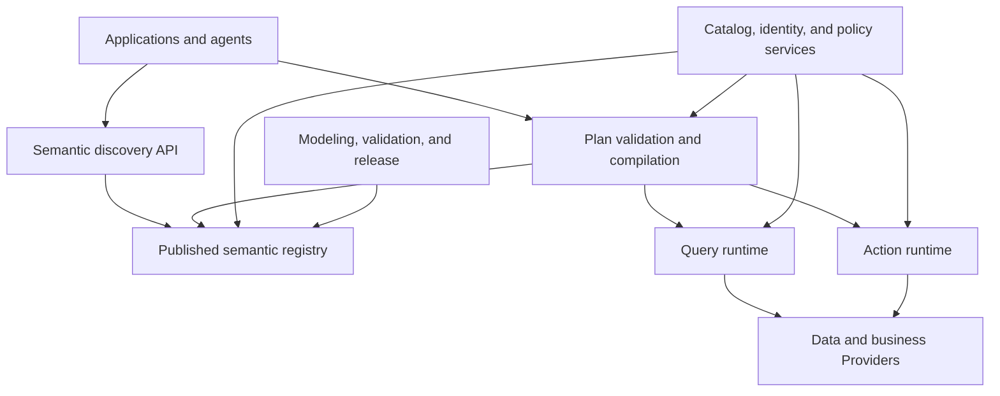
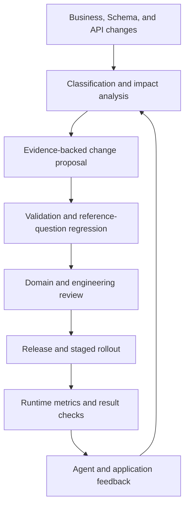
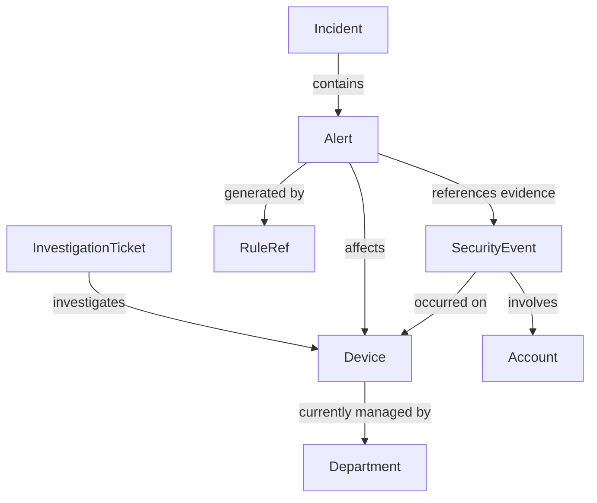

# Building an Enterprise Ontology Service: From Business Semantics to Executable Contracts

> Revision: v5 · Source verification date: 2026-10-15  
> Document type: Conceptual explanation, architecture design, and implementation guide; a baseline for project initiation and design reviews.  
> Audience: Domain owners, architects, and teams developing data platforms, business services, rule engines, and AI agents.  
> Reading guide: Chapters 1–4 establish concepts and trade-offs; Chapters 5–13 describe engineering design; Chapters 14–18 guide implementation, validation, and review.  
> Language edition: English translation of the Chinese v5 revision. The source file retains its earlier v4 filename; this edition uses `ontology_ai_data_service_architecture.v5.en.md` to identify both the content revision and language.

## Table of Contents

1. [Objectives and Changes in This Revision](#s1)
2. [What an Ontology Is: Boundaries Between Concepts, Models, and Services](#s2)
3. [Public Practices: What to Adopt and What Not to Infer](#s3)
4. [Choosing an Architecture: Semantic Control Plane, Analytical Semantic Layer, or Operational Ontology](#s4)
5. [Domain Modeling: Objects, Properties, Relations, Events, Metrics, and Rules](#s5)
6. [Object Identity: Cross-System Mapping, Disambiguation, Merging, and Splitting](#s6)
7. [Time and Facts: Current State, Historical State, and Knowledge Evidence](#s7)
8. [Data Representations and Mapping: Connecting Semantics to Real Data](#s8)
9. [Reference Architecture and a Minimal Implementation](#s9)
10. [Semantic Plans and Compilation: From Task Intent to Execution Plans](#s10)
11. [Runtime Interfaces and Agent Integration](#s11)
12. [Action Execution: Transactions, Idempotency, Authorization, and Approval](#s12)
13. [Security, Trustworthy Results, and Runtime Reliability](#s13)
14. [Versioning, Releases, and Continuous Evolution](#s14)
15. [End-to-End Example: Security Analysis and Incident Investigation](#s15)
16. [Phased Implementation and Team Responsibilities](#s16)
17. [Testing, Evaluation, and Acceptance Criteria](#s17)
18. [Key Architecture Decisions and Implementation Review Checklist](#s18)
19. [References and Evidence Mapping](#s19)
20. [Glossary](#s20)

---

<a id="s1"></a>
## 1. Objectives and Changes in This Revision

### 1.1 What Should Be Delivered?

The objective of ontology development is to let business applications and agents discover data, understand relationships, select capabilities, and obtain explainable execution results through stable, governable business concepts.

The deliverable cannot be limited to a concept diagram or a collection of Entity JSON definitions. A minimal working end-to-end system should include:

1. A versioned domain model with accountable owners.
2. Validated definitions of object identity, relationships, time, and metrics.
3. Executable data mappings and capability bindings.
4. A deterministic validation and compilation process that rejects invalid plans.
5. Authorization and action controls enforced at execution time.
6. A set of reference questions, reference plans, and expected results.
7. A change process that supports releases, rollback, and auditing.

For example, “retrieve alerts associated with a device over the past hour” requires clear answers about how the device is identified, when the association is valid, how an alert is defined, which time basis the query uses, which results are visible, and what it means if no data is returned.

### 1.2 What Is Retained and Corrected?

This revision retains the original principles: separate business semantics from physical structures; make mappings and capability contracts explicit; introduce graph databases only when needed; use progressive discovery and version governance; and let external changes and runtime feedback jointly drive evolution.

The main corrections and additions are:

| Earlier statement or gap | Treatment in this revision |
|---|---|
| An ontology service must be a “thin semantic control plane” | Treat this as a default starting point for organizations with existing data and business services; also allow operational ontologies and object services |
| Classes, properties, relations, and instances are sufficient to guide implementation | Add object identity, events, time, metrics, rule references, capabilities, and release contracts |
| A knowledge graph equals an ontology plus instances | Describe this as a common organization pattern; a knowledge graph may lack an explicit formal ontology, so this is not a strict set equation |
| Multiple customer identifiers can be unified | First validate identifier scope, subject meaning, and identity mappings; never merge solely on names or formats |
| Semantic relations can be translated into joins | Distinguish business relations, executable paths, and aggregation safety; add grain and fan-out checks |
| A customer can be resolved by name | Separate concept resolution from object search; retrieve and disambiguate concrete objects through data capabilities |
| Semantic validation completes authorization and constraint enforcement | Add execution-time reauthorization, completeness checks, and atomic precondition checks in business services |
| An empty query result supports a negative conclusion | Distinguish complete results, partial results, missing data, and indeterminate outcomes |

### 1.3 Facts, Recommendations, and Items Requiring Validation

This document uses three categories of statements:

- **Public practice:** Supported by the primary sources in Chapter 19; describes what the cited product or standard does.
- **Recommendation:** A reference design informed by those practices, not a common vendor standard or the only valid industry architecture.
- **Example or suggested target:** Custom DSLs, APIs, capacity figures, and acceptance targets intended for design discussion and local validation.

This document is not a complete reproduction of any vendor product. It does not promise that an ontology will automatically solve data quality, entity matching, or natural-language understanding. Its value is to make these problems explicit, measurable, and governable.

<a id="s2"></a>
## 2. What an Ontology Is: Boundaries Between Concepts, Models, and Services

### 2.1 An Engineering View of Ontologies

An ontology explicitly describes concepts, properties, relationships, and their meanings and constraints within a domain. It answers: “What exists in this business world, and what does it mean?”

For example, security analysis includes Device, Account, SecurityEvent, Alert, and Incident. An Account logging into a Device establishes a relationship; an individual login is an event; an abnormal-login rule may generate an Alert; and multiple Alerts may be investigated and organized into an Incident. Storing them in the same table does not make them the same kind of object.

An ontology is more than a collection of natural-language descriptions. At minimum, it needs stable identifiers, checkable types, explicit relationship endpoints, and a defined scope so that software can determine whether a plan makes sense.

An enterprise engineering ontology does not necessarily require full OWL formal semantics. Start with a constrained type model and contracts; adopt RDF, OWL, SHACL, or other standards when formal reasoning or industry interoperability requires them.

### 2.2 Three Distinct Levels

| Level | Question answered | Example |
|---|---|---|
| Business ontology | What are the concepts, meanings, and relationships? | Device, Account, login relationship |
| Executable semantic model | How are these concepts obtained from data, and which operations are allowed? | Device identifier mappings, event-time fields, alert counting definitions |
| Ontology platform or service | How are models managed, published, discovered, and used? | Metadata APIs, compiler, object service, action runtime |

Keep these levels separate. Otherwise, the question “Should we build a unified object index?” is easily confused with “Do we need an ontology?”

### 2.3 Relationships with Adjacent Systems

| System or concept | Primary responsibility | Connection to the ontology service |
|---|---|---|
| Schema | Structure of a particular interface or store | Referenced and validated by mappings |
| Catalog | Data asset discovery, ownership, and technical metadata | Supplies stable asset IDs and technical facts |
| Lineage | Data transformations and dependency chains | Supports provenance and change impact analysis |
| MDM / entity resolution | Master data and cross-system identity correspondence | Supplies object IDs, aliases, and merge records |
| Knowledge graph | Graph-based organization of facts and relationships | May store instances and relations or serve as a retrieval index |
| Metrics semantic layer | Measures, dimensions, grain, and aggregation | Reused as an analytical capability to avoid duplicate metric definitions |
| Rule engine | Predicates, complex conditions, CEP, and business decisions | Rule inputs and outputs bind to ontology definitions; rule versions are recorded |
| Workflow / business service | State transitions, transactions, and business side effects | Acts as a Provider for action capabilities |
| MCP / REST / gRPC | Capability invocation protocols | Carry discovery and invocation interfaces; do not define business semantics themselves |
| Skill | Task steps, strategies, and usage guidance | Guides the use of ontology and business capabilities |

A knowledge graph often combines a conceptual model with instance facts, but graphs extracted from text may have no strict, explicit ontology. A graph database is a storage choice; an ontology organizes semantics.

### 2.4 Constraints, Reasoning, and Data Validation Are Different

OWL uses the open-world assumption: a missing fact generally means unknown rather than automatically false.[S9] Therefore, failing to find a device owner does not, through ontology reasoning alone, establish that the device has no owner.

SHACL validates constraints on RDF graphs. For non-RDF interfaces, JSON Schema and custom validation can be used.[S10] Using SHACL does not mean that extra properties are forbidden by default; closed shapes require explicit configuration. Validation also depends on the completeness of the graph supplied to the validator.

This guide recommends four constraint categories:

| Category | Example | Main enforcement location |
|---|---|---|
| Structural constraint | Required ID; valid field type | Release validation, interface validation, ingestion |
| Data constraint | Unique ID within a tenant; existing relationship endpoints | Data quality checks, business stores, object services |
| Semantic constraint | Amounts in different currencies cannot be summed directly | Compiler, metrics engine |
| Business precondition | A closed ticket cannot be closed again | Inside the business service transaction |

Defining a constraint does not enforce it. Each constraint must record its enforcer, timing, coverage, violation handling, and most recent validation result.

<a id="s3"></a>
## 3. Public Practices: What to Adopt and What Not to Infer

### 3.1 Palantir: Operational Ontology with Explicit Backend Responsibilities

**Public practice:** Foundry connects objects, properties, links, and actions. Its backend distinguishes the Ontology Metadata Service, object databases, Object Set Service, Actions, and data indexing components. It includes instance storage, querying, and modification, rather than only a metadata directory.[S1–S3]

**Recommendation:** Adopt stable object semantics, separation of read and write capabilities, and clear runtime component responsibilities. A unified object store requires justification through business needs and cost. A vendor's internal action transaction semantics do not imply that multiple external business systems automatically receive distributed atomic transactions.

### 3.2 dbt MetricFlow: Semantic Relationships Must Account for Aggregation Safety

**Public practice:** MetricFlow builds join paths using entities defined in semantic models and uses entity types to restrict combinations that could produce fan-out or chasm joins.[S4]

**Recommendation:** Include entity keys, data grain, and relationship cardinality in compilation. Defining “a customer has orders” does not make every order metric safe to aggregate along every path. Supported paths, hop limits, and syntax vary by product version; use the deployed version as the implementation reference.

### 3.3 Snowflake: Analytical Definitions and Verified Questions

**Public practice:** Semantic Views distinguish logical tables, relationships, facts, dimensions, and metrics. The Verified Query Repository stores questions and their corresponding SQL to provide verified examples for natural-language queries.[S5–S6]

**Recommendation:** Define analytical semantics explicitly alongside the ontology's object model, and turn reference business questions into test assets. Verified SQL is useful guidance, but it cannot guarantee correctness for new questions, authorization contexts, or changing data.

### 3.4 Databricks: Reusable Metrics and Governance

**Public practice:** Unity Catalog metric views provide reusable measures, modeling, and access management, with agent-oriented metadata such as names and synonyms.[S7]

**Recommendation:** If an organization already uses such capabilities, reuse them through stable references and semantic alignment. Each metric definition should have a clearly designated authoritative maintenance location instead of separate copies in BI tools, agent prompts, and ontology files.

### 3.5 DataHub: Define the Metadata Model Before Building the Service

**Public practice:** DataHub emphasizes a model-first approach. Its metadata model organizes asset information using Entities, identifiers, and Aspects.[S8a–S8b]

**Recommendation:** Adopt stable identifiers and modular metadata. The catalog supplies physical asset facts; the ontology adds domain semantics and execution contracts. Synchronizing projections needed for serving is acceptable, but record the authoritative source and synchronization status to avoid unowned dual writes.

### 3.6 Microsoft GraphRAG: Extraction Is Not the Same as Authoritative Facts

**Public practice:** GraphRAG can extract entities, relationships, and claims from unstructured text and build retrieval-oriented indexes.[S11]

**Recommendation:** Treat extracted results as candidate knowledge with evidence. A text statement that “a device may be under attack” has a different evidentiary status from a rule match or an analyst-confirmed Incident. Do not write every extracted relationship directly into an operational ontology.

### 3.7 Principles That Can Be Derived

These public approaches serve different goals. They cannot be assembled into an architecture claimed to have been jointly validated by all the companies. The useful engineering directions are explicit semantics, stable identity, constrained relationships and metrics, read and write capability contracts, execution-side governance, and continuous validation against real questions.

The following chapters propose a design based on those directions; they do not describe vendors' internal implementations.

<a id="s4"></a>
## 4. Choosing an Architecture: Semantic Control Plane, Analytical Semantic Layer, or Operational Ontology

### 4.1 Three Forms

| Form | Core deliverable | Suitable situation | Main costs |
|---|---|---|---|
| Semantic control plane | Models, mappings, capability discovery, validation, and releases | Mature data and business services need common interpretation and access | Integration, contracts, governance |
| Analytical semantic layer | Metrics, dimensions, join rules, SQL compilation | BI, natural-language analytics, and metric consistency | Data modeling, definition governance, compute performance |
| Operational ontology platform | Object indexes, relationship queries, controlled actions, application interfaces | Multiple applications collaborate around shared objects and need common interactions | Data synchronization, object storage, security, edits, writeback |

These forms can be combined: the control plane manages definitions, a metrics engine handles analytics, and an object service supports selected scenarios. They can reside in one product while retaining clear logical responsibilities.

### 4.2 Recommended Starting Point

For teams with existing stream processing, rule engines, alert platforms, and query services, first establish the domain model and executable capability contracts, then connect existing query and action Providers. Do not start by developing an arbitrary cross-source SQL engine or migrating all instances.

Add object projections or relationship indexes when applications repeatedly build the same object views, source queries fail to meet latency requirements, or cross-system relationship traversal becomes necessary. “Thin” constrains responsibilities and coupling; it does not categorically prohibit caches or instance indexes.

### 4.3 What Justifies an Operational Ontology?

Before expanding, answer at least these questions:

- Which applications reuse the object API, and what cannot existing Providers satisfy?
- Which properties should be materialized, how quickly must they update, and how are deletions propagated?
- Are user edits written to an ontology projection or the source system, and how are conflicts handled?
- How are data, authorization, and object IDs handled during rebuilds?
- Do performance and availability gains justify synchronization and maintenance costs?

“Making things easier for the agent to understand” alone is usually insufficient justification for a unified object database.

<a id="s5"></a>
## 5. Domain Modeling: Objects, Properties, Relations, Events, Metrics, and Rules

### 5.1 Start with Tasks and Business Questions

The first modeling round should take 10–30 representative questions, several real action workflows, and existing data and services as inputs. Neither copy table structures directly nor invent an ideal business world that cannot be executed against available data.

For “check whether a device has recent abnormal logins,” ask: Does device mean an endpoint or a network address? Which time basis defines recent? Does abnormal mean a rule match or an analyst judgment? Are failed logins included? Which tenant can the requester see? These answers determine the model.

### 5.2 Metamodel

The following is a suggested initial metamodel. Its field names are defined by this guide:

| Type | Minimum required information |
|---|---|
| Domain | Stable ID, owner, boundaries, dependencies |
| EntityType | Definition, identity rules, lifecycle, property set |
| Property | Type, meaning, unit, nullability, sensitivity, temporal mode |
| RelationType | Endpoints, direction, cardinality, validity, evidence, permitted uses |
| EventType | Event ID, participating objects, occurrence / processing time, source |
| Metric | Base grain, filters, aggregation, dimensions, time basis, unit |
| Constraint | Expression, enforcement point, severity, violation handling |
| Representation / Mapping | Data representation, asset references, transformations, identity and temporal policies |
| Capability | Inputs, outputs, Provider, authorization, cost, read / write behavior |
| RuleRef | Rule-system ID, version, input / output semantics, applicability |
| Release | Dependency versions, validation reports, approvals, checksum |

Rules and metrics are part of enterprise executable semantics. This does not require every piece of logic to execute inside the ontology service.

### 5.3 Separate Concept IDs from Display Names

Use stable IDs such as `sec:Device`, `sec:Account`, and `sec:Device.managedBy`. Localized names, synonyms, and descriptions may change without changing these IDs.

Identical names need not have identical meanings. “Customer” may refer to a contractual customer, a contact, or a visiting user. Define concepts within domains first, then connect them through explicit cross-domain mappings. Keep shared models small, for example Organization, time, and units. Do not force every department to share one unbounded Customer concept.

### 5.4 Properties Need More Than Primitive Types

`amount: decimal` is insufficient without currency, precision, and the amount's business definition. `timestamp: long` is insufficient without timezone, unit, and business-time meaning.

Semantic types can be built on primitive types: `DeviceId`, `TenantId`, `IPAddress`, `Money`, and `EventInstant`. IDs should be typed to prevent an AccountId from being supplied where a DeviceId is required.

Explicitly distinguish missing, unknown, not applicable, and masked due to authorization. Interfaces can represent these through status fields; do not collapse them all into an empty string or zero.

### 5.5 Model Relationship Roles and Validity

“An account uses a device” may be a recently observed relationship rather than permanent ownership. It needs at least a time range, observation evidence, and a source. “A device belongs to a department” may instead be determined by historical CMDB assignments.

Suggested relationship fields include:

```yaml
id: sec:Device.managedBy
from: sec:Device
to: org:Department
cardinality:
  fromTo: zero_or_one
  toFrom: zero_or_many
validity: interval
meaning: The department responsible for managing the device at the specified valid time
executionPathRef: device-department-history-v1
```

Cardinality changes with traversal direction. Cardinality declarations also require data validation; they cannot remain merely desired properties in documentation.

### 5.6 Separate Events from State

“An account login occurred” is an event; “the device is currently online” is state; “the device was isolated” is action history. State may be derived from events, but record the derivation rule, late-data handling, and rebuild policy.

Label facts with categories such as `observed`, `derived`, `inferred`, and `human_confirmed`, and preserve evidence. These are not interchangeable positions on one confidence scale.

### 5.7 Define Metric Grain and Additivity

“Alert count” must specify whether it counts alert IDs, rule-match records, or event rows. “Number of abnormal devices” usually deduplicates by Device; adding daily distinct-device counts does not produce a monthly distinct-device count.

Each metric needs at least its base grain, filters, deduplication key, aggregation method, time field, timezone, permitted dimensions, unit, and version.

Fan-out example: an order worth CNY 100 is associated with two alerts. A direct join followed by `SUM(order.amount)` produces CNY 200. The relationship semantics are valid, but the metric is wrong. The compiler should use EXISTS, aggregate before joining, apply a supported deduplication strategy, or reject the path. A final SELECT DISTINCT cannot repair every aggregation error.

### 5.8 Appropriate Boundaries for Rules

Simple types and static range constraints can be expressed in the model. Complex risk judgments, CEP, and cross-event correlation belong in the rule engine. The model records the rule ID, version, input-field semantics, output fact category, and time model.

“No rule match” does not mean “no risk.” Data may be missing, rules may not cover the scenario, or computation may be incomplete. Rule results also need completeness and coverage information.

<a id="s6"></a>
## 6. Object Identity: Cross-System Mapping, Disambiguation, Merging, and Splitting

### 6.1 Why Identity Comes First

Without stable business-object identity, relationships, deduplication, historical queries, and action targets are unreliable. `client_no` and `party_id` may refer to a contracting party and a natural person respectively; they cannot simply be normalized into customerId.

An object reference should contain a tenant, domain type, and canonical ID:

```json
{"tenantId":"t1","typeId":"sec:Device","objectId":"d-1024"}
```

This is an interface example defined by this guide. Canonical IDs may reuse existing master-data IDs. Build an identity-mapping service only when cross-system identity unification is required.

### 6.2 Identity Mapping Records

| Field | Meaning |
|---|---|
| canonicalObjectRef | Canonical object reference |
| sourceSystem / sourceKey | Source system and original identifier |
| validFrom / validTo | Validity interval of the correspondence |
| mappingStatus | confirmed, candidate, rejected, and similar statuses |
| method / evidenceRef | Matching method and evidence |
| identityVersion | Mapping version |
| reviewer | Accountable confirmer when required |

For devices, IP addresses can be reassigned, hostnames can be duplicated, and MAC addresses may be unreliable. Do not assume they are permanent identities. Account IDs also need an authentication-domain or tenant scope.

### 6.3 Concept Resolution versus Instance Search

`resolveConcept("device")` returns an EntityType. `searchObjects(type=Device, name="Endpoint A")` returns instance candidates filtered by authorization. Names, hostnames, and phone numbers are usually not unique keys.

When ambiguity exists, queries can request further disambiguation. Actions must use a confirmed canonical object reference; the model must not select “the most likely one” on its own.

### 6.4 Merging, Splitting, and Historical Replay

Preserve aliases, original IDs, and change records after merging objects. Splitting requires reassessing relationship assignments. Do not silently rewrite targets in historical action logs.

Specify whether historical reports interpret identity as it was at the time or recompute using current identity. Both are valid, but require an explicit mode and identityVersion. Action services should also check whether references have been retired or redirected.

<a id="s7"></a>
## 7. Time and Facts: Current State, Historical State, and Knowledge Evidence

### 7.1 Distinguish at Least Four Kinds of Time

| Time | Meaning | Typical use |
|---|---|---|
| eventTime | When the business event occurred | “Logins that occurred yesterday” |
| processingTime | When the system processed or computed the event | “Rule matches processed in the past hour” |
| validTime | When a property or relation is valid in the business world | The device's department when an event occurred |
| recordedTime | When the system recorded or learned a fact | Reconstructing what the system knew at a given time |

Calling every time field timestamp can produce a technically correct query with an incorrect interpretation.

If the existing rule engine uses calculate time, label it honestly as processing or calculation time. Renaming it in a mapping does not turn it into event time. A migration requires assessing late arrivals, out-of-order data, watermarks, and changes to historical results.

### 7.2 Freeze Relative Time into a Deterministic Interval

Resolve “the past hour” at request entry using a trusted server clock and the business timezone. Produce a fixed `[start, end)` interval, and reuse the same reference instant throughout the plan. Do not let each Provider independently evaluate now.

A reasonable approach is to store absolute instants in UTC and interpret calendar days in the business timezone. “The past 24 hours” and “yesterday” are different conditions.

### 7.3 Historical Relationships and Bitemporality

An event-attribution query should match eventTime against the department relationship's validTime rather than defaulting to the device's current department. For retroactively corrected assignments, recordedTime is also needed to answer “what did the system believe at the time?”

Introduce bitemporal management only when required. If the first release supports only current state, declare `temporalMode: current_only` and reject historical questions instead of substituting current values for historical ones.

### 7.4 Freshness Is Not Completeness

Freshness describes how recently data was updated. Completeness describes whether the expected data within a specified scope has been covered. A recently updated source may still have collection gaps; an old event may have only just been backfilled.

Results should distinguish at least:

- `freshnessStatus`: Whether the update-lag target is met.
- `coverage`: Completed time ranges, partitions, or watermarks.
- `completeness`: complete, partial, or unknown.
- `lateDataPolicy`: Whether late data triggers corrections and how those corrections are communicated.

Do not invent completeness guarantees when watermarks or reconciliation evidence are unavailable.

### 7.5 Inferred Facts and Textual Evidence

Document extraction, model inference, and rule derivation should retain evidence, algorithm or rule versions, and applicable times. If confidence scores are present, identify whether they measure entity matching, extraction, or something else. These scores are not interchangeable and do not automatically represent probabilities.

Do not resolve fact conflicts by assuming that the latest written value is always correct. Source authority, valid time, business purpose, and validation status should jointly determine the selection.

<a id="s8"></a>
## 8. Data Representations and Mapping: Connecting Semantics to Real Data

### 8.1 A Mapping Is a Verifiable Contract

A mapping explains how a concept is obtained from a particular data representation. It goes beyond field renaming to cover identity, grain, type conversion, time, filtering, joins, provenance, quality, and executable capabilities.

For existing services, prefer binding to API outputs. For existing data models, bind to governed views or datasets. Add expressions and SQL compilation only when flexible querying requires them.

### 8.2 A Representation May Cover Only Part of an Object

DeviceIdentity, DeviceCurrentStatus, and DeviceHistory may use different Providers. The ability to read current device status does not establish the ability to query every historical device property.

Representation metadata should explicitly list property coverage, grain, supported operations, and temporal modes. If planning reveals that a requirement cannot be met, return `NoSuitableRepresentation`.

### 8.3 Mapping Example

The following is an illustrative DSL defined by this guide, not a configuration that can be used directly in dbt, Snowflake, or Palantir:

```yaml
id: sec-device-current-mapping-v1
entityType: sec:Device
representation: current_state
assetRef: catalog:cmdb/device_current
providerRef: device-query-v1
grain: one_row_per_tenant_and_device
identity:
  tenantField: tenant_id
  sourceKey: device_uuid
  resolverRef: device-identity-v1
properties:
  sec:Device.hostname:
    sourceField: hostname
    valueType: string
  sec:Device.lastSeenAt:
    sourceField: last_seen_ms
    transformRef: epoch-ms-to-instant-v1
    valueType: instant
    timeMeaning: observed_at
temporalMode: current_only
authority:
  purposes: [asset_inventory]
  role: authoritative
qualityGateRef: device-key-and-null-check-v1
freshnessPolicyRef: cmdb-serving-freshness-v1
```

Transformations must reference a trusted function registry or use restricted, typed expressions. Do not directly configure model-generated Python, SQL strings, or arbitrary code as production mappings.

### 8.4 Authority by Property and Purpose

The CMDB may own device assignments; endpoint-agent heartbeats may supply online status; a risk service may own threat judgments. No source is inherently authoritative for every property of an object.

When selecting a Provider, first filter by authorization, purpose, semantic equivalence, temporal mode, and quality; then compare cost or latency. A fast cache is not necessarily suitable for historical investigations.

Only semantically equivalent sources that satisfy current policies may be used as fallbacks. Older data, partial fields, or different definitions must be explicitly identified, and the request rejected when necessary.

### 8.5 Catalog and Lineage Integration

Reference stable asset IDs. Keeping field structures and version snapshots needed for compilation is reasonable, but label them as projections; the catalog remains authoritative for technical metadata. Domain owners maintain business definitions, which must not be automatically overwritten by source-field comments.

Connect semantic dependencies to data lineage, for example Property → Mapping → Dataset → Pipeline. Impact analysis needs both; semantic relationships are not the same as data lineage.

### 8.6 Federated Access versus Materialization

| Approach | Suitable use | Issues to address |
|---|---|---|
| Bind existing APIs | Stable business reads and writes with clear SLAs | Capability coverage, interface versions |
| Query within one engine | Data shares a compute domain | Modeling, query optimization, resource isolation |
| Restricted cross-source orchestration | Query several sources for a small candidate set | Batching, limits, partial failures |
| Materialized object / relationship projections | Frequent object queries or multi-hop traversal | CDC, deletion propagation, lag, rebuilds |
| General federation engine | Existing platform or broad, demonstrated demand | Optimizer, statistics, cross-source consistency, operations |

For the first release, allow only approved cross-source orchestration templates. For example, retrieve at most 100 device IDs, then batch-query their alerts. Do not execute large joins inside an agent process.

<a id="s9"></a>
## 9. Reference Architecture and a Minimal Implementation

### 9.1 Logical Architecture



These modules define responsibility boundaries. They do not have to be deployed as separate microservices.

### 9.2 Minimal Deployment Recommendation

Start with one modular service containing Authoring, Registry, Discovery, Validator, Compiler, and ProviderRegistry. Reuse existing query services, business services, and authorization systems.

A suggested initial stack uses a relational database for models, versions, and dependencies; object storage or Git for immutable release packages; full-text search for discovery; and an existing message bus for change notifications. Add vector retrieval and graph storage when retrieval quality or query needs justify them, rather than making them startup dependencies.

Java and Go teams can begin with typed structures and compilation interfaces without moving to a specialized language merely because they are building an ontology.

### 9.3 Metadata Storage Design

| Logical table / collection | Key fields |
|---|---|
| semantic_element | element_id, kind, domain_id, owner |
| element_revision | element_id, revision, definition, content_hash |
| dependency | from_revision, to_revision, dependency_kind |
| release | release_id, manifest, hash, status |
| release_element | release_id, element_id, revision |
| provider_contract | capability_id, revision, schema, provider_ref |
| approval | change_id, reviewer, decision, evidence |
| feedback | error_class, plan_ref, release_id, triage_status |

These are logical structures and may be combined in implementation. Sensitive logs, execution records, and instance data should not grow indefinitely in the same metadata tables.

### 9.4 Release Packages and Runtime Isolation

The runtime reads only published versions. Draft edits must not affect production discovery results. A release package contains models, mappings, capability contracts, rule references, dependency versions, and validation reports.

The Registry may cache release packages. If cache access fails, use the last validated version that is still permitted to execute. Emergency authorization revocations, action disabling, and source isolation must take effect independently; they must not wait for a model release.

### 9.5 Dependency Management

Cross-domain references specify compatible version ranges, resolved to concrete versions at release time. Release packages must be reproducible: the same package and inputs should generate the same deterministic plan. External state, permissions, and data may change, so identical execution results cannot be guaranteed indefinitely.

Distinguish cycles carefully: mutually related concepts are valid, but invalid cycles in release dependencies or derived computations must be rejected.

<a id="s10"></a>
## 10. Semantic Plans and Compilation: From Task Intent to Execution Plans

### 10.1 Correctness Validation Must Not Depend on the LLM

The LLM interprets natural language and proposes candidate tasks. Deterministic software checks types, relationships, versions, authorization, time, grain, and capabilities. The model may explain errors, but it cannot decide on its own that a rejection condition has been removed.

For simple scenarios, use a capability ID with typed parameters. Introduce Semantic Plans only when selections, filters, relationships, and aggregations need composition. Avoid designing a universal DSL for every database on day one.

### 10.2 Suggested Compilation Process

1. **Concept binding:** Resolve names to stable semantic IDs and handle domain ambiguity.
2. **Object binding:** Search and disambiguate instances, then produce typed object references.
3. **Type checking:** Validate properties, parameters, units, and operations.
4. **Time normalization:** Freeze relative times and identify the query's time field and mode.
5. **Relationship and grain checks:** Select supported paths and check fan-out and aggregation additivity.
6. **Authorization constraints:** Restrict the plan according to trusted identity and purpose.
7. **Provider selection:** Match property coverage, temporal support, quality, and capabilities.
8. **Logical optimization:** Apply provably equivalent rewrites such as constant folding, predicate pushdown, and projection pruning.
9. **Physical generation:** Compile into controlled API requests or parameterized queries.
10. **Runtime validation:** Providers reauthorize and check required preconditions during execution.

The order of authorization filtering, limits, and aggregation must be explicit. Selecting an unfiltered Top N before applying authorization can produce incorrect results or leak existence information.

### 10.3 IR Layers

Distinguish:

- User intent, which may contain unresolved terms such as “recent” or “abnormal.”
- Semantic logical plan, with fixed objects, properties, relationships, times, and metric definitions.
- Bound plan, with fixed mappings, capabilities, and release versions.
- Physical plan, with concrete Provider requests, batching strategies, and limits.

An existing rule engine may share a type system or parts of the IR between rule ASTs and semantic query plans. Do not directly bind business-rule execution flows to the ontology metamodel. Incremental integration makes risks easier to control.

### 10.4 Example Plan

This is another custom example defined by this guide:

```json
{
  "planSchemaVersion": "1.0",
  "releaseId": "sec-release-20261015-01",
  "operation": "query",
  "root": {
    "typeId": "sec:Device",
    "objectRef": {"tenantId":"t1","objectId":"d-1024"}
  },
  "traverse": [{"relationId":"sec:Alert.affectsDevice","direction":"inverse"}],
  "time": {
    "fieldId": "sec:Alert.detectedAt",
    "basis": "processing_time",
    "startInclusive": "2026-10-15T01:00:00Z",
    "endExclusive": "2026-10-15T02:00:00Z"
  },
  "select": ["sec:Alert.id","sec:Alert.severity","sec:Alert.ruleRef"],
  "sort": [{"fieldId":"sec:Alert.detectedAt","direction":"asc"}],
  "limit": 100,
  "completenessRequired": true
}
```

The compiler must add a unique-key tie-breaker to guarantee stable pagination. The plan cannot declare its own effective permissions; tenant and object references must be checked against trusted identity.

### 10.5 Plan Explanation and Limits

`explain` returns the resolved meaning, selected Provider, relationship execution strategy, time basis, authorization constraints, estimated cost, and reasons for unsupported operations. Results for ordinary agents may hide physical table names, sensitive policies, and internal topology. Engineering debug interfaces require separate authorization.

For the first release, limit traversal depth, candidate ID count, returned rows, scan range, execution duration, concurrency, and cost. Return structured errors when limits are exceeded instead of allowing the model to expand queries indefinitely.

### 10.6 Compiled Versions and Validity

A bound plan pins releaseId, Mapping revision, capability contracts, and required identity versions. It may carry a signed digest and a short expiration period, depending on the deployment.

Pinning the model version does not freeze current authorization. The execution side must recheck permissions, Provider status, disabled actions, and data-access conditions. Rolling back a model does not undo business actions that have already occurred.

<a id="s11"></a>
## 11. Runtime Interfaces and Agent Integration

### 11.1 Minimal API Set

The following interfaces are proposed contracts, not established standards:

| Interface | Main purpose | Minimum response |
|---|---|---|
| searchConcepts | Find domain concepts | IDs, definitions, domains, versions, visibility-filtered candidates |
| describeConcept | Inspect properties, relations, and constraints | Types, temporal modes, applicability |
| listCapabilities | Find read and write capabilities | Parameters, outputs, limits, side effects |
| searchObjects | Find instances | Canonical object references, disambiguation information, pagination |
| validatePlan | Check a plan | Binding information or structured errors |
| explainPlan | Explain plan meaning and cost | Provider, time basis, grain, limits |
| executeQuery | Run a query | Results, sources, completeness, cursor |
| previewAction | Preflight an action | Parameter digest, impact, conditions, approval requirements |
| executeAction | Execute an authorized action | Status, operation ID, audit reference |
| submitFeedback | Report problems | Classification, affected semantics, evidence references |

Mappings and source-system details are mainly intended for trusted compilers and administrators. Ordinary agents do not need all physical metadata by default.

### 11.2 Progressive Discovery

First discover relevant domains and concepts, then retrieve the required properties, relationships, and capabilities. Limit the number of results at each step and return stable references. Lexical and vector retrieval may be combined, but ranking does not replace ambiguity detection.

Discovery must also enforce authorization. A subject that may not know a sensitive relationship exists must not receive its name, definition, or examples. Indexes, vector candidates, and caches must apply the same visibility rules.

### 11.3 Trusted Context

User identity, tenant, agent identity, delegation scope, purpose, and authorization claims come from gateways and identity services. LLM-supplied values such as `role=admin` or `purpose=security_investigation` are request information only; they cannot directly grant privileges.

Context also includes language, timezone, request ID, and version. Identity tokens must not enter model context or log bodies.

### 11.4 MCP and Skills

The discovery, validation, and query capabilities above can be exposed as MCP Tools, or through REST or gRPC. Ontology contracts should remain independent of invocation protocols.

A Skill may instruct an agent to “confirm device identity, query alerts, then read evidence.” Such guidance helps correct usage, but all authorization, constraints, and cost limits remain enforced on the server.

### 11.5 Structured Errors

```json
{
  "code": "AmbiguousObject",
  "retryable": false,
  "stage": "identity_binding",
  "message": "Multiple devices with the same name exist within the currently visible scope",
  "nextStep": "request_object_disambiguation",
  "requestId": "req-1001"
}
```

Suggested error categories include UnknownConcept, AmbiguousConcept, AmbiguousObject, UnsupportedTemporalMode, UnsafeAggregation, NoSuitableRepresentation, StaleData, PartialCoverage, PermissionDenied, ApprovalRequired, VersionUnavailable, and ProviderFailure.

Explainability does not require revealing every policy reason. Separate user-facing messages from internal audit details.

<a id="s12"></a>
## 12. Action Execution: Transactions, Idempotency, Authorization, and Approval

### 12.1 Actions Are First-Class Capabilities with Explicit Execution Ownership

“Create an investigation ticket” and “isolate an endpoint” are not ordinary property updates. An action contract defines its target, inputs, outputs, side effects, authorization, preconditions, idempotency policy, transaction boundary, asynchronous status, and compensation capabilities.

Business services may be integrated with the ontology platform or run independently. The essential requirement is that the actual state owner enforces business conditions, rather than relying only on an ontology preview.

### 12.2 Example Action Contract

```yaml
id: sec:CreateInvestigationTicket
kind: action
providerRef: case-service-v1
inputSchemaRef: create-case-input-v1
outputSchemaRef: create-case-output-v1
sideEffects: [create_ticket, notify_assignee]
authorizationPolicyRef: case-create-policy
approvalPolicyRef: case-create-approval-policy
preconditionMode: checked_by_provider_at_commit
idempotency:
  required: true
  scope: tenant_action_and_request
  sameKeyDifferentPayload: reject
execution:
  mode: asynchronous
  statusCapabilityRef: get-case-operation-v1
  transactionBoundary: case_service_database
```

This contract does not automatically place the notification system and ticket database in one transaction. An outbox or similar mechanism may deliver notifications reliably, with duplicate handling managed separately.

### 12.3 A Preview Is Not a Commit

A preview returns target objects, a parameter digest, expected impact, the current state version, and approval requirements. Approval credentials should bind to the action, objects, parameter digest, subject, version, and validity period so that approval for A cannot be used to execute B.

At commit, reauthorize and atomically check business preconditions. An expectedVersion may detect changed target state. Expiration or state changes should require a new preview rather than blind replay of an old request.

Human approval depends on action risk and existing authorization policies. Authorized low-risk actions may execute automatically; high-risk isolation, freezing, or deletion may require approval. Do not indiscriminately require human confirmation for every action.

### 12.4 Idempotency and Timeouts

An idempotency key is scoped by tenant, action, and request. The same key with the same payload returns the existing status; a different payload is rejected. Retention must cover the business retry window.

A timeout means “outcome unknown,” not “execution failed.” Query status through operationId or the idempotency key before deciding to retry. Asynchronous states may include accepted, running, succeeded, failed, compensating, and compensated. The Provider owns state transitions.

### 12.5 Cross-System Transactions and Compensation

An Action name alone cannot provide cross-system ACID semantics. Operations spanning multiple Providers must explicitly use workflows, Saga, outbox, or manual handling.

Compensation does not necessarily restore the original state. A notification already sent, for example, cannot truly be recalled. Return reversibility, compensation status, and irreversible effects so that the agent does not promise a “complete rollback.”

<a id="s13"></a>
## 13. Security, Trustworthy Results, and Runtime Reliability

### 13.1 Authorization Enforcement Chain

The discovery layer controls metadata visibility. The compiler injects and validates plan constraints. Query and action Providers check actual authorization at execution time. The result layer applies masking and output policies.

Reuse IAM, policy engines, and source permissions, while retaining responsibility for mapping semantic elements to authorization objects and verifying enforcement by every Provider. “Authorization is handled externally” is not a reason to omit end-to-end tests.

### 13.2 Leakage Through Aggregation, Relationships, and Caches

Beyond row and column permissions, consider relationship existence, counts, samples, search suggestions, and error messages. Restrict small-group aggregations, enumeration of sensitive relationships, and exports where required.

Isolate caches by release version, tenant, authorization scope, purpose, parameters, and time interval. Permission changes should invalidate relevant caches or trigger revalidation before results are returned. Do not use only the natural-language question as a result-cache key.

### 13.3 Prompt Injection and Untrusted Text

Source documents, descriptions, evidence snippets, and user feedback are data. Even if they contain instructions such as “ignore authorization,” they cannot alter server-side policy. Metadata releases are reviewed, and expressions must not permit arbitrary code execution.

Keeping sensitive data out of model context does not permit the platform to read it without controls. Logs, vector indexes, debug examples, and exports also require governance.

### 13.4 Trustworthy Result Envelope

Use a common result envelope:

```json
{
  "data": [],
  "meta": {
    "releaseId": "sec-release-20261015-01",
    "planId": "plan-1001",
    "requestId": "req-1001",
    "sources": ["alert-query-v1"],
    "retrievedAt": "2026-10-15T02:00:03Z",
    "timeBasis": "processing_time",
    "completeness": "complete",
    "coverageEndExclusive": "2026-10-15T02:00:00Z",
    "freshnessStatus": "within_target",
    "conflictStatus": "none_detected",
    "maskingApplied": true,
    "ruleVersionRefs": ["abnormal-login-v12"],
    "warnings": [],
    "nextCursor": null
  }
}
```

Here, complete must be supported by Provider coverage evidence. `none_detected` means only that no conflict was found during the checks performed.

Detailed evidence references may be retained at object or field level, while ordinary agents receive only permitted summaries. For heterogeneous sources, return each source's read time and consistency mode unless a shared snapshot is explicitly provided. Do not imply that independent reads form one global atomic snapshot.

### 13.5 Conditions for Negative Answers

An empty result with complete coverage supports only: “No matches were found within this authorized scope, time basis, and rule version.” If coverage is partial or unknown, the answer should be “a complete determination is currently unavailable,” not “there are no anomalies.”

Explain limit truncation, incomplete pagination, source timeouts, and authorization-limited subsets. The agent's final answer must respect these statuses.

### 13.6 Runtime Reliability

Queries need connection and execution timeouts, concurrency isolation, batch limits, circuit breakers, and budgets. Read-only retries also need rate limits to prevent failure amplification. Action retries follow idempotency and status-query rules.

Separate model-serving resources from large scans. Execute long queries asynchronously and provide status and cancellation. If a Provider goes offline, do not automatically switch to a semantically different fallback.

Correlate metadata changes, execution plans, Provider calls, and action audits with requestId / traceId. Mask sensitive parameters and retain evidence according to authorization policies.

### 13.7 Capacity and Performance Budgets

Measure the number of semantic elements, request rate, release frequency, discovery calls per request, Provider fan-out, and result size. Small metadata volume does not mean the entire system is inexpensive.

Break latency down into discovery, validation / compilation, queuing, Provider execution, and result processing. Measure model inference separately. Set concrete SLOs after pilot load testing rather than deriving them from vendor marketing.

<a id="s14"></a>
## 14. Versioning, Releases, and Continuous Evolution

### 14.1 Immutable Versions and Atomic Publication

An element revision describes an individual change. A releaseId identifies a mutually compatible set of model, Mapping, and capability versions. A request must not arbitrarily combine the latest revision of every element.

The release process is: draft → validation → impact analysis → review → approval → immutable package creation → staged rollout → active-release pointer switch. The switch should be atomic; do not declare a release complete before its indexes are ready.

The first release can use Git pull requests, CI, and simple management APIs instead of building a full Ontology Studio. Later, add editing and review interfaces for business owners.

### 14.2 Compatibility Categories

| Change | Typical impact | Recommended treatment |
|---|---|---|
| Add synonyms or descriptions | Discovery results may change | Retrieval regression and ambiguity checks |
| Add an optional property | Interface may remain compatible | Output, authorization, and retrieval regression |
| Replace a physical field without changing business meaning | Mapping change | Type, performance, and result comparisons |
| Change a time field, timezone, or metric definition | Result meaning changes | New semantic version or ID; migration notice |
| Change relation cardinality or identity rules | Joins, deduplication, historical interpretation change | Data validation and plan recompilation |
| Tighten authorization | Behavior changes | Immediate enforcement; do not retain old access for compatibility |
| Remove a capability or property | Breaking change | Deprecation period, usage statistics, explicit retirement date |

Adding a property is not always risk-free, particularly for strict clients, default projections, and retrieval rankings. Evaluate compatibility in the context of consumers.

### 14.3 Rollback Boundaries

The active semantic release package, mappings, and capability routing can be rolled back only while old dependencies remain available. If a source field has been deleted, an old version may also fail; define migration and dependency-retention policies.

Model rollback does not reverse actions already issued, change historical data, or restore revoked permissions. Data repair, compensation, and model rollback are different operations.

### 14.4 Impact Analysis

Maintain a dependency graph: semantic element → Mapping → capability → registered plan / application / reference question. Catalog and lineage changes supply physical dependency inputs; actual invocation logs identify additional consumers.

Static analysis finds only known dependencies. Dynamic scripts and unregistered consumers may be missed, so staged rollouts, monitoring, and migration notices are still needed.

### 14.5 Evolution from Two Directions



AI can assist with candidate definitions, mappings, and tests. Cross-domain identity, authoritative sources, metric meaning, and action authorization require confirmation by accountable owners. Repetitive low-risk changes may use approved automation policies; this does not authorize a model to independently redefine business concepts.

### 14.6 Feedback Governance

Classify feedback as missing concepts, ambiguity, data problems, authorization problems, compilation issues, or Provider failures. `PermissionDenied` usually does not justify widening permissions; `ProviderTimeout` does not justify changing the ontology definition.

Retain the original question, plan version, failure stage, permitted context, and evidence references. Identify ownership before proposing changes instead of attributing every failure to missing semantics.

<a id="s15"></a>
## 15. End-to-End Example: Security Analysis and Incident Investigation

### 15.1 Business Scope for the First Phase

Assume an existing CMDB, Flink rule engine, event query store, alert service, and ticket service. The pilot supports three question categories: current device information, recent rule matches, and evidence associated with alerts. It also supports one low-risk action: creating an investigation ticket.

Endpoint isolation, unrestricted multi-hop queries across the network, and automatic incident determination are outside the first-phase scope.

### 15.2 Concepts and Relationships



An Alert may reference multiple events, and one event may support multiple alerts. The investigation system manages Incident status and determination; graph reachability alone does not establish an incident.

### 15.3 Reference Question

“Has device d-1024 had any abnormal-login alerts in the past hour? If so, show the rules and evidence, and create an investigation ticket.”

The domain owner must confirm that “the past hour” here uses alert detection time; “abnormal login” means alerts produced by a designated rule set, not a confirmed attack; displaying evidence requires separate data authorization; and ticket creation follows existing authorization policies.

### 15.4 End-to-End Flow

1. Authenticate and establish the current tenant and investigation purpose.
2. Bind `sec:Device` and validate the instance reference and visibility of d-1024.
3. Retrieve alert-time definitions, rule sets, evidence relationships, and capability contracts.
4. Freeze the time interval and create a typed semantic plan.
5. Compile to an existing alert-query capability; check pagination, deduplication, and coverage.
6. Return alerts, rule versions, sources, and completeness.
7. Batch-read evidence where authorized; return an explicit status when evidence is not visible.
8. If alerts exist and the action is authorized, preflight ticket creation and bind the target, alert set, and parameter digest.
9. Execute according to approval policy; the ticket service revalidates and enforces idempotency at commit.
10. Return the ticket-operation status and audit reference, and record runtime feedback.

### 15.5 Explain These Three Outcomes Differently

| Outcome | Acceptable answer |
|---|---|
| Complete coverage, no matches | No abnormal-login alerts were found under this detection-time range and rule version |
| Alerts found with complete evidence | Alerts and supporting evidence were found; an alert does not directly establish an incident |
| Source timeout or incomplete coverage | Available data is insufficient for a complete determination; identify the gap or retry path |

If the user asks about “abnormal logins that occurred in the past hour” but the existing system supports only processing time, the agent should explain the time-basis limitation or use an event-time capability. It must not silently change the question.

### 15.6 Integration with an Existing Rule Engine

Bind event fields and rule outputs to semantic types. Include rule IDs and versions in alert facts. Define the rule time model and output deduplication policy. Introduce an IR gradually between rule ASTs and execution plans to support type checking, normalization, predicate pushdown, and shared-condition optimization.

The ontology service primarily provides domain contracts and queryable results. It does not take over Flink node routing, sub-event caches, or CEP state. Indexes such as compressed prefix tries remain execution-layer capabilities. If an index-update version affects result traceability, record it as rule-execution evidence.

<a id="s16"></a>
## 16. Phased Implementation and Team Responsibilities

### 16.1 Implementation Phases

This is a suggested work sequence, not a schedule commitment. Each phase can be divided into several iterations according to staffing.

| Phase | Main work | Deliverables | Exit criteria |
|---|---|---|---|
| 0: Validate value | Select scenarios; inventory data and capabilities; record current errors | Scope, reference questions, baseline metrics | Accountable owner and executable data path exist |
| 1: Establish the model | A small core of objects, identity, time, relationships, and metrics | Model and sample-data validation | No critical definition ambiguity; sources confirmed |
| 2: Complete read-only access | Published registry, capability bindings, validation, result envelope | End-to-end query for one scenario | Correctness, authorization, and partial-result tests pass |
| 3: Add controlled actions | Preview, authorization, idempotency, status, audit | One end-to-end action | Retries and state changes do not produce incorrect side effects |
| 4: Govern evolution | CI, impact analysis, staged rollout, rollback, feedback | Version process and operational dashboard | Changes are verifiable; problems can be assigned and repaired |
| 5: Expand as needed | Cross-domain models, metrics, multiple sources, materialization or graph indexes | Expansion design and capacity validation | Measurable benefit over existing approaches |

### 16.2 Suggested First-Release Scope

Start with 5–10 entity types, a few relationships, 20–50 core properties, 2–3 read capabilities, and one action. These figures are pilot recommendations, not standards.

Prefer existing APIs. Initially support one query pattern and one Provider path. Carry semantic versions, time basis, and completeness through the whole chain. Expand composable plans after the initial end-to-end workflow works.

### 16.3 Responsibility Assignment

| Role | Decisions and responsibilities |
|---|---|
| Domain owner | Definitions, scope, authoritative sources, metric definitions, dispute resolution |
| Data owner | Assets and quality, identity keys, time and coverage evidence |
| Ontology service team | Metamodel, versioning, discovery, compilation contracts, impact analysis |
| Provider team | Data execution, performance, preconditions, idempotency, actual state |
| Security / IAM team | Delegated identity, policies, auditing, authorization mappings |
| Agent team | Intent interpretation, disambiguation, interaction, result explanation |
| Testing and operations | Regression, capacity, faults, releases, observability |

One person may hold multiple roles, but key decisions still need recorded ownership. “Automatic ontology generation” without a domain owner easily stops at field descriptions and demonstration systems.

### 16.4 Accounting for Cost and Value

Compare correct task-completion rates, error-diagnosis time, duplicate mappings, duplicate metric definitions, and the cost of adding new capabilities before and after adoption. Include model maintenance, identity governance, data repair, and Provider operations.

If an interface contract and a few reference queries achieve the same result, implement those first. A complete platform is not justified merely by the label “ontology.”

<a id="s17"></a>
## 17. Testing, Evaluation, and Acceptance Criteria

### 17.1 Build an Independent Reference Question Set

Domain experts confirm the question set, covering common tasks and boundary cases. Each case records the role / tenant, question, confirmed meaning, objects, time, semantic plan or capability call, expected results, tolerances, and indeterminate states.

Reference SQL can serve as a comparison, but must not share the same faulty mapping as the compiler under test. Prefer a small independently hand-calculated dataset for aggregation checks. Use fixed snapshots or dedicated test environments for dynamic data.

### 17.2 Required Test Scenarios

| Category | Validation focus |
|---|---|
| Models and types | No dangling references; correct units; matching parameter types |
| Identity | Duplicate names and keys, reused IPs, cross-tenant access, merges and splits |
| Time | Timezones, calendar days, interval boundaries, late data, historical assignments |
| Relationships and metrics | Fan-out, missing relationships, duplicate events, non-additive metrics |
| Authorization | Invisible concepts, row / column restrictions, relationship enumeration, cache isolation |
| Data state | Staleness, missing data, conflicts, unfinished pagination, partial source failures |
| Actions | Changed parameters, expired approvals, concurrent state changes, duplicate requests, status checks after timeouts |
| Releases | Mixed versions, dependency changes, unready indexes, rollback, authorization revocation |
| Agents | Semantic ambiguity, error recovery, untrusted text, explanations of partial results |
| Performance and faults | Rate limiting, circuit breakers, offline Providers, cancellation of long queries |

### 17.3 Layered Metrics

Measure concept resolution, instance binding, plan validity, execution results, and final answers separately. Do not evaluate only whether a model's response looks plausible.

Suggested metrics:

- Correct task-completion rate: The proportion of tasks whose interpretation, execution, and final answer are all correct.
- Semantic correctness rate: The proportion of plans matching expert-approved meaning.
- Correct uncertainty handling: The proportion of cases correctly disambiguated, rejected, or reported as incomplete when required.
- Authorization negative-test pass rate: Whether designed unauthorized-access tests are blocked.
- Metric consistency rate: Agreement with authoritative definitions and independent comparisons.
- Release regression rate, fault-diagnosis time, and model-maintenance cost.
- Discovery and compilation latency, Provider latency, invocation count, and cost.

### 17.4 Suggested Pilot Acceptance Criteria

These are initial recommendations to adjust to business risk, not published vendor benchmarks:

1. All pilot semantic elements, mappings, and capabilities have owners and pinned versions.
2. All action negative tests, cross-tenant tests, and authorization negative tests pass. Finite testing does not prove the absence of vulnerabilities.
3. Duplicate-object-name, processing-time / event-time, and partial-coverage cases behave as expected.
4. Query results and metrics on fixed test sets meet expert-approved consistency requirements.
5. Every result is traceable to its release, Provider, and necessary rule versions.
6. Provider failures do not silently change definitions; action replays do not repeat the side effects covered by the idempotency contract.
7. Complete a real staged-rollout exercise and a model-rollback exercise, recognizing that actions do not roll back with models.
8. Performance meets pilot SLOs under agreed concurrency, data volume, and budgets.

If a numeric target is useful, begin with a correct task-completion target such as 95%, then adjust it to the baseline and risk. Conversational self-scoring is not an acceptance criterion.

<a id="s18"></a>
## 18. Key Architecture Decisions and Implementation Review Checklist

### 18.1 Suggested Architecture Decision Records

| Decision | Recommended initial choice | Revisit when |
|---|---|---|
| Service form | Control plane plus existing Providers | Multiple applications need shared object services |
| Representation format | Typed JSON / YAML with an explicit metamodel | Standards-based exchange or formal reasoning is required |
| Metadata storage | Relational database and immutable release packages | Complex relationship retrieval becomes a bottleneck |
| Query capability | Controlled APIs and limited plans | Business needs dynamic composition |
| Cross-source execution | Approved templates and batch limits | An existing federation platform or growing demand justifies expansion |
| Instance storage | Keep instances in existing data / object services | Repeated queries, indexing, or relationship traversal offer clear benefits |
| Metrics | Reference the authoritative metrics system | No metrics platform exists and analytical demand is clear |
| Rules | Reference the existing rule engine | Shared types or IR have a concrete use case |
| Identity | Reuse master data with explicit mappings | Source identities are complex or require entity resolution |
| Actions | Execute in business Providers | Mature cross-system orchestration is needed |
| Governance interface | Git, CI, and management APIs | Business users frequently participate in modeling |

Each ADR records the problem, options, rationale, costs, validation method, and conditions for revisiting the choice. Technology choices should evolve with data scale and scenario demands.

### 18.2 Design Review Checklist

- [ ] Scenarios, scope, reference questions, value baseline, and owners are confirmed.
- [ ] Concept IDs are distinct from table names; domain boundaries and cross-domain mappings are explicit.
- [ ] Object IDs, tenant scope, identity disambiguation, and historical mappings are defined.
- [ ] Property semantic types, units, null states, and masking states are explicit.
- [ ] Relationship direction, cardinality, valid time, and executable paths are validated.
- [ ] Metric grain, deduplication, time basis, and additivity are defined.
- [ ] Rule versions and event-time / processing-time semantics are traceable.
- [ ] Mapping coverage, authoritative sources, quality, and fallback rules are checkable.
- [ ] The compiler deterministically rejects invalid types, unsafe aggregation, and unsupported plans.
- [ ] Providers independently verify actual authorization; the model cannot self-declare trusted identity.
- [ ] Empty results, partial results, and unknown coverage do not become absolute negative conclusions.
- [ ] Action commits check state; idempotency and unknown-outcome handling are validated.
- [ ] Releases are immutable with pinned dependencies; emergency revocation does not depend on a model release.
- [ ] Model rollback is not confused with reverting data or business side effects.
- [ ] Independent expected results, authorization negative tests, and fault exercises exist.
- [ ] Graph databases, materialization, and general federation engines have demonstrated requirements.

### 18.3 Open Questions to Resolve at Project Start

This document supplies a baseline design. The project must still establish: where authoritative identity resides; whether historical assignments are required; whether existing Providers can supply coverage evidence; whether authorization can be pushed down; where metric definitions are maintained; which systems an action transaction actually covers; and the required throughput, latency, data scale, and staffing.

These answers determine implementation complexity. Adding more model descriptions cannot bypass them.

<a id="s19"></a>
## 19. References and Evidence Mapping

The following primary public sources were checked for the Chinese revision on 2026-10-15. Online documentation changes; pin product and interface versions during implementation. This document does not derive general performance or return-on-investment figures from promotional case studies.

| ID | Source | Supported content |
|---|---|---|
| S1 | [Palantir — Ontology architecture](https://palantir.com/docs/foundry/object-backend/overview/) | Operational ontology backend; responsibilities of OMS, object databases, queries, Actions, and indexing |
| S2 | [Palantir — Object types overview](https://palantir.com/docs/foundry/object-link-types/object-types-overview/) | Object types and connections to backing datasources |
| S3 | [Palantir — Action types overview](https://palantir.com/docs/foundry/action-types/overview/) | Object-changing actions controlled by structured logic |
| S4 | [dbt — Joins in MetricFlow](https://docs.getdbt.com/docs/build/join-logic) | Entity types, join paths, fan-out restrictions |
| S5 | [Snowflake — Overview of semantic views](https://docs.snowflake.com/en/user-guide/views-semantic/overview) | Logical tables, relationships, facts, dimensions, metrics |
| S6 | [Snowflake — Cortex Analyst Verified Query Repository](https://docs.snowflake.com/en/user-guide/views-semantic/verified-query-repository) | Verified questions and SQL examples |
| S7 | [Databricks — Unity Catalog metric views](https://docs.databricks.com/aws/en/uc-semantics/metric-views) | Reusable metrics, management, modeling, agent metadata |
| S8a | [DataHub — Architecture overview](https://docs.datahub.com/docs/architecture/architecture) | Model-first metadata platform positioning |
| S8b | [DataHub — The Metadata Model](https://docs.datahub.com/docs/metadata-modeling/metadata-model) | Organization through Entities, identifiers, and Aspects |
| S9 | [W3C — OWL 2 Primer, Second Edition](https://www.w3.org/TR/owl-primer/) | Formal ontology representation and the open-world assumption |
| S10 | [W3C — Shapes Constraint Language](https://www.w3.org/TR/shacl/) | RDF graph shapes and constraint validation; this guide references the formal Recommendation |
| S11 | [Microsoft — GraphRAG indexing overview](https://microsoft.github.io/graphrag/index/overview/) | Extraction of entities, relationships, and claims from unstructured text |

**Citation boundary:** The brief descriptions of company capabilities in Chapter 3 come from these sources. The metamodels, APIs, architectural responsibilities, release mechanisms, examples, and acceptance criteria in Chapters 5–18 are recommendations proposed by this guide. Its JSON and YAML examples cannot be used directly as configurations for any of the cited vendor products.

<a id="s20"></a>
## 20. Glossary

| Term | Meaning in this guide |
|---|---|
| Ontology | Explicit domain concepts, relationships, meanings, and constraints |
| Semantic Control Plane | Control plane for managing and publishing semantics, mappings, and capability contracts |
| Operational Ontology | An ontology architecture supporting business-object queries, operations, and application collaboration |
| EntityType / Object | Object type / concrete object instance |
| Representation | An object's representation and coverage in a particular dataset or service |
| Mapping | A verifiable connection from semantics to data representations and Providers |
| Capability | A callable read or write capability contract |
| Provider | A system that actually supplies data, computation, or business actions |
| Semantic Plan | A typed, verifiable plan expressed in business semantics |
| IR | Intermediate representation for binding, validation, optimization, and execution-plan generation |
| Grain | The business granularity represented by each record or measure |
| Fan-out | Row expansion when one record joins to multiple records |
| SSOT | The authoritative maintenance source for a particular business meaning and purpose |
| Provenance | Records of a result's sources, processing, derivation, and evidence |
| Coverage | The data scope completed or guaranteed to be covered |
| Release | Immutable package pinning models, mappings, capabilities, and dependencies |
| ADR | Architecture Decision Record |

