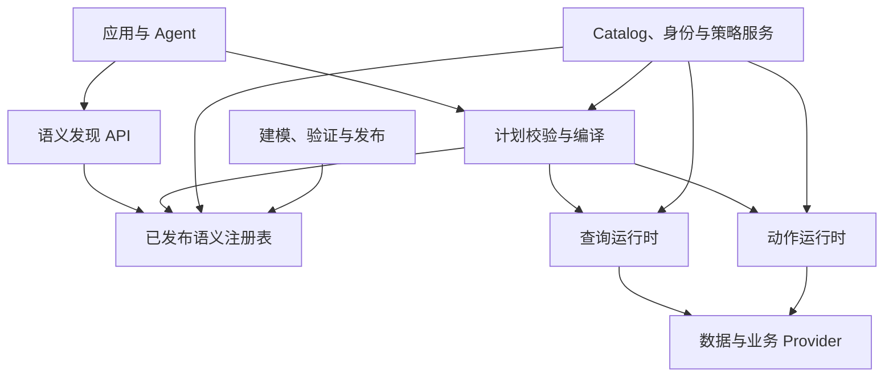
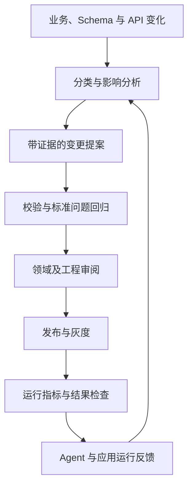
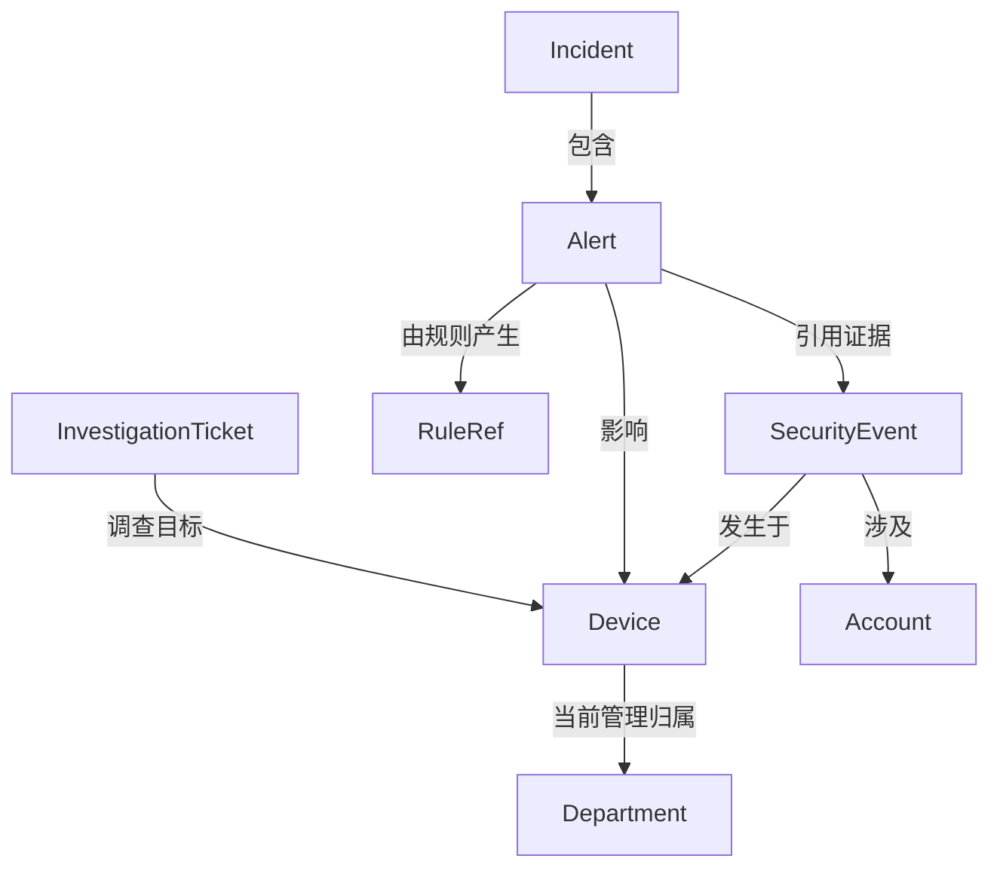

# 企业本体服务建设指南：从业务语义到可执行契约

> 修订版：v5 · 资料核对日期：2026-10-15  
> 文档性质：概念讲解、架构设计与实施指南，可作为项目立项和设计评审的基线。  
> 适用对象：领域负责人、架构师、数据平台、业务服务、规则引擎及 AI Agent 开发团队。  
> 阅读说明：第 1—4 章建立概念与取舍；第 5—13 章描述工程设计；第 14—18 章指导建设、验证和评审。

## 目录

1. [建设目标与本次修订](#s1)
2. [本体到底是什么：概念、模型与服务的边界](#s2)
3. [公开实践：可以借鉴什么，不能推导什么](#s3)
4. [选择建设形态：语义控制面、分析语义层与运营本体](#s4)
5. [领域建模：对象、属性、关系、事件、指标与规则](#s5)
6. [对象身份：跨系统映射、消歧、合并与拆分](#s6)
7. [时间与事实：当前状态、历史状态与知识证据](#s7)
8. [数据表示与 Mapping：把语义连接到真实数据](#s8)
9. [参考架构与最小工程实现](#s9)
10. [语义计划与编译：从任务意图到执行计划](#s10)
11. [运行时接口与 Agent 接入](#s11)
12. [动作执行：事务、幂等、授权与审批](#s12)
13. [安全、可信结果与运行保障](#s13)
14. [版本、发布与持续演进](#s14)
15. [贯穿案例：安全分析与事件调查](#s15)
16. [分阶段实施路线与团队责任](#s16)
17. [测试、评测与验收标准](#s17)
18. [关键架构决策与落地评审清单](#s18)
19. [参考资料与证据对应](#s19)
20. [术语速查](#s20)

---

<a id="s1"></a>
## 1. 建设目标与本次修订

### 1.1 应交付什么

本体建设的目标，是让业务应用和 Agent 能以稳定、可治理的业务概念，发现数据、理解关系、选择能力，并获得可解释的执行结果。

交付物不能仅是一张概念关系图或一组 Entity JSON。一个可运行的最小闭环应包含：

1. 一个有责任人、有版本的领域模型；
2. 一组经过验证的对象身份、关系、时间和指标定义；
3. 可以执行的数据映射与能力绑定；
4. 一个能拒绝错误计划的确定性校验与编译过程；
5. 一套在执行端生效的权限与动作控制；
6. 一组标准问题、标准计划及标准结果；
7. 一条可发布、可回退、可审计的变更链路。

例如，“查询某个设备过去一小时关联的告警”，必须明确设备如何识别、关联在哪个时间点有效、告警如何定义、查询使用什么时间、哪些结果可见，以及没有返回数据意味着什么。

### 1.2 对原文的保留与修正

保留原文的核心思路：业务语义与物理结构分离；明确 Mapping 和能力契约；图数据库按需引入；渐进式发现；版本治理；外部变化与运行反馈共同推动演进。

本版重点修正和补充：

| 原文中的表达或不足 | 本版处理 |
|---|---|
| 本体服务必然是“薄语义控制面” | 改为适合已有数据与业务服务的默认起点；允许运营本体和对象服务形态 |
| 类、属性、关系、实例四要素足以指导建设 | 补充对象身份、事件、时间、指标、规则引用、能力和发布契约 |
| Knowledge Graph 等于 Ontology 加实例 | 改为常见组织方式；知识图谱可能没有显式形式本体，二者不是严格集合等式 |
| 多个客户标识可以统一 | 先验证标识的范围、主体含义和身份映射，禁止仅凭名称或格式合并 |
| 语义关系可以转换为 join | 区分业务关系、可执行路径与聚合安全性；增加粒度和扇出校验 |
| 用姓名解析具体客户 | 区分“概念解析”和“对象检索”；具体对象由数据能力检索并消歧 |
| 权限和约束由语义校验完成 | 增加执行时重新授权、数据完整性判定和业务服务原子前置条件 |
| 查询无结果可作为否定结论 | 区分完整结果、部分结果、数据缺失和不可判定 |

### 1.3 事实、建议和待验证事项

本文使用三类表述：

- **公开实践**：由第 19 章一手资料支持，说明对应产品或标准做了什么。
- **本文建议**：结合这些实践提出的参考设计；不是厂商统一标准，也不是行业唯一最佳方案。
- **示例／建议目标**：自定义 DSL、API、容量和验收数字，仅用于设计讨论，需要本地验证。

本文不是任何厂商产品的完整复刻，也不承诺本体能自动解决数据质量、实体匹配或自然语言理解问题。其价值是让这些问题变得显式、可测量、可治理。

<a id="s2"></a>
## 2. 本体到底是什么：概念、模型与服务的边界

### 2.1 从工程视角理解本体

本体是对某个领域概念、属性、关系及其含义和约束的显式描述。它回答“这个业务世界中有什么，以及它们意味着什么”。

例如，安全分析中有 Device、Account、SecurityEvent、Alert、Incident。Account 登录 Device 是关系；一次登录是事件；异常登录规则可以产生 Alert；多个 Alert 经过调查形成 Incident。它们不能因为存放在同一张表里就变成同一种对象。

本体不是自然语言说明书的简单集合。至少应有稳定标识、可检查的类型、明确的关系端点和适用范围，使程序能够判断一个计划是否有意义。

同时，企业工程中的“本体”不一定需要完整 OWL 形式语义。可先使用受约束的类型模型和契约；需要形式推理、行业交换时再选择 RDF、OWL、SHACL 等标准。

### 2.2 三个不同层次

| 层次 | 回答的问题 | 示例 |
|---|---|---|
| 业务本体 | 概念是什么，含义与关系是什么？ | Device、Account、登录关系 |
| 可执行语义模型 | 如何从数据得到这些概念，允许哪些运算？ | 设备标识映射、事件时间字段、告警统计口径 |
| 本体平台／本体服务 | 如何管理、发布、发现和使用模型？ | 元数据 API、编译器、对象服务、动作运行时 |

必须区分这些层次，否则容易把“是否应建立统一对象索引”误当成“是否需要本体”的问题。

### 2.3 与相邻系统的关系

| 系统／概念 | 主要职责 | 与本体服务的连接 |
|---|---|---|
| Schema | 单个接口或存储的结构 | 被 Mapping 引用和校验 |
| Catalog | 数据资产发现、Owner、技术元数据 | 提供稳定资产 ID 和技术事实 |
| Lineage | 数据加工与依赖链 | 支撑来源说明和变更影响分析 |
| MDM／实体解析 | 主数据与跨系统身份对应 | 提供对象 ID、别名及合并记录 |
| Knowledge Graph | 用图组织事实及关系 | 可承载实例与关系，也可作为检索索引 |
| 指标语义层 | 度量、维度、粒度与聚合 | 作为分析能力复用，避免重复定义指标 |
| 规则引擎 | 谓词、复杂条件、CEP 和业务决策 | 规则输入输出绑定本体；记录规则版本 |
| 工作流／业务服务 | 状态转换、事务、业务副作用 | 作为动作能力 Provider |
| MCP／REST／gRPC | 能力调用协议 | 承载发现和调用接口，本身不定义业务语义 |
| Skill | 任务步骤、策略与使用方法 | 指导如何使用本体和业务能力 |

Knowledge Graph 经常由概念模型加实例事实组织而成，但也存在从文本抽取、没有严格显式本体的图。图数据库是一种存储选择，本体是一种语义组织方式。

### 2.4 约束、推理与数据校验不是同一件事

OWL 采用开放世界假设：缺少某条事实通常意味着未知，而非自动为假。[S9] 因此，“没有找到设备 Owner”不能仅凭本体推理认定设备无 Owner。

SHACL 为 RDF 图提供约束校验；对于非 RDF 接口，可使用 JSON Schema 加自定义校验。[S10] 要注意：使用 SHACL 不代表所有数据都默认禁止额外属性，是否关闭形状需要明确配置；校验也依赖被送入验证的图是否完整。

本文建议把约束分成四类：

| 类型 | 例子 | 主要执行位置 |
|---|---|---|
| 结构约束 | ID 必填、字段类型合法 | 发布校验、接口校验、数据摄取 |
| 数据约束 | 同租户内 ID 唯一、关系端点存在 | 数据质量、业务存储、对象服务 |
| 语义约束 | 金额不可跨币种直接相加 | 编译器、指标引擎 |
| 业务前置条件 | 已关闭工单不可重复关闭 | 业务服务事务内 |

定义约束不等于执行了约束。每条约束必须记录执行者、时机、覆盖范围、违反后的处理方式和最近验证结果。

<a id="s3"></a>
## 3. 公开实践：可以借鉴什么，不能推导什么

### 3.1 Palantir：运营本体与分工明确的后端

**公开实践：**Foundry 将对象、属性、关系与动作联系起来；其后端区分 Ontology Metadata Service、对象数据库、Object Set Service、Actions 和数据索引链路。它包含实例存储、查询及修改能力，不只是元数据目录。[S1–S3]

**本文建议：**借鉴稳定对象语义、读写能力分离和明确的运行时组件职责。是否建立统一对象存储，需要业务需求和成本证明。厂商内部动作的事务语义不能被推导为外部多个业务系统自动获得分布式原子事务。

### 3.2 dbt MetricFlow：语义关系需要考虑聚合安全

**公开实践：**MetricFlow 使用语义模型中的 entities 构建 join 路径，并依据实体类型限制可能产生 fan-out 或 chasm join 的组合。[S4]

**本文建议：**把实体键、数据粒度和关联基数纳入编译；建立了“客户有订单”关系，并不意味着任意订单指标都能在任意路径上正确聚合。具体可用路径、跳数和语法随产品版本变化，项目应以部署版本为准。

### 3.3 Snowflake：分析语义定义与已验证问题

**公开实践：**Semantic Views 区分逻辑表、关系、facts、dimensions 和 metrics；Verified Query Repository 保存问题及相应 SQL，为自然语言查询提供经过验证的示例。[S5–S6]

**本文建议：**本体的对象模型之外，应有明确的分析口径；把业务标准问题固化为测试资产。已验证 SQL 能提供参考，不能保证新问题、权限上下文和数据变化下的正确性。

### 3.4 Databricks：可复用指标与治理

**公开实践：**Unity Catalog metric views 提供可复用度量、建模和访问管理，并有面向 Agent 的名称、同义词等元数据。[S7]

**本文建议：**若企业已使用这类能力，本体服务通过稳定引用和语义对齐复用它。指标定义应只有明确的权威维护位置，不能在 BI、Agent 提示词和本体文件里各复制一份。

### 3.5 DataHub：先定义元数据模型，再建设服务

**公开实践：**DataHub 强调 model-first；其元数据模型以 Entity、标识和 Aspects 组织资产信息。[S8a–S8b]

**本文建议：**借鉴稳定标识和分块元数据设计。Catalog 提供物理资产事实，本体补充领域语义及执行契约；集成时允许同步服务所需投影，但必须记录权威来源和同步状态，避免无责任人的双写。

### 3.6 Microsoft GraphRAG：文本抽取与权威事实之间有距离

**公开实践：**GraphRAG 可从非结构化文本提取实体、关系和 claims，构建支持检索的索引。[S11]

**本文建议：**把抽取结果视为带证据的候选知识。文本中“设备可能受攻击”与经规则命中、分析员确认的 Incident 是不同事实等级；不要把所有抽取关系直接写入运营本体。

### 3.7 能归纳出的建设原则

这些公开方案服务的目标不同，不能拼接成一套声称得到各家公司共同验证的架构。可以提炼的工程方向是：显式语义、稳定身份、受约束的关系和指标、读写能力契约、执行端治理，以及基于真实问题的持续验证。

后续章节是基于上述方向提出的设计方案，不是对厂商内部实现的描述。

<a id="s4"></a>
## 4. 选择建设形态：语义控制面、分析语义层与运营本体

### 4.1 三种形态

| 形态 | 核心交付 | 适合情况 | 主要成本 |
|---|---|---|---|
| 语义控制面 | 模型、Mapping、能力发现、校验与发布 | 已有成熟数据／业务服务，需要统一理解和接入 | 集成、契约和治理 |
| 分析语义层 | 指标、维度、join 规则、SQL 编译 | BI、自然语言分析与指标一致性 | 数据建模、口径治理、计算性能 |
| 运营本体平台 | 对象索引、关系查询、受控动作、应用接口 | 多应用围绕同一对象协作，需统一交互 | 数据同步、对象存储、安全、编辑与写回 |

它们可组合：控制面负责定义，指标引擎负责分析，对象服务承载选定场景。物理上可在一个产品中，逻辑上仍应明确责任。

### 4.2 推荐起点

对于已有流处理、规则引擎、告警平台和查询服务的团队，建议先建立领域模型及可执行能力契约；直接接入已有查询和动作 Provider。第一阶段不开发任意跨源 SQL 引擎，也不迁移全量实例。

当多个应用反复建设相同对象视图、源查询无法满足时延，或需要跨系统关系遍历时，可增加对象投影或关系索引。这里“薄”约束的是职责和耦合，不是绝对禁止缓存或实例索引。

### 4.3 哪些需求推动升级为运营本体

扩展前至少回答：

- 对象 API 被哪些应用复用？现有 Provider 不能满足什么？
- 哪些属性应物化？需要多快更新？删除如何传播？
- 用户编辑写入本体投影还是源系统？冲突如何处理？
- 如何处理重建期间的数据、权限和对象 ID？
- 性能、可用性提升是否足以承担同步和维护成本？

如果回答仅是“便于 Agent 理解”，通常还不足以证明需要统一对象数据库。

<a id="s5"></a>
## 5. 领域建模：对象、属性、关系、事件、指标与规则

### 5.1 从任务和业务问题出发

第一轮建模输入应是 10—30 个代表性问题、几个真实动作流程以及现有数据和服务。既不能直接复制表结构，也不能脱离已有数据设计一个无法执行的理想世界。

例：“查设备近期是否存在异常登录。”需要追问：设备指终端还是网络地址？近期使用什么时间？异常是规则命中还是分析员认定？登录失败是否计算？查询者可见哪个租户？这些答案决定模型。

### 5.2 元模型

建议初始元模型如下，字段名称为本文自定义：

| 类型 | 最低必需信息 |
|---|---|
| Domain | 稳定 ID、Owner、边界、依赖 |
| EntityType | 定义、身份规则、生命周期、属性集合 |
| Property | 类型、含义、单位、可空性、敏感性、时间模式 |
| RelationType | 端点、方向、基数、时效、证据、允许用途 |
| EventType | 事件 ID、参与对象、发生／处理时间、事件来源 |
| Metric | 基础粒度、过滤、聚合、维度、时间口径、单位 |
| Constraint | 约束表达、执行点、级别、违反处理 |
| Representation／Mapping | 数据表示、资产引用、转换、身份与时间策略 |
| Capability | 输入输出、Provider、权限、成本、读写特性 |
| RuleRef | 规则系统 ID、版本、输入输出语义、适用条件 |
| Release | 依赖版本、校验报告、批准记录、校验和 |

规则和指标是企业可执行语义的一部分，不意味着所有逻辑都要由本体服务内部执行。

### 5.3 概念 ID 与显示名称分离

建议使用稳定 ID，例如 `sec:Device`、`sec:Account`、`sec:Device.managedBy`。中文名、同义词和描述可以修改，稳定 ID 不随展示名称变更。

同名不一定同义：“客户”可能分别指合同客户、联系人和访问用户。先在领域内定义，再以显式跨域映射关联。共享模型应尽量小，例如 Organization、时间和单位；不要强迫所有部门共用一个无边界的 Customer。

### 5.4 属性不仅需要基本类型

`amount: decimal` 不够，还需要币种、精度和金额口径；`timestamp: long` 不够，还需要时区、单位和业务时间含义。

语义类型可以建立在基本类型上：`DeviceId`、`TenantId`、`IPAddress`、`Money`、`EventInstant`。ID 应有类型，避免拿 AccountId 填入 DeviceId。

必须显式区分：缺失、未知、不适用、因权限遮蔽。接口可通过状态字段表达；不能统一把它们变成空字符串或 0。

### 5.5 关系需要建模角色和有效期

例如“账户使用设备”可能是最近观察到的关系，不是永久归属。它至少需要时间范围、观察证据和来源。“设备属于部门”则可能由 CMDB 的历史归属记录确定。

关系字段建议包括：

```yaml
id: sec:Device.managedBy
from: sec:Device
to: org:Department
cardinality:
  fromTo: zero_or_one
  toFrom: zero_or_many
validity: interval
meaning: 在指定有效时刻负责管理该设备的部门
executionPathRef: device-department-history-v1
```

方向改变时基数也改变。基数声明还需要数据验证，不能只是文档中的愿望。

### 5.6 事件与状态分离

“发生一次账户登录”是事件；“设备当前在线”是状态；“设备曾被隔离”是动作历史。状态可以由事件推导，但必须记录推导规则、迟到处理和重建策略。

建议对事实标注 `observed`、`derived`、`inferred`、`human_confirmed` 等类别，并保留证据。它们不是一条可互相覆盖的置信度轴。

### 5.7 指标要明确粒度和可加性

“告警数”必须确定是在告警 ID、规则命中记录还是事件行上计数。“异常设备数”通常按 Device 去重，不能把每日去重设备数直接相加得到月去重设备数。

每个指标至少定义：基础粒度、过滤、去重键、聚合方式、时间字段、时区、允许维度、单位及版本。

扇出例子：一个订单金额为 100 元，关联两条告警。直接 join 后 SUM(order.amount) 得到 200 元。关系语义正确，指标仍然错误。编译器应选用 EXISTS、先聚合再 join、受支持的去重策略，或拒绝该路径；不能依靠最后 SELECT DISTINCT 修正所有聚合。

### 5.8 规则的合理边界

简单类型和静态范围约束可在模型中表达；复杂风险判断、CEP、跨事件关联交给规则引擎。模型记录规则 ID、版本、输入字段语义、输出事实类别及时间模型。

“未命中规则”不等于“无风险”；可能是无数据、规则未覆盖或计算尚未完成。规则结果也需要完整性和覆盖说明。

<a id="s6"></a>
## 6. 对象身份：跨系统映射、消歧、合并与拆分

### 6.1 为什么身份是第一优先级

业务对象没有稳定身份，关系、去重、历史查询和动作目标都会不可靠。`client_no` 与 `party_id` 可能分别代表合同主体与自然人，不能简单归一成 customerId。

建议对象引用包含租户、领域类型和规范 ID：

```json
{"tenantId":"t1","typeId":"sec:Device","objectId":"d-1024"}
```

该格式是本文接口示例。规范 ID 可以复用已有主数据 ID；只有需要跨系统统一身份时才建立身份映射服务。

### 6.2 身份映射记录

| 字段 | 含义 |
|---|---|
| canonicalObjectRef | 规范对象引用 |
| sourceSystem／sourceKey | 源系统和原始标识 |
| validFrom／validTo | 对应关系有效期 |
| mappingStatus | confirmed、candidate、rejected 等 |
| method／evidenceRef | 匹配方式和证据 |
| identityVersion | 映射版本 |
| reviewer | 必要时的确认责任人 |

对于设备，IP 可重复分配，主机名可重复，MAC 也可能不可靠；不应默认作为永久身份。账户 ID 也应包含认证域或租户范围。

### 6.3 概念解析与实例查找

`resolveConcept("设备")` 返回 EntityType；`searchObjects(type=Device, name="终端A")` 返回受权限约束的实例候选。姓名、主机名和电话号码通常不是唯一键。

发生歧义时，查询可要求进一步消歧；动作必须使用已确认的规范对象引用，不能由模型挑选“最像的一个”。

### 6.4 合并、拆分与历史重放

合并对象后保留别名、原 ID 和变更记录；拆分需要重评关系归属。不可静默重写历史动作日志的目标。

项目要明确：历史报告按当时身份解释，还是按当前身份重算。两者均可，但必须提供明确模式和 identityVersion。动作服务还应检查对象引用是否已停用或被重定向。

<a id="s7"></a>
## 7. 时间与事实：当前状态、历史状态与知识证据

### 7.1 至少区分四种时间

| 时间 | 意义 | 典型用途 |
|---|---|---|
| eventTime | 业务事件发生时间 | “昨天发生的登录” |
| processingTime | 系统处理或计算时间 | “最近一小时处理的规则命中” |
| validTime | 属性或关系在现实业务中有效的时间 | 事件发生时设备所属部门 |
| recordedTime | 系统记录／获知事实的时间 | 追溯某时刻系统知道什么 |

把所有时间统一叫 timestamp，会使查询结果正确但解释错误。

如果现有规则引擎使用 calculate time，模型应诚实标为处理／计算时间。不能仅在 Mapping 中换一个名字就变成 event time；若迁移，需评估迟到、乱序、watermark 和历史结果变化。

### 7.2 相对时间必须冻结为确定区间

“最近一小时”在请求入口以服务端可信时钟和业务时区解析，形成固定的 `[start, end)` 区间，整个计划复用同一时刻。不要让各 Provider 独立计算 now。

一个合理的选择是 UTC 存储绝对时刻、业务时区解释自然日。“过去 24 小时”与“昨天”不是同一条件。

### 7.3 历史关系与双时间

事件归属查询需要按 eventTime 匹配部门关系的 validTime，不能默认使用设备当前部门。对于事后修正的归属记录，如需回答“当时系统认为什么”，还需要 recordedTime。

双时间管理仅在业务需要时引入。第一期若只支持当前状态，也应明确 `temporalMode: current_only`，对历史问题返回不支持，而非用当前值冒充历史。

### 7.4 新鲜度不等于结果完整性

新鲜度说明数据更新有多近；完整性说明指定范围内是否已覆盖应有数据。数据源刚更新，仍可能漏采；事件时间很旧，也可能刚被补录。

结果至少区分：

- `freshnessStatus`：是否满足更新延迟目标；
- `coverage`：已完成的时间区间、分区或 watermark；
- `completeness`：complete、partial、unknown；
- `lateDataPolicy`：迟到后是否修正和如何通知。

没有 watermark 或对账信息时，不应编造完整性保证。

### 7.5 推断事实与文本证据

文档抽取、模型推断和规则派生都需保留证据、算法或规则版本及适用时间。置信度若存在，要注明它是实体匹配评分、抽取评分还是其他指标；这些分数不能混用，也不自动等于概率。

对于事实冲突，不使用“最新写入值总是正确”的默认策略。来源权威、有效时间、业务用途和验证状态应共同决定选择。

<a id="s8"></a>
## 8. 数据表示与 Mapping：把语义连接到真实数据

### 8.1 Mapping 是可验证契约

Mapping 说明一个概念在某种数据表示中如何获得，不只是字段重命名。它要覆盖身份、粒度、类型转换、时间、过滤、关联、来源、质量和可执行能力。

对既有服务，优先绑定 API 输出；对既有数据模型，绑定治理后的视图或数据集。只有需要灵活查询时才增加表达式和 SQL 编译能力。

### 8.2 一个表示可以只覆盖对象的一部分

DeviceIdentity、DeviceCurrentStatus 和 DeviceHistory 可以有不同 Provider。不能因为能读取设备状态，就声明可以查询所有设备历史属性。

表示元数据应显式列出属性覆盖范围、粒度、可支持操作和时间模式。规划阶段发现不能满足需求，应返回 `NoSuitableRepresentation`。

### 8.3 示例 Mapping

以下为本文自定义示意 DSL，并非 dbt、Snowflake 或 Palantir 的直接配置：

```yaml
id: sec-device-current-mapping-v1
entityType: sec:Device
representation: current_state
assetRef: catalog:cmdb/device_current
providerRef: device-query-v1
grain: one_row_per_tenant_and_device
identity:
  tenantField: tenant_id
  sourceKey: device_uuid
  resolverRef: device-identity-v1
properties:
  sec:Device.hostname:
    sourceField: hostname
    valueType: string
  sec:Device.lastSeenAt:
    sourceField: last_seen_ms
    transformRef: epoch-ms-to-instant-v1
    valueType: instant
    timeMeaning: observed_at
temporalMode: current_only
authority:
  purposes: [asset_inventory]
  role: authoritative
qualityGateRef: device-key-and-null-check-v1
freshnessPolicyRef: cmdb-serving-freshness-v1
```

转换必须引用受信任的函数注册表，或使用受限且类型化的表达式。不要把模型生成的 Python、SQL 字符串或任意代码直接配置为生产 Mapping。

### 8.4 属性级与用途级权威

设备归属由 CMDB 负责；在线状态可能由 Agent 心跳负责；威胁判定由风险服务负责。不存在一个源天然对对象所有属性权威。

选择 Provider 时，应先筛选权限、用途、语义等价、时间模式和质量，再选择成本或时延。缓存快并不意味着适用于历史调查。

只有语义等价且满足当前策略的源才能降级替换。若使用更旧数据、部分字段或不同口径，必须显式标注，必要时拒绝。

### 8.5 Catalog 和 Lineage 集成

引用稳定资产 ID；保存编译所需的字段结构和版本快照是合理的，但注明这是投影，Catalog 仍是技术元数据权威。模型中的业务定义由领域负责人维护，不能被源字段注释自动覆盖。

记录语义依赖和数据血缘的连接，例如 Property → Mapping → Dataset → Pipeline；影响分析需要两者，语义关系不等于数据血缘。

### 8.6 联邦访问与物化取舍

| 方式 | 适用 | 需要承担的问题 |
|---|---|---|
| 绑定现有 API | 稳定业务读写、明确 SLA | 能力覆盖、接口版本 |
| 单引擎查询 | 数据同处一个计算域 | 模型、查询优化、资源隔离 |
| 受限跨源编排 | 小候选集合查多个源 | 批量请求、上限、部分失败 |
| 物化对象／关系投影 | 高频对象查询或多跳关系 | CDC、删除传播、延迟、重建 |
| 通用联邦引擎 | 已有平台或确有广泛需求 | 优化器、统计、跨源一致性、运维 |

第一期跨源能力建议只允许已批准的编排模板。例如先检索最多 100 个设备 ID，再批量查询相关告警；禁止把大规模 join 拉到 Agent 进程中执行。

<a id="s9"></a>
## 9. 参考架构与最小工程实现

### 9.1 逻辑架构



图中的模块是责任边界，不要求分别部署为微服务。

### 9.2 最小部署建议

可先实现一个模块化服务：Authoring、Registry、Discovery、Validator、Compiler、ProviderRegistry；复用已有查询服务、业务服务和权限系统。

建议初始技术栈：关系数据库保存模型、版本及依赖；对象存储或 Git 保存不可变发布包；全文检索用于发现；已有消息总线传递变更。向量检索和图存储按效果与查询需求增加，不作为启动依赖。

Java／Go 团队可以先用类型化结构和编译接口，不必因本体而迁移到专门语言。

### 9.3 元数据存储设计

| 逻辑表／集合 | 关键字段 |
|---|---|
| semantic_element | element_id、kind、domain_id、owner |
| element_revision | element_id、revision、definition、content_hash |
| dependency | from_revision、to_revision、dependency_kind |
| release | release_id、manifest、hash、status |
| release_element | release_id、element_id、revision |
| provider_contract | capability_id、revision、schema、provider_ref |
| approval | change_id、reviewer、decision、evidence |
| feedback | error_class、plan_ref、release_id、triage_status |

这些是逻辑结构，实际可合并。敏感日志、执行记录和实例数据不应无限增长在同一元数据表中。

### 9.4 发布包与运行时隔离

运行时只读已发布版本。编辑草稿不得污染生产发现结果。发布包包含模型、Mapping、能力契约、规则引用、依赖版本和校验报告。

Registry 可以缓存发布包；缓存失败时使用最后一个已验证且仍允许执行的版本。紧急权限撤销、动作禁用及数据源隔离必须独立生效，不能等模型重新发布。

### 9.5 依赖管理

跨域引用锁定兼容版本范围并在发布时解析为具体版本。发布包必须可重现：相同包和输入应生成相同确定性计划；外部状态、权限、数据内容可能变化，不能承诺执行结果永远相同。

依赖有环时区分：模型中相互关联可以存在，发布依赖和派生计算的非法循环必须拒绝。

<a id="s10"></a>
## 10. 语义计划与编译：从任务意图到执行计划

### 10.1 本体不应依赖 LLM 完成正确性校验

LLM 负责理解自然语言和提出候选任务；确定性程序负责类型、关系、版本、权限、时间、粒度和能力检查。模型能解释错误，但不能自行认定拒绝条件已解除。

简单场景直接使用能力 ID 加类型化参数即可。只有存在可组合的选择、过滤、关系和聚合时才引入 Semantic Plan，避免第一天设计覆盖所有数据库的通用 DSL。

### 10.2 建议编译过程

1. **绑定概念**：将名称解析为稳定语义 ID，处理领域歧义。
2. **绑定对象**：实例检索、消歧，生成类型化对象引用。
3. **类型检查**：属性、参数、单位及运算是否合法。
4. **时间归一化**：冻结相对时间，明确查询时间字段与模式。
5. **关系与粒度检查**：选择受支持路径，检查扇出和聚合可加性。
6. **权限约束**：根据可信身份和用途限制计划。
7. **Provider 选择**：匹配属性覆盖、时间、质量与能力。
8. **逻辑优化**：常量折叠、谓词下推、投影裁剪等可证明等价的改写。
9. **物理生成**：编译为受控 API 请求或参数化查询。
10. **运行校验**：Provider 在执行时重新授权并检查必要前置条件。

权限过滤与 limit、聚合的顺序需要明确，不能先截取不受权限过滤的 Top N 再过滤，否则会得到错误结果或泄露存在性。

### 10.3 IR 的分层

建议区分：

- 用户意图：可能含“近期”“异常”等待消歧词；
- 语义逻辑计划：固定对象、属性、关系、时间和指标定义；
- 绑定计划：固定 Mapping、能力和发布版本；
- 物理计划：具体 Provider 请求、批量策略和限制。

对于已有规则引擎，可让规则 AST 与查询语义计划复用类型系统或部分 IR，但不要把业务规则执行流与本体元模型直接绑定。逐步接入更容易控制风险。

### 10.4 示例计划

下面仍是本文自定义示例：

```json
{
  "planSchemaVersion": "1.0",
  "releaseId": "sec-release-20261015-01",
  "operation": "query",
  "root": {
    "typeId": "sec:Device",
    "objectRef": {"tenantId":"t1","objectId":"d-1024"}
  },
  "traverse": [{"relationId":"sec:Alert.affectsDevice","direction":"inverse"}],
  "time": {
    "fieldId": "sec:Alert.detectedAt",
    "basis": "processing_time",
    "startInclusive": "2026-10-15T01:00:00Z",
    "endExclusive": "2026-10-15T02:00:00Z"
  },
  "select": ["sec:Alert.id","sec:Alert.severity","sec:Alert.ruleRef"],
  "sort": [{"fieldId":"sec:Alert.detectedAt","direction":"asc"}],
  "limit": 100,
  "completenessRequired": true
}
```

排序还需由编译器补上唯一键保证分页稳定。该计划没有自行声明可生效权限；租户与对象引用须与可信身份核验。

### 10.5 计划解释与限制

`explain` 返回已解析的含义、选用 Provider、关联方式、时间口径、授权约束、预计成本和不支持原因。给普通 Agent 的结果可以隐藏物理表名、敏感策略和内部拓扑；工程调试接口单独授权。

第一期建议限制：最大遍历深度、最大候选 ID 数、返回行数、扫描范围、执行时长、并发和费用。超限要返回结构化错误，不让模型无限扩展查询。

### 10.6 编译后的版本与时效

绑定计划固定 releaseId、Mapping revision、能力契约和必要身份版本；可以携带签名摘要及短期有效期，具体机制取决于部署。

固定模型版本并不固定当前授权。执行端必须重新检查权限、Provider 状态、动作禁用和数据访问条件。模型回滚也不撤销已发生的业务动作。

<a id="s11"></a>
## 11. 运行时接口与 Agent 接入

### 11.1 最小 API 集合

下列接口是建议契约，不是现成标准：

| 接口 | 主要用途 | 最小返回 |
|---|---|---|
| searchConcepts | 查领域概念 | ID、定义、域、版本、可见性过滤后候选 |
| describeConcept | 看属性、关系和约束 | 类型、时间模式、适用范围 |
| listCapabilities | 找读写能力 | 参数、输出、限制、副作用 |
| searchObjects | 查实例 | 规范对象引用、消歧信息、分页 |
| validatePlan | 检查计划 | 绑定信息或结构化错误 |
| explainPlan | 看计划含义及代价 | Provider、时间、粒度、限制 |
| executeQuery | 查询 | 结果、来源、完整性、游标 |
| previewAction | 动作预检 | 参数摘要、影响、条件、批准要求 |
| executeAction | 已授权动作 | 状态、操作 ID、审计引用 |
| submitFeedback | 反馈问题 | 分类、受影响语义、证据引用 |

Mapping 和源系统细节主要面向受信任编译器与管理者，普通 Agent 不必默认取得全部物理元数据。

### 11.2 渐进式发现

先查相关领域和概念，再取需要的属性、关系及能力。每步限制数量并返回稳定引用。词法和向量检索可组合，但检索排名不能替代歧义判断。

发现接口也要受权限约束：无权知道某种敏感关系存在的主体，不应取得名称、定义或样例。索引、向量候选和缓存都要执行相同可见性逻辑。

### 11.3 可信上下文

用户身份、租户、代理身份、委托范围、用途和授权声明来自网关与身份服务。LLM 提供的 `role=admin` 或 `purpose=security_investigation` 只能是请求信息，不能直接提升权限。

上下文还包含语言、时区、请求 ID 和版本。身份令牌不进入模型上下文或日志正文。

### 11.4 MCP 和 Skill

可以将上述发现、验证和查询能力封装为 MCP Tools；也可以通过 REST 或 gRPC 提供。本体契约应独立于调用协议。

Skill 可指导“先确认设备身份，再查告警，再读取证据”。流程有助于正确使用，但所有权限、约束和成本限制仍在服务端执行。

### 11.5 结构化错误

```json
{
  "code": "AmbiguousObject",
  "retryable": false,
  "stage": "identity_binding",
  "message": "当前可见范围内存在多个同名设备",
  "nextStep": "request_object_disambiguation",
  "requestId": "req-1001"
}
```

建议错误分类包括：UnknownConcept、AmbiguousConcept、AmbiguousObject、UnsupportedTemporalMode、UnsafeAggregation、NoSuitableRepresentation、StaleData、PartialCoverage、PermissionDenied、ApprovalRequired、VersionUnavailable、ProviderFailure。

错误可解释不意味着泄露全部策略原因；普通用户的错误信息和内部审计详情应分开。

<a id="s12"></a>
## 12. 动作执行：事务、幂等、授权与审批

### 12.1 动作是一等能力，但执行责任明确

“创建调查工单”和“隔离终端”不是普通属性更新。动作契约需定义目标、输入、输出、副作用、权限、前置条件、幂等策略、事务边界、异步状态及补偿能力。

业务服务可以与本体平台集成，也可以独立运行；关键是业务条件由实际状态所有者执行，而非仅依赖本体预览。

### 12.2 动作契约示例

```yaml
id: sec:CreateInvestigationTicket
kind: action
providerRef: case-service-v1
inputSchemaRef: create-case-input-v1
outputSchemaRef: create-case-output-v1
sideEffects: [create_ticket, notify_assignee]
authorizationPolicyRef: case-create-policy
approvalPolicyRef: case-create-approval-policy
preconditionMode: checked_by_provider_at_commit
idempotency:
  required: true
  scope: tenant_action_and_request
  sameKeyDifferentPayload: reject
execution:
  mode: asynchronous
  statusCapabilityRef: get-case-operation-v1
  transactionBoundary: case_service_database
```

该契约不会自动使通知系统与工单数据库同事务。通知可通过 outbox 等机制可靠投递，并独立处理重复。

### 12.3 预览不是提交

预览返回目标对象、参数摘要、预期影响、当前状态版本及批准要求。批准凭证应绑定动作、对象、参数摘要、主体、版本和有效期，避免批准 A 后执行 B。

提交时重新授权并原子检查业务前置条件；可以使用 expectedVersion 防止目标状态已改变。过期或状态变化后要求重新预览，不能盲目重放旧请求。

是否需要人工批准按动作风险及已有授权策略决定：已授权的低风险动作可自动执行，高风险隔离、冻结或删除可要求审批。不要把所有动作无区别地强制人工确认。

### 12.4 幂等和超时

幂等键作用域包含租户、动作和请求；相同键相同载荷返回已有状态，不同载荷拒绝。保留期要覆盖业务重试周期。

超时意味着“结果未知”，不意味着“执行失败”。先通过 operationId 或幂等键查状态，再决定重试。异步状态可为 accepted、running、succeeded、failed、compensating、compensated；状态转换由 Provider 负责。

### 12.5 跨系统事务与补偿

本体层不能仅凭一个 Action 名称获得跨系统 ACID。多个 Provider 的操作需明确采用工作流、Saga、outbox 或人工处理。

补偿未必等于恢复原状，例如已发送通知不能真正收回。动作返回可撤销性、补偿状态和不可逆影响，避免 Agent 承诺“全部回滚”。

<a id="s13"></a>
## 13. 安全、可信结果与运行保障

### 13.1 权限执行链

发现层控制元数据可见性；编译层注入和验证计划约束；查询／动作 Provider 在执行时检查实际授权；结果层执行遮蔽和输出策略。

复用 IAM、策略引擎和数据源权限，但本体团队仍须定义语义元素与权限对象之间的映射，并验证每个 Provider 正确执行。不能以“权限由外部负责”为理由不做端到端测试。

### 13.2 聚合、关系和缓存泄露

行列权限之外，还需关注关系存在性、计数、样例、搜索建议和错误信息。必要时限制小样本聚合、敏感关系枚举和导出。

缓存按发布版本、租户、权限范围、用途、参数及时间区间隔离；权限发生变化应使相关缓存失效，或在返回前重新验证。不要只以自然语言问题作为结果缓存键。

### 13.3 提示注入与不可信文本

源文档、描述、证据片段和用户反馈都是数据，即使它们包含“忽略权限”等指令，也不能改变服务端策略。元数据发布经过审查，表达式不允许任意代码执行。

模型看不到敏感数据不代表平台可以无控制地读取它；日志、向量索引、调试样例和导出同样在治理范围内。

### 13.4 可信结果封装

建议结果使用统一 envelope：

```json
{
  "data": [],
  "meta": {
    "releaseId": "sec-release-20261015-01",
    "planId": "plan-1001",
    "requestId": "req-1001",
    "sources": ["alert-query-v1"],
    "retrievedAt": "2026-10-15T02:00:03Z",
    "timeBasis": "processing_time",
    "completeness": "complete",
    "coverageEndExclusive": "2026-10-15T02:00:00Z",
    "freshnessStatus": "within_target",
    "conflictStatus": "none_detected",
    "maskingApplied": true,
    "ruleVersionRefs": ["abnormal-login-v12"],
    "warnings": [],
    "nextCursor": null
  }
}
```

此处 complete 必须由 Provider 的覆盖证据支持；`none_detected` 只意味着检查中未发现冲突。

来源可在对象或字段级保存详细证据引用，对普通 Agent 仅返回允许披露的摘要。涉及异构数据源时，除非明确提供共享快照，否则返回各源读取时间和一致性模式，不能假装是一个全局原子快照。

### 13.5 否定答案的条件

空结果若覆盖完整，只能说明“在此授权范围、时间口径和规则版本下未发现命中”。若 coverage 为 partial／unknown，回答应为“目前无法完整判断”，而不是“没有异常”。

limit 截断、分页未完成、源超时或权限子集都应纳入解释。Agent 最终答案要服从这些状态。

### 13.6 运行时保障

查询侧设置连接与执行超时、并发隔离、批量上限、熔断和预算。只读请求重试也需限流，避免故障放大。动作重试遵循幂等和状态查询规则。

模型服务与大扫描任务分离资源；长查询异步执行并提供状态和取消能力。Provider 下线时不自动切到语义不等价的备源。

元数据变更、执行计划、Provider 调用和动作审计通过 requestId／traceId 关联；敏感参数脱敏，证据按权限留存。

### 13.7 容量与性能预算

先测量语义元素数、请求速率、发布频率、每请求发现次数、Provider 扇出和结果大小。不能凭元数据小就认为整体系统便宜。

建议将时延拆成发现、校验／编译、排队、Provider 执行和结果整理。模型推理时延单独统计。具体 SLO 在试点压测后制定，不从厂商产品宣传推导。

<a id="s14"></a>
## 14. 版本、发布与持续演进

### 14.1 不可变版本与原子发布

元素 revision 描述单项变化；releaseId 描述一组可兼容执行的模型、Mapping 和能力版本。不能让一次请求随意组合各元素的 latest。

发布过程：草稿 → 校验 → 影响分析 → 审阅 → 批准 → 生成不可变包 → 灰度 → 切换活动发布指针。切换应原子；索引尚未准备好时不得宣布发布完成。

第一期可以使用 Git PR、CI 和简单管理 API 实现，不必先建设完整 Ontology Studio。后续再提供面向业务 Owner 的编辑和评审界面。

### 14.2 兼容性分类

| 变化 | 通常影响 | 处理建议 |
|---|---|---|
| 增加同义词／描述 | 发现结果可能变化 | 检索回归与歧义检查 |
| 增加可选属性 | 接口可能兼容 | 输出、权限和检索回归 |
| 更换物理字段但业务含义不变 | Mapping 变化 | 类型、性能、结果对比 |
| 改变时间字段／时区／统计口径 | 结果含义变化 | 新语义版本或新 ID，迁移通知 |
| 修改关系基数或身份规则 | join、去重和历史解释变化 | 数据验证和计划重编译 |
| 收紧权限 | 行为变化 | 立即生效，不为兼容而保留旧授权 |
| 删除能力／属性 | 破坏兼容 | 弃用期、调用统计、明确停用日期 |

新增属性不一定完全无风险，尤其是严格客户端、默认投影和检索排序。兼容性需要结合调用者判断。

### 14.3 回退边界

可回退活动语义发布包、Mapping 和能力路由，但前提是旧依赖仍可用。若源字段已删除，旧版本也无法正常执行，需要迁移与依赖保留策略。

回退模型不会逆转已发出的动作、改变历史数据或恢复已撤销的权限。数据修复、补偿和模型回退是不同操作。

### 14.4 影响分析

维护依赖图：语义元素 → Mapping → 能力 → 已注册计划／应用／标准问题。Catalog 和 Lineage 的变化提供物理依赖输入；实际调用日志补充消费者信息。

静态影响分析只能找到已知依赖，动态脚本或未登记消费者可能遗漏，因此仍需灰度、告警和迁移通知。

### 14.5 双向演进



AI 可协助生成候选定义、Mapping 和测试，但跨域身份、权威源、指标含义和动作授权必须有明确责任人确认。低风险重复变更可采用已批准自动化策略，不意味着模型可以自主改变业务定义。

### 14.6 反馈治理

反馈按概念缺失、歧义、数据问题、权限、编译和 Provider 故障分类。`PermissionDenied` 通常不是扩大权限的理由；`ProviderTimeout` 也不是修改本体定义的理由。

保留原问题、计划版本、失败阶段、允许留存的上下文和证据引用。先定位问题归属，再生成提案，避免把所有故障都归因于语义缺失。

<a id="s15"></a>
## 15. 贯穿案例：安全分析与事件调查

### 15.1 第一阶段业务范围

假设已有 CMDB、Flink 规则引擎、事件查询库、告警服务及工单服务。试点支持三类问题：设备当前信息、近期规则命中、告警关联证据；支持一个低风险动作：创建调查工单。

终端隔离、全网任意多跳查询和自动认定事故不纳入第一期。

### 15.2 概念与关系



Alert 可以引用多个事件，同一事件也可能支持多个告警。Incident 的状态和判定由调查系统管理，不由图上的可达关系自动推断。

### 15.3 标准问题

“设备 d-1024 在过去一小时有没有异常登录告警？如果有，展示规则和证据，并创建一个调查工单。”

领域负责人需要确认：此处“过去一小时”按告警检测时间解释；“异常登录”指指定规则集合产生的告警，不等于攻击已确认；展示证据需单独数据权限；是否创建工单遵循现有授权策略。

### 15.4 端到端流程

1. 认证并确认当前租户与调查用途。
2. 绑定 `sec:Device`，验证 d-1024 的实例引用和可见性。
3. 获取告警时间、规则集合、证据关系和能力契约。
4. 冻结时间区间，形成类型化语义计划。
5. 编译为已有告警查询能力，检查分页、去重和覆盖。
6. 返回告警、规则版本、来源及完整性。
7. 在权限允许下批量读取证据；证据不可见时返回明确状态。
8. 若存在告警且动作已授权，预检创建工单，绑定目标、告警集合和参数摘要。
9. 根据批准策略执行；提交时由工单服务重新校验并处理幂等。
10. 返回工单操作状态和审计引用，记录运行反馈。

### 15.5 三种结果必须分别解释

| 结果 | 可接受回答 |
|---|---|
| 覆盖完整，未命中 | 在该检测时间范围和规则版本下未发现异常登录告警 |
| 有告警，有完整证据 | 发现告警及对应证据；告警不直接等同事故认定 |
| 源超时、覆盖不完整 | 当前数据不足以完整判断，指出缺口或重试入口 |

如果用户问的是“过去一小时发生的异常登录”，而现有系统只支持处理时间，Agent 应说明时间口径限制或改用支持事件时间的能力，不能静默改变问题。

### 15.6 与现有规则引擎的接入

给事件字段和规则输出绑定语义类型；规则 ID 和版本进入告警事实；定义规则时间模型与输出去重策略。规则 AST 到执行计划之间可逐步引入 IR，供类型检查、规范化、谓词下推及共享条件优化使用。

本体服务主要提供领域契约和可查询结果，并不接管 Flink 节点路由、子事件缓存或 CEP 状态。压缩前缀树等索引作为执行层能力存在，索引更新版本若影响结果可追溯性，应作为规则执行证据记录。

<a id="s16"></a>
## 16. 分阶段实施路线与团队责任

### 16.1 阶段划分

下面是建议工作顺序，不是工期承诺。可根据人力把每阶段拆成若干迭代。

| 阶段 | 主要工作 | 交付物 | 退出条件 |
|---|---|---|---|
| 0：验证价值 | 定场景、盘数据与能力、记录现有错误 | 范围、标准问题、基线指标 | 有负责人和可执行数据路径 |
| 1：建立模型 | 少量核心对象、身份、时间、关系与指标 | 模型及数据样本校验 | 定义无关键歧义，来源已确认 |
| 2：打通只读 | 发布注册表、能力绑定、校验及结果 envelope | 单场景端到端查询 | 正确性、权限及部分结果测试通过 |
| 3：接入受控动作 | 预览、授权、幂等、状态与审计 | 一个动作闭环 | 重试和状态变化不产生错误副作用 |
| 4：治理演进 | CI、影响分析、灰度、回退与反馈 | 版本流程和运行看板 | 变更可验证、问题能追责和修复 |
| 5：按需扩展 | 跨域、指标、多源、物化或图索引 | 扩展方案及容量验证 | 相比已有方式有可量化收益 |

### 16.2 第一版建议范围

建议先选 5—10 个实体类型、少量关系、20—50 个核心属性、2—3 个读能力和 1 个动作。范围数字是试点建议，不是标准。

优先复用已存在的 API；先支持一个查询模式和一个 Provider 路径；让语义版本、时间口径和完整性信息贯穿全链路。能闭环后再扩展组合计划。

### 16.3 责任分配

| 角色 | 必须负责的决策 |
|---|---|
| 领域 Owner | 定义、范围、权威源、指标口径、争议裁定 |
| 数据 Owner | 资产和质量、身份键、时间及覆盖证据 |
| 本体服务团队 | 元模型、版本、发现、编译契约和影响分析 |
| Provider 团队 | 数据执行、性能、前置条件、幂等和真实状态 |
| 安全／IAM 团队 | 委托身份、策略、审计与权限映射 |
| Agent 团队 | 意图解析、消歧、交互和结果解释 |
| 测试与运维 | 回归、容量、故障、发布和可观测性 |

可由同一个人承担多个角色，但关键决定仍需记录负责人。没有领域 Owner 的“自动建本体”很容易停留在字段注释和演示系统。

### 16.4 投入与价值核算

比较接入前后的正确任务完成率、定位错误时间、重复 Mapping 数、重复指标定义数和新能力接入成本。还要计入模型维护、身份治理、数据修复和 Provider 运维成本。

若相同效果只需补一份接口契约和几个标准查询，就先做这些；不必为“本体”名称建设完整平台。

<a id="s17"></a>
## 17. 测试、评测与验收标准

### 17.1 建立独立的标准问题集

问题集由领域专家确认，覆盖常见问题及边界。每个用例记录：角色／租户、问题、已确认含义、对象、时间、语义计划或能力调用、预期结果、允许误差和不确定状态。

标准 SQL 可以作为对照，但不能与待测编译器共用同一个错误 Mapping。聚合结果最好有独立人工计算的小数据集；动态数据用固定快照或专门测试环境。

### 17.2 必测场景

| 类别 | 验证重点 |
|---|---|
| 模型与类型 | 无悬空引用、单位正确、参数类型匹配 |
| 身份 | 同名、重复键、IP 复用、跨租户、合并拆分 |
| 时间 | 时区、自然日、区间边界、迟到、历史归属 |
| 关系与指标 | 扇出、空关联、重复事件、非可加指标 |
| 权限 | 不可见概念、行列限制、关系枚举、缓存隔离 |
| 数据状态 | 陈旧、缺失、冲突、分页未完、部分源失败 |
| 动作 | 参数变更、审批过期、并发状态变化、重复请求、超时后查状态 |
| 发布 | 混用版本、依赖变化、索引未就绪、回退与权限撤销 |
| Agent | 语义歧义、错误恢复、不可信文本、对部分结果的解释 |
| 性能与故障 | 限流、熔断、Provider 下线、长查询取消 |

### 17.3 分层指标

分别测量概念解析、实例绑定、计划合法性、执行结果和最终回答，避免只统计“模型回答看起来不错”。

建议指标：

- 任务正确完成率：整个任务的含义、执行和回答均正确的比例；
- 语义正确率：与专家标准含义一致的计划比例；
- 不确定性处理率：应消歧／拒绝／报告不完整时采取正确行为的比例；
- 权限负例通过率：设计的越权测试均被阻止；
- 指标一致率：与权威口径及独立对照一致的比例；
- 发布回归率、故障定位时长、模型维护成本；
- 发现和编译时延、Provider 时延、调用数量及费用。

### 17.4 试点验收建议

以下是初始建议门槛，需要按业务风险调整，不是公开厂商指标：

1. 所有试点语义元素、Mapping 和能力有 Owner 与固定版本。
2. 所有动作负例、跨租户及权限负例测试通过；有限测试不等于证明永无漏洞。
3. 同名对象、处理时间／事件时间和部分覆盖测试均按预期处理。
4. 固定测试集上的查询结果和指标达到专家认可的一致性要求。
5. 每个返回结果可追溯到发布、Provider 及必要规则版本。
6. Provider 故障不导致静默口径变更；动作重复执行不会重复产生约定副作用。
7. 完成一次真实灰度和一次模型回退演练，明确动作不随模型回退。
8. 性能在约定并发、数据量和预算下满足试点 SLO。

如果需要数值化，可先设任务正确完成率目标，例如 95%，再根据基线与风险调整；不能把对话自评分作为验收依据。

<a id="s18"></a>
## 18. 关键架构决策与落地评审清单

### 18.1 建议记录的 ADR

| 决策 | 推荐初始选择 | 何时重新评估 |
|---|---|---|
| 服务形态 | 控制面加现有 Provider | 多应用对象服务需求出现 |
| 表达形式 | 类型化 JSON／YAML，加明确元模型 | 需要标准交换或形式推理 |
| 元数据存储 | 关系数据库及不可变发布包 | 复杂关系检索成为性能瓶颈 |
| 查询能力 | 受控 API 与有限计划 | 业务确需动态组合 |
| 跨源执行 | 批准模板和批量上限 | 现有联邦平台或需求规模增长 |
| 实例存储 | 留在现有数据／对象服务 | 重复查询、索引或关系遍历有收益 |
| 指标 | 引用权威指标系统 | 没有指标平台且分析需求明确 |
| 规则 | 引用现有规则引擎 | 有明确可共享类型／IR 的需求 |
| 身份 | 复用主数据并显式映射 | 源身份复杂或需要实体解析 |
| 动作 | 业务 Provider 执行 | 需要成熟跨系统流程编排 |
| 治理入口 | Git、CI 和管理 API | 业务用户频繁参与建模 |

每个 ADR 写明问题、选项、依据、代价、验证方式和重新评估条件。选型应随数据规模与场景压力变化。

### 18.2 设计评审检查表

- [ ] 场景、范围、标准问题、价值基线和 Owner 已确认。
- [ ] 概念 ID 不等于表名，领域边界及跨域映射明确。
- [ ] 对象 ID、租户范围、身份消歧和历史映射明确。
- [ ] 属性的语义类型、单位、空值和遮蔽状态明确。
- [ ] 关系的方向、基数、有效时间及执行路径已验证。
- [ ] 指标粒度、去重、时间和可加性已定义。
- [ ] 规则版本与事件／处理时间口径可追溯。
- [ ] Mapping 覆盖、权威源、质量和降级规则可检查。
- [ ] 编译器可确定性拒绝非法类型、危险聚合和不支持的计划。
- [ ] Provider 独立校验真实权限，可信身份不由模型自报。
- [ ] 空结果、部分结果和未知覆盖不会被解释为绝对否定。
- [ ] 动作提交检查状态，幂等和结果未知处理已验证。
- [ ] 发布是不可变且依赖固定的，紧急撤权不依赖模型发布。
- [ ] 回退不被误解为数据和业务副作用回滚。
- [ ] 有独立标准结果、权限负例和故障演练。
- [ ] 图数据库、物化和通用联邦引擎均有需求依据。

### 18.3 必须在项目开始时回答的未决问题

本文提供基线设计，项目仍须确认：当前身份权威在哪里；是否需要历史归属；现有 Provider 能否提供覆盖证明；权限能否下推；指标定义在哪维护；动作事务实际覆盖哪些系统；期望吞吐、时延、数据规模和人员投入是多少。

这些问题的答案会决定实现复杂度。不能通过增加模型描述绕过它们。

<a id="s19"></a>
## 19. 参考资料与证据对应

以下为本次核对的一手公开资料，访问日期为 2026-10-15。在线文档持续变化，实施时应固定所用产品和接口版本。本文未使用宣传案例推导通用性能或收益数字。

| 编号 | 资料 | 支持的内容 |
|---|---|---|
| S1 | [Palantir — Ontology architecture](https://palantir.com/docs/foundry/object-backend/overview/) | 运营本体后端，OMS、对象数据库、查询、Actions 与索引职责 |
| S2 | [Palantir — Object types overview](https://palantir.com/docs/foundry/object-link-types/object-types-overview/) | 对象类型与 backing datasource 的连接 |
| S3 | [Palantir — Action types overview](https://palantir.com/docs/foundry/action-types/overview/) | 受结构化逻辑控制的对象变更动作 |
| S4 | [dbt — Joins in MetricFlow](https://docs.getdbt.com/docs/build/join-logic) | entity 类型、join 路径与扇出限制 |
| S5 | [Snowflake — Overview of semantic views](https://docs.snowflake.com/en/user-guide/views-semantic/overview) | 逻辑表、关系、facts、dimensions 和 metrics |
| S6 | [Snowflake — Cortex Analyst Verified Query Repository](https://docs.snowflake.com/en/user-guide/views-semantic/verified-query-repository) | 经验证的问题及 SQL 示例 |
| S7 | [Databricks — Unity Catalog metric views](https://docs.databricks.com/aws/en/uc-semantics/metric-views) | 可复用指标、管理、建模及 Agent 元数据 |
| S8a | [DataHub — Architecture overview](https://docs.datahub.com/docs/architecture/architecture) | model-first 元数据平台定位 |
| S8b | [DataHub — The Metadata Model](https://docs.datahub.com/docs/metadata-modeling/metadata-model) | Entity、标识及 Aspects 的组织方式 |
| S9 | [W3C — OWL 2 Primer, Second Edition](https://www.w3.org/TR/owl-primer/) | 本体形式表达与开放世界假设 |
| S10 | [W3C — Shapes Constraint Language](https://www.w3.org/TR/shacl/) | RDF 图的形状与约束验证；本文参考正式 Recommendation |
| S11 | [Microsoft — GraphRAG indexing overview](https://microsoft.github.io/graphrag/index/overview/) | 非结构化文本的实体、关系及 claims 抽取 |

**引用边界：**第 3 章对各家公司能力的简要描述来自上述资料；第 5—18 章的元模型、API、架构分工、发布机制、案例和验收方案是本文设计建议。文中的 JSON／YAML 不能直接作为任一厂商产品配置使用。

<a id="s20"></a>
## 20. 术语速查

| 术语 | 本文含义 |
|---|---|
| Ontology | 显式领域概念、关系及其含义和约束 |
| Semantic Control Plane | 管理与发布语义、映射和能力契约的控制面 |
| Operational Ontology | 面向业务对象查询、操作和应用协作的运营本体形态 |
| EntityType／Object | 对象类型／具体对象实例 |
| Representation | 对象在特定数据和服务中的表示及覆盖范围 |
| Mapping | 语义到数据表示和 Provider 的可验证连接 |
| Capability | 可调用的读或写能力契约 |
| Provider | 实际提供数据、计算或业务动作的系统 |
| Semantic Plan | 类型化、可校验的业务语义计划 |
| IR | 用于绑定、校验、优化和生成执行计划的中间表示 |
| Grain | 每条记录或度量所对应的业务粒度 |
| Fan-out | 一条记录关联多条记录导致行数扩张 |
| SSOT | 在特定业务含义和用途下的权威维护来源 |
| Provenance | 结果的来源、加工、推导与证据记录 |
| Coverage | 已完成或可保证覆盖的数据范围 |
| Release | 固定模型、映射、能力及依赖的不可变发布包 |
| ADR | 架构决策记录 |

