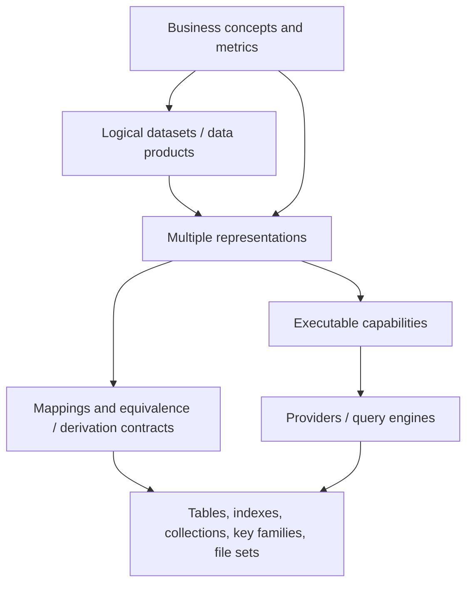
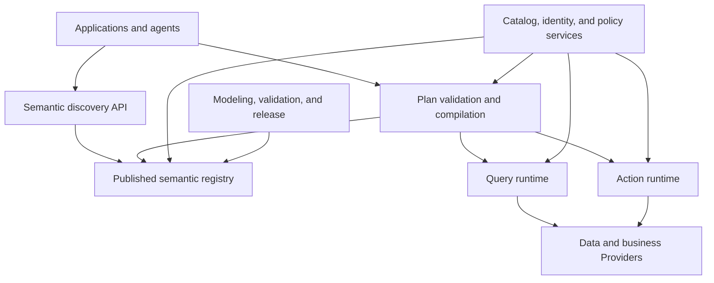
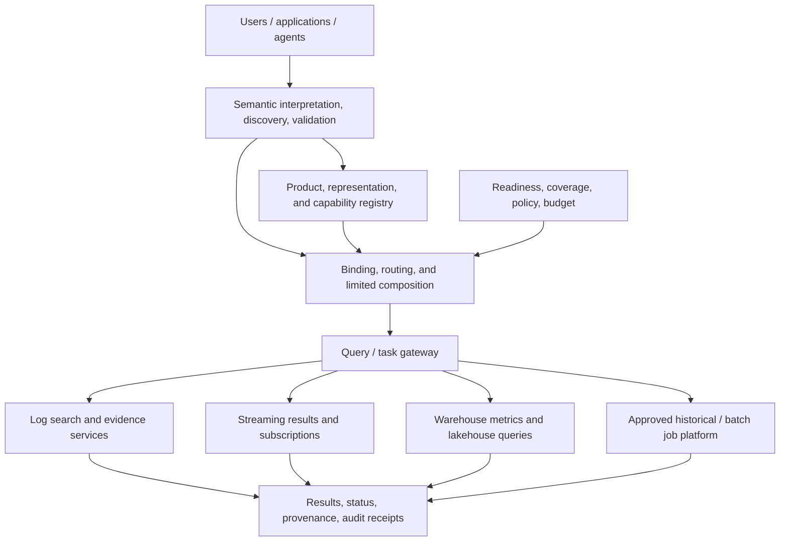
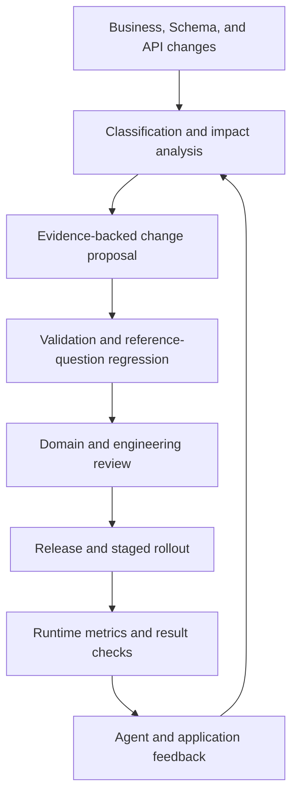
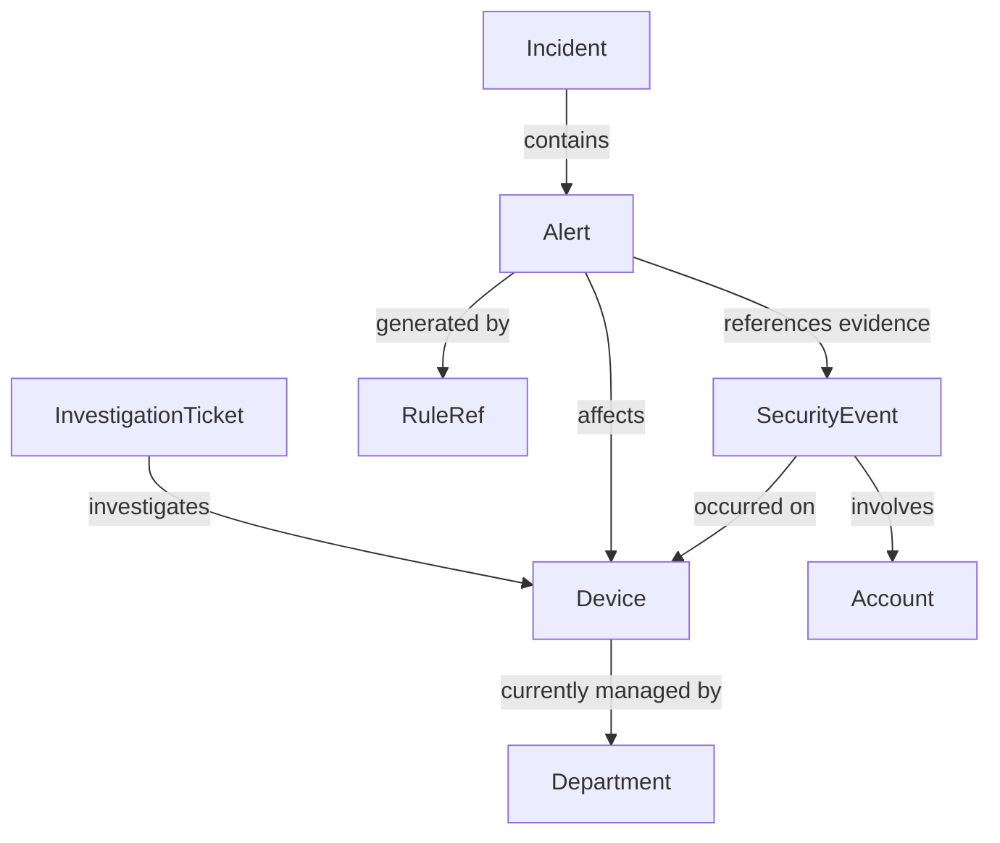

# Building an Enterprise Ontology Service: From Business Semantics to Executable Contracts

> Revision: v7 (English edition) · Source verification date: 2026-10-15  
> Document type: Conceptual explanation, architecture design, and implementation guide; a baseline for project initiation and design reviews.  
> Audience: Domain owners, architects, and teams developing data platforms, business services, rule engines, and AI agents.  
> Reading guide: Chapters 1–4 establish concepts and trade-offs; Chapters 5–13 describe engineering design; Chapters 14–18 guide implementation, validation, and review. v6 adds multiple stores and representations; v7 focuses on Sections 4.4–4.5, 8.21–8.25, 9.8–9.10, 10.11–10.15, 15.8–15.9, and 16.7–17.8, explaining reuse of mature search, streaming, batch, and lakehouse platforms.  
> Version and language: `ontology_ai_data_service_architecture.v7.en.md`, translated from the latest Chinese v7 with the same chapter and subsection structure.  
> Citations: “Reference S1” identifies a source in Chapter 19; S means Source, not a chapter number.

## Table of Contents

- [1. Objectives and Changes in This Revision](#s1)
  - [1.1 What Should Be Delivered?](#section-1-1)
  - [1.2 Conceptual Corrections Completed in v5](#section-1-2)
  - [1.3 Facts, Recommendations, and Items Requiring Validation](#section-1-3)
  - [1.4 v6 Scope: Multiple Stores and Data Shapes](#section-1-4)
  - [1.5 v7 Scope: Reusing PB Search, Streaming Rules, T+1 Warehouses, and Lakehouse](#section-1-5)
- [2. What an Ontology Is: Boundaries Between Concepts, Models, and Services](#s2)
  - [2.1 An Engineering View of Ontologies](#section-2-1)
  - [2.2 Three Distinct Levels](#section-2-2)
  - [2.3 Relationships with Adjacent Systems](#section-2-3)
  - [2.4 Constraints, Reasoning, and Data Validation Are Different](#section-2-4)
- [3. Public Practices: What to Adopt and What Not to Infer](#s3)
  - [3.1 Palantir: Operational Ontology with Explicit Backend Responsibilities](#section-3-1)
  - [3.2 dbt MetricFlow: Semantic Relationships Must Account for Aggregation Safety](#section-3-2)
  - [3.3 Snowflake: Analytical Definitions and Verified Questions](#section-3-3)
  - [3.4 Databricks: Reusable Metrics and Governance](#section-3-4)
  - [3.5 DataHub: Define the Metadata Model Before Building the Service](#section-3-5)
  - [3.6 Microsoft GraphRAG: Extraction Is Not the Same as Authoritative Facts](#section-3-6)
  - [3.7 Principles That Can Be Derived](#section-3-7)
- [4. Choosing an Architecture: Semantic Control Plane, Analytical Semantic Layer, or Operational Ontology](#s4)
  - [4.1 Three Forms](#section-4-1)
  - [4.2 Recommended Starting Point](#section-4-2)
  - [4.3 What Justifies an Operational Ontology?](#section-4-3)
  - [4.4 With Mature Platforms, Focus on Semantic Integration and Capability Reuse](#section-4-4)
  - [4.5 Five Capability Planes and Their Responsibilities](#section-4-5)
- [5. Domain Modeling: Objects, Properties, Relations, Events, Metrics, and Rules](#s5)
  - [5.1 Start with Tasks and Business Questions](#section-5-1)
  - [5.2 Metamodel](#section-5-2)
  - [5.3 Separate Concept IDs from Display Names](#section-5-3)
  - [5.4 Properties Need More Than Primitive Types](#section-5-4)
  - [5.5 Model Relationship Roles and Validity](#section-5-5)
  - [5.6 Separate Events from State](#section-5-6)
  - [5.7 Define Metric Grain and Additivity](#section-5-7)
  - [5.8 Appropriate Boundaries for Rules](#section-5-8)
  - [5.9 Extend the Metamodel: Computations, Products, and Execution Instances](#section-5-9)
  - [5.10 Model Raw Events, Detection Conclusions, Offline Metrics, and Investigation Judgments Separately](#section-5-10)
- [6. Object Identity: Cross-System Mapping, Disambiguation, Merging, and Splitting](#s6)
  - [6.1 Why Identity Comes First](#section-6-1)
  - [6.2 Identity Mapping Records](#section-6-2)
  - [6.3 Concept Resolution versus Instance Search](#section-6-3)
  - [6.4 Merging, Splitting, and Historical Replay](#section-6-4)
- [7. Time and Facts: Current State, Historical State, and Knowledge Evidence](#s7)
  - [7.1 Distinguish at Least Four Kinds of Time](#section-7-1)
  - [7.2 Freeze Relative Time into a Deterministic Interval](#section-7-2)
  - [7.3 Historical Relationships and Bitemporality](#section-7-3)
  - [7.4 Freshness Is Not Completeness](#section-7-4)
  - [7.5 Inferred Facts and Textual Evidence](#section-7-5)
  - [7.6 Business Date, Availability, Readiness, and Revision Time](#section-7-6)
  - [7.7 Provisional, Stable, Published, and Revised Results](#section-7-7)
- [8. Heterogeneous Assets, Representations, and Mapping: Describing, Selecting, and Using Multiple Sources](#s8)
  - [8.1 The Problem: Multiple Business Representations, Not a Database Inventory](#section-8-1)
  - [8.2 Establish Six Related Object Categories](#section-8-2)
  - [8.3 Classify Representation Shapes Before Database Products](#section-8-3)
  - [8.4 Registration Units and Integration Boundaries by Source](#section-8-4)
  - [8.5 Registering Multiple Representations of One Business Fact](#section-8-5)
  - [8.6 Representation Contract: Required Declarations](#section-8-6)
  - [8.7 Separate Contract Definitions from Runtime State](#section-8-7)
  - [8.8 Describe How Rows Are Produced, Not Only Field Mappings](#section-8-8)
  - [8.9 Relationships Between Representations: More Than Shared Fields](#section-8-9)
  - [8.10 Describing Pre-Aggregates and Determining When They Are Usable](#section-8-10)
  - [8.11 Mergeability of Aggregate States and Information Loss](#section-8-11)
  - [8.12 Three Composition Rules: Replicas, Complementary Partitions, and Different Objects](#section-8-12)
  - [8.13 Hot / Cold Composition and Near-Real-Time Gaps](#section-8-13)
  - [8.14 Evaluate Coverage, Freshness, Retention, and Availability Separately](#section-8-14)
  - [8.15 Processing and Replication Pipelines Are Asset Relationships Too](#section-8-15)
  - [8.16 Three Responsibilities: Connector, Adapter, and Provider](#section-8-16)
  - [8.17 Register Query Capabilities by Access Path](#section-8-17)
  - [8.18 Normalizing Native Differences](#section-8-18)
  - [8.19 When to Materialize a New Representation](#section-8-19)
  - [8.20 Deliver a Usage Contract for Every Asset](#section-8-20)
  - [8.21 PB-Scale Log Search: Query Semantics and Search Coverage](#section-8-21)
  - [8.22 Streaming Rule Engines as Continuous Fact-Producing Providers](#section-8-22)
  - [8.23 T+1 Warehouses: Reuse Existing Business Definitions and Publications](#section-8-23)
  - [8.24 Lakehouse: Separate Table Format, Catalog, Engine, and Service](#section-8-24)
  - [8.25 Table Snapshots, Cross-Table Publications, and Reproducibility](#section-8-25)
- [9. Reference Architecture and a Minimal Implementation](#s9)
  - [9.1 Logical Architecture](#section-9-1)
  - [9.2 Minimal Deployment Recommendation](#section-9-2)
  - [9.3 Metadata Storage Design](#section-9-3)
  - [9.4 Release Packages and Runtime Isolation](#section-9-4)
  - [9.5 Dependency Management](#section-9-5)
  - [9.6 Additional Components for Multiple Sources](#section-9-6)
  - [9.7 Three Distinct Paths](#section-9-7)
  - [9.8 Capability Integration over Mature Platforms](#section-9-8)
  - [9.9 Three Plans and Two Publication Cycles](#section-9-9)
  - [9.10 Integrate Existing Governance First](#section-9-10)
- [10. Semantic Plans and Compilation: From Task Intent to Execution Plans](#s10)
  - [10.1 Correctness Validation Must Not Depend on the LLM](#section-10-1)
  - [10.2 Suggested Compilation Process](#section-10-2)
  - [10.3 IR Layers](#section-10-3)
  - [10.4 Example Plan](#section-10-4)
  - [10.5 Plan Explanation and Limits](#section-10-5)
  - [10.6 Compiled Versions and Validity](#section-10-6)
  - [10.7 Planning Across Representations: Prove Answerability Before Comparing Cost](#section-10-7)
  - [10.8 Example Provider Capability Profile](#section-10-8)
  - [10.9 Limited Cross-Source Execution Templates](#section-10-9)
  - [10.10 Routing Explanations, Failures, and Fallbacks](#section-10-10)
  - [10.11 Four More Routing Dimensions: Fact Status, Result Maturity, Execution Mode, and Reproducibility](#section-10-11)
  - [10.12 Separate Synchronous Queries, Asynchronous Tasks, and Continuous Subscriptions](#section-10-12)
  - [10.13 Bounded, Progressive Investigation at PB Scale](#section-10-13)
  - [10.14 Combining Stream and Batch Results: Comparable Does Not Mean Additive](#section-10-14)
  - [10.15 Historical Analysis Needs Its Own Semantics, Not Just Current Code](#section-10-15)
- [11. Runtime Interfaces and Agent Integration](#s11)
  - [11.1 Minimal API Set](#section-11-1)
  - [11.2 Progressive Discovery](#section-11-2)
  - [11.3 Trusted Context](#section-11-3)
  - [11.4 MCP and Skills](#section-11-4)
  - [11.5 Structured Errors](#section-11-5)
  - [11.6 Expose Answerable Scope, Not a Universal Database Console](#section-11-6)
  - [11.7 Task Interfaces for Mature Execution Platforms](#section-11-7)
- [12. Action Execution: Transactions, Idempotency, Authorization, and Approval](#s12)
  - [12.1 Actions Are First-Class Capabilities with Explicit Execution Ownership](#section-12-1)
  - [12.2 Example Action Contract](#section-12-2)
  - [12.3 A Preview Is Not a Commit](#section-12-3)
  - [12.4 Idempotency and Timeouts](#section-12-4)
  - [12.5 Cross-System Transactions and Compensation](#section-12-5)
  - [12.6 Separate Query Rights, Job Rights, and Rule Publication](#section-12-6)
- [13. Security, Trustworthy Results, and Runtime Reliability](#s13)
  - [13.1 Authorization Enforcement Chain](#section-13-1)
  - [13.2 Leakage Through Aggregation, Relationships, and Caches](#section-13-2)
  - [13.3 Prompt Injection and Untrusted Text](#section-13-3)
  - [13.4 Trustworthy Result Envelope](#section-13-4)
  - [13.5 Conditions for Negative Answers](#section-13-5)
  - [13.6 Runtime Reliability](#section-13-6)
  - [13.7 Capacity and Performance Budgets](#section-13-7)
  - [13.8 Precision and Evidence for Multi-Representation Results](#section-13-8)
  - [13.9 Deletion, Authorization Changes, and Replica Governance](#section-13-9)
  - [13.10 Availability and Capacity Across Sources](#section-13-10)
  - [13.11 Execution Receipts Need Capability, Publication, and Run Versions](#section-13-11)
  - [13.12 Resource, Export, and Long-Running Cost Controls](#section-13-12)
- [14. Versioning, Releases, and Continuous Evolution](#s14)
  - [14.1 Immutable Versions and Atomic Publication](#section-14-1)
  - [14.2 Compatibility Categories](#section-14-2)
  - [14.3 Rollback Boundaries](#section-14-3)
  - [14.4 Impact Analysis](#section-14-4)
  - [14.5 Evolution from Two Directions](#section-14-5)
  - [14.6 Feedback Governance](#section-14-6)
  - [14.7 Additional Versions to Pin Across Sources](#section-14-7)
  - [14.8 Coordinating Rules, Data Products, and Semantic Releases](#section-14-8)
- [15. End-to-End Example: Security Analysis and Incident Investigation](#s15)
  - [15.1 Business Scope for the First Phase](#section-15-1)
  - [15.2 Concepts and Relationships](#section-15-2)
  - [15.3 Reference Question](#section-15-3)
  - [15.4 End-to-End Flow](#section-15-4)
  - [15.5 Explain These Three Outcomes Differently](#section-15-5)
  - [15.6 Integration with an Existing Rule Engine](#section-15-6)
  - [15.7 Multi-Store Example: Using One Login Event Across Systems](#section-15-7)
  - [15.8 An Investigation Across Four Platform Categories](#section-15-8)
  - [15.9 Three Questions That Are Easy to Answer Incorrectly](#section-15-9)
- [16. Phased Implementation and Team Responsibilities](#s16)
  - [16.1 Implementation Phases](#section-16-1)
  - [16.2 Suggested First-Release Scope](#section-16-2)
  - [16.3 Responsibility Assignment](#section-16-3)
  - [16.4 Accounting for Cost and Value](#section-16-4)
  - [16.5 Integrate by Dataset, Not Every Database at Once](#section-16-5)
  - [16.6 Integration Priorities and Expansion Costs](#section-16-6)
  - [16.7 Integration Order for Existing Platforms](#section-16-7)
  - [16.8 Additional Responsibilities and Deliverables](#section-16-8)
- [17. Testing, Evaluation, and Acceptance Criteria](#s17)
  - [17.1 Build an Independent Reference Question Set](#section-17-1)
  - [17.2 Required Test Scenarios](#section-17-2)
  - [17.3 Layered Metrics](#section-17-3)
  - [17.4 Suggested Pilot Acceptance Criteria](#section-17-4)
  - [17.5 Heterogeneous Data and Multiple-Representation Tests](#section-17-5)
  - [17.6 Additional v6 Acceptance Criteria](#section-17-6)
  - [17.7 Cross-Platform Capability Acceptance Tests](#section-17-7)
  - [17.8 v7 Pilot Exit Criteria](#section-17-8)
- [18. Key Architecture Decisions and Implementation Review Checklist](#s18)
  - [18.1 Suggested Architecture Decision Records](#section-18-1)
  - [18.2 Design Review Checklist](#section-18-2)
  - [18.3 Open Questions to Resolve at Project Start](#section-18-3)
  - [18.4 Additional Multi-Store Review](#section-18-4)
  - [18.5 Additional Mature-Platform Review](#section-18-5)
- [19. References and Evidence Mapping](#s19)
- [20. Glossary](#s20)

---

<a id="s1"></a>
## 1. Objectives and Changes in This Revision

<a id="section-1-1"></a>
### 1.1 What Should Be Delivered?

The objective of ontology development is to let business applications and agents discover data, understand relationships, select capabilities, and obtain explainable execution results through stable, governable business concepts.

The deliverable cannot be limited to a concept diagram or a collection of Entity JSON definitions. A minimal working end-to-end system should include:

1. A versioned domain model with accountable owners.
2. Validated definitions of object identity, relationships, time, and metrics.
3. Executable data mappings and capability bindings.
4. A deterministic validation and compilation process that rejects invalid plans.
5. Authorization and action controls enforced at execution time.
6. A set of reference questions, reference plans, and expected results.
7. A change process that supports releases, rollback, and auditing.

For example, “retrieve alerts associated with a device over the past hour” requires clear answers about how the device is identified, when the association is valid, how an alert is defined, which time basis the query uses, which results are visible, and what it means if no data is returned.

<a id="section-1-2"></a>
### 1.2 Conceptual Corrections Completed in v5

This revision retains the original principles: separate business semantics from physical structures; make mappings and capability contracts explicit; introduce graph databases only when needed; use progressive discovery and version governance; and let external changes and runtime feedback jointly drive evolution.

The main corrections and additions are:

| Earlier statement or gap | Treatment in this revision |
|---|---|
| An ontology service must be a “thin semantic control plane” | Treat this as a default starting point for organizations with existing data and business services; also allow operational ontologies and object services |
| Classes, properties, relations, and instances are sufficient to guide implementation | Add object identity, events, time, metrics, rule references, capabilities, and release contracts |
| A knowledge graph equals an ontology plus instances | Describe this as a common organization pattern; a knowledge graph may lack an explicit formal ontology, so this is not a strict set equation |
| Multiple customer identifiers can be unified | First validate identifier scope, subject meaning, and identity mappings; never merge solely on names or formats |
| Semantic relations can be translated into joins | Distinguish business relations, executable paths, and aggregation safety; add grain and fan-out checks |
| A customer can be resolved by name | Separate concept resolution from object search; retrieve and disambiguate concrete objects through data capabilities |
| Semantic validation completes authorization and constraint enforcement | Add execution-time reauthorization, completeness checks, and atomic precondition checks in business services |
| An empty query result supports a negative conclusion | Distinguish complete results, partial results, missing data, and indeterminate outcomes |

<a id="section-1-3"></a>
### 1.3 Facts, Recommendations, and Items Requiring Validation

This document uses three categories of statements:

- **Public practice:** Supported by the primary sources in Chapter 19; describes what the cited product or standard does.
- **Recommendation:** A reference design informed by those practices, not a common vendor standard or the only valid industry architecture.
- **Example or suggested target:** Custom DSLs, APIs, capacity figures, and acceptance targets intended for design discussion and local validation.

This document is not a complete reproduction of any vendor product. It does not promise that an ontology will automatically solve data quality, entity matching, or natural-language understanding. Its value is to make these problems explicit, measurable, and governable.

<a id="section-1-4"></a>
### 1.4 v6 Scope: Multiple Stores and Data Shapes

This revision includes Redis, MySQL, ES, ClickHouse, MongoDB, TiDB, Doris, HBase, Cassandra, and HDFS as expected sources, without creating ten separate business ontologies. It centers on Representations of the same business facts and adds:

- Six object categories: concepts, logical datasets, representations, physical assets, mappings, and capabilities.
- Registration units, access paths, and semantic boundaries for each source.
- Descriptions of replicas, search projections, wide tables, current state, history, aggregates, sketches, and archives.
- Equivalence, derivation, and coverage relationships; selection, composition, and enrichment rules.
- Aggregate derivability, exactness / approximation, hot / cold overlap, gaps, and update / deletion propagation.
- Planning based on answerability and actual coverage, with integration procedures and targeted acceptance tests.

Begin with detail, redundant, and aggregate forms of one real dataset, then validate an end-to-end query. Connecting every database driver first is insufficient. Chapter 8 contracts and Chapter 10 routing depend on one another: metadata without execution cannot deliver the service, while connectors without semantic checks cannot ensure correct results.

<a id="section-1-5"></a>
### 1.5 v7 Scope: Reusing PB Search, Streaming Rules, T+1 Warehouses, and Lakehouse

v6 addresses how to describe and use data distributed across stores and shapes. v7 addresses how to discover, select, coordinate, and explain mature processing and query platforms through business semantics.

It adds capability planes, computation and data-product metamodels, business readiness and result maturity, lake-table version contracts, interactive / asynchronous / subscription modes, governed historical analysis, stream / batch comparison, platform responsibilities, and acceptance tests. The goal is verifiable semantic connections across platforms, rather than another compute engine.

The design takes the user's capability categories as inputs. Actual log-engine APIs, rule DSLs, scheduling / quality metadata, and lake-table configurations have not been supplied. Matrices and example contracts must therefore be checked against real systems. Labels such as “PB-scale,” “T+1,” and “Lakehouse” do not establish completeness, latency, or consistency guarantees.

<a id="s2"></a>
## 2. What an Ontology Is: Boundaries Between Concepts, Models, and Services

<a id="section-2-1"></a>
### 2.1 An Engineering View of Ontologies

An ontology explicitly describes concepts, properties, relationships, and their meanings and constraints within a domain. It answers: “What exists in this business world, and what does it mean?”

For example, security analysis includes Device, Account, SecurityEvent, Alert, and Incident. An Account logging into a Device establishes a relationship; an individual login is an event; an abnormal-login rule may generate an Alert; and multiple Alerts may be investigated and organized into an Incident. Storing them in the same table does not make them the same kind of object.

An ontology is more than a collection of natural-language descriptions. At minimum, it needs stable identifiers, checkable types, explicit relationship endpoints, and a defined scope so that software can determine whether a plan makes sense.

An enterprise engineering ontology does not necessarily require full OWL formal semantics. Start with a constrained type model and contracts; adopt RDF, OWL, SHACL, or other standards when formal reasoning or industry interoperability requires them.

<a id="section-2-2"></a>
### 2.2 Three Distinct Levels

| Level | Question answered | Example |
|---|---|---|
| Business ontology | What are the concepts, meanings, and relationships? | Device, Account, login relationship |
| Executable semantic model | How are these concepts obtained from data, and which operations are allowed? | Device identifier mappings, event-time fields, alert counting definitions |
| Ontology platform or service | How are models managed, published, discovered, and used? | Metadata APIs, compiler, object service, action runtime |

Keep these levels separate. Otherwise, the question “Should we build a unified object index?” is easily confused with “Do we need an ontology?”

<a id="section-2-3"></a>
### 2.3 Relationships with Adjacent Systems

| System or concept | Primary responsibility | Connection to the ontology service |
|---|---|---|
| Schema | Structure of a particular interface or store | Referenced and validated by mappings |
| Catalog | Data asset discovery, ownership, and technical metadata | Supplies stable asset IDs and technical facts |
| Lineage | Data transformations and dependency chains | Supports provenance and change impact analysis |
| MDM / entity resolution | Master data and cross-system identity correspondence | Supplies object IDs, aliases, and merge records |
| Knowledge graph | Graph-based organization of facts and relationships | May store instances and relations or serve as a retrieval index |
| Metrics semantic layer | Measures, dimensions, grain, and aggregation | Reused as an analytical capability to avoid duplicate metric definitions |
| Rule engine | Predicates, complex conditions, CEP, and business decisions | Rule inputs and outputs bind to ontology definitions; rule versions are recorded |
| Workflow / business service | State transitions, transactions, and business side effects | Acts as a Provider for action capabilities |
| MCP / REST / gRPC | Capability invocation protocols | Carry discovery and invocation interfaces; do not define business semantics themselves |
| Skill | Task steps, strategies, and usage guidance | Guides the use of ontology and business capabilities |

A knowledge graph often combines a conceptual model with instance facts, but graphs extracted from text may have no strict, explicit ontology. A graph database is a storage choice; an ontology organizes semantics.

<a id="section-2-4"></a>
### 2.4 Constraints, Reasoning, and Data Validation Are Different

OWL uses the open-world assumption: a missing fact generally means unknown rather than automatically false.[References S9](#s19) Therefore, failing to find a device owner does not, through ontology reasoning alone, establish that the device has no owner.

SHACL validates constraints on RDF graphs. For non-RDF interfaces, JSON Schema and custom validation can be used.[References S10](#s19) Using SHACL does not mean that extra properties are forbidden by default; closed shapes require explicit configuration. Validation also depends on the completeness of the graph supplied to the validator.

This guide recommends four constraint categories:

| Category | Example | Main enforcement location |
|---|---|---|
| Structural constraint | Required ID; valid field type | Release validation, interface validation, ingestion |
| Data constraint | Unique ID within a tenant; existing relationship endpoints | Data quality checks, business stores, object services |
| Semantic constraint | Amounts in different currencies cannot be summed directly | Compiler, metrics engine |
| Business precondition | A closed ticket cannot be closed again | Inside the business service transaction |

Defining a constraint does not enforce it. Each constraint must record its enforcer, timing, coverage, violation handling, and most recent validation result.

<a id="s3"></a>
## 3. Public Practices: What to Adopt and What Not to Infer

<a id="section-3-1"></a>
### 3.1 Palantir: Operational Ontology with Explicit Backend Responsibilities

**Public practice:** Foundry connects objects, properties, links, and actions. Its backend distinguishes the Ontology Metadata Service, object databases, Object Set Service, Actions, and data indexing components. It includes instance storage, querying, and modification, rather than only a metadata directory.[References S1–S3](#s19)

**Recommendation:** Adopt stable object semantics, separation of read and write capabilities, and clear runtime component responsibilities. A unified object store requires justification through business needs and cost. A vendor's internal action transaction semantics do not imply that multiple external business systems automatically receive distributed atomic transactions.

<a id="section-3-2"></a>
### 3.2 dbt MetricFlow: Semantic Relationships Must Account for Aggregation Safety

**Public practice:** MetricFlow builds join paths using entities defined in semantic models and uses entity types to restrict combinations that could produce fan-out or chasm joins.[References S4](#s19)

**Recommendation:** Include entity keys, data grain, and relationship cardinality in compilation. Defining “a customer has orders” does not make every order metric safe to aggregate along every path. Supported paths, hop limits, and syntax vary by product version; use the deployed version as the implementation reference.

<a id="section-3-3"></a>
### 3.3 Snowflake: Analytical Definitions and Verified Questions

**Public practice:** Semantic Views distinguish logical tables, relationships, facts, dimensions, and metrics. The Verified Query Repository stores questions and their corresponding SQL to provide verified examples for natural-language queries.[References S5–S6](#s19)

**Recommendation:** Define analytical semantics explicitly alongside the ontology's object model, and turn reference business questions into test assets. Verified SQL is useful guidance, but it cannot guarantee correctness for new questions, authorization contexts, or changing data.

<a id="section-3-4"></a>
### 3.4 Databricks: Reusable Metrics and Governance

**Public practice:** Unity Catalog metric views provide reusable measures, modeling, and access management, with agent-oriented metadata such as names and synonyms.[References S7](#s19)

**Recommendation:** If an organization already uses such capabilities, reuse them through stable references and semantic alignment. Each metric definition should have a clearly designated authoritative maintenance location instead of separate copies in BI tools, agent prompts, and ontology files.

<a id="section-3-5"></a>
### 3.5 DataHub: Define the Metadata Model Before Building the Service

**Public practice:** DataHub emphasizes a model-first approach. Its metadata model organizes asset information using Entities, identifiers, and Aspects.[References S8a–S8b](#s19)

**Recommendation:** Adopt stable identifiers and modular metadata. The catalog supplies physical asset facts; the ontology adds domain semantics and execution contracts. Synchronizing projections needed for serving is acceptable, but record the authoritative source and synchronization status to avoid unowned dual writes.

<a id="section-3-6"></a>
### 3.6 Microsoft GraphRAG: Extraction Is Not the Same as Authoritative Facts

**Public practice:** GraphRAG can extract entities, relationships, and claims from unstructured text and build retrieval-oriented indexes.[References S11](#s19)

**Recommendation:** Treat extracted results as candidate knowledge with evidence. A text statement that “a device may be under attack” has a different evidentiary status from a rule match or an analyst-confirmed Incident. Do not write every extracted relationship directly into an operational ontology.

<a id="section-3-7"></a>
### 3.7 Principles That Can Be Derived

These public approaches serve different goals. They cannot be assembled into an architecture claimed to have been jointly validated by all the companies. The useful engineering directions are explicit semantics, stable identity, constrained relationships and metrics, read and write capability contracts, execution-side governance, and continuous validation against real questions.

The following chapters propose a design based on those directions; they do not describe vendors' internal implementations.

<a id="s4"></a>
## 4. Choosing an Architecture: Semantic Control Plane, Analytical Semantic Layer, or Operational Ontology

<a id="section-4-1"></a>
### 4.1 Three Forms

| Form | Core deliverable | Suitable situation | Main costs |
|---|---|---|---|
| Semantic control plane | Models, mappings, capability discovery, validation, and releases | Mature data and business services need common interpretation and access | Integration, contracts, governance |
| Analytical semantic layer | Metrics, dimensions, join rules, SQL compilation | BI, natural-language analytics, and metric consistency | Data modeling, definition governance, compute performance |
| Operational ontology platform | Object indexes, relationship queries, controlled actions, application interfaces | Multiple applications collaborate around shared objects and need common interactions | Data synchronization, object storage, security, edits, writeback |

These forms can be combined: the control plane manages definitions, a metrics engine handles analytics, and an object service supports selected scenarios. They can reside in one product while retaining clear logical responsibilities.

<a id="section-4-2"></a>
### 4.2 Recommended Starting Point

For teams with existing stream processing, rule engines, alert platforms, and query services, first align existing business definitions, metrics, and data products. Establish missing domain models and executable capability contracts, then connect existing query and action Providers. Do not start by developing an arbitrary cross-source SQL engine or migrating all instances.

Add object projections or relationship indexes when applications repeatedly build the same object views, source queries fail to meet latency requirements, or cross-system relationship traversal becomes necessary. “Thin” constrains responsibilities and coupling; it does not categorically prohibit caches or instance indexes.

<a id="section-4-3"></a>
### 4.3 What Justifies an Operational Ontology?

Before expanding, answer at least these questions:

- Which applications reuse the object API, and what cannot existing Providers satisfy?
- Which properties should be materialized, how quickly must they update, and how are deletions propagated?
- Are user edits written to an ontology projection or the source system, and how are conflicts handled?
- How are data, authorization, and object IDs handled during rebuilds?
- Do performance and availability gains justify synchronization and maintenance costs?

“Making things easier for the agent to understand” alone is usually insufficient justification for a unified object database.

<a id="section-4-4"></a>
### 4.4 With Mature Platforms, Focus on Semantic Integration and Capability Reuse

If an enterprise already has PB-scale log search, streaming rules, a T+1 warehouse, and a Lakehouse, the main gap is usually not storage or compute. It is shared business meaning, product contracts, capability discovery, result definitions, and version governance across platforms.

The recommended objective is: **define the business world through domain ontologies, trustworthy inputs and outputs through data products, connections to existing execution platforms through capability contracts, and capability selection and composition through semantic plans.**

Extend the v6 interpretation of Provider beyond database access to existing log-search services, rule-result services, warehouse-metrics services, lake-table queries, and offline investigation jobs. Prefer these services initially rather than bypassing their authorization, resource management, and operations to reconnect directly to storage.

A thin control plane remains a useful responsibility boundary, but it cannot be merely a concept directory. It needs answerability validation, readiness, plan binding, execution receipts, and result interpretation. Delegate scheduling and large-scale computation to existing platforms where possible.

<a id="section-4-5"></a>
### 4.5 Five Capability Planes and Their Responsibilities

| Plane | Existing systems to reuse | Ontology contracts to add | Guarantees that must not be inferred |
|---|---|---|---|
| Log search | PB-scale engine and search services | Log types, field semantics, matching, index coverage, limits, evidence references | PB capacity does not mean arbitrary low-latency queries, exact statistics, or unrestricted complete recall |
| Streaming detection | Streaming rule / CEP platform | Inputs / outputs, time and windows, rule / feature versions, match meaning, operational coverage | No matches does not mean no risk; state exactly-once does not imply exactly-once external effects |
| Offline analytics | T+1 warehouse, scheduling, quality, metrics | Business dates, publications, readiness, authoritative metrics, historical dimensions | T+1 does not guarantee on-time daily completion or complete current-day data |
| Lakehouse queries | Table format, Catalog, query / job engines | Table identity, snapshots / versions, schema, operations, resource domains, retention | A table snapshot is not a common cross-table snapshot or cross-system consistency |
| Business operations | Domain services and workflows | Targets, authorization, preconditions, idempotency, transactions, approval | Reading analytical results does not authorize writes |

Streaming, batch, and interactive describe computation modes; Lakehouse describes an architecture; databases are storage / serving products. They are not mutually exclusive alternatives to place in one simple priority list.

<a id="s5"></a>
## 5. Domain Modeling: Objects, Properties, Relations, Events, Metrics, and Rules

<a id="section-5-1"></a>
### 5.1 Start with Tasks and Business Questions

The first modeling round should take 10–30 representative questions, several real action workflows, and existing data and services as inputs. Neither copy table structures directly nor invent an ideal business world that cannot be executed against available data.

For “check whether a device has recent abnormal logins,” ask: Does device mean an endpoint or a network address? Which time basis defines recent? Does abnormal mean a rule match or an analyst judgment? Are failed logins included? Which tenant can the requester see? These answers determine the model.

<a id="section-5-2"></a>
### 5.2 Metamodel

The following is a suggested initial metamodel. Its field names are defined by this guide:

| Type | Minimum required information |
|---|---|
| Domain | Stable ID, owner, boundaries, dependencies |
| EntityType | Definition, identity rules, lifecycle, property set |
| Property | Type, meaning, unit, nullability, sensitivity, temporal mode |
| RelationType | Endpoints, direction, cardinality, validity, evidence, permitted uses |
| EventType | Event ID, participating objects, occurrence / processing time, source |
| Metric | Base grain, filters, aggregation, dimensions, time basis, unit |
| Constraint | Expression, enforcement point, severity, violation handling |
| LogicalDataset / DataProduct | Logical data collection, authoritative definitions, owner, data contract |
| Representation | Shape, grain, scope, field coverage, provenance, aggregate states, time, capabilities |
| PhysicalAssetRef | Catalog asset ID, structure version, physical generation references |
| Mapping | Verifiable bindings to fields, identities, transformations, and filters |
| RepresentationRelation | Replica, projection, aggregate, partition relationships and proof conditions |
| CapabilityProfile | Actual access path, required bindings, native semantics, budgets, validated configuration |
| Capability | Inputs, outputs, Provider, authorization, cost, read / write behavior |
| RuleRef | Rule-system ID, version, input / output semantics, applicability |
| Release | Dependency versions, validation reports, approvals, checksum |
| ComputationDefinition / ExecutionRun | Processing / rule / query-template definitions and actual runs |
| ServingPublication | Business date, scope, readiness, batch, revision publication |
| Subscription | Authorization, start, delivery, lifecycle of continuous result consumption |

Rules and metrics are part of enterprise executable semantics. This does not require every piece of logic to execute inside the ontology service.

<a id="section-5-3"></a>
### 5.3 Separate Concept IDs from Display Names

Use stable IDs such as `sec:Device`, `sec:Account`, and `sec:Device.managedBy`. Localized names, synonyms, and descriptions may change without changing these IDs.

Identical names need not have identical meanings. “Customer” may refer to a contractual customer, a contact, or a visiting user. Define concepts within domains first, then connect them through explicit cross-domain mappings. Keep shared models small, for example Organization, time, and units. Do not force every department to share one unbounded Customer concept.

<a id="section-5-4"></a>
### 5.4 Properties Need More Than Primitive Types

`amount: decimal` is insufficient without currency, precision, and the amount's business definition. `timestamp: long` is insufficient without timezone, unit, and business-time meaning.

Semantic types can be built on primitive types: `DeviceId`, `TenantId`, `IPAddress`, `Money`, and `EventInstant`. IDs should be typed to prevent an AccountId from being supplied where a DeviceId is required.

Explicitly distinguish missing, unknown, not applicable, and masked due to authorization. Interfaces can represent these through status fields; do not collapse them all into an empty string or zero.

<a id="section-5-5"></a>
### 5.5 Model Relationship Roles and Validity

“An account uses a device” may be a recently observed relationship rather than permanent ownership. It needs at least a time range, observation evidence, and a source. “A device belongs to a department” may instead be determined by historical CMDB assignments.

Suggested relationship fields include:

```yaml
id: sec:Device.managedBy
from: sec:Device
to: org:Department
cardinality:
  fromTo: zero_or_one
  toFrom: zero_or_many
validity: interval
meaning: The department responsible for managing the device at the specified valid time
executionPathRef: device-department-history-v1
```

Cardinality changes with traversal direction. Cardinality declarations also require data validation; they cannot remain merely desired properties in documentation.

<a id="section-5-6"></a>
### 5.6 Separate Events from State

“An account login occurred” is an event; “the device is currently online” is state; “the device was isolated” is action history. State may be derived from events, but record the derivation rule, late-data handling, and rebuild policy.

Label facts with categories such as `observed`, `derived`, `inferred`, and `human_confirmed`, and preserve evidence. These are not interchangeable positions on one confidence scale.

<a id="section-5-7"></a>
### 5.7 Define Metric Grain and Additivity

“Alert count” must specify whether it counts alert IDs, rule-match records, or event rows. “Number of abnormal devices” usually deduplicates by Device; adding daily distinct-device counts does not produce a monthly distinct-device count.

Each metric needs at least its base grain, filters, deduplication key, aggregation method, time field, timezone, permitted dimensions, unit, and version.

Fan-out example: an order worth CNY 100 is associated with two alerts. A direct join followed by `SUM(order.amount)` produces CNY 200. The relationship semantics are valid, but the metric is wrong. The compiler should use EXISTS, aggregate before joining, apply a supported deduplication strategy, or reject the path. A final SELECT DISTINCT cannot repair every aggregation error.

<a id="section-5-8"></a>
### 5.8 Appropriate Boundaries for Rules

Simple types and static range constraints can be expressed in the model. Complex risk judgments, CEP, and cross-event correlation belong in the rule engine. The model records the rule ID, version, input-field semantics, output fact category, and time model.

“No rule match” does not mean “no risk.” Data may be missing, rules may not cover the scenario, or computation may be incomplete. Rule results also need completeness and coverage information.

<a id="section-5-9"></a>
### 5.9 Extend the Metamodel: Computations, Products, and Execution Instances

Add these logical objects to the v6 asset and representation model:

| Object | Meaning | Minimum information |
|---|---|---|
| DataProduct | An owned dataset, metric set, or result set for consumption | Definition, inputs / outputs, quality, readiness, maintenance, serving contracts |
| ComputationDefinition | Rule, SQL model, batch job, or approved query template | Stable ID, version, inputs, output representations, time and revision semantics |
| ExecutionCapability | Callable functionality exposed by an existing platform | Mode, required inputs, allowed scope, budget, authorization, Provider |
| ExecutionRun | An actual query, replay, or job | runId, pinned versions, input snapshots, status, cost, outputs, receipt |
| ServingPublication | A business-consumable data-product publication | businessDate, batch, readiness, validation, coverage, revision |
| Subscription | Approved continuous result consumption | Meaning, start point, replay / deduplication, delivery, renewal, stop policy |

Reference existing platform objects instead of creating a second scheduling database. ComputationDefinition is a definition, ExecutionRun an instance, and ServingPublication a consumable result publication. Job success does not automatically establish publication.

An ontology Release pins semantics and capability contracts. A data Publication establishes that a date, scope, and data version meet consumption conditions. They are different.

<a id="section-5-10"></a>
### 5.10 Model Raw Events, Detection Conclusions, Offline Metrics, and Investigation Judgments Separately

A business chain may contain raw logs, normalized events, rule matches, alerts, analytical features, metrics, and analyst-confirmed incidents. A shared device ID does not make these replicas of one fact.

Maintain two relationship categories:

- **Data derivation:** Which inputs and computation versions produced which outputs; supports recomputation, lineage, and impact analysis.
- **Business evidence:** Which logs / events support an alert and which alerts participate in incident determination; supports investigation and explanation.

A CEP match may involve multiple events, and an event may participate in several matches. Log count, event count, match count, alert count, and incident count are different metrics unless explicit definitions and mappings establish otherwise.

<a id="s6"></a>
## 6. Object Identity: Cross-System Mapping, Disambiguation, Merging, and Splitting

<a id="section-6-1"></a>
### 6.1 Why Identity Comes First

Without stable business-object identity, relationships, deduplication, historical queries, and action targets are unreliable. `client_no` and `party_id` may refer to a contracting party and a natural person respectively; they cannot simply be normalized into customerId.

An object reference should contain a tenant, domain type, and canonical ID:

```json
{"tenantId":"t1","typeId":"sec:Device","objectId":"d-1024"}
```

This is an interface example defined by this guide. Canonical IDs may reuse existing master-data IDs. Build an identity-mapping service only when cross-system identity unification is required.

<a id="section-6-2"></a>
### 6.2 Identity Mapping Records

| Field | Meaning |
|---|---|
| canonicalObjectRef | Canonical object reference |
| sourceSystem / sourceKey | Source system and original identifier |
| validFrom / validTo | Validity interval of the correspondence |
| mappingStatus | confirmed, candidate, rejected, and similar statuses |
| method / evidenceRef | Matching method and evidence |
| identityVersion | Mapping version |
| reviewer | Accountable confirmer when required |

For devices, IP addresses can be reassigned, hostnames can be duplicated, and MAC addresses may be unreliable. Do not assume they are permanent identities. Account IDs also need an authentication-domain or tenant scope.

<a id="section-6-3"></a>
### 6.3 Concept Resolution versus Instance Search

`resolveConcept("device")` returns an EntityType. `searchObjects(type=Device, name="Endpoint A")` returns instance candidates filtered by authorization. Names, hostnames, and phone numbers are usually not unique keys.

When ambiguity exists, queries can request further disambiguation. Actions must use a confirmed canonical object reference; the model must not select “the most likely one” on its own.

<a id="section-6-4"></a>
### 6.4 Merging, Splitting, and Historical Replay

Preserve aliases, original IDs, and change records after merging objects. Splitting requires reassessing relationship assignments. Do not silently rewrite targets in historical action logs.

Specify whether historical reports interpret identity as it was at the time or recompute using current identity. Both are valid, but require an explicit mode and identityVersion. Action services should also check whether references have been retired or redirected.

<a id="s7"></a>
## 7. Time and Facts: Current State, Historical State, and Knowledge Evidence

<a id="section-7-1"></a>
### 7.1 Distinguish at Least Four Kinds of Time

| Time | Meaning | Typical use |
|---|---|---|
| eventTime | When the business event occurred | “Logins that occurred yesterday” |
| processingTime | When the system processed or computed the event | “Rule matches processed in the past hour” |
| validTime | When a property or relation is valid in the business world | The device's department when an event occurred |
| recordedTime | When the system recorded or learned a fact | Reconstructing what the system knew at a given time |

Calling every time field timestamp can produce a technically correct query with an incorrect interpretation.

If the existing rule engine uses calculate time, label it honestly as processing or calculation time. Renaming it in a mapping does not turn it into event time. A migration requires assessing late arrivals, out-of-order data, watermarks, and changes to historical results.

<a id="section-7-2"></a>
### 7.2 Freeze Relative Time into a Deterministic Interval

Resolve “the past hour” at request entry using a trusted server clock and the business timezone. Produce a fixed `[start, end)` interval, and reuse the same reference instant throughout the plan. Do not let each Provider independently evaluate now.

A reasonable approach is to store absolute instants in UTC and interpret calendar days in the business timezone. “The past 24 hours” and “yesterday” are different conditions.

<a id="section-7-3"></a>
### 7.3 Historical Relationships and Bitemporality

An event-attribution query should match eventTime against the department relationship's validTime rather than defaulting to the device's current department. For retroactively corrected assignments, recordedTime is also needed to answer “what did the system believe at the time?”

Introduce bitemporal management only when required. If the first release supports only current state, declare `temporalMode: current_only` and reject historical questions instead of substituting current values for historical ones.

<a id="section-7-4"></a>
### 7.4 Freshness Is Not Completeness

Freshness describes how recently data was updated. Completeness describes whether the expected data within a specified scope has been covered. A recently updated source may still have collection gaps; an old event may have only just been backfilled.

Results should distinguish at least:

- `freshnessStatus`: Whether the update-lag target is met.
- `coverage`: Completed time ranges, partitions, or watermarks.
- `completeness`: complete, partial, or unknown.
- `lateDataPolicy`: Whether late data triggers corrections and how those corrections are communicated.

Do not invent completeness guarantees when watermarks or reconciliation evidence are unavailable.

<a id="section-7-5"></a>
### 7.5 Inferred Facts and Textual Evidence

Document extraction, model inference, and rule derivation should retain evidence, algorithm or rule versions, and applicable times. If confidence scores are present, identify whether they measure entity matching, extraction, or something else. These scores are not interchangeable and do not automatically represent probabilities.

Do not resolve fact conflicts by assuming that the latest written value is always correct. Source authority, valid time, business purpose, and validation status should jointly determine the selection.

<a id="section-7-6"></a>
### 7.6 Business Date, Availability, Readiness, and Revision Time

T+1 and Lakehouse environments also need:

- businessDate: The business date assigned to facts / metrics, including calendar, timezone, and business-day rules.
- availableAt: When an input or result becomes readable through a capability.
- readyAt: When a scope passes the checks required for official consumption.
- revisedAt: When late data, backfills, deletions, or rule changes produce a revision.

A job for October 14 may succeed on October 15 morning, but publication may wait for source reconciliation, dimensions, and quality checks. If still unready at 11:00, report “October 14 data is awaiting publication,” not zero.

“Yesterday's data” requests a business date. “The latest complete published day” may refer to an earlier date, but only use that substitution when user intent or an approved product policy permits it, and disclose the actual date.

<a id="section-7-7"></a>
### 7.7 Provisional, Stable, Published, and Revised Results

Define statuses such as provisional, stable, published, and revised in product contracts. These names are recommendations, not a universal standard. Explain whether each status allows retraction, supplemental delivery, recomputation, and change.

A watermark measures event-time progress in a processing pipeline. Without source completeness, late-data policies, and downstream commits, it is not a statement of complete business truth. Flink documentation distinguishes event time, processing time, and late events.[Reference S22a](#s19)

If an existing rule engine uses calculate / processing time, retain that basis. Offline event-time reanalysis can differ. Distinguish reproducing historical computation behavior from analyzing historical facts with current logic.

<a id="s8"></a>
## 8. Heterogeneous Assets, Representations, and Mapping: Describing, Selecting, and Using Multiple Sources

<a id="section-8-1"></a>
### 8.1 The Problem: Multiple Business Representations, Not a Database Inventory

Enterprises store the same business facts in Redis, MySQL, Elasticsearch (ES), ClickHouse, MongoDB, TiDB, Doris, HBase, Cassandra, HDFS, and other systems because of ingestion methods, processing pipelines, performance, cost, serving requirements, and business needs. Redundancy and pre-aggregation are usually deliberate engineering choices rather than errors that an ontology should eliminate.

The ontology should explain **what each representation means, which information it retains, how it relates to other representations, and under which conditions it can answer a question.**

Do not create `RedisCustomer`, `ESCustomer`, and `MySQLCustomer` as three business concepts. Usually there is one Customer with several Representations that differ in purpose and coverage. Conversely, one table may contain several business concepts or versions; one table does not automatically equal one object type.

Distinguish three levels of integration:

1. **Asset registration:** Identify the location, structure, and accountable owner.
2. **Semantic binding:** Establish meaning, data grain, and time basis.
3. **Executable integration:** Provide a real Provider, authorization, query templates, and runtime guarantees.

Completing the first level does not make an asset safe for agents to use. Textual ontology descriptions do not automatically create connectors or query capabilities.

<a id="section-8-2"></a>
### 8.2 Establish Six Related Object Categories

| Object | What it expresses | Example | Authoritative maintainer |
|---|---|---|---|
| Business Concept | Meaning of objects, events, relations, and metrics | Device, SecurityEvent, EventCount | Domain owner |
| Logical Dataset / Data Product | A dataset or service product with an explicit contract | Normalized login events, current device view | Data product owner |
| Representation | A usable representation of a concept or dataset | Event detail, search projection, minute aggregate | Joint confirmation by domain and data owners |
| Physical Asset | Actual storage structure and location | Table, index, collection, key family, file set | Catalog / asset owner |
| Mapping | Verifiable connection between semantics, representation, and fields | Event ID, time, device reference, transformations | Data / integration team |
| Capability / Provider | Access method and execution boundaries | Read events by device, search, aggregate, offline job | Service / engine team |

A Logical Dataset does not require a complete Data Product platform first; it can begin as a stable ID and contract. A Representation may also bind directly to business concepts and existing data services. Avoid layers that add no practical value.

Relationships are usually many-to-many: an entity has multiple representations; one representation covers multiple concepts; a representation references multiple shards or partitions; and one physical wide table supports multiple representations. Mappings connect declared semantics to fields; Providers perform the actual reads and computations.



Arrows indicate bindings or dependencies, not data copying. Relationships in the metadata graph do not automatically become executable runtime joins.

<a id="section-8-3"></a>
### 8.3 Classify Representation Shapes Before Database Products

| Shape | Information retained | Questions supported | Uses not supported by default |
|---|---|---|---|
| raw | Original payload, source, original identifiers | Evidence, replay, reprocessing | Direct counting as normalized business facts |
| normalized_detail | One normalized event or fact with a stable ID | Exact filtering, detail counts, correlation | Cross-source deduplication without validation |
| search_projection | Search-oriented fields, tokenization, or vectors | Text search, candidate retrieval | Automatic equivalence to business equality predicates |
| current_state | Current effective value per object | Current assets or ticket status | Historical state or assignments |
| history | State versions, validity intervals, or changes | Point-in-time queries, audits | A unique object view without time constraints |
| enriched_projection | Detail enriched with dimensions or related fields | Reduced online joins, reporting | Dimensions assumed to be current or event-time values |
| exact_aggregate | Sums, counts, or mergeable states at a declared grain | Metrics over supported dimensions and time grains | Arbitrary new filters or reconstruction of detail |
| approximate_sketch | HLL, quantile sketches, and similar states | Metrics that permit approximation | Exact audits, member enumeration, arbitrary state interoperability |
| cache | Temporarily stored results for a scope, parameter set, or object | Low-latency reads within the declared scope | Treating a miss as proof of nonexistence |
| archive | Long-retention files, batches, or historical partitions | Offline investigation, infrequent recomputation | Millisecond online queries |

These dimensions can be combined. A Redis asset may contain current state, event windows, count summaries, or cached results. A ClickHouse asset may hold detail, current projections, or pre-aggregates. Technology names cannot replace semantic classification.

<a id="section-8-4"></a>
### 8.4 Registration Units and Integration Boundaries by Source

This table proposes integration contracts, not a complete assessment of each database. Validate capabilities against **product version, deployment, asset structure, indexes / engine, query template, and authorization configuration**. SQL support does not make every query safe or semantically equivalent.

| Source | Suggested asset unit | Mapping / access-path details | Boundaries and validation |
|---|---|---|---|
| Redis | Key family with a common encoding and contract; structures such as Hash or ZSet | Key template, tenant encoding, shard routing, serialization, member / score meaning, TTL / eviction, batch and window reads | Misses may mean expiration or lack of warm-up. Do not treat SCAN as a stable business snapshot. Providers own cross-key semantics. SCAN may return duplicates and does not provide snapshot semantics for changing collections.[References S12a–S12b](#s19) |
| MySQL | Table, view, or controlled business read API | Primary keys, uniqueness, logical deletion, database / table sharding, read endpoint, isolation level, parameterized queries | InnoDB consistent reads have transaction and isolation boundaries. Reading a replica does not establish a common point in time with other systems.[Reference S13](#s19) |
| ES | Index family, alias-resolved index set, or controlled search API | Document ID, routing, field mappings, text / keyword, nested fields, index generation, search_after / PIT strategy | Refresh affects search visibility; cardinality is approximate; tokenized search is not exact equality.[References S14a–S14b](#s19) |
| ClickHouse | Table, view, materialized view, and target table | Actual engine, sorting / partition keys, deduplication / version policy, aggregate states, Merge queries, TTL | Register detail and aggregate targets separately. Validate incremental-view triggers and state merging; dimension changes do not automatically recompute historical enrichment.[Reference S15](#s19) |
| MongoDB | Collection, view, or domain API | Document schema / version, nested paths, array grain, expansion rules, indexes, shard key, read preference / read concern | Flexible schema does not mean untyped fields. Array expansion changes grain; read guarantees depend on configuration.[References S16a–S16b](#s19) |
| TiDB | Table, view, or business API | Primary keys, transaction / read mode, read endpoint, snapshot time, retention boundaries | Stale Read explicitly reads historical versions. MySQL protocol compatibility does not justify reusing every transactional or execution assumption.[Reference S17](#s19) |
| Doris | Table, materialized view, or query API | Duplicate / Unique / Aggregate model, keys, aggregation functions, ingestion and update versions, partitions | Keys mean different things in different models. Aggregate-table row counts are not raw event counts.[Reference S18](#s19) |
| HBase | Table plus RowKey family and Column Family / Qualifier contract | RowKey encoding and salting, Get / range Scan, cell timestamp meaning, version count, TTL, scan bounds | Row atomicity is not a multi-row transaction. Ordinary Scan is not a table snapshot. Cell timestamps are not automatically business valid time.[Reference S19](#s19) |
| Cassandra | keyspace.table and approved query patterns | Partition key, clustering key, time buckets, read / write consistency, TTL, version / deduplication rules | Model around query patterns. Require bounded partition reads rather than assuming arbitrary cross-partition filters and joins.[Reference S20](#s19) |
| HDFS | File set, partition, or registered table with schema and batch contracts | Path templates, Parquet / ORC / JSON formats, partitions, manifest / committed batch, schema version, execution engine | HDFS is a filesystem. Structured queries need a real Provider such as Spark, Trino, or Hive. A directory's existence does not establish complete partition commitment.[Reference S21](#s19) |

For Hive tables or lake-table formats on HDFS, register file assets, logical-table metadata, and execution engines separately. Reference an actual table snapshot ID where available; do not invent snapshot guarantees. HBase's use of HDFS does not justify exposing its underlying files directly to an agent while bypassing HBase services.

<a id="section-8-5"></a>
### 8.5 Registering Multiple Representations of One Business Fact

Consider the logical dataset “normalized login events.” Assume the representations genuinely derive from the same normalization pipeline. This is a design example, not a claim about an existing enterprise deployment.

| Representation ID | Asset | Grain / scope | Purpose | Relationship |
|---|---|---|---|---|
| login-detail-hot-v1 | ClickHouse detail table | One normalized event; past 30 days | Exact filters, detail, metric reference | Baseline detail representation |
| login-search-v1 | ES index | One search projection per eventId; past 7 days | Text search, candidate retrieval | Derived search projection; not additional events |
| login-recent-v1 | Redis window data | One event; past 10 minutes; addressed by device | Low-latency small-window reads | Replica / cache with limited time coverage |
| login-minute-v1 | Doris aggregate table | Tenant × device × minute × result | Minute / hour event counts | Aggregation of detail under fixed filters and rules |
| login-archive-v1 | HDFS Parquet files | One event; committed historical partitions | Long-term investigation, recomputation | May overlap hot detail |
| device-current-v1 | MySQL / TiDB device table | Current state per device | Object display, device identity | Related dimension, not another login event copy |
| evidence-doc-v1 | MongoDB evidence collection | Evidence document with embedded snippets | Investigation evidence | References events; not event detail |
| event-by-device-v1 | HBase / Cassandra table | Event projection organized by device and time bucket | Device-scoped queries | Different access organization; verify event correspondence |

Do not UNION these assets into an event universe or add their row counts merely because all contain deviceId. Storing a fact several times does not mean it happened several times.

<a id="section-8-6"></a>
### 8.6 Representation Contract: Required Declarations

Extend the Chapter 5 metamodel with a contract for each executable representation:

| Field group | Required information, or information explicitly marked unknown |
|---|---|
| Semantic binding | conceptRefs, logicalDatasetId, semantic definition / filter / rule versions |
| Shape and source | shape, sourceFactSetId, upstreamRefs, derivationRef |
| Identity and grain | Canonical identity, grain, primary keys, event deduplication keys, version-selection policy |
| Properties and dimensions | Field coverage, semantic types, units, conversions, meaning of materialized dimensions |
| Scope and time | Tenant / region / business subset, timeBasis, time field, validity interval, bucket, timezone |
| Retention and lifecycle | Retained scope, TTL / eviction / logical deletion, archival, rebuild, deletion propagation |
| Aggregation | Metric definition, filters, groupBy, aggregate state, exact / approximate, merge conditions |
| Representation relationships | Evidence-backed replicaOf, projectionOf, aggregateOf, subsetOf, and similar declarations |
| Execution capabilities | capabilityRefs, access paths, required keys, pushdown operations, cost, budgets |
| Consistency and quality | Read mode, version / snapshot policy, coverage evidence source, quality gates, handling of unknowns |
| Authorization and governance | Owner, policy references, purpose, asset version, release version, validation reports |

Shape is not inferred from the database name. `sourceFactSetId` is a governed identifier for a source fact set, not a business primary key; matching IDs alone do not prove matching content.

<a id="section-8-7"></a>
### 8.7 Separate Contract Definitions from Runtime State

The model stores expected behavior and checking methods. A runtime status service reports actual progress. For example:

- Static contract: Expected retention of 30 days, permitted lag of two minutes, deduplication by eventId, coverage checked through ingestion-status-v1.
- Runtime status: Committed partitions for a tenant, regional gaps, source offsets / batches, watermarks, validation time.

Do not write a watermark that changes every second into an immutable ontology revision. Nor does retention=30d prove complete actual coverage for 30 days. When evidence is missing, mark the status unknown; do not invent coverage to make routing succeed.

<a id="section-8-8"></a>
### 8.8 Describe How Rows Are Produced, Not Only Field Mappings

The following custom DSL illustrates a detail representation. Integration teams must complete missing information before publication:

```yaml
id: login-detail-hot-v1
logicalDatasetId: sec:NormalizedLoginEvents
conceptRefs: [sec:SecurityEvent, sec:Device]
shape: normalized_detail
sourceFactSetId: normalized-login-facts-v3
assetRefs: [catalog:clickhouse/security/login_events]
identity:
  objectType: sec:SecurityEvent
  keyFields: [tenant_id, event_id]
  canonicalMappingRef: login-event-identity-v1
grain: one_row_per_canonical_event_after_version_resolution
mappingRef: login-detail-fields-v1
rowSemantics:
  inclusionPredicateRef: accepted-login-events-v3
  deduplicationRef: event-latest-revision-v1
  deletionPolicyRef: event-deletion-v1
time:
  basis: event_time
  fieldId: sec:SecurityEvent.occurredAt
  timezone: UTC
retentionPolicyRef: hot-events-30d-v1
coverageStatusProviderRef: login-ingestion-status-v1
qualityGateRef: login-detail-quality-v1
capabilityRefs: [get-login-events-by-device-v1]
```

Here, event_time applies only to login detail that truly captures business occurrence time. Results from an existing calculation-time rule engine need a separate detection-fact representation marked processing_time; the two cannot be interchanged.

Maintain concrete field bindings separately. The following mapping accompanies the representation above:

```yaml
id: login-detail-fields-v1
representationRef: login-detail-hot-v1
assetRef: catalog:clickhouse/security/login_events
fields:
  sec:SecurityEvent.id:
    sourceField: event_id
    semanticType: SecurityEventId
  sec:SecurityEvent.tenantId:
    sourceField: tenant_id
    semanticType: TenantId
  sec:SecurityEvent.occurredAt:
    sourceField: event_time_ms
    sourceUnit: epoch_millisecond
    transformRef: epoch-ms-to-instant-v1
    semanticType: EventInstant
  sec:SecurityEvent.device:
    sourceField: device_uuid
    targetType: sec:Device
    identityResolverRef: device-identity-v1
  sec:SecurityEvent.loginResult:
    sourceField: result_code
    transformRef: login-result-normalization-v3
    semanticType: LoginResult
```

The Representation declares meaning and allowed operations; the Mapping identifies actual values and conversions. For example, `sec:SecurityEvent.occurredAt` binds to event_time_ms. The compiler resolves it through a controlled conversion, and release validation checks the reference and unit.

A Redis key family additionally needs keyTemplateRef, valueCodecRef, routingRef, time-score / member-deduplication meaning, and batch limits. The Provider must safely encode tenant and object IDs; never interpolate user strings directly into native keys or queries. A Lua-generated write timestamp is processing / ingestion time, not event occurrence time.

<a id="section-8-9"></a>
### 8.9 Relationships Between Representations: More Than Shared Fields

| Relationship | Meaning | What must be validated |
|---|---|---|
| replicaOf | A copy of the same business facts | Identity, scope, versions / deletion, lag, definitions |
| projectionOf | A subset of fields or search structure | Retained fields and query semantics; lost information cannot be recovered |
| aggregateOf | An aggregate or state derived from detail | Grain, filters, deduplication, time, functions, updates, retractions |
| subsetOf | A restricted business scope | Machine-readable scope predicates and coverage evidence |
| partitionOf | A shard or partition of a fact set | Coverage boundaries, disjointness, completeness |
| snapshotOf | A view at a particular time or version | Snapshot point, retention, reproducibility |
| enrichedFrom | Dimensions added from other representations | Join cardinality, dimension valid time, update behavior |

Attach validation conditions, versions, and evidence. Similar fields may suggest a candidate relationship but cannot automatically establish substitutability.

**Replica equivalence, projection answerability, and aggregate derivability are different judgments.** A search index may find candidates without being suitable for exact counts over all detail. An aggregate may answer a metric without being able to reconstruct events.

<a id="section-8-10"></a>
### 8.10 Describing Pre-Aggregates and Determining When They Are Usable

Suppose a minute-level representation stores `eventCount` by `(tenant, device, minute, loginResult)` from canonically deduplicated login detail:

```yaml
id: login-minute-v1
logicalDatasetId: sec:NormalizedLoginEvents
shape: exact_aggregate
sourceFactSetId: normalized-login-facts-v3
assetRefs: [catalog:doris/security/login_minute]
derivation:
  kind: aggregateOf
  inputRepresentationRef: login-detail-hot-v1
  transformRef: login-minute-count-v3
  deduplicationRef: event-latest-revision-v1
  inputFilterRef: accepted-login-events-v3
grain:
  dimensions: [tenantId, deviceId, loginResult]
  bucket:
    field: eventTime
    size: PT1M
    timezone: UTC
measures:
  eventCount:
    semanticMetricRef: sec:LoginEventCount.v3
    stateKind: scalar_count
    mergeOperator: sum
    finalizeOperator: identity
    exactness: exact
    requiresDisjointContributions: true
maintenance:
  correctionPolicyRef: login-minute-recompute-v1
coverageStatusProviderRef: login-minute-status-v1
capabilityRefs: [aggregate-login-count-v1]
```

The compiler must establish that required dimensions, filters, time range, deduplication, and update semantics can be computed from this representation:

- “Failed login count for a device over a whole hour”: Sum minutes if buckets are complete, definitions agree, and contributions are not duplicated.
- “Source IPs of failed logins”: IP is not retained and cannot be derived.
- “Exact count from 10:00:30 to 10:03:15”: Whole-minute buckets cannot precisely trim the edges. Query detail for boundary intervals and complete middle buckets, or use detail throughout; prove non-overlap and semantic consistency.
- “Distinct devices over the hour”: Do not add minute-level distinct-count scalars. Use detail, exact sets, or compatible mergeable sketches.
- “A new rule version”: Do not reuse old-rule aggregates under a new label unless equivalence is established.

Aggregate substitution is constrained materialized-view rewriting. Reuse existing metrics or query engines where possible. Approved metric bindings and rewrite rules suffice initially; a complete custom optimizer is not required.

<a id="section-8-11"></a>
### 8.11 Mergeability of Aggregate States and Information Loss

| Stored result | Conditions for further computation | Invalid operations |
|---|---|---|
| SUM, COUNT | Same definition and units; disjoint contributions; duplicates and retractions handled | Adding replicas to detail, adding sets with unknown overlap |
| Final AVG scalar | Combine with known weights; preferably retain SUM and COUNT | Directly averaging group averages |
| MIN, MAX | Same definition and valid input set | Recovering detail or automatically correcting a deleted extreme |
| Distinct-count scalar | Usually cannot be merged exactly across potentially overlapping sets | Adding daily UV to obtain monthly UV |
| Exact set / bitmap state | Compatible encoding, object-ID dictionaries, and operation contracts | Ignoring dictionary or scope differences |
| HLL / quantile sketch | Compatible algorithm, parameters, hashes, encoding, and state version; approximation permitted | Merging scalar quantiles or promising zero error |
| Top K list | Only under proven algorithms and sufficient additional state | Concatenating local Top K lists as exact global Top K |

Approximation error, missing data, duplicate contributions, and model confidence are separate issues. Unknown data gaps cannot be hidden inside an algorithmic error bound. ClickHouse's examples likewise explain why averages require merging intermediate states rather than averaging final values.[Reference S15](#s19)

<a id="section-8-12"></a>
### 8.12 Three Composition Rules: Replicas, Complementary Partitions, and Different Objects

1. **Alternative selection:** When ES and ClickHouse contain the same events, choose a representation that satisfies the question; replicas are not independent contributions.
2. **Vertical composition:** Combine verified complementary scopes from HDFS history and hot detail. Trim overlaps or deduplicate by canonical event identity and revision.
3. **Horizontal enrichment:** Join event detail with MySQL device attributes or MongoDB evidence through controlled joins / batch APIs. Define one-to-many behavior, missing values, and dimension time.

If shared origin, complementarity, or overlap is unknown, reject an “exact total” or return an explicit uncertainty state. UNION DISTINCT is not a substitute for evidence. Even identical eventIds require consideration of tenants, revisions, and deletion markers.

<a id="section-8-13"></a>
### 8.13 Hot / Cold Composition and Near-Real-Time Gaps

For a request covering `[09:00, 11:00)`, suppose history is verified complete through 10:00 and hot data covers from 10:00 onward. Fix 10:00 as the boundary, use half-open intervals, and bind the corresponding coverage evidence.

If the cold source ends at 09:58 and hot data starts at 10:00, the two-minute gap must be reported. If hot data begins at 09:55, trim the overlap or deduplicate with stable fact identities. Sources using different time bases cannot be sliced at the same instant without justification.

Freezing a time window only aligns the interpretation of “recent”; it does not freeze the dataset. Late arrivals, revisions, deletions, backfills, and expiration can still change records within the interval. Replay requires real snapshots, batches, or stable result sets. Otherwise label the mode best_effort and record each source's read status.

<a id="section-8-14"></a>
### 8.14 Evaluate Coverage, Freshness, Retention, and Availability Separately

- **Scope coverage:** Whether the source contains the requested tenant, region, event type, and time.
- **Processing completeness:** Whether the scope has finished processing and whether partitions are missing.
- **Freshness:** Whether update lag meets the task; business event time cannot substitute for ingestion time when measuring lag.
- **Retention:** How long configuration permits data to remain; this does not prove absence of eviction or loss.
- **Runtime availability:** Whether this access succeeds, times out, or truncates.

These forms of evidence relate to one another but cannot substitute for one another. Remaining Redis TTL does not prove complete event coverage; ES refresh does not prove lossless upstream CDC; a maximum event timestamp generally does not prove every preceding event has arrived.

<a id="section-8-15"></a>
### 8.15 Processing and Replication Pipelines Are Asset Relationships Too

Mappings reference execution semantics; lineage records processing paths; runtime state records progress. Register inputs and outputs, ingestion / CDC / batch / dual-write methods, transformation versions, initial-snapshot / incremental handoff, identity preservation, deduplication, deletion, and backfill behavior.

Replication, normalization, filtering, masking, tokenization, wide-table enrichment, aggregation, and approximate summarization are distinct derivation steps, not merely “synchronization.” Migrations and rebuilds need generations, publication cutovers, and reconciliation so that old and new generations are not both read and double-counted.

For mechanisms such as ClickHouse incremental materialized views, declare the actual maintenance mode: whether dimension changes affect existing rows, whether history needs backfilling, and whether deletions or revisions recompute targets. The label “materialized view” does not imply automatic propagation of every change.[Reference S15](#s19)

<a id="section-8-16"></a>
### 8.16 Three Responsibilities: Connector, Adapter, and Provider

| Component | Main responsibility | Not assumed by default |
|---|---|---|
| Metadata Connector | Collect structures, indexes, partitions, table models, and technical facts | Automatically confirm business meaning or cross-source equivalence |
| Execution Adapter | Convert native parameters and types; parameterize requests; handle cursors, errors, cancellation | Decide which business definition is correct |
| Domain Provider | Expose controlled business queries / actions; enforce authorization and consistency contracts | Expose every native command to agents |

One module may implement these responsibilities, but keep the interfaces distinct. Prefer an existing domain API. Direct database access is appropriate for approved reads under an execution gateway's resource and authorization controls. Credentials and connection strings belong in a secret-management system; the model references only connectionRef.

An HDFS metadata connector can discover files; execution still requires a configured query or job engine. A Redis connector can discover registered key families; member meanings and encodings cannot be reliably inferred from a few samples.

<a id="section-8-17"></a>
### 8.17 Register Query Capabilities by Access Path

A Cassandra table may support “read a range given tenant, device, and time bucket” without supporting arbitrary network-wide conditions. HBase Get and Scan need separate controls. Reading a known Redis key and enumerating all devices are different capabilities.

A capability contract therefore records requiredBindings, supportedPredicates, projection, aggregation, sort, pagination, snapshot, costClass, maxPartitions, maxBytes, and related limits. Validate declarations through probes / tests and pin configuration versions. A driver's method does not establish a business capability.

SQL systems also need actual limits: permitted tables, partition filters, functions and types, collations, NULL behavior, timezones, and precision. Similar SQL syntax does not imply equivalent comparison, conversion, and aggregation semantics.

<a id="section-8-18"></a>
### 8.18 Normalizing Native Differences

Normalize output types and errors while retaining differences that affect business interpretation:

- ID types, unsigned integers, Decimal precision, timestamp precision, timezone.
- Case sensitivity / collation, tokenization, array and nested-object matching.
- NULL, missing fields, empty arrays, and authorization masking.
- Duplicate rows, update versions, logical deletion, TTL expiration, tombstone visibility.
- Exact counts, approximate aggregates, truncation, pagination consistency.

The canonical model may choose common semantics, but execution is permitted only when the Adapter / Provider can establish an equivalent conversion. Otherwise return UnsupportedPredicate or SemanticMismatch. Do not silently substitute a superficially similar operation.

<a id="section-8-19"></a>
### 8.19 When to Materialize a New Representation

If existing assets cannot answer a task within latency and budget constraints, return “no suitable representation.” A data-engineering process evaluates new projections, wide tables, indexes, or aggregates.

Define demand, ownership, source facts, maintenance, precision, deletion propagation, cost, and acceptance. Agents may propose changes, but query failure must not automatically trigger full data migration or permanent index creation.

The ontology makes the gap explainable: a missing IP dimension, insufficient history, absent merge state, unavailable access path, or failed source. It cannot restore information that was discarded.

<a id="section-8-20"></a>
### 8.20 Deliver a Usage Contract for Every Asset

Each integration delivers an asset ID, associated concepts / logical dataset, representation contract, field and identity mappings, derivation relationships and evidence, real query Provider, runtime-status interface, authorization policy, test report, and owner.

Agents primarily consume concepts, answerable scopes, and capabilities. Planners consume approved representation contracts. Data-engineering teams maintain sources and pipelines. Distributed copies can then be described consistently and used correctly without moving them all into an ontology database.

<a id="section-8-21"></a>
### 8.21 PB-Scale Log Search: Query Semantics and Search Coverage

PB scale describes capacity or processing scale; it does not establish query SLA, filtering support, statistical precision, or completeness. This guide does not assume the enterprise engine is ES or generalize ES mechanics to every log platform. Validate unknown capabilities through actual contracts and measurements.

For each log data product, register sources and types, parsing / normalization versions, record identity, tenant, event / ingestion time, retention, index tiers, searchable fields, tokenized / exact / regex semantics, sampling and truncation, sorting and pagination, aggregation precision, cost, and evidence-retrieval interfaces.

“Raw files exist,” “ingested,” “searchable in an index,” “a field has been parsed,” and “all matches can be exported” are different states. Parser upgrades and index backfills may change candidates for the same historical range; record versions and coverage.

Expose candidate search, exact filtering, counts / aggregation, raw-evidence reads, and long-running export separately. If an engine offers only Top N or approximate statistics, declare that limitation rather than presenting it as exact full-scope querying.

<a id="section-8-22"></a>
### 8.22 Streaming Rule Engines as Continuous Fact-Producing Providers

Distinguish at least three integration modes:

1. **Read existing outputs:** Query rule matches, alerts, and evidence through result services or persisted representations.
2. **Subscribe to outputs:** Subscribe to future results from approved rule sets with explicit start, scope, deduplication, replay, and stop behavior.
3. **Change computation definitions:** Add, edit, enable, or disable rules; expand collection; or run historical analysis. These are governed jobs or actions.

A rule contract includes version and effective interval, input products, field and feature versions, window / ordering / correlation semantics, time basis, match identity, evidence references, state TTL, lag / backlog, output visibility, retractions / updates, and recovery policy.

A successful checkpoint primarily identifies a recoverable point for the computation state it covers. Consistency of external outputs and notifications depends on the concrete Source, Sink, transaction, or idempotency mechanism. A “Flink exactly-once” label alone does not establish end-to-end guarantees.[Reference S22b](#s19)

Do not automatically expose Flink internal state and sub-event caches as long-term fact-query services. If needed, build a separate Provider with explicit authorization, time scope, retention, and consistency contracts while allowing internal implementations to evolve independently.

The following custom contract illustrates an existing processing-time rule. It describes integration requirements, not a claim that every field already exists:

```yaml
id: sec:AbnormalLoginDetection.v12
kind: continuous_detection
inputProductRef: sec:NormalizedLoginEvents.v3
ruleDefinitionRef: rules:abnormal-login-v12
timeSemantics:
  basis: processing_time
  clockPolicyRef: detection-runtime-clock-v1
  windowDefinitionRef: abnormal-login-window-v12
output:
  factType: sec:RuleMatch
  representationRef: abnormal-login-matches-v12
  identityPolicyRef: rule-match-identity-v2
  evidencePolicyRef: login-match-evidence-v1
statePolicyRef: detection-state-retention-v12
featureVersionPolicyRef: login-features-v4
coverageStatusProviderRef: detection-runtime-status-v1
readCapabilityRef: query-abnormal-login-matches-v1
replay:
  exactHistoricalReproduction: unsupported_without_recorded_runtime_inputs
```

Its output is a RuleMatch, not automatically an Incident. If event-time rules also exist, define their own versioned contracts. Do not silently rename processing time to achieve apparent stream / batch uniformity.

<a id="section-8-23"></a>
### 8.23 T+1 Warehouses: Reuse Existing Business Definitions and Publications

Integrate existing subject domains, facts / dimensions, metrics, quality, and scheduling metadata first. If the enterprise uses labels such as ODS / DWD / DWS / ADS, record them as processing layers, not proof of authority, query scope, or completeness.

For each product, record business date and timezone, source coverage, dependencies, snapshot / incremental strategy, slowly changing dimensions / historical joins, deduplication, metric versions, quality checks, batch, promised readiness, actual publication, backfill, and revision windows.

An owner may designate a particular metric as authoritative for a published scope. This does not make a warehouse table authoritative for every task forever. Real-time investigation may still require evidence search, and current state may require a business service; the warehouse supplies validated historical analytical definitions.

For “yesterday's abnormal-device count by department,” prefer the published authoritative metric. Check readiness before reading results. Fresher raw logs are not automatically a substitute for that metric.

This daily-metrics example separates a contract from runtime status. All identifiers are illustrative:

```yaml
id: sec:DailyDepartmentMetrics.v3
ownerRef: security-analytics-domain
metricRefs: [sec:AbnormalDeviceCount.v3]
servingCapabilityRef: query-daily-department-metrics-v1
publicationContract:
  businessDateCalendarRef: china-business-calendar-v1
  timezone: Asia/Shanghai
  expectedAvailabilityPolicyRef: next-day-publication-sla-v1
  readinessPolicyRef: sources-dimensions-quality-reconciled-v2
  revisionPolicyRef: daily-metrics-correction-v1
  statusProviderRef: warehouse-publication-status-v1
```

Example runtime-status response:

```json
{
  "dataProductRef": "sec:DailyDepartmentMetrics.v3",
  "businessDate": "2026-10-14",
  "readiness": "not_ready",
  "reasonCode": "DEPENDENCY_NOT_PUBLISHED",
  "publicationRef": null,
  "observedAt": "2026-10-15T03:00:00Z"
}
```

Expected T+1 readiness is an SLA; actual not_ready is an observation. The SLA cannot substitute for status. Published results return a real publicationRef, coverage, and revision. Dependency details are disclosed only to authorized subjects.

<a id="section-8-24"></a>
### 8.24 Lakehouse: Separate Table Format, Catalog, Engine, and Service

A Lakehouse is not merely an HDFS directory or one query capability. Establish at least:

| Layer | Information to register |
|---|---|
| Physical storage | File / object location, permissions, lifecycle |
| Table format and protocol | Actual Iceberg / Delta / other format and version, schema, partitions, delete / update representation |
| Catalog | Stable table identity, namespace, metadata access, authorization |
| Execution engine | Real query / job Provider, supported protocol features, isolation, functions, types |
| Data product | Business semantics, ready batch, metrics, owner, quality |

Iceberg defines table snapshots and schema / partition evolution. Delta supports version reads, whose availability depends on log and data-file retention.[References S23–S24](#s19) These are examples, not assumptions that the enterprise uses either format. Validate other formats separately.

Do not bypass the table protocol by enumerating underlying Parquet files to read a logical table: this can omit or duplicate updates, deletes, uncommitted files, and snapshot transitions. The Reader must support the table's actual protocol features; otherwise reject or route to a compatible engine.

When multiple engines read one table, validate time, Decimal, NULL, deletion visibility, and authorization. Shared files do not automatically imply identical results or access controls.

<a id="section-8-25"></a>
### 8.25 Table Snapshots, Cross-Table Publications, and Reproducibility

Table A's snapshotId and Table B's snapshotId do not inherently represent a common business point in time. For cross-table reports, an existing scheduler / publication system should supply a validated input-version vector or manifest with per-table snapshots, business dates, dependencies, quality, and publication time.

A manifest pins selected versions but does not create a distributed transaction. The product owner's publication validation determines business consistency. Platforms with genuine cross-table atomic mechanisms should register those actual capabilities separately.

A technical table-snapshot time is also not business valid time. Determining a device's department yesterday still needs a validTime model; selecting yesterday's file snapshot cannot replace historical-assignment semantics.

Define input-version retention for audit and replay. If snapshots or files have expired, report that reproduction is unavailable rather than guessing from current data. Compaction, cleanup, revisions, and deletion must align with reproducibility commitments.

<a id="s9"></a>
## 9. Reference Architecture and a Minimal Implementation

<a id="section-9-1"></a>
### 9.1 Logical Architecture



These modules define responsibility boundaries. They do not have to be deployed as separate microservices.

<a id="section-9-2"></a>
### 9.2 Minimal Deployment Recommendation

If these components are missing, start with one modular service containing Authoring, Registry, Discovery, Validator, Compiler, and ProviderRegistry. Where Catalogs, metrics, and release governance already exist, reuse and adapt them. Reuse existing query services, business services, and authorization systems rather than requiring a new unified runtime.

A suggested initial stack uses a relational database for models, versions, and dependencies; object storage or Git for immutable release packages; full-text search for discovery; and an existing message bus for change notifications. Add vector retrieval and graph storage when retrieval quality or query needs justify them, rather than making them startup dependencies.

Java and Go teams can begin with typed structures and compilation interfaces without moving to a specialized language merely because they are building an ontology.

<a id="section-9-3"></a>
### 9.3 Metadata Storage Design

| Logical table / collection | Key fields |
|---|---|
| semantic_element | element_id, kind, domain_id, owner |
| element_revision | element_id, revision, definition, content_hash |
| dependency | from_revision, to_revision, dependency_kind |
| release | release_id, manifest, hash, status |
| release_element | release_id, element_id, revision |
| provider_contract | capability_id, revision, schema, provider_ref |
| approval | change_id, reviewer, decision, evidence |
| feedback | error_class, plan_ref, release_id, triage_status |

These are logical structures and may be combined in implementation. Sensitive logs, execution records, and instance data should not grow indefinitely in the same metadata tables.

<a id="section-9-4"></a>
### 9.4 Release Packages and Runtime Isolation

The runtime reads only published versions. Draft edits must not affect production discovery results. A release package contains models, mappings, capability contracts, rule references, dependency versions, and validation reports.

The Registry may cache release packages. If cache access fails, use the last validated version that is still permitted to execute. Emergency authorization revocations, action disabling, and source isolation must take effect independently; they must not wait for a model release.

<a id="section-9-5"></a>
### 9.5 Dependency Management

Cross-domain references specify compatible version ranges, resolved to concrete versions at release time. Release packages must be reproducible: the same package and inputs should generate the same deterministic plan. External state, permissions, and data may change, so identical execution results cannot be guaranteed indefinitely.

Distinguish cycles carefully: mutually related concepts are valid, but invalid cycles in release dependencies or derived computations must be rejected.

<a id="section-9-6"></a>
### 9.6 Additional Components for Multiple Sources

Extend the Chapter 9.1 architecture with these responsibilities, not necessarily separate services:

| Component | Inputs and outputs | Relationship to the registry |
|---|---|---|
| Asset Ingestion | Structures, indexes, table models from Catalogs / connectors | Updates technical projections, not business definitions |
| Representation Registry | Representations, grain, scope, derivation, equivalence, capability bindings | Extension of the executable semantic registry |
| Coverage / Health Service | Partition commits, batches, watermarks, gaps, quality, availability | Runtime evidence, not replacement of static definitions |
| Capability Registry | Validated native operations and budgets | Execution boundaries for the compiler |
| Plan Binder / Router | Selects by semantics, coverage, authorization, precision, budget | Produces pinned routes and explanations |
| Query Runtime | Calls Adapters / Providers; performs limited composition | Batching, limits, cursors, cancellation, partial failures |

The registry holds governed semantic contracts. High-frequency progress stays in status / monitoring systems; credentials in secret management; large fact sets in sources or selected projections.

Add logical records such as representation_revision, representation_relation, mapping_revision, capability_profile, and validation_evidence. Keep coverage_observation, provider_health, and execution_receipt at runtime. Record observation time, scope, and expiration conditions; a health check from hours ago is not proof of present availability.

<a id="section-9-7"></a>
### 9.7 Three Distinct Paths

- **Metadata path:** Collect structures → model semantics → owner confirmation / CI → release. Changes models without moving business data.
- **Data path:** Ingestion / CDC / ETL / Flink / batch jobs → multiple storage representations. Retains existing data-engineering infrastructure.
- **Query path:** Discover → validate → choose representations / capabilities → execute → return results and evidence. Reads only what the task needs.

Synchronization and recomputation are long-running data pipelines, not implicit rebuilds on every user query. Separating the paths permits ontology development while retaining the current multi-store architecture.

<a id="section-9-8"></a>
### 9.8 Capability Integration over Mature Platforms



Split gateways for interactive, asynchronous, and subscription modes if useful. Logical uniformity does not require all data to pass through one process. The ontology layer does not take over log-shard indexing, stream state, warehouse scheduling, or lake-table maintenance.

<a id="section-9-9"></a>
### 9.9 Three Plans and Two Publication Cycles

- **Semantic task plan:** The question, concepts, metrics, time, and outputs.
- **Query execution plan:** Capabilities over existing published products and their limited composition.
- **Data-engineering construction plan:** Changes needed for a new product, index, rule, or permanent pipeline.

The first two can use authorized runtime paths. The third enters existing engineering review, CI, and scheduling releases. Invoking an approved parameterized historical-analysis template is governed job execution, not permission for a model to create arbitrary permanent pipelines.

Semantic Releases and data Publications evolve separately. A model can remain stable while data publishes daily. Metric-definition changes require coordinated migration, but every new partition does not need a new ontology release.

<a id="section-9-10"></a>
### 9.10 Integrate Existing Governance First

Reuse domain terminology / metrics, Catalog and lineage, rule registration and release, warehouse scheduling and quality, search authorization, lake-table Catalogs, resource groups, and auditing. Fill missing semantic bindings and contracts instead of creating competing authorities.

If a metric is maintained in a warehouse or metrics platform, store its stable reference and business-definition mapping. If readiness / coverage APIs are missing, add adapters and evidence collection. Platform maturity is not proof that every required guarantee exists.

<a id="s10"></a>
## 10. Semantic Plans and Compilation: From Task Intent to Execution Plans

<a id="section-10-1"></a>
### 10.1 Correctness Validation Must Not Depend on the LLM

The LLM interprets natural language and proposes candidate tasks. Deterministic software checks types, relationships, versions, authorization, time, grain, and capabilities. The model may explain errors, but it cannot decide on its own that a rejection condition has been removed.

For simple scenarios, use a capability ID with typed parameters. Introduce Semantic Plans only when selections, filters, relationships, and aggregations need composition. Avoid designing a universal DSL for every database on day one.

<a id="section-10-2"></a>
### 10.2 Suggested Compilation Process

1. **Concept binding:** Resolve names to stable semantic IDs and handle domain ambiguity.
2. **Object binding:** Search and disambiguate instances, then produce typed object references.
3. **Type checking:** Validate properties, parameters, units, and operations.
4. **Time normalization:** Freeze relative times and identify the query's time field and mode.
5. **Relationship and grain checks:** Select supported paths and check fan-out and aggregation additivity.
6. **Authorization constraints:** Restrict the plan according to trusted identity and purpose.
7. **Provider selection:** Match property coverage, temporal support, quality, and capabilities.
8. **Logical optimization:** Apply provably equivalent rewrites such as constant folding, predicate pushdown, and projection pruning.
9. **Physical generation:** Compile into controlled API requests or parameterized queries.
10. **Runtime validation:** Providers reauthorize and check required preconditions during execution.

The order of authorization filtering, limits, and aggregation must be explicit. Selecting an unfiltered Top N before applying authorization can produce incorrect results or leak existence information.

<a id="section-10-3"></a>
### 10.3 IR Layers

Distinguish:

- User intent, which may contain unresolved terms such as “recent” or “abnormal.”
- Semantic logical plan, with fixed objects, properties, relationships, times, and metric definitions.
- Bound plan, with fixed mappings, capabilities, and release versions.
- Physical plan, with concrete Provider requests, batching strategies, and limits.

An existing rule engine may share a type system or parts of the IR between rule ASTs and semantic query plans. Do not directly bind business-rule execution flows to the ontology metamodel. Incremental integration makes risks easier to control.

<a id="section-10-4"></a>
### 10.4 Example Plan

This is another custom example defined by this guide:

```json
{
  "planSchemaVersion": "1.0",
  "releaseId": "sec-release-20261015-01",
  "operation": "query",
  "root": {
    "typeId": "sec:Device",
    "objectRef": {"tenantId":"t1","objectId":"d-1024"}
  },
  "traverse": [{"relationId":"sec:Alert.affectsDevice","direction":"inverse"}],
  "time": {
    "fieldId": "sec:Alert.detectedAt",
    "basis": "processing_time",
    "startInclusive": "2026-10-15T01:00:00Z",
    "endExclusive": "2026-10-15T02:00:00Z"
  },
  "select": ["sec:Alert.id","sec:Alert.severity","sec:Alert.ruleRef"],
  "sort": [{"fieldId":"sec:Alert.detectedAt","direction":"asc"}],
  "limit": 100,
  "completenessRequired": true
}
```

The compiler must add a unique-key tie-breaker to guarantee stable pagination. The plan cannot declare its own effective permissions; tenant and object references must be checked against trusted identity.

<a id="section-10-5"></a>
### 10.5 Plan Explanation and Limits

`explain` returns the resolved meaning, selected Provider, relationship execution strategy, time basis, authorization constraints, estimated cost, and reasons for unsupported operations. Results for ordinary agents may hide physical table names, sensitive policies, and internal topology. Engineering debug interfaces require separate authorization.

For the first release, limit traversal depth, candidate ID count, returned rows, scan range, execution duration, concurrency, and cost. Return structured errors when limits are exceeded instead of allowing the model to expand queries indefinitely.

<a id="section-10-6"></a>
### 10.6 Compiled Versions and Validity

A bound plan pins releaseId, Mapping revision, capability contracts, and required identity versions. It may carry a signed digest and a short expiration period, depending on the deployment.

Pinning the model version does not freeze current authorization. The execution side must recheck permissions, Provider status, disabled actions, and data-access conditions. Rolling back a model does not undo business actions that have already occurred.

<a id="section-10-7"></a>
### 10.7 Planning Across Representations: Prove Answerability Before Comparing Cost

Normalize the task into Query Requirements: concept / metric version, fields, filters, grain, time basis, scope, precision, completeness, latency, and budget.

Recommended routing process:

1. Find candidates by logical dataset and semantic ID, not directly by database type.
2. Exclude representations that are invisible, unauthorized, prohibited for the purpose, or outside tenant scope.
3. Check properties, filters, units, deduplication, temporal mode, and dimension time.
4. For aggregates, validate derivability: grain, bucket edges, metric / filters, state merging, update semantics.
5. Check access paths: required key / partition bindings, indexes, pushdown, scan limits.
6. Obtain runtime state and evaluate coverage, completeness, freshness, and quality; unknown does not satisfy complete.
7. If one source is insufficient, evaluate approved hot / cold or limited cross-source templates; establish boundaries, deduplication, and consistency mode.
8. Only after hard constraints pass, compare latency, cost, scan size, load, and isolation policy.
9. Pin representation versions, physical generations, time boundaries, capabilities, and required receipts; produce explain.
10. Recheck identity, authorization, and status validity at execution. Rebind or fail when conditions invalidate guarantees.

A general cost optimizer is unnecessary initially. Use approved representation priorities, rule-based matching, and budgets. Add cost models when candidate and query diversity justify them and statistics are reliable.

For “device detail from the past five minutes,” Redis is a candidate only with demonstrated complete coverage, device access, and no expiration truncation. Otherwise prefer a validated detail service. For monthly hourly login counts, a semantically validated Doris aggregate may be suitable. Do not mechanically route every recent request to Redis and every statistic to ClickHouse.

<a id="section-10-8"></a>
### 10.8 Example Provider Capability Profile

This custom example describes one approved Cassandra read pattern, not its entire product capability:

```yaml
id: get-events-by-device-bucket-v1
providerRef: event-history-service-v1
representationRef: event-by-device-v1
profileVersion: 1
requiredBindings: [tenantId, deviceId, bucketDate]
supportedPredicates:
  eventTime: [gte, lt]
  eventId: [eq]
projection: [eventId, deviceId, eventTime, eventType]
execution:
  accessMode: partition_range
  pushdownRef: device-bucket-time-range-v1
  arbitraryJoin: false
  arbitraryAggregation: false
  maxPartitions: 8
  maxRows: 10000
  deadlineMs: 3000
readPolicyRef: cassandra-event-history-read-v1
paginationContractRef: device-event-pagination-v1
validationReportRef: event-history-conformance-20261015
```

Similar templates can describe HBase RowKey ranges or Redis key-window reads, but each must implement its own boundaries, pagination, consistency, and errors. Replacing a driver name is insufficient.

<a id="section-10-9"></a>
### 10.9 Limited Cross-Source Execution Templates

Initially approve only verifiable patterns: batch attribute lookup by canonical ID, detail reads for bounded candidates, complementary time-partition composition, and aggregation of compatible states. Define input limits, batch size, maximum fan-out, timeouts, missing-value handling, and partial failures.

“ES candidates → MySQL details” enriches only the candidates returned by ES. MySQL lookups cannot recover objects ES has not indexed, nor establish complete recall. If Top N is permitted, explain ranking and truncation rather than claiming all objects were scanned.

Pin device sets or stable references when querying their events; do not re-resolve a different set on each page. Global sorting and Top K need correct merge algorithms, not arbitrary concatenation of per-source limited results.

If authorization cannot be pushed down, only a trusted execution service with approved processing rights may filter, with correct semantics before aggregation, limits, and caching. Otherwise do not expose the capability. Never send unfiltered rows to the model first.

<a id="section-10-10"></a>
### 10.10 Routing Explanations, Failures, and Fallbacks

Explain the selected representation, safe rejection summaries for alternatives, metric and time basis, scope, composition boundaries, precision, coverage evidence, scan budget, and result limits. Hide physical names and policy details according to authorization.

Add errors such as NoAnswerableRepresentation, UnsafeUnion, UnsupportedRollup, IncompatibleAggregateState, CoverageGap, SemanticMismatch, RequiredBindingMissing, and BudgetExceeded. Retrying transient faults does not resolve semantic incompatibility.

After Provider failure, reroute only under equivalent semantics and current policies. Relaxing completeness, precision, or freshness requires an explicit product policy and result annotation. Do not silently replace an exact query with an approximate sketch while preserving its original conclusion.

<a id="section-10-11"></a>
### 10.11 Four More Routing Dimensions: Fact Status, Result Maturity, Execution Mode, and Reproducibility

Beyond v6 answerability checks, v7 asks:

1. Does the request seek logs, detection conclusions, metrics, or investigation judgments? Reject substitutions across incompatible fact categories.
2. Does it need provisional real-time results, the latest stable results, or an authoritative publication for a business date?
3. Can existing data answer it? If not, is an approved asynchronous template available, or is subscription the right mode?
4. Must it reproduce a historical result, and are the necessary rule, identity, dimension, and input versions retained?

“Current rule matches” usually reads streaming outputs; “validated departmental metrics for yesterday” reads a warehouse publication; “original evidence” uses search; “three months under a new rule” uses an approved historical job. Platform strength or speed alone does not decide routing.

<a id="section-10-12"></a>
### 10.12 Separate Synchronous Queries, Asynchronous Tasks, and Continuous Subscriptions

| Mode | Input and lifecycle | Result contract |
|---|---|---|
| Synchronous query | Bounded parameters, short budget, pagination | Data or structured failure; explicit truncation and coverage |
| Asynchronous query / reanalysis | Submit, queue, run, inspect, cancel, retrieve | taskId, pinned inputs, progress, completion, output reference, retention |
| Continuous subscription | Approved scope, start, renew, stop | Ordering scope / deduplication, updates and retractions, acknowledgments, recovery, audit |

A large query may be read-only; historical analysis may write temporary results without changing business state; enabling a rule or creating production materialization changes system behavior. Model risks separately and enforce resource, write / lifecycle, and business-action authorizations respectively.

If a platform lacks asynchronous or subscription support, an ontology field cannot create it. Integrate only modes that really exist.

<a id="section-10-13"></a>
### 10.13 Bounded, Progressive Investigation at PB Scale

Bind tenant, time, log type, and supported selective conditions first. Use native partitions / indexes and budget estimates. Send only necessary IDs, statistics, and evidence summaries to agents. Consume large outputs through controlled result-set references and pagination.

A template may proceed through time / object localization → evidence search → bounded correlation → metric comparison, but preserve recall and completeness boundaries at every step. Sampling and Top N are useful for exploration, not automatically sufficient for complete negative conclusions or exact population statistics.

Apply admission control whenever scan scope grows: estimated bytes / shards, queue, concurrency, cost, resource domain, and authorization. Use runtime hard limits when estimates are uncertain. Trino resource groups are one public example of queuing and resource limits, not a mandated platform.[Reference S25](#s19)

Do not let an agent repeatedly relax filters into a full-store scan. Over-budget requests return reviewable narrower-scope / asynchronous options; already authorized asynchronous templates can execute within established budgets.

<a id="section-10-14"></a>
### 10.14 Combining Stream and Batch Results: Comparable Does Not Mean Additive

Real-time provisional and offline stable metrics may have reconciliationOf or supersedes relationships when definitions agree. Do not add them by default.

“Yesterday's published metric plus today's real-time increment” is valid only with aligned scope, time boundaries, versions, identities, dimensions, corrections, and non-overlapping contributions. Distinct-device counts, cumulative state, and sliding-window metrics require specific merge rules.

If real-time processing uses processing time and offline data uses event time, or rule versions / backfill scopes differ, return labeled perspectives and explain differences. Do not present them as identical definitions. Building aligned definitions is a data-engineering decision.

When recomputation differs, investigate collection gaps, late data, rules, identity, dimensions, deduplication, and execution defects. It does not prove that offline is always correct or real-time is untrustworthy.

<a id="section-10-15"></a>
### 10.15 Historical Analysis Needs Its Own Semantics, Not Just Current Code

Specify whether a task reproduces a past conclusion, applies current rules to historical facts, or repairs a particular data version. Each pins different rules, features, identities, dimensions, and inputs.

Rules using processing time, internal clocks, live external features, or non-replayable state may be impossible to reproduce exactly even with complete raw logs. Without recorded state / features / timing, label results “reanalysis,” not “exact reproduction.”

New-rule historical runs need independent run / result identities, analysis time, fact time, rule versions, and links to original alerts. Do not create duplicate production alerts, notifications, or tickets by default. Side effects require an explicitly approved action path.

An approved historical-analysis capability may use this example contract; the platform owner configures actual templates and budgets:

```yaml
id: reanalyze-login-history-v1
kind: batch_analysis
executionMode: asynchronous
providerRef: approved-history-job-platform-v1
inputProductRef: sec:NormalizedLoginEvents.v3
requiredBindings: [tenantId, timeRange, approvedRuleVersion, inputVersionVectorRef]
templateRef: approved-login-reanalysis-template-v1
resourcePolicyRef: investigation-backfill-budget-v1
output:
  factType: sec:RetrospectiveFinding
  resultStoreRef: governed-investigation-results-v1
  lifecyclePolicyRef: temporary-investigation-results-v1
sideEffects:
  productionAlerts: false
  notifications: false
  businessActions: false
authorizationPolicyRef: history-analysis-execute-v1
statusCapabilityRef: get-history-analysis-task-v1
```

The Provider's isolation must enforce these false flags; they cannot be mere prompt instructions. Promoting findings to production alerts requires a separate deduplicated, authorized, audited action.

<a id="s11"></a>
## 11. Runtime Interfaces and Agent Integration

<a id="section-11-1"></a>
### 11.1 Minimal API Set

The following interfaces are proposed contracts, not established standards:

| Interface | Main purpose | Minimum response |
|---|---|---|
| searchConcepts | Find domain concepts | IDs, definitions, domains, versions, visibility-filtered candidates |
| describeConcept | Inspect properties, relations, and constraints | Types, temporal modes, applicability |
| listCapabilities | Find read and write capabilities | Parameters, outputs, limits, side effects |
| searchObjects | Find instances | Canonical object references, disambiguation information, pagination |
| validatePlan | Check a plan | Binding information or structured errors |
| explainPlan | Explain plan meaning and cost | Provider, time basis, grain, limits |
| executeQuery | Run a query | Results, sources, completeness, cursor |
| previewAction | Preflight an action | Parameter digest, impact, conditions, approval requirements |
| executeAction | Execute an authorized action | Status, operation ID, audit reference |
| submitFeedback | Report problems | Classification, affected semantics, evidence references |

Mappings and source-system details are mainly intended for trusted compilers and administrators. Ordinary agents do not need all physical metadata by default.

<a id="section-11-2"></a>
### 11.2 Progressive Discovery

First discover relevant domains and concepts, then retrieve the required properties, relationships, and capabilities. Limit the number of results at each step and return stable references. Lexical and vector retrieval may be combined, but ranking does not replace ambiguity detection.

Discovery must also enforce authorization. A subject that may not know a sensitive relationship exists must not receive its name, definition, or examples. Indexes, vector candidates, and caches must apply the same visibility rules.

<a id="section-11-3"></a>
### 11.3 Trusted Context

User identity, tenant, agent identity, delegation scope, purpose, and authorization claims come from gateways and identity services. LLM-supplied values such as `role=admin` or `purpose=security_investigation` are request information only; they cannot directly grant privileges.

Context also includes language, timezone, request ID, and version. Identity tokens must not enter model context or log bodies.

<a id="section-11-4"></a>
### 11.4 MCP and Skills

The discovery, validation, and query capabilities above can be exposed as MCP Tools, or through REST or gRPC. Ontology contracts should remain independent of invocation protocols.

A Skill may instruct an agent to “confirm device identity, query alerts, then read evidence.” Such guidance helps correct usage, but all authorization, constraints, and cost limits remain enforced on the server.

<a id="section-11-5"></a>
### 11.5 Structured Errors

```json
{
  "code": "AmbiguousObject",
  "retryable": false,
  "stage": "identity_binding",
  "message": "Multiple devices with the same name exist within the currently visible scope",
  "nextStep": "request_object_disambiguation",
  "requestId": "req-1001"
}
```

Suggested error categories include UnknownConcept, AmbiguousConcept, AmbiguousObject, UnsupportedTemporalMode, UnsafeAggregation, NoSuitableRepresentation, StaleData, PartialCoverage, PermissionDenied, ApprovalRequired, VersionUnavailable, and ProviderFailure.

Explainability does not require revealing every policy reason. Separate user-facing messages from internal audit details.

<a id="section-11-6"></a>
### 11.6 Expose Answerable Scope, Not a Universal Database Console

Agent discovery can describe supported concepts, properties, metrics, time bases, queryable history, required object / partition bindings, precision, complete-result support, and asynchronous queries. Do not expose arbitrary SQL, ES DSL, Redis commands, or HDFS-path execution by default.

Add engineering interfaces such as `describeRepresentations`, `getRepresentationRelations`, `getCoverageStatus`, and `validateAnswerability`; ordinary agents consume filtered capability summaries. Govern concept discovery and technical-asset search separately.

The compiler handles post-routing technical details. Agents should clarify business ambiguity, such as whether approximation is allowed, instead of asking ordinary users to choose Redis or Doris.

<a id="section-11-7"></a>
### 11.7 Task Interfaces for Mature Execution Platforms

Adapt existing gateway protocols rather than requiring uniform platform interfaces:

| Capability | Purpose | Key response |
|---|---|---|
| getProductReadiness | Check publication for a date / scope | Status, actual coverage, publicationRef, quality, gaps |
| estimateExecution | Estimate a bounded plan | Scan size, cost, queue, estimate confidence, limits |
| submitTask / getTask / cancelTask | Manage approved asynchronous templates | taskId, state, receipt, output references |
| readResultSet | Authorized paginated reads | Schema, cursor, truncation, retention, provenance |
| subscribeResults / stopSubscription | Subscribe to existing products | subscriptionId, start point, delivery / retraction semantics |
| proposeDataProductChange | Propose rules, representations, or processing | Proposal ID, dependencies, cost, approval path |

Task states may include accepted, queued, running, succeeded, failed, cancel_requested, cancelled, and expired. Accepting cancellation does not establish that work has stopped; report actual platform state. Result-set expiration does not mean source data disappeared.

Enforce authorization at subscription creation and throughout delivery. After revocation, stop or filter subsequent delivery. A model remembering a subscription cannot replace durable server state.

<a id="s12"></a>
## 12. Action Execution: Transactions, Idempotency, Authorization, and Approval

<a id="section-12-1"></a>
### 12.1 Actions Are First-Class Capabilities with Explicit Execution Ownership

“Create an investigation ticket” and “isolate an endpoint” are not ordinary property updates. An action contract defines its target, inputs, outputs, side effects, authorization, preconditions, idempotency policy, transaction boundary, asynchronous status, and compensation capabilities.

Business services may be integrated with the ontology platform or run independently. The essential requirement is that the actual state owner enforces business conditions, rather than relying only on an ontology preview.

<a id="section-12-2"></a>
### 12.2 Example Action Contract

```yaml
id: sec:CreateInvestigationTicket
kind: action
providerRef: case-service-v1
inputSchemaRef: create-case-input-v1
outputSchemaRef: create-case-output-v1
sideEffects: [create_ticket, notify_assignee]
authorizationPolicyRef: case-create-policy
approvalPolicyRef: case-create-approval-policy
preconditionMode: checked_by_provider_at_commit
idempotency:
  required: true
  scope: tenant_action_and_request
  sameKeyDifferentPayload: reject
execution:
  mode: asynchronous
  statusCapabilityRef: get-case-operation-v1
  transactionBoundary: case_service_database
```

This contract does not automatically place the notification system and ticket database in one transaction. An outbox or similar mechanism may deliver notifications reliably, with duplicate handling managed separately.

<a id="section-12-3"></a>
### 12.3 A Preview Is Not a Commit

A preview returns target objects, a parameter digest, expected impact, the current state version, and approval requirements. Approval credentials should bind to the action, objects, parameter digest, subject, version, and validity period so that approval for A cannot be used to execute B.

At commit, reauthorize and atomically check business preconditions. An expectedVersion may detect changed target state. Expiration or state changes should require a new preview rather than blind replay of an old request.

Human approval depends on action risk and existing authorization policies. Authorized low-risk actions may execute automatically; high-risk isolation, freezing, or deletion may require approval. Do not indiscriminately require human confirmation for every action.

<a id="section-12-4"></a>
### 12.4 Idempotency and Timeouts

An idempotency key is scoped by tenant, action, and request. The same key with the same payload returns the existing status; a different payload is rejected. Retention must cover the business retry window.

A timeout means “outcome unknown,” not “execution failed.” Query status through operationId or the idempotency key before deciding to retry. Asynchronous states may include accepted, running, succeeded, failed, compensating, and compensated. The Provider owns state transitions.

<a id="section-12-5"></a>
### 12.5 Cross-System Transactions and Compensation

An Action name alone cannot provide cross-system ACID semantics. Operations spanning multiple Providers must explicitly use workflows, Saga, outbox, or manual handling.

Compensation does not necessarily restore the original state. A notification already sent, for example, cannot truly be recalled. Return reversibility, compensation status, and irreversible effects so that the agent does not promise a “complete rollback.”

<a id="section-12-6"></a>
### 12.6 Separate Query Rights, Job Rights, and Rule Publication

Reading alerts does not authorize rule modification. Executing a historical template does not authorize arbitrary code, inputs, or unlimited result retention. Reading a lake table does not authorize protocol changes or production scheduling.

Define separate action contracts for rule publication / activation, production materialization, index construction, collection expansion, and replay of historical side effects. Record scope, budgets, owners, dependencies, approvals, rollback, and audit.

Historical temporary outputs use separate workspaces, retention, and cleanup policies. Parameterized computation can run within existing authorization; out-of-template demands become change proposals. Do not require manual approval for every large query or bypass cost and export governance merely because a request is read-only.

<a id="s13"></a>
## 13. Security, Trustworthy Results, and Runtime Reliability

<a id="section-13-1"></a>
### 13.1 Authorization Enforcement Chain

The discovery layer controls metadata visibility. The compiler injects and validates plan constraints. Query and action Providers check actual authorization at execution time. The result layer applies masking and output policies.

Reuse IAM, policy engines, and source permissions, while retaining responsibility for mapping semantic elements to authorization objects and verifying enforcement by every Provider. “Authorization is handled externally” is not a reason to omit end-to-end tests.

<a id="section-13-2"></a>
### 13.2 Leakage Through Aggregation, Relationships, and Caches

Beyond row and column permissions, consider relationship existence, counts, samples, search suggestions, and error messages. Restrict small-group aggregations, enumeration of sensitive relationships, and exports where required.

Isolate caches by release version, tenant, authorization scope, purpose, parameters, and time interval. Permission changes should invalidate relevant caches or trigger revalidation before results are returned. Do not use only the natural-language question as a result-cache key.

<a id="section-13-3"></a>
### 13.3 Prompt Injection and Untrusted Text

Source documents, descriptions, evidence snippets, and user feedback are data. Even if they contain instructions such as “ignore authorization,” they cannot alter server-side policy. Metadata releases are reviewed, and expressions must not permit arbitrary code execution.

Keeping sensitive data out of model context does not permit the platform to read it without controls. Logs, vector indexes, debug examples, and exports also require governance.

<a id="section-13-4"></a>
### 13.4 Trustworthy Result Envelope

Use a common result envelope:

```json
{
  "data": [],
  "meta": {
    "releaseId": "sec-release-20261015-01",
    "planId": "plan-1001",
    "requestId": "req-1001",
    "sources": ["alert-query-v1"],
    "retrievedAt": "2026-10-15T02:00:03Z",
    "timeBasis": "processing_time",
    "completeness": "complete",
    "coverageEndExclusive": "2026-10-15T02:00:00Z",
    "freshnessStatus": "within_target",
    "conflictStatus": "none_detected",
    "maskingApplied": true,
    "ruleVersionRefs": ["abnormal-login-v12"],
    "warnings": [],
    "nextCursor": null
  }
}
```

Here, complete must be supported by Provider coverage evidence. `none_detected` means only that no conflict was found during the checks performed.

Detailed evidence references may be retained at object or field level, while ordinary agents receive only permitted summaries. For heterogeneous sources, return each source's read time and consistency mode unless a shared snapshot is explicitly provided. Do not imply that independent reads form one global atomic snapshot.

<a id="section-13-5"></a>
### 13.5 Conditions for Negative Answers

An empty result with complete coverage supports only: “No matches were found within this authorized scope, time basis, and rule version.” If coverage is partial or unknown, the answer should be “a complete determination is currently unavailable,” not “there are no anomalies.”

Explain limit truncation, incomplete pagination, source timeouts, and authorization-limited subsets. The agent's final answer must respect these statuses.

<a id="section-13-6"></a>
### 13.6 Runtime Reliability

Queries need connection and execution timeouts, concurrency isolation, batch limits, circuit breakers, and budgets. Read-only retries also need rate limits to prevent failure amplification. Action retries follow idempotency and status-query rules.

Separate model-serving resources from large scans. Execute long queries asynchronously and provide status and cancellation. If a Provider goes offline, do not automatically switch to a semantically different fallback.

Correlate metadata changes, execution plans, Provider calls, and action audits with requestId / traceId. Mask sensitive parameters and retain evidence according to authorization policies.

<a id="section-13-7"></a>
### 13.7 Capacity and Performance Budgets

Measure the number of semantic elements, request rate, release frequency, discovery calls per request, Provider fan-out, and result size. Small metadata volume does not mean the entire system is inexpensive.

Break latency down into discovery, validation / compilation, queuing, Provider execution, and result processing. Measure model inference separately. Set concrete SLOs after pilot load testing rather than deriving them from vendor marketing.

<a id="section-13-8"></a>
### 13.8 Precision and Evidence for Multi-Representation Results

Extend the Chapter 13.4 envelope with optional fields below, defining missing and unknown behavior in the interface contract:

```json
{
  "representationReceipts": [
    {
      "representationId": "login-minute-v1",
      "revision": 3,
      "scopeRef": "tenant-t1-device-d1024-hour-window",
      "dataGeneration": "approved-generation-42",
      "coverageEvidenceRef": "coverage-observation-1001",
      "readAt": "2026-10-15T02:00:03Z"
    }
  ],
  "precision": {"mode": "exact", "metricRef": "sec:LoginEventCount.v3"},
  "consistencyMode": "per_source_read",
  "composition": {"kind": "single_representation"},
  "truncated": false
}
```

For multiple sources, return per-source receipts, actual scopes, snapshots / batches where available, and gaps. Record aggregate-state and algorithm versions where necessary. `exact` describes computational precision, not input completeness; completeness needs a separate judgment.

<a id="section-13-9"></a>
### 13.9 Deletion, Authorization Changes, and Replica Governance

Deleting source data does not immediately remove replicas, search indexes, caches, aggregates, archives, or vector indexes. Each derivation relationship needs deletion-propagation ownership and lag. Aggregates unable to retract contributions must be recomputed, invalidated, or withdrawn from serving.

Access policy covers all representations. Restricted detail must not leak through unreviewed aggregates, samples, or search summaries. Business deletion, compliance deletion, and audit retention have different policies defined by their owners.

<a id="section-13-10"></a>
### 13.10 Availability and Capacity Across Sources

Record candidates, selected representations, rejection reasons, scan and return volumes, fan-out, cross-source transfer, coverage-check costs, and fallback counts per capability. Focus on semantic errors and incorrect routing, not merely successful database calls.

Rate-limit metadata sampling too, preventing Redis-wide scans, Cassandra partition enumeration, or large HDFS directory listings from harming production. Schema sampling does not prove complete type or quality guarantees.

<a id="section-13-11"></a>
### 13.11 Execution Receipts Need Capability, Publication, and Run Versions

Retain v6 representation receipts and add capabilityRef, executionMode, runId / taskId, dataProductRef, publicationRef, businessDate, resultMaturity, rule / feature versions, inputVersionVectorRef where available, resultSetRef, and expiresAt.

Not every field is mandatory for every capability. Log search may lack publicationRef, current business services may lack pinnable snapshots, and stream results may not be finalized. Declare actual guarantees and missing-field meaning.

User-facing explanations should distinguish business time / scope, actual data cutoff, fact category and maturity, precision, completeness, revision possibility, and source. A single generic “updated at” is insufficient.

<a id="section-13-12"></a>
### 13.12 Resource, Export, and Long-Running Cost Controls

Give interactive queries, historical jobs, production warehouses, and streaming production separate resource domains and priorities using existing queues and quotas. Switching Providers or splitting tasks must not bypass aggregate budgets.

Account separately for compute, temporary storage, export volume, cross-domain transfer, and subscription costs. Result references retain access controls; do not export authorized internal data through unrestricted links.

Asynchronous tasks need deadlines, idempotent submission keys, retention, and cleanup. Subscriptions need leases, backlog controls, maximum scopes, stop and renewal rules. Shared computation must deliver permission-safe outputs rather than shared unfiltered data or repeated side effects.

<a id="s14"></a>
## 14. Versioning, Releases, and Continuous Evolution

<a id="section-14-1"></a>
### 14.1 Immutable Versions and Atomic Publication

An element revision describes an individual change. A releaseId identifies a mutually compatible set of model, Mapping, and capability versions. A request must not arbitrarily combine the latest revision of every element.

The release process is: draft → validation → impact analysis → review → approval → immutable package creation → staged rollout → active-release pointer switch. The switch should be atomic; do not declare a release complete before its indexes are ready.

The first release can use Git pull requests, CI, and simple management APIs instead of building a full Ontology Studio. Later, add editing and review interfaces for business owners.

<a id="section-14-2"></a>
### 14.2 Compatibility Categories

| Change | Typical impact | Recommended treatment |
|---|---|---|
| Add synonyms or descriptions | Discovery results may change | Retrieval regression and ambiguity checks |
| Add an optional property | Interface may remain compatible | Output, authorization, and retrieval regression |
| Replace a physical field without changing business meaning | Mapping change | Type, performance, and result comparisons |
| Change a time field, timezone, or metric definition | Result meaning changes | New semantic version or ID; migration notice |
| Change relation cardinality or identity rules | Joins, deduplication, historical interpretation change | Data validation and plan recompilation |
| Tighten authorization | Behavior changes | Immediate enforcement; do not retain old access for compatibility |
| Remove a capability or property | Breaking change | Deprecation period, usage statistics, explicit retirement date |

Adding a property is not always risk-free, particularly for strict clients, default projections, and retrieval rankings. Evaluate compatibility in the context of consumers.

<a id="section-14-3"></a>
### 14.3 Rollback Boundaries

The active semantic release package, mappings, and capability routing can be rolled back only while old dependencies remain available. If a source field has been deleted, an old version may also fail; define migration and dependency-retention policies.

Model rollback does not reverse actions already issued, change historical data, or restore revoked permissions. Data repair, compensation, and model rollback are different operations.

<a id="section-14-4"></a>
### 14.4 Impact Analysis

Maintain a dependency graph: semantic element → Mapping → capability → registered plan / application / reference question. Catalog and lineage changes supply physical dependency inputs; actual invocation logs identify additional consumers.

Static analysis finds only known dependencies. Dynamic scripts and unregistered consumers may be missed, so staged rollouts, monitoring, and migration notices are still needed.

<a id="section-14-5"></a>
### 14.5 Evolution from Two Directions



AI can assist with candidate definitions, mappings, and tests. Cross-domain identity, authoritative sources, metric meaning, and action authorization require confirmation by accountable owners. Repetitive low-risk changes may use approved automation policies; this does not authorize a model to independently redefine business concepts.

<a id="section-14-6"></a>
### 14.6 Feedback Governance

Classify feedback as missing concepts, ambiguity, data problems, authorization problems, compilation issues, or Provider failures. `PermissionDenied` usually does not justify widening permissions; `ProviderTimeout` does not justify changing the ontology definition.

Retain the original question, plan version, failure stage, permitted context, and evidence references. Identify ownership before proposing changes instead of attributing every failure to missing semantics.

<a id="section-14-7"></a>
### 14.7 Additional Versions to Pin Across Sources

Where necessary, record physical schema, ES index generation, file manifest / batch, processing version, metric version, enrichment time, aggregate-state encoding, and identity mapping. Not every source has snapshots; report real guarantees.

Do not disguise semantic changes as physical optimizations. Moving from exact distinct counts to HLL, detail to samples, or event-time departments to current departments may require contract changes and evaluation. A location-only migration with unchanged meaning requires binding changes and reconciliation.

Rebuilds need explicit old / new generation cutovers. Pinning an old representation in a semantic release does not guarantee old generations remain forever; version retention must match asset lifecycle.

<a id="section-14-8"></a>
### 14.8 Coordinating Rules, Data Products, and Semantic Releases

Extend dependencies to semantic element / metric → rule or processing definition → input product → output representation / publication → consuming capability / application. Reuse lineage and add missing rule / evidence relationships.

Rule updates record effective intervals, treatment of existing windows / state, backfill, and output identity. Metric updates record whether history is recomputed. Schema evolution validates actual consumer-engine compatibility. Technical permission to add a field does not approve its business meaning.

Use reviewable manifests for compatible versions and migration order rather than requiring all platforms to deploy atomically. Define supported combinations during mixed-version periods. Treat model rollback, rule rollback, data-publication withdrawal, and action compensation separately.

<a id="s15"></a>
## 15. End-to-End Example: Security Analysis and Incident Investigation

<a id="section-15-1"></a>
### 15.1 Business Scope for the First Phase

Assume an existing CMDB, Flink rule engine, event query store, alert service, and ticket service. The pilot supports three question categories: current device information, recent rule matches, and evidence associated with alerts. It also supports one low-risk action: creating an investigation ticket.

Endpoint isolation, unrestricted multi-hop queries across the network, and automatic incident determination are outside the first-phase scope.

<a id="section-15-2"></a>
### 15.2 Concepts and Relationships



An Alert may reference multiple events, and one event may support multiple alerts. The investigation system manages Incident status and determination; graph reachability alone does not establish an incident.

<a id="section-15-3"></a>
### 15.3 Reference Question

“Has device d-1024 had any abnormal-login alerts in the past hour? If so, show the rules and evidence, and create an investigation ticket.”

The domain owner must confirm that “the past hour” here uses alert detection time; “abnormal login” means alerts produced by a designated rule set, not a confirmed attack; displaying evidence requires separate data authorization; and ticket creation follows existing authorization policies.

<a id="section-15-4"></a>
### 15.4 End-to-End Flow

1. Authenticate and establish the current tenant and investigation purpose.
2. Bind `sec:Device` and validate the instance reference and visibility of d-1024.
3. Retrieve alert-time definitions, rule sets, evidence relationships, and capability contracts.
4. Freeze the time interval and create a typed semantic plan.
5. Compile to an existing alert-query capability; check pagination, deduplication, and coverage.
6. Return alerts, rule versions, sources, and completeness.
7. Batch-read evidence where authorized; return an explicit status when evidence is not visible.
8. If alerts exist and the action is authorized, preflight ticket creation and bind the target, alert set, and parameter digest.
9. Execute according to approval policy; the ticket service revalidates and enforces idempotency at commit.
10. Return the ticket-operation status and audit reference, and record runtime feedback.

<a id="section-15-5"></a>
### 15.5 Explain These Three Outcomes Differently

| Outcome | Acceptable answer |
|---|---|
| Complete coverage, no matches | No abnormal-login alerts were found under this detection-time range and rule version |
| Alerts found with complete evidence | Alerts and supporting evidence were found; an alert does not directly establish an incident |
| Source timeout or incomplete coverage | Available data is insufficient for a complete determination; identify the gap or retry path |

If the user asks about “abnormal logins that occurred in the past hour” but the existing system supports only processing time, the agent should explain the time-basis limitation or use an event-time capability. It must not silently change the question.

<a id="section-15-6"></a>
### 15.6 Integration with an Existing Rule Engine

Bind event fields and rule outputs to semantic types. Include rule IDs and versions in alert facts. Define the rule time model and output deduplication policy. Introduce an IR gradually between rule ASTs and execution plans to support type checking, normalization, predicate pushdown, and shared-condition optimization.

The ontology service primarily provides domain contracts and queryable results. It does not take over Flink node routing, sub-event caches, or CEP state. Indexes such as compressed prefix tries remain execution-layer capabilities. If an index-update version affects result traceability, record it as rule-execution evidence.

<a id="section-15-7"></a>
### 15.7 Multi-Store Example: Using One Login Event Across Systems

Using the Chapter 8.5 assets, assign canonical identity `(tenantId, eventId)` with revisions / deletion markers for changes. Each representation maintains source correspondence and evidence. Current device assignments come from master data; historical assignments use a separate historical representation.

If one eventId appears in Redis, ES, ClickHouse, and HDFS, its canonical contribution is still one. A MongoDB evidence document referencing it is a different object. A Doris eventCount already includes it and must not receive another detail contribution.

**Task A: Device login detail for the past five minutes.**

Check eventTime versus processingTime, then object and tenant. Select Redis only if actual coverage, access path, version, and retention satisfy the request. Otherwise choose a verified ClickHouse / HBase / Cassandra detail capability. Native readability without completeness evidence cannot produce a “complete, no anomalies” claim.

**Task B: Hourly failed-login counts for seven days, then details for abnormal hours.**

1. Pin `sec:LoginEventCount.v3`, event type, failure definition, deduplication, and eventTime.
2. Verify that the Doris minute aggregate supports device / result filters, full-hour buckets, and exact additive counts.
3. Use aggregation only for hourly metrics. Drill through to detail with the same filters, identity, and time.
4. If detail retention has expired, explain that metrics remain available but details need archival processing or are unavailable.
5. If aggregates use old revisions and detail reflects newer ones, require aligned batches or report reconciliation differences; equal displayed numbers are not evidence of validation.

**Task C: All login evidence containing a keyword over 90 days.**

Seven-day ES retention cannot establish 90-day coverage. HDFS archives do not automatically provide full-text search. Use an approved asynchronous archive-scan Provider and compare its matching semantics with tokenized search. Without equivalent capability, report that complete retrieval is unsupported and propose engineering work. Do not present seven days as the whole period.

**Task D: Exact event counts across hot and cold data.**

Pin boundaries, generations, and revision / deletion policies. Combine disjoint scopes with matching semantics; deduplicate overlaps using enumerable stable identities. Reject exact merging when only incompatible aggregate scalars and unknown overlap remain. Retain scope and deduplication explanations.

These tasks illustrate selection, aggregate rewriting and drill-through, missing capabilities, and complementary composition. The ontology preserves storage layout while making its semantic and execution boundaries checkable.

<a id="section-15-8"></a>
### 15.8 An Investigation Across Four Platform Categories

Task: “Investigate today's abnormal logins for device d-1024, compare with a 30-day baseline, and show evidence. If current rules missed cases, analyze history under new conditions.”

**Clarify business meaning first.** Today uses the business timezone. Does abnormal mean rule matches, statistical deviation, or confirmed incidents? Does the baseline exclude today, which working days apply, and which department assignments? Are the new conditions an approved template? Task definitions and contracts settle these questions.

**Step 1: Read streaming detection outputs.** Query today's existing alerts for the device, binding rule versions and calculation time. Report operational coverage, backlog, and evidence references. Processing-time results answer a detection-time range, not all occurrence-time events.

**Step 2: Retrieve log evidence.** Use evidence IDs or bounded object / time predicates and retrieve necessary snippets. Twenty referenced events and twenty log matches are not automatically one-to-one; use registered record identity and evidence mappings.

**Step 3: Read the historical baseline.** Prefer published `DeviceLoginBaseline.vN`. If daily aggregates lack required hour / IP dimensions, do not force them into the task. Choose an answerable bounded lakehouse query or approved job.

**Step 4: Check comparability.** Today's results and the baseline must satisfy contracts for fact category, identity, deduplication, time, rule / feature versions, and dimensions. Otherwise present labeled perspectives and limits, not an apparently precise “200% increase.” An incomplete current day also needs exposure-duration treatment, not an undefined comparison with full days.

**Step 5: Run historical analysis.** Invoke an approved template with pinned table versions, rule / feature versions, time range, budget, and temporary outputs. Return taskId. On completion, present findings and evidence without replaying production notifications or tickets automatically.

**Step 6: Report capability gaps.** Repeated demand for the same baseline or cross-source task should produce a product / metric proposal with maintenance and serving costs, rather than scanning PB logs every time.

<a id="section-15-9"></a>
### 15.9 Three Questions That Are Easy to Answer Incorrectly

| Question | Correct treatment |
|---|---|
| Yesterday's report is empty; were there no anomalies? | Check businessDate publication and completeness. Unready data is awaiting publication, not zero |
| No stream alerts and no PB-search matches: can we conclude no attack? | Report no findings only within rule coverage, recall, authorization, and time limits; do not infer no attack |
| All raw data is in the lake; can we reproduce detection three months ago exactly? | Check historical rules, processing-time behavior, features, state, and input versions. Otherwise offer clearly labeled reanalysis |

<a id="s16"></a>
## 16. Phased Implementation and Team Responsibilities

<a id="section-16-1"></a>
### 16.1 Implementation Phases

This is a suggested work sequence, not a schedule commitment. Each phase can be divided into several iterations according to staffing.

| Phase | Main work | Deliverables | Exit criteria |
|---|---|---|---|
| 0: Validate value | Select scenarios; inventory data and capabilities; record current errors | Scope, reference questions, baseline metrics | Accountable owner and executable data path exist |
| 1: Establish the model | A small core of objects, identity, time, relationships, and metrics | Model and sample-data validation | No critical definition ambiguity; sources confirmed |
| 2: Complete read-only access | Published registry, capability bindings, validation, result envelope | End-to-end query for one scenario | Correctness, authorization, and partial-result tests pass |
| 3: Add controlled actions | Preview, authorization, idempotency, status, audit | One end-to-end action | Retries and state changes do not produce incorrect side effects |
| 4: Govern evolution | CI, impact analysis, staged rollout, rollback, feedback | Version process and operational dashboard | Changes are verifiable; problems can be assigned and repaired |
| 5: Expand as needed | Cross-domain models, metrics, multiple sources, materialization or graph indexes | Expansion design and capacity validation | Measurable benefit over existing approaches |

<a id="section-16-2"></a>
### 16.2 Suggested First-Release Scope

Start with 5–10 entity types, a few relationships, 20–50 core properties, 2–3 read capabilities, and one action. These figures are pilot recommendations, not standards.

Prefer existing APIs. Initially support one query pattern and one Provider path. Carry semantic versions, time basis, and completeness through the whole chain. Expand composable plans after the initial end-to-end workflow works.

<a id="section-16-3"></a>
### 16.3 Responsibility Assignment

| Role | Decisions and responsibilities |
|---|---|
| Domain owner | Definitions, scope, authoritative sources, metric definitions, dispute resolution |
| Data owner | Assets and quality, identity keys, time and coverage evidence |
| Ontology service team | Metamodel, versioning, discovery, compilation contracts, impact analysis |
| Provider team | Data execution, performance, preconditions, idempotency, actual state |
| Security / IAM team | Delegated identity, policies, auditing, authorization mappings |
| Agent team | Intent interpretation, disambiguation, interaction, result explanation |
| Testing and operations | Regression, capacity, faults, releases, observability |

One person may hold multiple roles, but key decisions still need recorded ownership. “Automatic ontology generation” without a domain owner easily stops at field descriptions and demonstration systems.

<a id="section-16-4"></a>
### 16.4 Accounting for Cost and Value

Compare correct task-completion rates, error-diagnosis time, duplicate mappings, duplicate metric definitions, and the cost of adding new capabilities before and after adoption. Include model maintenance, identity governance, data repair, and Provider operations.

If an interface contract and a few reference queries achieve the same result, implement those first. A complete platform is not justified merely by the label “ontology.”

<a id="section-16-5"></a>
### 16.5 Integrate by Dataset, Not Every Database at Once

Choose one real logical dataset, integrate normalized detail, then one redundant projection and one aggregate. Prove all three can be described and used correctly. Select technologies present in real pipelines; the pilot need not include ten databases.

For each representation:

1. **Register the asset:** Catalog ID, owner, structure, retention, authorization, connection reference.
2. **Verify samples and generation:** Ingestion / processing, filters, deduplication, identity, revisions, deletion.
3. **Bind semantics:** Object / event / metric, logical dataset, shape, grain.
4. **Declare relationships:** Replica, projection, aggregate, partition, or snapshot; evidence and scope.
5. **Bind capabilities:** Real Provider, input keys, operations, limits, precision, consistency.
6. **Integrate status:** Coverage, freshness, gaps, commits, health; mark unknowns.
7. **Validate against references:** Fixed-scope comparisons with detail / authority, including duplicates, late data, updates, deletion.
8. **Publish gradually:** Real-query trials, routing and result records, rollback and fault exercises.

Assets may be discovered or modeled, but only validated / published capabilities execute in production. Distinguish “discoverable” from “usable for answering.”

<a id="section-16-6"></a>
### 16.6 Integration Priorities and Expansion Costs

Prioritize sources with mature service wrappers, clear semantics, and stable identity. Expand SQL, search, key / partition ranges, documents, and file jobs according to frequent business questions. Reuse technical connectors, but confirm business mappings and answerability per dataset.

Estimate connector development, business definitions, reconciliation, coverage evidence, authorization mappings, native optimization, and operations separately. A working driver connection is usually the smallest part.

<a id="section-16-7"></a>
### 16.7 Integration Order for Existing Platforms

Inventory existing capabilities before rebuilding from drivers:

1. Confirm semantics from domain terminology, rules, warehouse metrics, and reference questions.
2. Select one rule-result service, one search API, and one published historical product.
3. Align identity, fact category, time, evidence references, and readiness; retain explicit incompatible boundaries.
4. Validate the read-only “detection → evidence → baseline” flow, explanations, and rejections.
5. Bind a bounded lakehouse query or approved historical template; integrate asynchronous status, budgets, and lifecycle.
6. Expand subscriptions, cross-domain products, and construction proposals based on value; keep existing rule-release procedures.

Assess compute strength, metadata discovery, semantic clarity, provable coverage, authorization consistency, and reproducibility separately. A Lakehouse does not replace validation of the latter three.

<a id="section-16-8"></a>
### 16.8 Additional Responsibilities and Deliverables

| Team / owner | Additional deliverables |
|---|---|
| Log-search team | Field / parser semantics, search scope and truncation, count precision, budgets, evidence location |
| Streaming / rules team | Inputs / outputs, time / windows, state / recovery, result versions, coverage |
| Warehouse / metrics team | Business date, authoritative metrics, readiness, quality, revisions / backfills, baselines |
| Lakehouse / query team | Table identity, protocol / engine support, version reads, retention, resources, authorization |
| Ontology / agent team | Semantic binding, answerability, routing, explanation, feedback, cross-platform acceptance |

Deliver capability catalogs, product / publication contracts, readiness adapters, task templates, asynchronous adapters, and comparison / reconciliation rules. Existing teams retain internal scheduling, storage, and computation ownership.

<a id="s17"></a>
## 17. Testing, Evaluation, and Acceptance Criteria

<a id="section-17-1"></a>
### 17.1 Build an Independent Reference Question Set

Domain experts confirm the question set, covering common tasks and boundary cases. Each case records the role / tenant, question, confirmed meaning, objects, time, semantic plan or capability call, expected results, tolerances, and indeterminate states.

Reference SQL can serve as a comparison, but must not share the same faulty mapping as the compiler under test. Prefer a small independently hand-calculated dataset for aggregation checks. Use fixed snapshots or dedicated test environments for dynamic data.

<a id="section-17-2"></a>
### 17.2 Required Test Scenarios

| Category | Validation focus |
|---|---|
| Models and types | No dangling references; correct units; matching parameter types |
| Identity | Duplicate names and keys, reused IPs, cross-tenant access, merges and splits |
| Time | Timezones, calendar days, interval boundaries, late data, historical assignments |
| Relationships and metrics | Fan-out, missing relationships, duplicate events, non-additive metrics |
| Authorization | Invisible concepts, row / column restrictions, relationship enumeration, cache isolation |
| Data state | Staleness, missing data, conflicts, unfinished pagination, partial source failures |
| Actions | Changed parameters, expired approvals, concurrent state changes, duplicate requests, status checks after timeouts |
| Releases | Mixed versions, dependency changes, unready indexes, rollback, authorization revocation |
| Agents | Semantic ambiguity, error recovery, untrusted text, explanations of partial results |
| Performance and faults | Rate limiting, circuit breakers, offline Providers, cancellation of long queries |

<a id="section-17-3"></a>
### 17.3 Layered Metrics

Measure concept resolution, instance binding, plan validity, execution results, and final answers separately. Do not evaluate only whether a model's response looks plausible.

Suggested metrics:

- Correct task-completion rate: The proportion of tasks whose interpretation, execution, and final answer are all correct.
- Semantic correctness rate: The proportion of plans matching expert-approved meaning.
- Correct uncertainty handling: The proportion of cases correctly disambiguated, rejected, or reported as incomplete when required.
- Authorization negative-test pass rate: Whether designed unauthorized-access tests are blocked.
- Metric consistency rate: Agreement with authoritative definitions and independent comparisons.
- Release regression rate, fault-diagnosis time, and model-maintenance cost.
- Discovery and compilation latency, Provider latency, invocation count, and cost.

<a id="section-17-4"></a>
### 17.4 Suggested Pilot Acceptance Criteria

These are initial recommendations to adjust to business risk, not published vendor benchmarks:

1. All pilot semantic elements, mappings, and capabilities have owners and pinned versions.
2. All action negative tests, cross-tenant tests, and authorization negative tests pass. Finite testing does not prove the absence of vulnerabilities.
3. Duplicate-object-name, processing-time / event-time, and partial-coverage cases behave as expected.
4. Query results and metrics on fixed test sets meet expert-approved consistency requirements.
5. Every result is traceable to its release, Provider, and necessary rule versions.
6. Provider failures do not silently change definitions; action replays do not repeat the side effects covered by the idempotency contract.
7. Complete a real staged-rollout exercise and a model-rollback exercise, recognizing that actions do not roll back with models.
8. Performance meets pilot SLOs under agreed concurrency, data volume, and budgets.

If a numeric target is useful, begin with a correct task-completion target such as 95%, then adjust it to the baseline and risk. Conversational self-scoring is not an acceptance criterion.

<a id="section-17-5"></a>
### 17.5 Heterogeneous Data and Multiple-Representation Tests

| Scenario | Expected behavior |
|---|---|
| One event copied to ES, Redis, and ClickHouse | Count does not triple; selection or deduplication has evidence |
| Hot / cold overlap or gaps | Explicit trimming / deduplication or gap reporting |
| Minute aggregates for second-aligned intervals | Detail-edge correction or rejection; no proportional guessing |
| Missing IP or evidence fields in aggregates | Select detail or reject; never reconstruct discarded fields |
| Multi-day UV, AVG, quantiles, Top K | Validate merge states; reject invalid secondary aggregation |
| Incompatible HLL / bitmap parameters or encodings | Reject or use a validated explicit conversion |
| Redis expiration, eviction, cold cache, duplicate scans | Missing is not negative proof; no scan-snapshot promise |
| ES refresh lag, truncation, approximate cardinality | Correct visibility, truncation, precision labels |
| MongoDB array expansion, missing fields, schema evolution | Correct types and grain; no miscounts |
| ClickHouse / Doris aggregates disagree with revisions | Recompute, invalidate, report differences, or reject routing |
| Missing HBase / Cassandra required keys / partitions | Reject or choose an approved capability; no unbounded scan |
| Partially written HDFS partitions or changed manifests | Uncommitted files are not complete scopes |
| Different collation, NULL, timezone, precision | Equivalent normalization or rejection, never silent meaning changes |
| Source deletion / tighter permissions with stale caches | All serving representations follow deletion / authorization policy |
| Failure leaves only semantically different fallback | No silent substitution; follow explicit degradation policy |

Build Connector / Adapter conformance suites with shared semantic tests and engine-specific negatives. Pin deployment configuration. Mock request-shape tests alone cannot establish real source semantics.

<a id="section-17-6"></a>
### 17.6 Additional v6 Acceptance Criteria

Cover at least one replica selection, valid aggregate rewrite, required aggregate rejection, hot / cold overlap or gap, restricted key / partition access, and update / deletion propagation. Explain why each route was selected and alternatives rejected.

Before production, list unverified completeness, snapshot, and precision guarantees. Product responses must match those limitations. Stronger guarantees can be offered after evidence collection improves.

<a id="section-17-7"></a>
### 17.7 Cross-Platform Capability Acceptance Tests

| Test | Expected behavior |
|---|---|
| Search returns only Top N or samples | Explicit truncation / sampling; no exact full-scope conclusion |
| Logs exist but some are unparsed / unindexed | Separate searchable coverage from file existence |
| Rule downtime, backlog, or version change | Expose coverage and versions; empty results do not imply no risk |
| Processing-time detection versus event-time offline metrics | No silent equivalence or addition; use comparison contracts |
| T+1 upstream complete but dimensions / quality unready | Product remains unpublished; no “complete yesterday” result |
| Backfill revises a business date | Receipts distinguish revisions; old-report dependencies are explicit |
| Lake-table protocol / engine incompatibility | Reject or use compatible engine; do not bypass protocol |
| Separately pinned table snapshots | No claim of business consistency without publication evidence |
| Snapshots cleaned before reproduction | Explicitly unavailable; do not substitute current data |
| Async submission timeout or incomplete cancellation | Idempotency / status handling; no duplicate job or false cancellation |
| Subscription revocation, retractions, replay | Server enforces ongoing authorization and delivery contracts |
| Historical findings overlap production alerts | Separate identity; no automatic duplicate notifications / tickets |
| Subqueries collectively exceed budget | Enforce total budget; splitting cannot bypass it |

Reference sets include log evidence, rule conclusions, warehouse metrics, and lakehouse versions. Measure business-answer correctness, routing, rejection / uncertainty handling, scan costs, queue times, and end-to-end completion separately.

<a id="section-17-8"></a>
### 17.8 v7 Pilot Exit Criteria

Complete a real cross-platform read-only investigation and an approved asynchronous historical analysis. Explain fact category, time basis, maturity, input / rule versions, and cutoff for each result. Exercise unready warehouse data, streaming backlog, search truncation, and unavailable snapshots.

Correctly identifying incompatible stream / batch definitions and rejecting invalid composition is a valid acceptance result. Do not weaken definitions to demonstrate uniformity. Load-test real task costs; PB storage capacity is not a task-performance metric.

<a id="s18"></a>
## 18. Key Architecture Decisions and Implementation Review Checklist

<a id="section-18-1"></a>
### 18.1 Suggested Architecture Decision Records

| Decision | Recommended initial choice | Revisit when |
|---|---|---|
| Service form | Control plane plus existing Providers | Multiple applications need shared object services |
| Representation format | Typed JSON / YAML with an explicit metamodel | Standards-based exchange or formal reasoning is required |
| Metadata storage | Relational database and immutable release packages | Complex relationship retrieval becomes a bottleneck |
| Query capability | Controlled APIs and limited plans | Business needs dynamic composition |
| Cross-source execution | Approved templates and batch limits | An existing federation platform or growing demand justifies expansion |
| Instance storage | Keep instances in existing data / object services | Repeated queries, indexing, or relationship traversal offer clear benefits |
| Metrics | Reference the authoritative metrics system | No metrics platform exists and analytical demand is clear |
| Rules | Reference the existing rule engine | Shared types or IR have a concrete use case |
| Identity | Reuse master data with explicit mappings | Source identities are complex or require entity resolution |
| Actions | Execute in business Providers | Mature cross-system orchestration is needed |
| Governance interface | Git, CI, and management APIs | Business users frequently participate in modeling |

Each ADR records the problem, options, rationale, costs, validation method, and conditions for revisiting the choice. Technology choices should evolve with data scale and scenario demands.

<a id="section-18-2"></a>
### 18.2 Design Review Checklist

- [ ] Scenarios, scope, reference questions, value baseline, and owners are confirmed.
- [ ] Concept IDs are distinct from table names; domain boundaries and cross-domain mappings are explicit.
- [ ] Object IDs, tenant scope, identity disambiguation, and historical mappings are defined.
- [ ] Property semantic types, units, null states, and masking states are explicit.
- [ ] Relationship direction, cardinality, valid time, and executable paths are validated.
- [ ] Metric grain, deduplication, time basis, and additivity are defined.
- [ ] Rule versions and event-time / processing-time semantics are traceable.
- [ ] Mapping coverage, authoritative sources, quality, and fallback rules are checkable.
- [ ] The compiler deterministically rejects invalid types, unsafe aggregation, and unsupported plans.
- [ ] Providers independently verify actual authorization; the model cannot self-declare trusted identity.
- [ ] Empty results, partial results, and unknown coverage do not become absolute negative conclusions.
- [ ] Action commits check state; idempotency and unknown-outcome handling are validated.
- [ ] Releases are immutable with pinned dependencies; emergency revocation does not depend on a model release.
- [ ] Model rollback is not confused with reverting data or business side effects.
- [ ] Independent expected results, authorization negative tests, and fault exercises exist.
- [ ] Graph databases, materialization, and general federation engines have demonstrated requirements.

<a id="section-18-3"></a>
### 18.3 Open Questions to Resolve at Project Start

This document supplies a baseline design. The project must still establish: where authoritative identity resides; whether historical assignments are required; whether existing Providers can supply coverage evidence; whether authorization can be pushed down; where metric definitions are maintained; which systems an action transaction actually covers; and the required throughput, latency, data scale, and staffing.

These answers determine implementation complexity. Adding more model descriptions cannot bypass them.

<a id="section-18-4"></a>
### 18.4 Additional Multi-Store Review

- [ ] Business concepts, logical datasets, representations, physical assets, mappings, and capabilities are distinct.
- [ ] Replica, projection, aggregate, partition, and snapshot relationships have evidence rather than field-name guesses.
- [ ] Identity, grain, filters, time, scope, updates, and deletion are explicit per representation.
- [ ] Aggregate grain, additivity, state encoding, and exact / approximate behavior are defined.
- [ ] Substitution, composition, and enrichment have deterministic rules; duplicate contributions are handled.
- [ ] Hot / cold gaps and overlap are detectable; a frozen interval is not a snapshot.
- [ ] Static contracts and runtime state are separate; coverage claims have real evidence.
- [ ] Each capability has access paths, required keys, native semantics, budgets, and configuration versions.
- [ ] HDFS assets have query / job Providers; connectivity alone does not establish answerability.
- [ ] Source failure does not silently select a semantically incompatible fallback.
- [ ] Deletion, authorization, and lifecycle apply to all derived representations.
- [ ] Real-source reconciliation and Adapter semantic tests have run.

<a id="section-18-5"></a>
### 18.5 Additional Mature-Platform Review

- [ ] The ontology integrates existing semantics instead of rebuilding search, scheduling, stream state, or table maintenance.
- [ ] Logs, normalized events, rule matches, metrics, and incident judgments are distinct.
- [ ] Rule / feature versions, windows, time, state, and result updates are explainable.
- [ ] T+1 has business dates and actual readiness, not merely partition names or successful jobs.
- [ ] Lakehouse storage, table protocol, Catalog, engine, and products are separate.
- [ ] Table snapshots are not confused with cross-table / cross-system consistency; retention limits reproduction.
- [ ] Synchronous, asynchronous, subscription, and production-change contracts and permissions are separate.
- [ ] PB queries have bounded scope, total budgets, hard limits, queues, and result lifecycles.
- [ ] Stream / batch comparability and supersession are defined; addition is not automatic.
- [ ] Historical work distinguishes reproduction from reanalysis and does not replay side effects automatically.
- [ ] Semantic Release, computation version, data Publication, and ExecutionRun are linked.

<a id="s19"></a>
## 19. References and Evidence Mapping

The following primary public sources were checked for the source revision on 2026-10-15. Online documentation changes; pin product and interface versions during implementation. This document does not derive general performance or return-on-investment figures from promotional case studies.

| ID | Source | Supported content |
|---|---|---|
| S1 | [Palantir — Ontology architecture](https://palantir.com/docs/foundry/object-backend/overview/) | Operational ontology backend; OMS, object databases, queries, Actions, indexing |
| S2 | [Palantir — Object types overview](https://palantir.com/docs/foundry/object-link-types/object-types-overview/) | Object types and backing datasources |
| S3 | [Palantir — Action types overview](https://palantir.com/docs/foundry/action-types/overview/) | Structured, controlled object-changing actions |
| S4 | [dbt — Joins in MetricFlow](https://docs.getdbt.com/docs/build/join-logic) | Entity types, join paths, fan-out restrictions |
| S5 | [Snowflake — Overview of semantic views](https://docs.snowflake.com/en/user-guide/views-semantic/overview) | Logical tables, relationships, facts, dimensions, metrics |
| S6 | [Snowflake — Cortex Analyst Verified Query Repository](https://docs.snowflake.com/en/user-guide/views-semantic/verified-query-repository) | Verified questions and SQL examples |
| S7 | [Databricks — Unity Catalog metric views](https://docs.databricks.com/aws/en/uc-semantics/metric-views) | Reusable metrics, management, modeling, agent metadata |
| S8a | [DataHub — Architecture overview](https://docs.datahub.com/docs/architecture/architecture) | Model-first metadata platform |
| S8b | [DataHub — The Metadata Model](https://docs.datahub.com/docs/metadata-modeling/metadata-model) | Entities, identifiers, Aspects |
| S9 | [W3C — OWL 2 Primer, Second Edition](https://www.w3.org/TR/owl-primer/) | Formal ontologies and the open-world assumption |
| S10 | [W3C — Shapes Constraint Language](https://www.w3.org/TR/shacl/) | RDF shapes and constraint validation; formal Recommendation |
| S11 | [Microsoft — GraphRAG indexing overview](https://microsoft.github.io/graphrag/index/overview/) | Entities, relationships, and claims extracted from text |
| S12a | [Redis — SCAN](https://redis.io/docs/latest/commands/scan/) | Duplicate returns, changing collections, cursor boundaries |
| S12b | [Redis — EXPIRE](https://redis.io/docs/latest/commands/expire/) | Key expiration; not proof of business completeness |
| S13 | [MySQL 8.4 — Consistent Nonlocking Reads](https://dev.mysql.com/doc/refman/8.4/en/innodb-consistent-read.html) | Transaction and isolation semantics of InnoDB consistent reads |
| S14a | [Elastic — Near real-time search](https://www.elastic.co/docs/manage-data/data-store/near-real-time-search) | Refresh and search visibility |
| S14b | [Elastic — Cardinality aggregation](https://www.elastic.co/docs/reference/aggregations/search-aggregations-metrics-cardinality-aggregation) | Approximate distinct counting and precision |
| S15 | [ClickHouse — Incremental materialized view](https://clickhouse.com/docs/concepts/features/materialized-views/incremental-materialized-view) | Insert-driven processing, aggregate states, dimension-update limits |
| S16a | [MongoDB — Schema Validation](https://www.mongodb.com/docs/manual/core/schema-validation/) | Document schema and validation |
| S16b | [MongoDB — Read Concern](https://www.mongodb.com/docs/manual/reference/read-concern/) | Read guarantees depend on actual policies |
| S17 | [TiDB v7.1 — Usage Scenarios of Stale Read](https://docs.pingcap.com/tidb/v7.1/stale-read/) | Historical reads; this verified version must be rechecked against the deployment |
| S18 | [Apache Doris 3.x — Table Type Overview](https://doris.apache.org/docs/3.x/table-design/data-model/overview/) | Duplicate / Unique / Aggregate models and semantics |
| S19 | [Apache HBase — ACID Semantics](https://hbase.apache.org/acid-semantics/) | Row-level guarantees, multi-row boundaries, non-snapshot scans |
| S20 | [Apache Cassandra — Data Definition](https://cassandra.apache.org/doc/stable/cassandra/developing/cql/ddl.html) | Partition / clustering keys and query-pattern constraints |
| S21 | [Apache Hadoop — HDFS Architecture](https://hadoop.apache.org/docs/current/hadoop-project-dist/hadoop-hdfs/HdfsDesign.html) | Filesystem role and high-throughput access |
| S22a | [Apache Flink — Timely Stream Processing](https://nightlies.apache.org/flink/flink-docs-stable/docs/concepts/time/) | Event time, processing time, watermarks, late data |
| S22b | [Apache Flink — Fault Tolerance Guarantees](https://nightlies.apache.org/flink/flink-docs-stable/docs/connectors/datastream/guarantees/) | Source / Sink and end-to-end fault-tolerance boundaries |
| S23 | [Apache Iceberg — Specification](https://iceberg.apache.org/spec/) | Table snapshots, schema and partition evolution |
| S24 | Delta Lake — [Table batch reads and writes](https://docs.delta.io/delta-batch/); [Table utility commands](https://docs.delta.io/delta-utility/) | Version reads, historical dependencies, file cleanup, retention |
| S25 | [Trino — Resource groups](https://trino.io/docs/current/admin/resource-groups.html) | A public implementation of queues, concurrency, resource governance |

**Citation boundary:** Product summaries in Chapter 3 and explicitly cited mechanisms in Chapters 7, 8, and 10 come from these sources. Metamodels; asset, representation, computation, and publication contracts; routing; APIs; responsibilities; releases; examples; and acceptance criteria in Chapters 5–18 are this guide's recommendations. They are not an architecture jointly published by the database vendors. JSON and YAML examples are not directly usable vendor configurations.

<a id="s20"></a>
## 20. Glossary

| Term | Meaning in this guide |
|---|---|
| Ontology | Explicit domain concepts, relationships, meanings, constraints |
| Semantic Control Plane | Control plane managing and publishing semantics, mappings, capability contracts |
| Operational Ontology | Architecture supporting business-object queries, operations, application collaboration |
| EntityType / Object | Object type / concrete instance |
| Logical Dataset / Data Product | Logical collection / product with explicit semantics and ownership |
| Physical Asset | Actual table, index, collection, key family, file set, or similar asset |
| Representation | A concept or dataset's shape, grain, scope, derivation, and capability contract |
| Answerability | Ability to answer a question under semantic, capability, scope, precision, and other constraints |
| Roll-up / Aggregate Rewriting | Deriving required results from provably compatible finer-grained aggregates |
| Aggregate State | Intermediate state merged and finalized under constrained rules |
| Data Generation | Physical generation produced by migration or rebuilding |
| Mapping | Verifiable connection from semantics to representations and Providers |
| Capability | Callable read or write contract |
| Provider | System actually supplying data, computation, or business actions |
| Semantic Plan | Typed, verifiable plan in business semantics |
| IR | Intermediate representation for binding, validation, optimization, execution-plan generation |
| Grain | Business granularity of a record or measure |
| Fan-out | Row expansion when one record joins multiple records |
| SSOT | Authoritative maintenance source for a business meaning and purpose |
| Provenance | Sources, processing, derivation, and evidence of results |
| Coverage | Completed or guaranteed data scope |
| Release | Immutable package pinning models, mappings, capabilities, dependencies |
| Data Publication | Publication meeting consumption conditions for a date / scope |
| Result Maturity | Provisional, stable, published, revised, or similar status |
| ExecutionRun | Actual query, job, or historical run with versions, inputs, outputs |
| Backfill / Replay | Versioned, purpose-specific backfill / replay, not necessarily exact reproduction |
| Input Version Vector | Manifest of selected input versions; does not create cross-table atomicity |
| Admission Control | Resource admission before and during execution |
| ADR | Architecture Decision Record |
