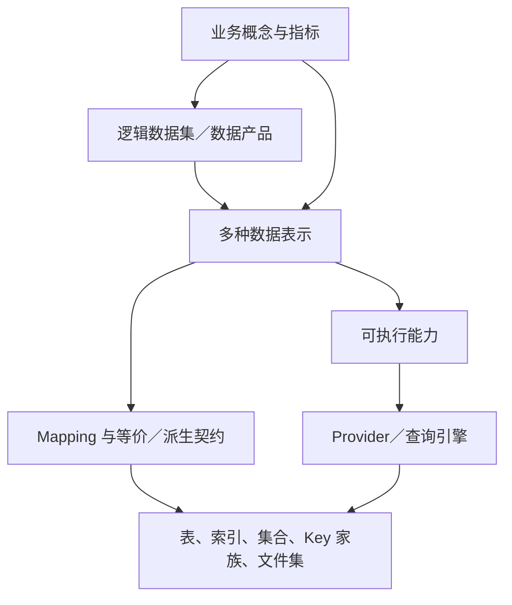
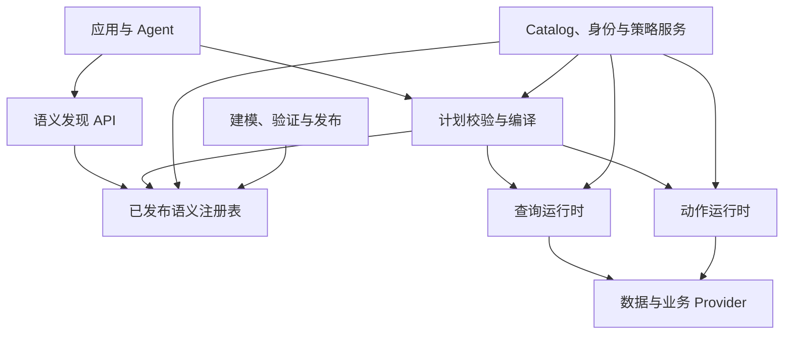
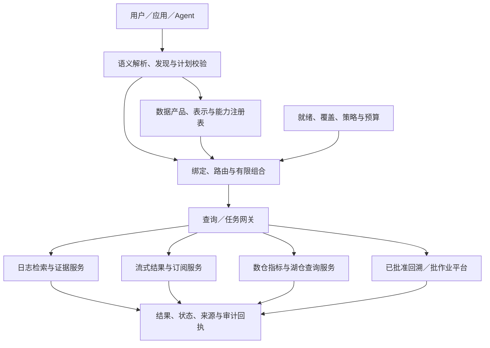
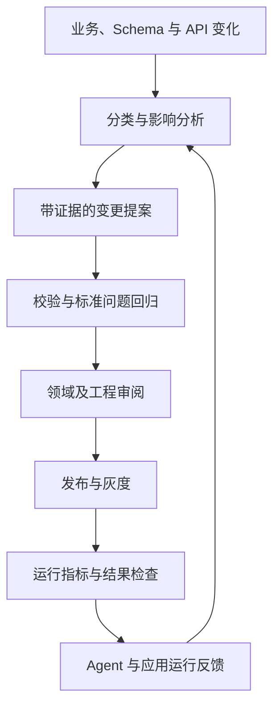
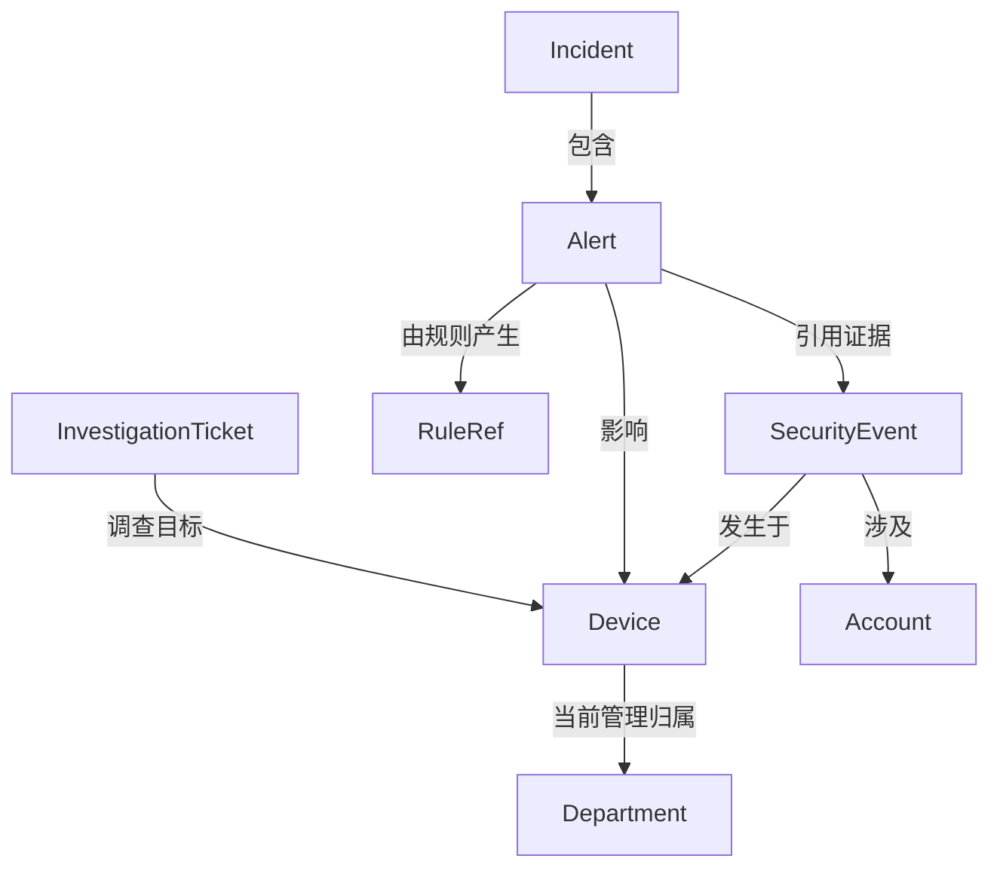

# 企业本体服务建设指南：从业务语义到可执行契约

> 修订版：v7（中文审阅版） · 资料核对日期：2026-10-15  
> 文档性质：概念讲解、架构设计与实施指南，可作为项目立项和设计评审的基线。  
> 适用对象：领域负责人、架构师、数据平台、业务服务、规则引擎及 AI Agent 开发团队。  
> 阅读说明：第 1—4 章建立概念与取舍；第 5—13 章描述工程设计；第 14—18 章指导建设、验证和评审。v6 补充多存储／多表示；v7 重点为 4.4—4.5、8.21—8.25、9.8—9.10、10.11—10.15、15.8—15.9 与 16.7—17.8，说明如何复用成熟检索、流、批和湖仓平台。
> 版本与语言：文件名 `ontology_ai_data_service_architecture.v7.zh-CN.md`；本次只修订中文，英文版待核对后同步。
> 引用说明：“参考资料 S1”等表示第 19 章的资料编号，S 为 Source，不是章节号。

## 目录

- [1. 建设目标与本次修订](#s1)
  - [1.1 应交付什么](#section-1-1)
  - [1.2 v5 已完成的概念修正](#section-1-2)
  - [1.3 事实、建议和待验证事项](#section-1-3)
  - [1.4 v6 修订范围：面向企业多存储和多种数据形态](#section-1-4)
  - [1.5 v7 修订范围：复用 PB 检索、流式规则、T+1 数仓与 Lakehouse](#section-1-5)
- [2. 本体到底是什么：概念、模型与服务的边界](#s2)
  - [2.1 从工程视角理解本体](#section-2-1)
  - [2.2 三个不同层次](#section-2-2)
  - [2.3 与相邻系统的关系](#section-2-3)
  - [2.4 约束、推理与数据校验不是同一件事](#section-2-4)
- [3. 公开实践：可以借鉴什么，不能推导什么](#s3)
  - [3.1 Palantir：运营本体与分工明确的后端](#section-3-1)
  - [3.2 dbt MetricFlow：语义关系需要考虑聚合安全](#section-3-2)
  - [3.3 Snowflake：分析语义定义与已验证问题](#section-3-3)
  - [3.4 Databricks：可复用指标与治理](#section-3-4)
  - [3.5 DataHub：先定义元数据模型，再建设服务](#section-3-5)
  - [3.6 Microsoft GraphRAG：文本抽取与权威事实之间有距离](#section-3-6)
  - [3.7 能归纳出的建设原则](#section-3-7)
- [4. 选择建设形态：语义控制面、分析语义层与运营本体](#s4)
  - [4.1 三种形态](#section-4-1)
  - [4.2 推荐起点](#section-4-2)
  - [4.3 哪些需求推动升级为运营本体](#section-4-3)
  - [4.4 平台已成熟时，建设目标要转为语义整合与能力复用](#section-4-4)
  - [4.5 五个能力面：分别负责什么](#section-4-5)
- [5. 领域建模：对象、属性、关系、事件、指标与规则](#s5)
  - [5.1 从任务和业务问题出发](#section-5-1)
  - [5.2 元模型](#section-5-2)
  - [5.3 概念 ID 与显示名称分离](#section-5-3)
  - [5.4 属性不仅需要基本类型](#section-5-4)
  - [5.5 关系需要建模角色和有效期](#section-5-5)
  - [5.6 事件与状态分离](#section-5-6)
  - [5.7 指标要明确粒度和可加性](#section-5-7)
  - [5.8 规则的合理边界](#section-5-8)
  - [5.9 扩充元模型：计算能力、数据产品与执行实例](#section-5-9)
  - [5.10 原始事件、检测结论、离线指标和调查认定分别建模](#section-5-10)
- [6. 对象身份：跨系统映射、消歧、合并与拆分](#s6)
  - [6.1 为什么身份是第一优先级](#section-6-1)
  - [6.2 身份映射记录](#section-6-2)
  - [6.3 概念解析与实例查找](#section-6-3)
  - [6.4 合并、拆分与历史重放](#section-6-4)
- [7. 时间与事实：当前状态、历史状态与知识证据](#s7)
  - [7.1 至少区分四种时间](#section-7-1)
  - [7.2 相对时间必须冻结为确定区间](#section-7-2)
  - [7.3 历史关系与双时间](#section-7-3)
  - [7.4 新鲜度不等于结果完整性](#section-7-4)
  - [7.5 推断事实与文本证据](#section-7-5)
  - [7.6 业务日期、可查询时刻、就绪时刻与修订时刻](#section-7-6)
  - [7.7 初步、稳定、已发布和已修订是不同结果状态](#section-7-7)
- [8. 异构数据资产、数据表示与 Mapping：描述、选择和使用多源数据](#s8)
  - [8.1 问题定义：描述的不是“数据库清单”，而是数据的多种业务表示](#section-8-1)
  - [8.2 建立六类关联对象](#section-8-2)
  - [8.3 先按表示形态分类，再看数据库产品](#section-8-3)
  - [8.4 各数据源的登记单元与接入边界](#section-8-4)
  - [8.5 一个业务事实有多个表示：具体怎么登记](#section-8-5)
  - [8.6 Representation Contract：必须声明的字段](#section-8-6)
  - [8.7 定义契约与运行状态分离](#section-8-7)
  - [8.8 字段映射之外，还要声明行是怎么来的](#section-8-8)
  - [8.9 多种表示的关系：不要只记录相同字段](#section-8-9)
  - [8.10 预聚合如何描述，以及何时可用](#section-8-10)
  - [8.11 聚合状态的可合并性与信息损失](#section-8-11)
  - [8.12 冗余副本、互补分区与不同对象：三种组合规则](#section-8-12)
  - [8.13 热冷拼接和近实时缺口](#section-8-13)
  - [8.14 覆盖、新鲜度、保留期与可用性分别计算](#section-8-14)
  - [8.15 加工与复制链路也是资产关系的一部分](#section-8-15)
  - [8.16 Connector、Adapter、Provider 三个职责](#section-8-16)
  - [8.17 查询能力应按访问路径登记](#section-8-17)
  - [8.18 原生差异如何归一化](#section-8-18)
  - [8.19 什么时候应该物化新的表示](#section-8-19)
  - [8.20 落地交付物：每个资产至少交出一张“可使用说明”](#section-8-20)
  - [8.21 PB 级日志检索：登记查询语义和搜索覆盖](#section-8-21)
  - [8.22 流式规则引擎：作为持续产生事实的 Provider](#section-8-22)
  - [8.23 T+1 数仓：复用已有业务口径和发布体系](#section-8-23)
  - [8.24 Lakehouse：把表格式、Catalog、引擎和服务分开](#section-8-24)
  - [8.25 表级快照、跨表发布与可复现边界](#section-8-25)
- [9. 参考架构与最小工程实现](#s9)
  - [9.1 逻辑架构](#section-9-1)
  - [9.2 最小部署建议](#section-9-2)
  - [9.3 元数据存储设计](#section-9-3)
  - [9.4 发布包与运行时隔离](#section-9-4)
  - [9.5 依赖管理](#section-9-5)
  - [9.6 多源接入后的组件扩展](#section-9-6)
  - [9.7 三条并行但不同的链路](#section-9-7)
  - [9.8 成熟平台上的能力接入架构](#section-9-8)
  - [9.9 三种计划和两个发布周期](#section-9-9)
  - [9.10 优先集成已有治理系统](#section-9-10)
- [10. 语义计划与编译：从任务意图到执行计划](#s10)
  - [10.1 本体不应依赖 LLM 完成正确性校验](#section-10-1)
  - [10.2 建议编译过程](#section-10-2)
  - [10.3 IR 的分层](#section-10-3)
  - [10.4 示例计划](#section-10-4)
  - [10.5 计划解释与限制](#section-10-5)
  - [10.6 编译后的版本与时效](#section-10-6)
  - [10.7 多表示规划：先证明可回答，再比较成本](#section-10-7)
  - [10.8 Provider 能力配置示例](#section-10-8)
  - [10.9 有限跨源执行模板](#section-10-9)
  - [10.10 路由解释、失败与降级](#section-10-10)
  - [10.11 路由增加四个维度：事实等级、结果成熟度、执行模式与可复现性](#section-10-11)
  - [10.12 将同步查询、异步任务和持续订阅分开](#section-10-12)
  - [10.13 在 PB 规模下采用有界、渐进的调查计划](#section-10-13)
  - [10.14 流批结果结合：可比不等于可相加](#section-10-14)
  - [10.15 历史回溯需要独立语义，而非重跑当前代码](#section-10-15)
- [11. 运行时接口与 Agent 接入](#s11)
  - [11.1 最小 API 集合](#section-11-1)
  - [11.2 渐进式发现](#section-11-2)
  - [11.3 可信上下文](#section-11-3)
  - [11.4 MCP 和 Skill](#section-11-4)
  - [11.5 结构化错误](#section-11-5)
  - [11.6 为 Agent 暴露“可回答范围”，而非数据库万能入口](#section-11-6)
  - [11.7 面向成熟执行平台的任务接口](#section-11-7)
- [12. 动作执行：事务、幂等、授权与审批](#s12)
  - [12.1 动作是一等能力，但执行责任明确](#section-12-1)
  - [12.2 动作契约示例](#section-12-2)
  - [12.3 预览不是提交](#section-12-3)
  - [12.4 幂等和超时](#section-12-4)
  - [12.5 跨系统事务与补偿](#section-12-5)
  - [12.6 查询授权、作业授权与规则发布分别控制](#section-12-6)
- [13. 安全、可信结果与运行保障](#s13)
  - [13.1 权限执行链](#section-13-1)
  - [13.2 聚合、关系和缓存泄露](#section-13-2)
  - [13.3 提示注入与不可信文本](#section-13-3)
  - [13.4 可信结果封装](#section-13-4)
  - [13.5 否定答案的条件](#section-13-5)
  - [13.6 运行时保障](#section-13-6)
  - [13.7 容量与性能预算](#section-13-7)
  - [13.8 多表示结果的证据与精度](#section-13-8)
  - [13.9 删除、权限变化与冗余副本治理](#section-13-9)
  - [13.10 多源可用性与容量指标](#section-13-10)
  - [13.11 结果回执应记录能力、发布及运行版本](#section-13-11)
  - [13.12 控制资源、导出和长期运行成本](#section-13-12)
- [14. 版本、发布与持续演进](#s14)
  - [14.1 不可变版本与原子发布](#section-14-1)
  - [14.2 兼容性分类](#section-14-2)
  - [14.3 回退边界](#section-14-3)
  - [14.4 影响分析](#section-14-4)
  - [14.5 双向演进](#section-14-5)
  - [14.6 反馈治理](#section-14-6)
  - [14.7 多源版本还需要固定哪些内容](#section-14-7)
  - [14.8 规则、数据产品和语义发布的协同版本](#section-14-8)
- [15. 贯穿案例：安全分析与事件调查](#s15)
  - [15.1 第一阶段业务范围](#section-15-1)
  - [15.2 概念与关系](#section-15-2)
  - [15.3 标准问题](#section-15-3)
  - [15.4 端到端流程](#section-15-4)
  - [15.5 三种结果必须分别解释](#section-15-5)
  - [15.6 与现有规则引擎的接入](#section-15-6)
  - [15.7 多存储案例：同一登录事件在不同系统中如何被使用](#section-15-7)
  - [15.8 贯穿四类平台的调查任务](#section-15-8)
  - [15.9 三个容易误答的问题](#section-15-9)
- [16. 分阶段实施路线与团队责任](#s16)
  - [16.1 阶段划分](#section-16-1)
  - [16.2 第一版建议范围](#section-16-2)
  - [16.3 责任分配](#section-16-3)
  - [16.4 投入与价值核算](#section-16-4)
  - [16.5 按数据集接入，而非一次性接通所有数据库](#section-16-5)
  - [16.6 接入优先级与扩展成本](#section-16-6)
  - [16.7 面向已有平台的接入顺序](#section-16-7)
  - [16.8 新增责任与交付物](#section-16-8)
- [17. 测试、评测与验收标准](#s17)
  - [17.1 建立独立的标准问题集](#section-17-1)
  - [17.2 必测场景](#section-17-2)
  - [17.3 分层指标](#section-17-3)
  - [17.4 试点验收建议](#section-17-4)
  - [17.5 异构数据和多表示专项测试](#section-17-5)
  - [17.6 v6 增加的验收条件](#section-17-6)
  - [17.7 平台能力组合专项验收](#section-17-7)
  - [17.8 v7 试点退出条件](#section-17-8)
- [18. 关键架构决策与落地评审清单](#s18)
  - [18.1 建议记录的 ADR](#section-18-1)
  - [18.2 设计评审检查表](#section-18-2)
  - [18.3 必须在项目开始时回答的未决问题](#section-18-3)
  - [18.4 多存储场景补充评审](#section-18-4)
  - [18.5 成熟数据平台补充评审](#section-18-5)
- [19. 参考资料与证据对应](#s19)
- [20. 术语速查](#s20)

---

<a id="s1"></a>
## 1. 建设目标与本次修订

<a id="section-1-1"></a>
### 1.1 应交付什么

本体建设的目标，是让业务应用和 Agent 能以稳定、可治理的业务概念，发现数据、理解关系、选择能力，并获得可解释的执行结果。

交付物不能仅是一张概念关系图或一组 Entity JSON。一个可运行的最小闭环应包含：

1. 一个有责任人、有版本的领域模型；
2. 一组经过验证的对象身份、关系、时间和指标定义；
3. 可以执行的数据映射与能力绑定；
4. 一个能拒绝错误计划的确定性校验与编译过程；
5. 一套在执行端生效的权限与动作控制；
6. 一组标准问题、标准计划及标准结果；
7. 一条可发布、可回退、可审计的变更链路。

例如，“查询某个设备过去一小时关联的告警”，必须明确设备如何识别、关联在哪个时间点有效、告警如何定义、查询使用什么时间、哪些结果可见，以及没有返回数据意味着什么。

<a id="section-1-2"></a>
### 1.2 v5 已完成的概念修正

保留原文的核心思路：业务语义与物理结构分离；明确 Mapping 和能力契约；图数据库按需引入；渐进式发现；版本治理；外部变化与运行反馈共同推动演进。

本版重点修正和补充：

| 原文中的表达或不足 | 本版处理 |
|---|---|
| 本体服务必然是“薄语义控制面” | 改为适合已有数据与业务服务的默认起点；允许运营本体和对象服务形态 |
| 类、属性、关系、实例四要素足以指导建设 | 补充对象身份、事件、时间、指标、规则引用、能力和发布契约 |
| Knowledge Graph 等于 Ontology 加实例 | 改为常见组织方式；知识图谱可能没有显式形式本体，二者不是严格集合等式 |
| 多个客户标识可以统一 | 先验证标识的范围、主体含义和身份映射，禁止仅凭名称或格式合并 |
| 语义关系可以转换为 join | 区分业务关系、可执行路径与聚合安全性；增加粒度和扇出校验 |
| 用姓名解析具体客户 | 区分“概念解析”和“对象检索”；具体对象由数据能力检索并消歧 |
| 权限和约束由语义校验完成 | 增加执行时重新授权、数据完整性判定和业务服务原子前置条件 |
| 查询无结果可作为否定结论 | 区分完整结果、部分结果、数据缺失和不可判定 |

<a id="section-1-3"></a>
### 1.3 事实、建议和待验证事项

本文使用三类表述：

- **公开实践**：由第 19 章一手资料支持，说明对应产品或标准做了什么。
- **本文建议**：结合这些实践提出的参考设计；不是厂商统一标准，也不是行业唯一最佳方案。
- **示例／建议目标**：自定义 DSL、API、容量和验收数字，仅用于设计讨论，需要本地验证。

本文不是任何厂商产品的完整复刻，也不承诺本体能自动解决数据质量、实体匹配或自然语言理解问题。其价值是让这些问题变得显式、可测量、可治理。

<a id="section-1-4"></a>
### 1.4 v6 修订范围：面向企业多存储和多种数据形态

本次把 Redis、MySQL、ES、ClickHouse、MongoDB、TiDB、Doris、HBase、Cassandra、HDFS 纳入预期接入范围，但不按产品名称拆成十套业务本体。文档以同一业务事实的不同 Representation 为核心，新增：

- 概念、逻辑数据集、数据表示、物理资产、Mapping、能力六类对象。
- 各源的资产登记单元、访问路径和语义边界。
- 副本、搜索投影、宽表、当前状态、历史、聚合、摘要和归档的描述方式。
- 表示之间的等价／派生／覆盖关系，及选择、拼接和富化规则。
- 聚合可推导性、精确／近似、热冷重叠、数据缺口、更新删除传播。
- 基于可回答性与真实覆盖的计划路由，以及接入步骤和专项验收。

实现顺序是：先描述一个真实数据集的明细、冗余和聚合，再验证查询闭环；不是先把所有数据库驱动连一遍。第 8 章的契约和第 10 章的路由是相互依赖的：有元数据而无执行能力不能落地，有连接器而无语义判定不能保证结果正确。

<a id="section-1-5"></a>
### 1.5 v7 修订范围：复用 PB 检索、流式规则、T+1 数仓与 Lakehouse

v6 回答“数据在多个地方以不同形态存放，如何描述和使用”；v7 进一步回答“已有成熟加工与查询平台，如何在业务语义上发现、选择、协同并解释其结果”。

本次新增能力面划分、计算与数据产品元模型、业务就绪和结果成熟度、湖表版本契约、交互／异步／订阅模式、受控历史回溯、流批比较以及平台职责和验收。重点不是增加另一套计算引擎，而是建立可验证的跨平台语义连接。

本文以用户给定的能力类型为架构输入，尚未获得实际日志引擎接口、规则 DSL、调度／质量元数据及湖表格式配置。所有能力矩阵和示例契约仍需与真实系统对照确认，不把“PB 级”“T+1”“Lakehouse”等标签当作完整性、时延或一致性保证。

<a id="s2"></a>
## 2. 本体到底是什么：概念、模型与服务的边界

<a id="section-2-1"></a>
### 2.1 从工程视角理解本体

本体是对某个领域概念、属性、关系及其含义和约束的显式描述。它回答“这个业务世界中有什么，以及它们意味着什么”。

例如，安全分析中有 Device、Account、SecurityEvent、Alert、Incident。Account 登录 Device 是关系；一次登录是事件；异常登录规则可以产生 Alert；多个 Alert 经过调查形成 Incident。它们不能因为存放在同一张表里就变成同一种对象。

本体不是自然语言说明书的简单集合。至少应有稳定标识、可检查的类型、明确的关系端点和适用范围，使程序能够判断一个计划是否有意义。

同时，企业工程中的“本体”不一定需要完整 OWL 形式语义。可先使用受约束的类型模型和契约；需要形式推理、行业交换时再选择 RDF、OWL、SHACL 等标准。

<a id="section-2-2"></a>
### 2.2 三个不同层次

| 层次 | 回答的问题 | 示例 |
|---|---|---|
| 业务本体 | 概念是什么，含义与关系是什么？ | Device、Account、登录关系 |
| 可执行语义模型 | 如何从数据得到这些概念，允许哪些运算？ | 设备标识映射、事件时间字段、告警统计口径 |
| 本体平台／本体服务 | 如何管理、发布、发现和使用模型？ | 元数据 API、编译器、对象服务、动作运行时 |

必须区分这些层次，否则容易把“是否应建立统一对象索引”误当成“是否需要本体”的问题。

<a id="section-2-3"></a>
### 2.3 与相邻系统的关系

| 系统／概念 | 主要职责 | 与本体服务的连接 |
|---|---|---|
| Schema | 单个接口或存储的结构 | 被 Mapping 引用和校验 |
| Catalog | 数据资产发现、Owner、技术元数据 | 提供稳定资产 ID 和技术事实 |
| Lineage | 数据加工与依赖链 | 支撑来源说明和变更影响分析 |
| MDM／实体解析 | 主数据与跨系统身份对应 | 提供对象 ID、别名及合并记录 |
| Knowledge Graph | 用图组织事实及关系 | 可承载实例与关系，也可作为检索索引 |
| 指标语义层 | 度量、维度、粒度与聚合 | 作为分析能力复用，避免重复定义指标 |
| 规则引擎 | 谓词、复杂条件、CEP 和业务决策 | 规则输入输出绑定本体；记录规则版本 |
| 工作流／业务服务 | 状态转换、事务、业务副作用 | 作为动作能力 Provider |
| MCP／REST／gRPC | 能力调用协议 | 承载发现和调用接口，本身不定义业务语义 |
| Skill | 任务步骤、策略与使用方法 | 指导如何使用本体和业务能力 |

Knowledge Graph 经常由概念模型加实例事实组织而成，但也存在从文本抽取、没有严格显式本体的图。图数据库是一种存储选择，本体是一种语义组织方式。

<a id="section-2-4"></a>
### 2.4 约束、推理与数据校验不是同一件事

OWL 采用开放世界假设：缺少某条事实通常意味着未知，而非自动为假。[参考资料 S9](#s19) 因此，“没有找到设备 Owner”不能仅凭本体推理认定设备无 Owner。

SHACL 为 RDF 图提供约束校验；对于非 RDF 接口，可使用 JSON Schema 加自定义校验。[参考资料 S10](#s19) 要注意：使用 SHACL 不代表所有数据都默认禁止额外属性，是否关闭形状需要明确配置；校验也依赖被送入验证的图是否完整。

本文建议把约束分成四类：

| 类型 | 例子 | 主要执行位置 |
|---|---|---|
| 结构约束 | ID 必填、字段类型合法 | 发布校验、接口校验、数据摄取 |
| 数据约束 | 同租户内 ID 唯一、关系端点存在 | 数据质量、业务存储、对象服务 |
| 语义约束 | 金额不可跨币种直接相加 | 编译器、指标引擎 |
| 业务前置条件 | 已关闭工单不可重复关闭 | 业务服务事务内 |

定义约束不等于执行了约束。每条约束必须记录执行者、时机、覆盖范围、违反后的处理方式和最近验证结果。

<a id="s3"></a>
## 3. 公开实践：可以借鉴什么，不能推导什么

<a id="section-3-1"></a>
### 3.1 Palantir：运营本体与分工明确的后端

**公开实践：**Foundry 将对象、属性、关系与动作联系起来；其后端区分 Ontology Metadata Service、对象数据库、Object Set Service、Actions 和数据索引链路。它包含实例存储、查询及修改能力，不只是元数据目录。[参考资料 S1–S3](#s19)

**本文建议：**借鉴稳定对象语义、读写能力分离和明确的运行时组件职责。是否建立统一对象存储，需要业务需求和成本证明。厂商内部动作的事务语义不能被推导为外部多个业务系统自动获得分布式原子事务。

<a id="section-3-2"></a>
### 3.2 dbt MetricFlow：语义关系需要考虑聚合安全

**公开实践：**MetricFlow 使用语义模型中的 entities 构建 join 路径，并依据实体类型限制可能产生 fan-out 或 chasm join 的组合。[参考资料 S4](#s19)

**本文建议：**把实体键、数据粒度和关联基数纳入编译；建立了“客户有订单”关系，并不意味着任意订单指标都能在任意路径上正确聚合。具体可用路径、跳数和语法随产品版本变化，项目应以部署版本为准。

<a id="section-3-3"></a>
### 3.3 Snowflake：分析语义定义与已验证问题

**公开实践：**Semantic Views 区分逻辑表、关系、facts、dimensions 和 metrics；Verified Query Repository 保存问题及相应 SQL，为自然语言查询提供经过验证的示例。[参考资料 S5–S6](#s19)

**本文建议：**本体的对象模型之外，应有明确的分析口径；把业务标准问题固化为测试资产。已验证 SQL 能提供参考，不能保证新问题、权限上下文和数据变化下的正确性。

<a id="section-3-4"></a>
### 3.4 Databricks：可复用指标与治理

**公开实践：**Unity Catalog metric views 提供可复用度量、建模和访问管理，并有面向 Agent 的名称、同义词等元数据。[参考资料 S7](#s19)

**本文建议：**若企业已使用这类能力，本体服务通过稳定引用和语义对齐复用它。指标定义应只有明确的权威维护位置，不能在 BI、Agent 提示词和本体文件里各复制一份。

<a id="section-3-5"></a>
### 3.5 DataHub：先定义元数据模型，再建设服务

**公开实践：**DataHub 强调 model-first；其元数据模型以 Entity、标识和 Aspects 组织资产信息。[参考资料 S8a–S8b](#s19)

**本文建议：**借鉴稳定标识和分块元数据设计。Catalog 提供物理资产事实，本体补充领域语义及执行契约；集成时允许同步服务所需投影，但必须记录权威来源和同步状态，避免无责任人的双写。

<a id="section-3-6"></a>
### 3.6 Microsoft GraphRAG：文本抽取与权威事实之间有距离

**公开实践：**GraphRAG 可从非结构化文本提取实体、关系和 claims，构建支持检索的索引。[参考资料 S11](#s19)

**本文建议：**把抽取结果视为带证据的候选知识。文本中“设备可能受攻击”与经规则命中、分析员确认的 Incident 是不同事实等级；不要把所有抽取关系直接写入运营本体。

<a id="section-3-7"></a>
### 3.7 能归纳出的建设原则

这些公开方案服务的目标不同，不能拼接成一套声称得到各家公司共同验证的架构。可以提炼的工程方向是：显式语义、稳定身份、受约束的关系和指标、读写能力契约、执行端治理，以及基于真实问题的持续验证。

后续章节是基于上述方向提出的设计方案，不是对厂商内部实现的描述。

<a id="s4"></a>
## 4. 选择建设形态：语义控制面、分析语义层与运营本体

<a id="section-4-1"></a>
### 4.1 三种形态

| 形态 | 核心交付 | 适合情况 | 主要成本 |
|---|---|---|---|
| 语义控制面 | 模型、Mapping、能力发现、校验与发布 | 已有成熟数据／业务服务，需要统一理解和接入 | 集成、契约和治理 |
| 分析语义层 | 指标、维度、join 规则、SQL 编译 | BI、自然语言分析与指标一致性 | 数据建模、口径治理、计算性能 |
| 运营本体平台 | 对象索引、关系查询、受控动作、应用接口 | 多应用围绕同一对象协作，需统一交互 | 数据同步、对象存储、安全、编辑与写回 |

它们可组合：控制面负责定义，指标引擎负责分析，对象服务承载选定场景。物理上可在一个产品中，逻辑上仍应明确责任。

<a id="section-4-2"></a>
### 4.2 推荐起点

对于已有流处理、规则引擎、告警平台和查询服务的团队，建议先对齐现有业务定义、指标与数据产品，建立缺失的领域模型及可执行能力契约；直接接入已有查询和动作 Provider。第一阶段不开发任意跨源 SQL 引擎，也不迁移全量实例。

当多个应用反复建设相同对象视图、源查询无法满足时延，或需要跨系统关系遍历时，可增加对象投影或关系索引。这里“薄”约束的是职责和耦合，不是绝对禁止缓存或实例索引。

<a id="section-4-3"></a>
### 4.3 哪些需求推动升级为运营本体

扩展前至少回答：

- 对象 API 被哪些应用复用？现有 Provider 不能满足什么？
- 哪些属性应物化？需要多快更新？删除如何传播？
- 用户编辑写入本体投影还是源系统？冲突如何处理？
- 如何处理重建期间的数据、权限和对象 ID？
- 性能、可用性提升是否足以承担同步和维护成本？

如果回答仅是“便于 Agent 理解”，通常还不足以证明需要统一对象数据库。

<a id="s4-platforms"></a>
<a id="section-4-4"></a>
### 4.4 平台已成熟时，建设目标要转为语义整合与能力复用

如果企业已具备 PB 级日志检索、流式规则计算、T+1 数仓和 Lakehouse，本体项目的主要缺口通常不再是缺少存储或执行引擎，而是缺少跨平台的业务含义、数据产品契约、能力发现、结果口径及版本治理。

此时推荐的目标是：**以领域本体定义业务世界，以数据产品定义可信输入输出，以能力契约连接已有执行平台，以语义计划选择和组合可用能力。**

需要调整 v6 的理解：Provider 不局限于数据库访问接口，也包括现成的日志检索服务、规则结果服务、数仓指标服务、湖表查询服务和离线回溯作业。第一阶段应优先接入这些服务，不绕过已有权限、资源管理和运维体系重新直连所有底层存储。

“薄控制面”仍可作为职责边界，但它不能只有概念目录。必须覆盖可回答性校验、数据就绪状态、计划绑定、执行回执和结果解释。执行调度与大规模计算则尽量委托已有平台。

<a id="section-4-5"></a>
### 4.5 五个能力面：分别负责什么

| 能力面 | 应复用的现有系统 | 本体层补充的契约 | 不应推导出的保证 |
|---|---|---|---|
| 日志检索 | PB 级检索引擎和检索服务 | 日志类型、字段语义、匹配方式、索引覆盖、检索限制、证据引用 | PB 容量不等于任意查询低时延、精确统计或无条件全量召回 |
| 流式检测 | 流计算规则／CEP 平台 | 规则输入输出、时间和窗口、规则／特征版本、命中语义、运行覆盖 | 未命中不等于无风险；状态 exactly-once 不等于所有外部副作用 exactly-once |
| 离线分析 | T+1 数仓、调度、质量及指标体系 | 业务日期、发布批次、就绪条件、权威指标、维度历史口径 | T+1 标签不等于每天准时完成，也不表示今天有完整数据 |
| 湖仓查询 | 湖表格式、Catalog、查询／作业引擎 | 表身份、快照／版本、schema、支持操作、资源域、保留边界 | 有湖表快照不等于跨表共同快照，更不等于跨所有系统一致 |
| 业务操作 | 领域服务与工作流 | 目标、授权、前置条件、幂等、事务和审批 | 读分析结果自动授权写操作 |

其中流、批、交互是计算方式，Lakehouse 是体系结构，数据库是存储／服务产品。这些不是互斥选项，不能作为同一列的简单替代品进行优先级排序。

<a id="s5"></a>
## 5. 领域建模：对象、属性、关系、事件、指标与规则

<a id="section-5-1"></a>
### 5.1 从任务和业务问题出发

第一轮建模输入应是 10—30 个代表性问题、几个真实动作流程以及现有数据和服务。既不能直接复制表结构，也不能脱离已有数据设计一个无法执行的理想世界。

例：“查设备近期是否存在异常登录。”需要追问：设备指终端还是网络地址？近期使用什么时间？异常是规则命中还是分析员认定？登录失败是否计算？查询者可见哪个租户？这些答案决定模型。

<a id="section-5-2"></a>
### 5.2 元模型

建议初始元模型如下，字段名称为本文自定义：

| 类型 | 最低必需信息 |
|---|---|
| Domain | 稳定 ID、Owner、边界、依赖 |
| EntityType | 定义、身份规则、生命周期、属性集合 |
| Property | 类型、含义、单位、可空性、敏感性、时间模式 |
| RelationType | 端点、方向、基数、时效、证据、允许用途 |
| EventType | 事件 ID、参与对象、发生／处理时间、事件来源 |
| Metric | 基础粒度、过滤、聚合、维度、时间口径、单位 |
| Constraint | 约束表达、执行点、级别、违反处理 |
| LogicalDataset／DataProduct | 逻辑数据集合、权威口径、责任人、数据契约 |
| Representation | 形态、粒度、范围、字段覆盖、来源、聚合状态、时间与能力 |
| PhysicalAssetRef | Catalog 资产标识、结构版本与物理代次引用 |
| Mapping | 数据表示与字段／身份／转换／过滤的可验证绑定 |
| RepresentationRelation | 副本、投影、聚合、分区等关系及证明条件 |
| CapabilityProfile | 实际访问路径、必要绑定、原生语义、预算与验证配置 |
| Capability | 输入输出、Provider、权限、成本、读写特性 |
| RuleRef | 规则系统 ID、版本、输入输出语义、适用条件 |
| Release | 依赖版本、校验报告、批准记录、校验和 |
| ComputationDefinition／ExecutionRun | 加工／规则／查询模板定义及具体运行实例 |
| ServingPublication | 业务日期、范围、就绪、数据批次及修订发布 |
| Subscription | 持续结果消费的授权、起点、交付及生命周期 |

规则和指标是企业可执行语义的一部分，不意味着所有逻辑都要由本体服务内部执行。

<a id="section-5-3"></a>
### 5.3 概念 ID 与显示名称分离

建议使用稳定 ID，例如 `sec:Device`、`sec:Account`、`sec:Device.managedBy`。中文名、同义词和描述可以修改，稳定 ID 不随展示名称变更。

同名不一定同义：“客户”可能分别指合同客户、联系人和访问用户。先在领域内定义，再以显式跨域映射关联。共享模型应尽量小，例如 Organization、时间和单位；不要强迫所有部门共用一个无边界的 Customer。

<a id="section-5-4"></a>
### 5.4 属性不仅需要基本类型

`amount: decimal` 不够，还需要币种、精度和金额口径；`timestamp: long` 不够，还需要时区、单位和业务时间含义。

语义类型可以建立在基本类型上：`DeviceId`、`TenantId`、`IPAddress`、`Money`、`EventInstant`。ID 应有类型，避免拿 AccountId 填入 DeviceId。

必须显式区分：缺失、未知、不适用、因权限遮蔽。接口可通过状态字段表达；不能统一把它们变成空字符串或 0。

<a id="section-5-5"></a>
### 5.5 关系需要建模角色和有效期

例如“账户使用设备”可能是最近观察到的关系，不是永久归属。它至少需要时间范围、观察证据和来源。“设备属于部门”则可能由 CMDB 的历史归属记录确定。

关系字段建议包括：

```yaml
id: sec:Device.managedBy
from: sec:Device
to: org:Department
cardinality:
  fromTo: zero_or_one
  toFrom: zero_or_many
validity: interval
meaning: 在指定有效时刻负责管理该设备的部门
executionPathRef: device-department-history-v1
```

方向改变时基数也改变。基数声明还需要数据验证，不能只是文档中的愿望。

<a id="section-5-6"></a>
### 5.6 事件与状态分离

“发生一次账户登录”是事件；“设备当前在线”是状态；“设备曾被隔离”是动作历史。状态可以由事件推导，但必须记录推导规则、迟到处理和重建策略。

建议对事实标注 `observed`、`derived`、`inferred`、`human_confirmed` 等类别，并保留证据。它们不是一条可互相覆盖的置信度轴。

<a id="section-5-7"></a>
### 5.7 指标要明确粒度和可加性

“告警数”必须确定是在告警 ID、规则命中记录还是事件行上计数。“异常设备数”通常按 Device 去重，不能把每日去重设备数直接相加得到月去重设备数。

每个指标至少定义：基础粒度、过滤、去重键、聚合方式、时间字段、时区、允许维度、单位及版本。

扇出例子：一个订单金额为 100 元，关联两条告警。直接 join 后 SUM(order.amount) 得到 200 元。关系语义正确，指标仍然错误。编译器应选用 EXISTS、先聚合再 join、受支持的去重策略，或拒绝该路径；不能依靠最后 SELECT DISTINCT 修正所有聚合。

<a id="section-5-8"></a>
### 5.8 规则的合理边界

简单类型和静态范围约束可在模型中表达；复杂风险判断、CEP、跨事件关联交给规则引擎。模型记录规则 ID、版本、输入字段语义、输出事实类别及时间模型。

“未命中规则”不等于“无风险”；可能是无数据、规则未覆盖或计算尚未完成。规则结果也需要完整性和覆盖说明。

<a id="section-5-9"></a>
### 5.9 扩充元模型：计算能力、数据产品与执行实例

在 v6 的资产和表示模型上，补充以下逻辑对象：

| 对象 | 含义 | 至少记录 |
|---|---|---|
| DataProduct | 供消费的有责任人数据／指标／结果集合 | 业务定义、输入输出、质量、就绪、维护与服务契约 |
| ComputationDefinition | 规则、SQL 模型、批作业或已批准查询模板 | 稳定 ID、版本、输入、输出表示、时间与修订语义 |
| ExecutionCapability | 现有平台暴露的可调用能力 | 模式、必需输入、可执行范围、预算、授权与 Provider |
| ExecutionRun | 某次查询、重放或作业的实际执行 | runId、绑定版本、输入快照、状态、成本、输出和回执 |
| ServingPublication | 可供业务消费的一次数据产品发布 | businessDate、批次、就绪、验证、覆盖与修订版本 |
| Subscription | 经批准的持续结果订阅 | 结果语义、起点、重放／去重、交付、续期与停止策略 |

这些可以引用既有平台对象，而非建立第二套调度元数据库。ComputationDefinition 是定义，ExecutionRun 是运行实例，ServingPublication 是业务可消费的结果发布；作业成功不自动等于结果已发布。

本体发布 Release 与数据产品 Publication 也不同：前者固定语义和能力契约；后者说明某业务日期、范围和数据版本已达到消费条件。

<a id="section-5-10"></a>
### 5.10 原始事件、检测结论、离线指标和调查认定分别建模

同一业务链路上至少可能有：原始日志、规范事件、规则命中、告警、分析特征、指标、人工认定事故。不要因它们有相同设备 ID，就当作同一事实的不同副本。

建议同时维护两类关系：

- **数据派生关系**：哪份输入经哪个加工版本形成哪份输出，用于重算、血缘和影响分析。
- **业务证据关系**：哪些日志／事件支撑某条告警、哪些告警参与事故认定，用于调查和解释。

一次 CEP 命中可能对应多条事件，一条事件也可能参与多次命中。因此“日志数”“事件数”“命中数”“告警数”“事故数”是不同指标，除非有明确业务定义和映射，不能互换。

<a id="s6"></a>
## 6. 对象身份：跨系统映射、消歧、合并与拆分

<a id="section-6-1"></a>
### 6.1 为什么身份是第一优先级

业务对象没有稳定身份，关系、去重、历史查询和动作目标都会不可靠。`client_no` 与 `party_id` 可能分别代表合同主体与自然人，不能简单归一成 customerId。

建议对象引用包含租户、领域类型和规范 ID：

```json
{"tenantId":"t1","typeId":"sec:Device","objectId":"d-1024"}
```

该格式是本文接口示例。规范 ID 可以复用已有主数据 ID；只有需要跨系统统一身份时才建立身份映射服务。

<a id="section-6-2"></a>
### 6.2 身份映射记录

| 字段 | 含义 |
|---|---|
| canonicalObjectRef | 规范对象引用 |
| sourceSystem／sourceKey | 源系统和原始标识 |
| validFrom／validTo | 对应关系有效期 |
| mappingStatus | confirmed、candidate、rejected 等 |
| method／evidenceRef | 匹配方式和证据 |
| identityVersion | 映射版本 |
| reviewer | 必要时的确认责任人 |

对于设备，IP 可重复分配，主机名可重复，MAC 也可能不可靠；不应默认作为永久身份。账户 ID 也应包含认证域或租户范围。

<a id="section-6-3"></a>
### 6.3 概念解析与实例查找

`resolveConcept("设备")` 返回 EntityType；`searchObjects(type=Device, name="终端A")` 返回受权限约束的实例候选。姓名、主机名和电话号码通常不是唯一键。

发生歧义时，查询可要求进一步消歧；动作必须使用已确认的规范对象引用，不能由模型挑选“最像的一个”。

<a id="section-6-4"></a>
### 6.4 合并、拆分与历史重放

合并对象后保留别名、原 ID 和变更记录；拆分需要重评关系归属。不可静默重写历史动作日志的目标。

项目要明确：历史报告按当时身份解释，还是按当前身份重算。两者均可，但必须提供明确模式和 identityVersion。动作服务还应检查对象引用是否已停用或被重定向。

<a id="s7"></a>
## 7. 时间与事实：当前状态、历史状态与知识证据

<a id="section-7-1"></a>
### 7.1 至少区分四种时间

| 时间 | 意义 | 典型用途 |
|---|---|---|
| eventTime | 业务事件发生时间 | “昨天发生的登录” |
| processingTime | 系统处理或计算时间 | “最近一小时处理的规则命中” |
| validTime | 属性或关系在现实业务中有效的时间 | 事件发生时设备所属部门 |
| recordedTime | 系统记录／获知事实的时间 | 追溯某时刻系统知道什么 |

把所有时间统一叫 timestamp，会使查询结果正确但解释错误。

如果现有规则引擎使用 calculate time，模型应诚实标为处理／计算时间。不能仅在 Mapping 中换一个名字就变成 event time；若迁移，需评估迟到、乱序、watermark 和历史结果变化。

<a id="section-7-2"></a>
### 7.2 相对时间必须冻结为确定区间

“最近一小时”在请求入口以服务端可信时钟和业务时区解析，形成固定的 `[start, end)` 区间，整个计划复用同一时刻。不要让各 Provider 独立计算 now。

一个合理的选择是 UTC 存储绝对时刻、业务时区解释自然日。“过去 24 小时”与“昨天”不是同一条件。

<a id="section-7-3"></a>
### 7.3 历史关系与双时间

事件归属查询需要按 eventTime 匹配部门关系的 validTime，不能默认使用设备当前部门。对于事后修正的归属记录，如需回答“当时系统认为什么”，还需要 recordedTime。

双时间管理仅在业务需要时引入。第一期若只支持当前状态，也应明确 `temporalMode: current_only`，对历史问题返回不支持，而非用当前值冒充历史。

<a id="section-7-4"></a>
### 7.4 新鲜度不等于结果完整性

新鲜度说明数据更新有多近；完整性说明指定范围内是否已覆盖应有数据。数据源刚更新，仍可能漏采；事件时间很旧，也可能刚被补录。

结果至少区分：

- `freshnessStatus`：是否满足更新延迟目标；
- `coverage`：已完成的时间区间、分区或 watermark；
- `completeness`：complete、partial、unknown；
- `lateDataPolicy`：迟到后是否修正和如何通知。

没有 watermark 或对账信息时，不应编造完整性保证。

<a id="section-7-5"></a>
### 7.5 推断事实与文本证据

文档抽取、模型推断和规则派生都需保留证据、算法或规则版本及适用时间。置信度若存在，要注明它是实体匹配评分、抽取评分还是其他指标；这些分数不能混用，也不自动等于概率。

对于事实冲突，不使用“最新写入值总是正确”的默认策略。来源权威、有效时间、业务用途和验证状态应共同决定选择。

<a id="section-7-6"></a>
### 7.6 业务日期、可查询时刻、就绪时刻与修订时刻

T+1 和湖仓环境还需区分：

- businessDate：事实／指标归属的业务日期，包含日历、时区及营业日规则。
- availableAt：某份输入或结果何时可被某能力读取。
- readyAt：该业务范围通过哪些检查后可正式消费。
- revisedAt：迟到、补数、删除或规则修订何时形成新版本。

例如业务日 10 月 14 日的数据，可能在 15 日上午任务成功，但直到源对账、维度依赖和质量验证完成才发布。11:00 查询时若仍未就绪，应返回“14 日数据待发布”，不能把空分区解释为零。

“昨天的数据”通常是请求业务日期；“最新已发布完整日”则可能回退到更早日期，只有用户意图或批准的产品策略允许才可采用，并显式说明实际日期。

<a id="section-7-7"></a>
### 7.7 初步、稳定、已发布和已修订是不同结果状态

建议按产品契约定义 provisional、stable、published、revised 等结果状态；这些名称为本文建议，不是统一行业标准。每种状态说明是否可能撤回、补发、重算和改变。

watermark 是某处理链路的事件时间进度机制，不能脱离源完整性、迟到策略和下游提交解释为全业务真相；Flink 官方也明确区分事件时间、处理时间和迟到事件。[参考资料 S22a](#s19)

若现有规则引擎使用 calculate／processing time，其检测结果继续采用该口径。离线作业按 event time 重算得到的结果可能不同，必须区分“重放当时计算行为”和“用现行逻辑重新分析历史事实”。

<a id="s8"></a>
## 8. 异构数据资产、数据表示与 Mapping：描述、选择和使用多源数据

<a id="section-8-1"></a>
### 8.1 问题定义：描述的不是“数据库清单”，而是数据的多种业务表示

企业会因为接入方式、加工链路、性能、成本、服务范围和业务需求，把同一业务事实以不同形态写入 Redis、MySQL、Elasticsearch（下文简称 ES）、ClickHouse、MongoDB、TiDB、Doris、HBase、Cassandra、HDFS 等系统。冗余和预聚合通常是有意的工程选择，不是等待本体消除的错误。

本体建设应回答：**某种表示到底表达什么、保留了哪些信息、与其他表示有什么关系，以及在什么条件下可以用于某个问题。**

因此不应建立 `RedisCustomer`、`ESCustomer`、`MySQLCustomer` 作为三种业务概念。通常仍是一个 Customer，加上多个用途和覆盖不同的 Representation。反过来，同一张表也可能包含多个业务概念或多种版本，不能自动一表一对象。

这里把“接入”分成三个层次：

1. **资产登记**：知道资产在哪里、结构和责任人是什么。
2. **语义绑定**：知道它表示什么、数据粒度和时间口径是什么。
3. **可执行接入**：有真实 Provider、权限、查询模板和运行保证。

完成第一层不代表已经能够让 Agent 安全使用；本体中的文字描述也不会自动产生连接器或查询能力。

<a id="section-8-2"></a>
### 8.2 建立六类关联对象

| 对象 | 负责表达 | 示例 | 权威维护方 |
|---|---|---|---|
| Business Concept | 业务对象、事件、关系、指标的含义 | Device、SecurityEvent、EventCount | 领域 Owner |
| Logical Dataset／Data Product | 有明确契约的数据集合或服务产品 | 规范化登录事件集、设备当前视图 | 数据产品 Owner |
| Representation | 某概念或数据集的一种实际可用表示 | 事件明细、事件搜索投影、分钟聚合 | 领域与数据 Owner 共同确认 |
| Physical Asset | 实际存储结构及位置 | 表、索引、集合、Key 家族、文件集 | Catalog／资产 Owner |
| Mapping | 语义与该表示、资产字段之间的可验证连接 | 事件 ID、时间、设备引用及转换 | 数据／接入团队 |
| Capability／Provider | 如何访问及执行边界 | 按设备读事件、搜索、聚合、离线作业 | 服务／引擎团队 |

Logical Dataset 不一定要求先建设完整 Data Product 平台；它可以先是一个稳定 ID 和契约。Representation 也可以直接关联业务概念和已有数据服务，避免为分层而增加无用包装。

关系通常是多对多：一个实体有多个表示，一个表示覆盖多个概念，一个表示引用多个分片或分区，一个物理宽表同时支持多个表示。Mapping 连接已声明的语义和字段；Provider 负责真正读取和计算。



图中箭头表示绑定或依赖，不表示复制数据。元数据图中的关系也不自动成为运行时可执行的 join。

<a id="section-8-3"></a>
### 8.3 先按表示形态分类，再看数据库产品

| 表示形态 | 保留的信息 | 可支持的问题 | 不能默认支持的用途 |
|---|---|---|---|
| 原始记录 raw | 原始载荷、来源、原始标识 | 取证、重放、重新加工 | 直接作为规范业务事实统计 |
| 规范化明细 normalized_detail | 一条规范事件／事实及稳定 ID | 精确过滤、明细计数、关联 | 不经验证的跨源去重 |
| 搜索投影 search_projection | 供检索的字段、分词或向量 | 文本搜索、候选检索 | 与业务等值条件天然等价 |
| 当前状态 current_state | 每个对象当前有效值 | 当前资产、当前工单状态 | 历史状态和历史归属 |
| 版本／历史 history | 状态版本、有效区间或变更 | 时点查询、审计 | 不加时间约束的唯一对象视图 |
| 宽表／富化 enriched_projection | 明细加维度或关联字段 | 减少在线 join、报表 | 维度一定是最新值或事件时值 |
| 精确聚合 exact_aggregate | 明确粒度下的和、计数或可合并状态 | 受支持维度及时间粒度上的指标 | 任意新增过滤、恢复原始明细 |
| 近似摘要 approximate_sketch | HLL、分位摘要等算法状态 | 允许误差的指标 | 精确审计、枚举成员、任意状态互操作 |
| 缓存／结果集 cache | 指定范围、参数或对象的暂存结果 | 已声明范围内的低时延读取 | 缓存未命中等于对象不存在 |
| 归档／冷数据 archive | 长保留期文件、批次或历史分区 | 离线回溯、低频重计算 | 毫秒级在线查询 |

这些维度可组合。一个 Redis 资产可以是当前状态、事件窗口、计数摘要或缓存；一个 ClickHouse 资产也可能是明细、当前投影或预聚合。技术名称不能代替语义分类。

<a id="s8-sources"></a>
<a id="section-8-4"></a>
### 8.4 各数据源的登记单元与接入边界

下表是建议的接入契约，非对数据库完整能力的评价。实际能力必须以**产品版本＋部署方式＋资产结构＋索引／引擎＋查询模板＋权限配置**登记和验证；不能把支持 SQL 等同于任意查询都安全或语义相同。

| 数据源 | 建议登记的资产单元 | Mapping／访问路径需补充 | 关键边界与验证 |
|---|---|---|---|
| Redis | 具有统一编码和契约的 Key 家族；Hash／ZSet 等结构 | Key 模板、租户编码、分片路由、序列化、member／score 含义、TTL／驱逐、批量与窗口读能力 | 未命中可能是过期或未预热；不将 SCAN 当稳定业务快照；跨 Key 语义由 Provider 保证。官方说明 SCAN 可能重复返回且不提供动态集合的快照语义。[参考资料 S12a–S12b](#s19) |
| MySQL | 表、视图或受控业务读接口 | 主键、唯一约束、逻辑删除、分库分表、读端点、隔离级别、参数化查询 | InnoDB 一致性读有事务与隔离级别边界；读到某副本不代表与其他系统同一时点。[参考资料 S13](#s19) |
| ES | 索引族、别名指向的索引集合或受控搜索接口 | 文档 ID、routing、字段 mapping、text／keyword、nested、索引代次、search_after／PIT 策略 | 搜索可见性受 refresh 影响；cardinality 是近似去重；分词检索不能冒充精确相等。[参考资料 S14a–S14b](#s19) |
| ClickHouse | 表、视图、物化视图及目标表 | 实际引擎、排序／分区键、去重／版本策略、聚合状态、Merge 查询、TTL | 明细与聚合目标分别登记；增量物化视图的触发及状态合并要按具体定义验证，不能把维表更新视为历史富化自动重算。[参考资料 S15](#s19) |
| MongoDB | collection、view 或领域 API | 文档 schema／版本、嵌套路径、数组粒度、展开规则、索引、分片键、read preference／read concern | schema 灵活不等于字段无类型；数组展开会改变粒度；读一致性取决于实际设置。[参考资料 S16a–S16b](#s19) |
| TiDB | 表、视图或业务接口 | 主键、事务／读模式、具体读取端点、快照时间及保留边界 | Stale Read 明确读取历史版本；不能仅因 MySQL 协议兼容就复用全部事务和执行假设。[参考资料 S17](#s19) |
| Doris | 表、物化视图／查询接口 | Duplicate／Unique／Aggregate 模型、Key、聚合函数、导入与更新版本、分区 | 同名 Key 在不同模型中含义不同；聚合表中的行数不等于原始事件数。[参考资料 S18](#s19) |
| HBase | 表＋RowKey 家族＋Column Family／Qualifier 契约 | RowKey 编码与盐值、Get／范围 Scan、cell 时间戳含义、版本数、TTL、扫描边界 | 行级原子性不能扩展为多行事务；普通 Scan 不等于全表快照；cell timestamp 不自动等于业务有效时间。[参考资料 S19](#s19) |
| Cassandra | keyspace.table 及批准查询模式 | partition key、clustering key、时间桶、读写 consistency、TTL、版本／去重规则 | 围绕查询模式建模；必须能构造受限分区读取，不能默认跨分区任意过滤和 join。[参考资料 S20](#s19) |
| HDFS | 有 schema 和批次契约的文件集、分区或注册表 | 路径模板、Parquet／ORC／JSON 等格式、分区、manifest／提交批次、schema 版本、执行引擎 | HDFS 是文件系统；结构化查询需绑定 Spark／Trino／Hive 等真实 Provider；目录存在不证明分区完整提交。[参考资料 S21](#s19) |

HDFS 上若存在 Hive 表或湖表格式，文件资产、逻辑表元数据与执行引擎分别登记；有表级快照时引用真实 snapshot ID，没有时不要自行生成“快照保证”。HBase 使用 HDFS 作为存储，也不意味着应把 HBase 底层文件绕过服务直接暴露给 Agent。

<a id="section-8-5"></a>
### 8.5 一个业务事实有多个表示：具体怎么登记

以“规范化登录事件”这一逻辑数据集为例。假设各表示确实由同一条规范化链路派生；下表是设计示例，不是对企业现状的断言。

| Representation ID | 所在资产 | 粒度／范围 | 用途 | 与其他表示的关系 |
|---|---|---|---|---|
| login-detail-hot-v1 | ClickHouse 明细表 | 每条规范事件；近 30 天 | 精确过滤、明细及指标对照 | 明细基准表示 |
| login-search-v1 | ES 索引 | 每个 eventId 一份搜索投影；近 7 天 | 文本搜索和候选检索 | 从明细派生的搜索投影，不新增事件 |
| login-recent-v1 | Redis 窗口数据 | 每条事件；近 10 分钟，按设备寻址 | 小窗口低时延读取 | 受限时间覆盖的副本／缓存 |
| login-minute-v1 | Doris 聚合表 | 租户×设备×分钟×结果 | 分钟／小时事件计数 | 明细按固定过滤和规则聚合 |
| login-archive-v1 | HDFS Parquet 文件集 | 每条事件；已提交历史分区 | 长期回溯、重计算 | 与热明细可能有覆盖重叠 |
| device-current-v1 | MySQL／TiDB 设备表 | 每个设备当前状态 | 对象展示、设备身份 | 关联维度，不是另一份登录事件 |
| evidence-doc-v1 | MongoDB 证据集合 | 每个证据文档，内嵌若干片段 | 调查证据 | 引用事件，不等于事件明细 |
| event-by-device-v1 | HBase／Cassandra 表 | 按设备与时间桶组织的事件投影 | 指定设备范围查询 | 另一种访问组织方式，需验证事件对应 |

不能因为这些资产都包含 deviceId，就把它们 UNION 成事件全集或把全部行数相加。数据存了多份，并不意味着业务发生了多次。

<a id="s8-contract"></a>
<a id="section-8-6"></a>
### 8.6 Representation Contract：必须声明的字段

建议扩展第 5 章元模型，为每个可执行表示维护以下契约：

| 字段组 | 必填或需显式标为未知的信息 |
|---|---|
| 语义绑定 | conceptRefs、logicalDatasetId、语义定义／过滤／规则版本 |
| 形态与来源 | shape、sourceFactSetId、upstreamRefs、derivationRef |
| 身份与粒度 | canonical identity、grain、主键、事件去重键、版本选择策略 |
| 属性与维度 | 字段覆盖、语义类型、单位、转换、已固化维度含义 |
| 范围与时间 | 租户／区域／业务子集、timeBasis、time field、有效区间、时间桶与时区 |
| 保留与生命周期 | 保留范围、TTL／驱逐／逻辑删除、归档、重建、删除传播 |
| 聚合信息 | 指标定义、过滤、groupBy、聚合状态、精确／近似、可合并条件 |
| 来源关系 | replicaOf、projectionOf、aggregateOf、subsetOf 等有证据的声明 |
| 执行能力 | capabilityRefs、访问路径、必要键、可下推操作、成本和预算 |
| 一致性与质量 | 读模式、版本／快照策略、覆盖证明来源、质量门槛、未知时的处理 |
| 权限与治理 | Owner、策略引用、用途、资产版本、发布版本、验证报告 |

其中 shape 是数据形态，不由数据库自动推断；`sourceFactSetId` 表示来源事实集合的治理标识，不是业务主键，也不能单靠 ID 相同证明内容一致。

<a id="section-8-7"></a>
### 8.7 定义契约与运行状态分离

模型中保存“期望如何运行”和“如何检查”的定义；运行状态服务提供“这次实际运行到了哪里”。例如：

- 静态契约：预期保留 30 天、允许延迟 2 分钟、按 eventId 去重、通过 ingestion-status-v1 查询覆盖。
- 运行状态：本租户哪些分区已提交、哪个区域存在缺口、当前 source offset／批次、水位和验证时间。

不要把每秒变化的 watermark 写入不可变本体版本；也不要把 retention=30d 当作当前确实覆盖完整 30 天的证明。缺少状态证据时标 unknown，禁止为挑选数据源而虚构覆盖。

<a id="section-8-8"></a>
### 8.8 字段映射之外，还要声明行是怎么来的

以下为本文自定义示意 DSL，展示明细表示，未填写的信息需由接入团队补齐后才能发布：

```yaml
id: login-detail-hot-v1
logicalDatasetId: sec:NormalizedLoginEvents
conceptRefs: [sec:SecurityEvent, sec:Device]
shape: normalized_detail
sourceFactSetId: normalized-login-facts-v3
assetRefs: [catalog:clickhouse/security/login_events]
identity:
  objectType: sec:SecurityEvent
  keyFields: [tenant_id, event_id]
  canonicalMappingRef: login-event-identity-v1
grain: one_row_per_canonical_event_after_version_resolution
mappingRef: login-detail-fields-v1
rowSemantics:
  inclusionPredicateRef: accepted-login-events-v3
  deduplicationRef: event-latest-revision-v1
  deletionPolicyRef: event-deletion-v1
time:
  basis: event_time
  fieldId: sec:SecurityEvent.occurredAt
  timezone: UTC
retentionPolicyRef: hot-events-30d-v1
coverageStatusProviderRef: login-ingestion-status-v1
qualityGateRef: login-detail-quality-v1
capabilityRefs: [get-login-events-by-device-v1]
```

这里的 event_time 只适用于确实采集了业务发生时间的登录明细。若表示的是现有规则引擎的计算结果，应另建检测事实表示并标为 processing_time，不能将二者互换。

具体字段绑定独立维护，以下为与上面 representation 相配套的 Mapping 示例：

```yaml
id: login-detail-fields-v1
representationRef: login-detail-hot-v1
assetRef: catalog:clickhouse/security/login_events
fields:
  sec:SecurityEvent.id:
    sourceField: event_id
    semanticType: SecurityEventId
  sec:SecurityEvent.tenantId:
    sourceField: tenant_id
    semanticType: TenantId
  sec:SecurityEvent.occurredAt:
    sourceField: event_time_ms
    sourceUnit: epoch_millisecond
    transformRef: epoch-ms-to-instant-v1
    semanticType: EventInstant
  sec:SecurityEvent.device:
    sourceField: device_uuid
    targetType: sec:Device
    identityResolverRef: device-identity-v1
  sec:SecurityEvent.loginResult:
    sourceField: result_code
    transformRef: login-result-normalization-v3
    semanticType: LoginResult
```

Representation 声明业务含义和允许操作，Mapping 指明实际取值与转换。例如 representation 中的时间引用为 `sec:SecurityEvent.occurredAt`，具体绑定到 event_time_ms；编译器解析引用后使用受控函数转换，发布时校验引用及时间单位一致。

Redis Key 家族则需另补 keyTemplateRef、valueCodecRef、routingRef、时间 score／成员去重含义及批量上限。模板必须由 Provider 安全编码租户和对象 ID；不能把用户字符串直接插入原生 Key 或查询语句。假如 Lua 生成的是写入时间，该时间记录为 processing／ingestion time，不冒充事件发生时间。

<a id="section-8-9"></a>
### 8.9 多种表示的关系：不要只记录相同字段

| 关系 | 含义 | 在使用前需要验证 |
|---|---|---|
| replicaOf | 同一业务事实的副本 | 身份、范围、版本／删除、时延和口径一致 |
| projectionOf | 保留部分字段／搜索结构 | 保留字段和查询语义；丢失信息不可恢复 |
| aggregateOf | 从明细得到聚合或状态 | 粒度、过滤、去重、时间、函数、更新与撤回 |
| subsetOf | 只包含某业务范围 | 可机读的范围谓词及覆盖证据 |
| partitionOf | 一个事实集合的分片／分区 | 覆盖边界、互斥性、完整性 |
| snapshotOf | 某个时刻或版本的视图 | 快照点、保留期、可复现性 |
| enrichedFrom | 从其他表示补充维度 | 关联基数、维度有效时间、更新行为 |

这些关系附带验证条件、版本和证据。字段相似只能产生候选关系，不能自动发布为“可替代”。

**副本等价、投影可回答和聚合可推导是三个不同判断。** 搜索索引可用于找候选，不代表它能替代完整明细做精确计数；聚合表可回答某指标，不代表它能恢复事件。

<a id="s8-aggregate"></a>
<a id="section-8-10"></a>
### 8.10 预聚合如何描述，以及何时可用

设分钟表示按 `(tenant, device, minute, loginResult)` 保存 `eventCount`，来自经过规范去重的登录明细：

```yaml
id: login-minute-v1
logicalDatasetId: sec:NormalizedLoginEvents
shape: exact_aggregate
sourceFactSetId: normalized-login-facts-v3
assetRefs: [catalog:doris/security/login_minute]
derivation:
  kind: aggregateOf
  inputRepresentationRef: login-detail-hot-v1
  transformRef: login-minute-count-v3
  deduplicationRef: event-latest-revision-v1
  inputFilterRef: accepted-login-events-v3
grain:
  dimensions: [tenantId, deviceId, loginResult]
  bucket:
    field: eventTime
    size: PT1M
    timezone: UTC
measures:
  eventCount:
    semanticMetricRef: sec:LoginEventCount.v3
    stateKind: scalar_count
    mergeOperator: sum
    finalizeOperator: identity
    exactness: exact
    requiresDisjointContributions: true
maintenance:
  correctionPolicyRef: login-minute-recompute-v1
coverageStatusProviderRef: login-minute-status-v1
capabilityRefs: [aggregate-login-count-v1]
```

编译器应证明查询所需维度、过滤、时间窗口、去重和更新口径可由此表示计算：

- 查询“某设备整小时失败登录次数”：如果桶覆盖完整、过滤一致且无重复贡献，可以按分钟求和。
- 查询“失败登录来源 IP”：聚合未保留 IP，不能从此表推导。
- 查询“10:00:30—10:03:15 的精确次数”：完整分钟桶不能精确裁剪首尾，应取明细边界＋完整中间桶，或全部明细；还要证明不重叠且口径相同。
- 查询“该小时的设备去重数”：不能把分钟去重标量相加；需要明细、精确集合或兼容的可合并摘要。
- 请求新规则版本：旧规则预聚合若不等价，不能只换一个指标标签复用。

聚合替换本质是受约束的物化视图改写。可复用已有指标／查询引擎；第一期用批准的指标绑定和改写规则即可，不必自研完整优化器。

<a id="section-8-11"></a>
### 8.11 聚合状态的可合并性与信息损失

| 已保存结果 | 可以正确继续计算的条件 | 不能做什么 |
|---|---|---|
| SUM、COUNT | 相同定义、相同单位、互不重叠的贡献且已处理重复／撤回 | 副本与明细混加、未知重叠下相加 |
| AVG 的最终标量 | 仅在权重已知时按权重合成；更推荐保存 SUM＋COUNT | 直接平均各组平均数 |
| MIN、MAX | 同一定义和有效输入集合 | 恢复明细、自动处理已删除极值 |
| distinct count 标量 | 通常不能跨可能重叠集合精确合并 | 把每天 UV 相加得到月 UV |
| 精确集合／Bitmap 状态 | 编码、对象 ID 字典和运算契约兼容 | 忽略编码字典与作用域差异 |
| HLL／分位摘要等 | 算法、参数、哈希、编码及状态版本兼容，并允许近似 | 将标量分位值直接合并、承诺零误差 |
| Top K 列表 | 仅在已证明的算法和补充状态条件下使用 | 把局部 Top K 拼接当作精确全局 Top K |

“近似误差”“数据缺失”“重复贡献”“模型置信度”是不同问题，应分别说明；未知的数据缺口不能用算法误差范围掩盖。ClickHouse 官方示例也说明平均数等需要合并中间状态，而非平均最终结果。[参考资料 S15](#s19)

<a id="s8-composition"></a>
<a id="section-8-12"></a>
### 8.12 冗余副本、互补分区与不同对象：三种组合规则

1. **替代选择**：ES 和 ClickHouse 存同一批事件时，选满足查询语义的一个表示；不把副本视为独立贡献。
2. **纵向拼接**：HDFS 历史与热明细覆盖不同时间段时，可合并已证明互补的范围；有重叠则裁剪或按规范事件身份及版本消重。
3. **横向富化**：事件明细关联 MySQL 设备信息或 MongoDB 证据，使用受控 join／批量接口，明确一对多、缺失和维度时点。

两份数据是否来自相同事实集合、是否互补、是否有重叠都未知时，应拒绝“精确总数”或返回明确的不确定状态，不能用 UNION DISTINCT 猜测。即使 eventId 一样，也需考虑不同租户、修订版本和删除标记。

<a id="section-8-13"></a>
### 8.13 热冷拼接和近实时缺口

例如请求 `[09:00, 11:00)`，历史表示经验证只覆盖到 10:00，热表示可覆盖从 10:00 开始的范围。编译计划应固定 10:00 为边界，明确使用左闭右开区间，并读取对应覆盖凭证。

如果冷源只到 09:58，热源从 10:00 开始，中间两分钟是缺口，不可隐去。若热源从 09:55 开始，可裁剪重叠或以稳定事实身份去重；若两个源使用不同时间基准，不能直接按同一时刻切片。

窗口固定只能防止各子请求对“最近”理解不同，不等于固定查询期间的数据集合：迟到、修订、删除、回填和过期仍可能改变区间内内容。要实现重放，需真实快照、批次或稳定结果集支持；否则标为 best_effort，并记录各源读取状态。

<a id="section-8-14"></a>
### 8.14 覆盖、新鲜度、保留期与可用性分别计算

- **范围覆盖**：此源是否包含目标租户、区域、事件类型和时间。
- **处理完成度**：这些范围是否已完成加工，是否存在缺失分区。
- **新鲜度**：相对更新时效是否满足任务；业务事件时间不能直接替代入库时间测延迟。
- **保留期**：配置允许留存多久；不保证未驱逐、未丢失和全程完整。
- **运行可用性**：这次访问是否成功、是否超时／截断。

这些证据需要相互连接，但不能相互替代。Redis key 剩余 TTL 不能证明事件区间完整；ES refresh 也不能证明上游 CDC 无漏数；一个“最大事件时间”通常不足以证明之前所有事件已到达。

<a id="section-8-15"></a>
### 8.15 加工与复制链路也是资产关系的一部分

Mapping 引用执行语义；Lineage 记录加工路径；运行状态记录进度。加工链路至少需要登记：输入输出、采集／CDC／批导／双写方式、转换版本、初始快照与增量衔接、事件身份保持、去重、删除及回填行为。

复制、规范化、过滤、脱敏、分词、宽表富化、聚合和近似摘要，应作为不同的派生步骤，而非全部标为“同步”。同一逻辑资产的迁移／重建需有 generation、发布切换及对账，避免同时读取新旧代次造成重复。

对 ClickHouse 增量物化视图等机制，应按实际触发和维护模式声明：维表变化是否影响既有行、历史数据是否需要回填、删除修订是否重算目标。不能凭“物化视图”四个字假定所有变化自动传播。[参考资料 S15](#s19)

<a id="section-8-16"></a>
### 8.16 Connector、Adapter、Provider 三个职责

| 组件 | 主要职责 | 不应默认负责 |
|---|---|---|
| Metadata Connector | 采集资产结构、索引／分区、表模型等技术信息 | 自动确认业务含义、跨源等价 |
| Execution Adapter | 原生参数和类型转换、参数化请求、游标、错误与取消 | 自行决定哪个业务口径正确 |
| Domain Provider | 暴露有业务语义的受控查询／动作，落实授权和一致性契约 | 把每种原生命令都暴露给 Agent |

一个产品可由同一模块实现这些职责，但接口要分开。已有领域 API 时优先绑定 Provider；直连数据库适用于经批准的只读访问，并由执行网关控制资源和权限。密码、连接串和原始凭证进入密钥系统，模型只引用 connectionRef。

HDFS 的元数据连接器可以发现文件；执行仍需要已配置的查询／作业引擎。Redis 连接器可以发现 Key 家族配置；其成员语义和编码不能仅从若干样例可靠推断。

<a id="section-8-17"></a>
### 8.17 查询能力应按访问路径登记

同一个 Cassandra 表可能支持“给定租户、设备、时间桶后查范围”，但不支持任意全网条件查询；HBase Get 和 Scan 也要分别控制。Redis 按已知 Key 读与枚举全部设备是不同能力。

因此 capability contract 需要记录 requiredBindings、supportedPredicates、projection、aggregation、sort、pagination、snapshot、costClass、maxPartitions、maxBytes 等。能力声明须经探测／测试验证并锁定配置版本，不能从驱动是否有某方法来推定业务能力。

对于 SQL 系统也要记录实际限制：允许的表、分区过滤、函数与类型、排序规则、NULL、时区和精度。SQL 语法相近不代表各引擎比较、类型转换和聚合语义完全相同。

<a id="section-8-18"></a>
### 8.18 原生差异如何归一化

归一化输出类型和错误，但保留影响业务解释的差异：

- ID 类型、无符号整数、Decimal 精度、时间精度与时区。
- 字符串大小写／排序规则、分词、数组和嵌套对象的匹配方式。
- NULL、字段缺失、空数组和权限遮蔽的不同状态。
- 重复行、更新版本、逻辑删除、TTL 到期与 tombstone 的可见性。
- 精确计数、近似聚合、截断及分页一致性。

规范模型可以选择统一语义，但只有 Adapter／Provider 能证明等价转换时才允许执行。不支持时返回 UnsupportedPredicate 或 SemanticMismatch，禁止静默降为看似相近的操作。

<a id="section-8-19"></a>
### 8.19 什么时候应该物化新的表示

如果已有资产无法在延迟和预算内回答任务，规划器应返回“缺少可用表示”，由数据工程流程评估新增投影、宽表、索引或聚合。

新增表示需定义需求、Owner、源事实、维护链路、精度、删除传播、成本和验收。Agent 可以生成提案，但运行时查询失败不能自动触发全量数据迁移或长期索引创建。

这里本体的贡献是让缺口可解释：是缺少 IP 维度、历史保留不足、没有合并状态、缺乏访问路径，还是源本身不可用。它不负责凭空恢复丢失信息。

<a id="section-8-20"></a>
### 8.20 落地交付物：每个资产至少交出一张“可使用说明”

每次接入交付：资产 ID、所属概念／逻辑数据集、表示契约、字段与身份 Mapping、派生关系及证据、真实查询 Provider、运行状态接口、权限策略、测试报告与 Owner。

Agent 主要消费概念、可回答范围和能力；规划器消费已批准的表示契约；数据工程团队维护源和加工链路。这样同一批数据虽分散在不同数据库，仍可被一致描述和正确使用，而无需集中搬进一个本体数据库。


<a id="s8-platforms"></a>
<a id="section-8-21"></a>
### 8.21 PB 级日志检索：登记查询语义和搜索覆盖

PB 规模描述容量或处理规模，不足以推断检索 SLA、过滤能力、统计精度和数据完整性。这里不预设企业引擎是 ES，也不把 ES 的机制泛化到所有日志检索平台；未知产品能力以实测契约为准。

每个日志数据产品至少登记：日志源和类型、解析／规范化版本、原始记录身份、租户、event／ingestion time、保留范围、索引分层、可搜索字段、分词／精确／正则语义、抽样和截断、排序分页、聚合精度、查询成本及证据获取接口。

“原始文件存在”“已经入库”“可被索引搜索”“已解析出某字段”“可导出完整命中集合”是不同状态。发生 parser 升级或索引补建时，对同一历史范围也可能得到不同候选集，需要记录版本和覆盖。

建议分别提供：候选搜索、精确条件过滤、计数／聚合、原始证据读取、长时导出等能力。若引擎只能给 Top N／近似统计，契约照实声明；不为了统一接口伪装成精确全量查询。

<a id="section-8-22"></a>
### 8.22 流式规则引擎：作为持续产生事实的 Provider

至少区分三种接入：

1. **读取已产生结果**：查询规则命中、告警和证据，通常通过结果服务或落地表示。
2. **订阅持续结果**：订阅已批准规则集合的后续输出，明确起点、范围、去重、重放和停止。
3. **改变计算定义**：新增／修改／启停规则、扩展采集或进行历史回溯，属于受治理的作业或动作。

规则契约需要：规则版本及生效区间、输入数据产品、字段和特征版本、窗口／顺序／关联语义、时间基准、命中身份、证据引用、状态 TTL、延迟／积压、输出可见性、撤回／更新和故障恢复策略。

Checkpoint 成功主要证明其覆盖的计算状态恢复点；外部结果和通知是否一致，需要具体 Source、Sink、事务或幂等机制支持，不能仅凭“Flink exactly-once”标签确认全链路保证。[参考资料 S22b](#s19)

不得把 Flink 内部状态和子事件缓存自动当作长期事实查询服务。若确需暴露其内容，应另建有权限、时间范围、保留和一致性契约的 Provider；内部实现可独立演进。

以下是现有计算时间规则的自定义契约示例；只描述接入要求，不表示已经具备所有字段：

```yaml
id: sec:AbnormalLoginDetection.v12
kind: continuous_detection
inputProductRef: sec:NormalizedLoginEvents.v3
ruleDefinitionRef: rules:abnormal-login-v12
timeSemantics:
  basis: processing_time
  clockPolicyRef: detection-runtime-clock-v1
  windowDefinitionRef: abnormal-login-window-v12
output:
  factType: sec:RuleMatch
  representationRef: abnormal-login-matches-v12
  identityPolicyRef: rule-match-identity-v2
  evidencePolicyRef: login-match-evidence-v1
statePolicyRef: detection-state-retention-v12
featureVersionPolicyRef: login-features-v4
coverageStatusProviderRef: detection-runtime-status-v1
readCapabilityRef: query-abnormal-login-matches-v1
replay:
  exactHistoricalReproduction: unsupported_without_recorded_runtime_inputs
```

该输出是 RuleMatch，不自动等于 Incident。若现有平台还提供 event-time 规则，另建对应版本契约；不能为了流批统一，把当前 processing-time 模式静默改名。

<a id="section-8-23"></a>
### 8.23 T+1 数仓：复用已有业务口径和发布体系

先对接既有主题域、事实／维度、指标、质量和调度元数据。ODS／DWD／DWS／ADS 等名称若在企业使用，可记录为加工分层，但不凭层名判断业务权威、可查询范围或数据完整。

对每个产品记录：业务日期和时区、源覆盖、输入依赖、快照／增量策略、维度拉链／历史关联、去重、指标版本、质量检查、批次、承诺就绪时间、实际发布状态、补数与修订窗口。

Owner 可批准“某发布日范围内该指标为权威结果”。这不是说某张数仓表永远对所有任务权威。实时调查仍可能需要检索证据，当前状态需要业务服务；数仓适合提供已验证的历史分析口径。

读取“昨日部门异常设备数”时，优先复用已发布权威指标；先查就绪状态，再查结果。不能只因为原始日志更新更快就把原始日志计数替换为该指标。

下面用一个日指标产品演示契约与运行状态分离。所有标识均为示例：

```yaml
id: sec:DailyDepartmentMetrics.v3
ownerRef: security-analytics-domain
metricRefs: [sec:AbnormalDeviceCount.v3]
servingCapabilityRef: query-daily-department-metrics-v1
publicationContract:
  businessDateCalendarRef: china-business-calendar-v1
  timezone: Asia/Shanghai
  expectedAvailabilityPolicyRef: next-day-publication-sla-v1
  readinessPolicyRef: sources-dimensions-quality-reconciled-v2
  revisionPolicyRef: daily-metrics-correction-v1
  statusProviderRef: warehouse-publication-status-v1
```

运行状态响应示例：

```json
{
  "dataProductRef": "sec:DailyDepartmentMetrics.v3",
  "businessDate": "2026-10-14",
  "readiness": "not_ready",
  "reasonCode": "DEPENDENCY_NOT_PUBLISHED",
  "publicationRef": null,
  "observedAt": "2026-10-15T03:00:00Z"
}
```

预期 T+1 就绪属于 SLA，实际 not_ready 属于本次观测；不能把 SLA 当作状态。已发布结果则返回真实 publicationRef、覆盖和修订版本。接口只向有权主体披露允许查看的依赖状态。

<a id="section-8-24"></a>
### 8.24 Lakehouse：把表格式、Catalog、引擎和服务分开

Lakehouse 不只是一个 HDFS 目录，也不是单一查询能力。接入时至少明确：

| 层次 | 需记录的信息 |
|---|---|
| 物理存储 | 文件／对象位置、权限与数据生命周期 |
| 表格式与协议 | 实际 Iceberg／Delta／其他格式及版本、schema、分区、删除与更新表示 |
| Catalog | 稳定表身份、命名空间、元数据访问与权限规则 |
| 执行引擎 | 真实查询／作业 Provider、可读协议特性、隔离、函数与类型 |
| 数据产品 | 业务语义、就绪批次、指标、Owner 和质量 |

Iceberg 定义表级快照及 schema／分区演进；Delta 提供版本读取，其历史可读性受日志和数据文件保留影响。[参考资料 S23–S24](#s19) 这些是具体机制示例，不表示企业一定使用两者，其他格式另做适配验证。

不能绕过表协议直接枚举底层 Parquet 文件来读取逻辑表：可能漏掉或重复计算更新、删除、未提交文件和快照切换。实际 Reader 必须支持该表用到的协议特性，否则拒绝或走兼容引擎。

同一湖表由多个引擎访问时，也需验证时间、Decimal、NULL、删除可见性和权限；不能因文件相同就认为执行结果和访问控制天然相同。

<a id="section-8-25"></a>
### 8.25 表级快照、跨表发布与可复现边界

表 A 的 snapshotId 与表 B 的 snapshotId 没有共同业务时刻的天然保证。对跨表报告，建议由既有调度／发布系统给出经过验证的输入版本向量或发布清单：每表快照、业务日期、依赖、质量和发布时间。

清单把选定版本组合固定下来，但本身不能创造分布式事务；是否满足业务一致性由数据产品 Owner 的发布验证决定。支持真正跨表原子机制的平台，按其真实能力另行登记。

湖表技术快照时间也不等于事实业务有效时间。查询某设备在昨天所属部门，仍需正确的 validTime 模型；指定昨日文件快照不能代替历史归属定义。

为审计／重放设定输入版本保留期。快照／文件已过期时返回不可重现，不从当前数据猜出旧结果。压缩、清理、修订和删除策略必须与复现承诺协调。

<a id="s9"></a>
## 9. 参考架构与最小工程实现

<a id="section-9-1"></a>
### 9.1 逻辑架构



图中的模块是责任边界，不要求分别部署为微服务。

<a id="section-9-2"></a>
### 9.2 最小部署建议

若尚无相关组件，可先实现一个模块化服务：Authoring、Registry、Discovery、Validator、Compiler、ProviderRegistry；已有 Catalog、指标和发布治理时优先复用并做适配。复用已有查询服务、业务服务和权限系统，不要求把它们统一改造成新的运行时。

建议初始技术栈：关系数据库保存模型、版本及依赖；对象存储或 Git 保存不可变发布包；全文检索用于发现；已有消息总线传递变更。向量检索和图存储按效果与查询需求增加，不作为启动依赖。

Java／Go 团队可以先用类型化结构和编译接口，不必因本体而迁移到专门语言。

<a id="section-9-3"></a>
### 9.3 元数据存储设计

| 逻辑表／集合 | 关键字段 |
|---|---|
| semantic_element | element_id、kind、domain_id、owner |
| element_revision | element_id、revision、definition、content_hash |
| dependency | from_revision、to_revision、dependency_kind |
| release | release_id、manifest、hash、status |
| release_element | release_id、element_id、revision |
| provider_contract | capability_id、revision、schema、provider_ref |
| approval | change_id、reviewer、decision、evidence |
| feedback | error_class、plan_ref、release_id、triage_status |

这些是逻辑结构，实际可合并。敏感日志、执行记录和实例数据不应无限增长在同一元数据表中。

<a id="section-9-4"></a>
### 9.4 发布包与运行时隔离

运行时只读已发布版本。编辑草稿不得污染生产发现结果。发布包包含模型、Mapping、能力契约、规则引用、依赖版本和校验报告。

Registry 可以缓存发布包；缓存失败时使用最后一个已验证且仍允许执行的版本。紧急权限撤销、动作禁用及数据源隔离必须独立生效，不能等模型重新发布。

<a id="section-9-5"></a>
### 9.5 依赖管理

跨域引用锁定兼容版本范围并在发布时解析为具体版本。发布包必须可重现：相同包和输入应生成相同确定性计划；外部状态、权限、数据内容可能变化，不能承诺执行结果永远相同。

依赖有环时区分：模型中相互关联可以存在，发布依赖和派生计算的非法循环必须拒绝。

<a id="section-9-6"></a>
### 9.6 多源接入后的组件扩展

在 9.1 的逻辑架构上增加以下职责，不要求全部成为独立微服务：

| 组件 | 输入与输出 | 与本体注册表的关系 |
|---|---|---|
| Asset Ingestion | 从 Catalog／连接器导入结构、索引、表模型等 | 更新技术资产投影，不直接修改业务定义 |
| Representation Registry | 维护表示、粒度、范围、派生、等价和能力绑定 | 属于可执行语义注册表的扩展 |
| Coverage／Health Service | 汇集分区提交、批次、watermark、缺口、质量、可用性 | 提供运行状态及证据引用，不覆盖静态定义 |
| Capability Registry | 维护经过验证的原生执行能力及预算 | 为编译器提供可执行边界 |
| Plan Binder／Router | 用语义、覆盖、权限、精度和预算选择表示 | 产生固定路由的绑定计划及选择理由 |
| Query Runtime | 调用 Adapter／Provider，执行有限跨源组合 | 控制批量、限流、游标、取消及部分失败 |

本体注册表维护的是受治理的语义契约；高频进度指标留在状态／监控系统；凭证留在密钥系统；海量事实留在数据源或选定投影。

元数据模型新增 representation_revision、representation_relation、mapping_revision、capability_profile、validation_evidence 等逻辑记录。运行时另维护 coverage_observation、provider_health、execution_receipt。记录观测时间、作用范围和失效条件，不能把几小时前的健康检查当成当前可用证明。

<a id="section-9-7"></a>
### 9.7 三条并行但不同的链路

- **元数据链路**：结构采集 → 语义建模 → 人工确认／CI → 发布；改变模型，不搬运业务数据。
- **数据链路**：采集／CDC／ETL／Flink／批任务 → 多种存储表示；保持现有数据工程体系。
- **查询链路**：发现 → 校验 → 选表示／能力 → 执行 → 结果与证据；只读取任务所需内容。

跨源同步和重算任务是长期数据链路，不应在每次用户查询时隐式重建。把这三条链路分开，可以在保留现有多存储架构的前提下建设本体。

<a id="s9-platforms"></a>
<a id="section-9-8"></a>
### 9.8 成熟平台上的能力接入架构



上图可按交互、异步、订阅拆为多个网关；逻辑统一不要求所有数据经同一进程搬运。本体层不接管日志分片索引、流状态、数仓调度和湖表文件维护。

<a id="section-9-9"></a>
### 9.9 三种计划和两个发布周期

- **语义任务计划**：用户要回答什么，使用哪些概念、指标、时间和输出。
- **查询执行计划**：对已存在、已发布数据产品调用哪些能力，如何有限组合。
- **加工建设计划**：新增数据产品、索引、规则或长期流水线所需的工程变更。

前两者可进入已授权运行路径；第三者进入已有数据工程评审、CI 和调度发布。调用已批准参数化回溯模板属于受治理作业执行，不等于模型可以任意创建长期生产流水线。

语义 Release 与数据 Publication 分别演进。模型可长期稳定，数据每天发布；修订指标含义时，模型和相关数据产品需协同迁移，但无需每个新分区都发布一次本体。

<a id="section-9-10"></a>
### 9.10 优先集成已有治理系统

依次复用领域术语／指标、Catalog 与血缘、规则注册与发布、数仓调度及质量、检索权限、湖表 Catalog、资源组与审计。只补齐它们之间缺失的语义绑定及契约，不建立第二套各自竞争的权威。

若同一个指标已在数仓或指标平台维护，本体保存稳定引用与业务定义映射。若治理系统缺少就绪／覆盖接口，应新增适配层和证据采集；不能以“已有平台很成熟”为理由假定所有保证均存在。

<a id="s10"></a>
## 10. 语义计划与编译：从任务意图到执行计划

<a id="section-10-1"></a>
### 10.1 本体不应依赖 LLM 完成正确性校验

LLM 负责理解自然语言和提出候选任务；确定性程序负责类型、关系、版本、权限、时间、粒度和能力检查。模型能解释错误，但不能自行认定拒绝条件已解除。

简单场景直接使用能力 ID 加类型化参数即可。只有存在可组合的选择、过滤、关系和聚合时才引入 Semantic Plan，避免第一天设计覆盖所有数据库的通用 DSL。

<a id="section-10-2"></a>
### 10.2 建议编译过程

1. **绑定概念**：将名称解析为稳定语义 ID，处理领域歧义。
2. **绑定对象**：实例检索、消歧，生成类型化对象引用。
3. **类型检查**：属性、参数、单位及运算是否合法。
4. **时间归一化**：冻结相对时间，明确查询时间字段与模式。
5. **关系与粒度检查**：选择受支持路径，检查扇出和聚合可加性。
6. **权限约束**：根据可信身份和用途限制计划。
7. **Provider 选择**：匹配属性覆盖、时间、质量与能力。
8. **逻辑优化**：常量折叠、谓词下推、投影裁剪等可证明等价的改写。
9. **物理生成**：编译为受控 API 请求或参数化查询。
10. **运行校验**：Provider 在执行时重新授权并检查必要前置条件。

权限过滤与 limit、聚合的顺序需要明确，不能先截取不受权限过滤的 Top N 再过滤，否则会得到错误结果或泄露存在性。

<a id="section-10-3"></a>
### 10.3 IR 的分层

建议区分：

- 用户意图：可能含“近期”“异常”等待消歧词；
- 语义逻辑计划：固定对象、属性、关系、时间和指标定义；
- 绑定计划：固定 Mapping、能力和发布版本；
- 物理计划：具体 Provider 请求、批量策略和限制。

对于已有规则引擎，可让规则 AST 与查询语义计划复用类型系统或部分 IR，但不要把业务规则执行流与本体元模型直接绑定。逐步接入更容易控制风险。

<a id="section-10-4"></a>
### 10.4 示例计划

下面仍是本文自定义示例：

```json
{
  "planSchemaVersion": "1.0",
  "releaseId": "sec-release-20261015-01",
  "operation": "query",
  "root": {
    "typeId": "sec:Device",
    "objectRef": {"tenantId":"t1","objectId":"d-1024"}
  },
  "traverse": [{"relationId":"sec:Alert.affectsDevice","direction":"inverse"}],
  "time": {
    "fieldId": "sec:Alert.detectedAt",
    "basis": "processing_time",
    "startInclusive": "2026-10-15T01:00:00Z",
    "endExclusive": "2026-10-15T02:00:00Z"
  },
  "select": ["sec:Alert.id","sec:Alert.severity","sec:Alert.ruleRef"],
  "sort": [{"fieldId":"sec:Alert.detectedAt","direction":"asc"}],
  "limit": 100,
  "completenessRequired": true
}
```

排序还需由编译器补上唯一键保证分页稳定。该计划没有自行声明可生效权限；租户与对象引用须与可信身份核验。

<a id="section-10-5"></a>
### 10.5 计划解释与限制

`explain` 返回已解析的含义、选用 Provider、关联方式、时间口径、授权约束、预计成本和不支持原因。给普通 Agent 的结果可以隐藏物理表名、敏感策略和内部拓扑；工程调试接口单独授权。

第一期建议限制：最大遍历深度、最大候选 ID 数、返回行数、扫描范围、执行时长、并发和费用。超限要返回结构化错误，不让模型无限扩展查询。

<a id="section-10-6"></a>
### 10.6 编译后的版本与时效

绑定计划固定 releaseId、Mapping revision、能力契约和必要身份版本；可以携带签名摘要及短期有效期，具体机制取决于部署。

固定模型版本并不固定当前授权。执行端必须重新检查权限、Provider 状态、动作禁用和数据访问条件。模型回滚也不撤销已发生的业务动作。

<a id="section-10-7"></a>
### 10.7 多表示规划：先证明可回答，再比较成本

将用户任务规范为 Query Requirements：概念／指标版本、字段、过滤、粒度、时间口径、范围、精确度、完整性、时延与预算。

推荐路由过程：

1. 按逻辑数据集与语义 ID 找候选表示，而非按数据库类型直接路由。
2. 剔除无权发现／访问、不允许该用途或租户范围不匹配的表示。
3. 检查所需属性、过滤、单位、去重定义、时间模式和维度时点是否可满足。
4. 对聚合表示验证可推导性：粒度、桶边界、指标及过滤、状态合并和更新口径。
5. 检查访问路径：必要 Key／分区绑定、索引、下推操作、扫描上限。
6. 查询运行状态，评估请求范围覆盖、完成度、新鲜度和质量；unknown 不视为满足 complete。
7. 若单源不能满足，评估已批准的热冷拼接或有限跨源模板，证明边界、去重和一致性模式。
8. 仅在这些硬条件通过后，按时延、费用、扫描量、负载与隔离策略选择。
9. 固定具体表示版本、物理代次、时间边界、执行能力及必要运行凭证，输出 explain。
10. 执行时重新检查身份、权限和状态有效性；变化使原保证不成立时重新绑定或失败。

路由不需要第一期就做通用代价优化器。可以采用：受批准的表示优先级＋规则化约束匹配＋预算上限。只有候选多、查询组合多且统计可靠后再增加代价模型。

例如“近五分钟按设备看明细”，Redis 可成为候选，但必须证明该窗口数据完整、可按设备寻址且不会过期截断；若不能证明，优先选已验证的明细服务。“过去一个月每小时登录次数”可用经过口径验证的 Doris 聚合，而不是机械地把所有近期问题送 Redis、所有统计送 ClickHouse。

<a id="section-10-8"></a>
### 10.8 Provider 能力配置示例

以下为自定义示例，描述 Cassandra 的一种已批准读模式；不代表它的全部产品能力：

```yaml
id: get-events-by-device-bucket-v1
providerRef: event-history-service-v1
representationRef: event-by-device-v1
profileVersion: 1
requiredBindings: [tenantId, deviceId, bucketDate]
supportedPredicates:
  eventTime: [gte, lt]
  eventId: [eq]
projection: [eventId, deviceId, eventTime, eventType]
execution:
  accessMode: partition_range
  pushdownRef: device-bucket-time-range-v1
  arbitraryJoin: false
  arbitraryAggregation: false
  maxPartitions: 8
  maxRows: 10000
  deadlineMs: 3000
readPolicyRef: cassandra-event-history-read-v1
paginationContractRef: device-event-pagination-v1
validationReportRef: event-history-conformance-20261015
```

相同模板可用于 HBase RowKey 范围或 Redis 指定 Key 窗口能力，但要分别实现边界、分页、一致性和错误处理，不能只替换驱动名称。

<a id="section-10-9"></a>
### 10.9 有限跨源执行模板

第一期只批准几种可验证模式：按规范 ID 批量补属性、有限候选集合取明细、互补时间分区拼接、可合并状态的聚合。对每种模板定义输入上限、批量大小、最大扇出、超时、缺失及部分失败策略。

“ES 搜索候选 → MySQL 读详情”只能保证对 ES 返回候选的补查；MySQL 回查不能找回 ES 尚未索引的对象，也不自动使召回完整。若允许只返回 Top N 候选，结果要说明排序和截断，不能声称已扫描全部对象。

“按查询得到的设备集合查事件”需要绑定设备集合或其稳定引用，禁止在每个分页里重新解析不同的集合。跨源排序及 Top K 需要正确的全局合并算法，不能逐源 limit 后任意拼接。

源侧不能执行权限过滤时，仅在受信任执行服务中按已批准的数据处理权限过滤，且必须在聚合、limit 和结果缓存前保证语义正确。做不到则不提供该能力；绝不能先把未过滤行送进模型。

<a id="section-10-10"></a>
### 10.10 路由解释、失败与降级

explain 至少说明：选择的表示、拒绝其他表示的安全摘要、匹配的指标与时间口径、执行范围、组合边界、精确／近似、覆盖证据、扫描预算和结果限制。物理名称和策略细节按授权隐藏。

建议增加错误：NoAnswerableRepresentation、UnsafeUnion、UnsupportedRollup、IncompatibleAggregateState、CoverageGap、SemanticMismatch、RequiredBindingMissing、BudgetExceeded。重试仅能解决瞬态故障，不能消除语义不等价。

Provider 失败后，只能在同等语义和当前策略下重新选择。若允许放宽完整性、精度或时效，应由产品策略明确决定并在结果中标注；不能在后台把精确查询换成近似摘要而保持原结论。

<a id="s10-execution"></a>
<a id="section-10-11"></a>
### 10.11 路由增加四个维度：事实等级、结果成熟度、执行模式与可复现性

v6 先按表示判定可回答性，v7 进一步检查：

1. 请求是找日志、查检测结论、算指标，还是读取调查认定？事实等级不符直接拒绝替代。
2. 请求需要初步实时结果、最新稳定结果，还是某业务日的已发布权威结果？
3. 当前已存在数据能否回答？若不能，是否有允许调用的异步模板？订阅是否才是正确模式？
4. 是否必须重现某次历史结果？需要的规则、身份、维度和输入快照是否仍可用？

例如“现在有哪些规则命中”通常读流式结果；“昨天经校验的部门指标”读数仓发布；“找出原始证据”走检索；“按新规则重算三个月”走批准的历史作业。不是按哪个平台更强或更快决定。

<a id="section-10-12"></a>
### 10.12 将同步查询、异步任务和持续订阅分开

| 模式 | 输入与生命周期 | 结果契约 |
|---|---|---|
| 同步查询 | 有界参数、短时预算、分页 | 数据或结构化失败；必须说明截断及覆盖 |
| 异步查询／回溯 | 提交、排队、运行、状态、取消、结果获取 | taskId、绑定输入、进度、完成状态、输出引用与保留期 |
| 持续订阅 | 批准订阅范围、起点、续期、停止 | 有序范围／去重、更新撤回、交付确认、恢复与审计 |

查询可能很大但只读；回溯可能产生临时结果但不改变业务状态；规则启停和生产物化会改变系统行为。这几种风险分开建模，分别做资源授权、写入／生命周期授权和业务动作审批。

既有平台若没有异步／订阅能力，本体不因定义一个字段就获得此能力，应先受限接入真实可用模式。

<a id="section-10-13"></a>
### 10.13 在 PB 规模下采用有界、渐进的调查计划

先绑定租户、时间、日志类型和受支持选择条件，使用引擎原生分区／索引与预算估计；结果只把必要 ID、统计和证据摘要送入 Agent。大结果通过受控结果集引用和分页消费。

可先按“定位时间与对象 → 检索证据 → 受限关联 → 指标对比”的模板执行，但每一步保留召回和完整性边界。抽样或 Top N 可以用于探索，不能自动升级为完整否定或精确总体结论。

每次扩大扫描范围都执行 admission control：扫描字节／分片估计、队列、并发、费用、资源域和授权。估计不准时配合运行中硬上限，不仅依赖查询前估算。Trino 的资源组是队列和资源限制的一个公开实现示例，不要求企业采用它。[参考资料 S25](#s19)

不让 Agent 自动循环放宽条件直至完成全库扫描。超预算返回可审查的缩小范围／异步执行选项；已授权异步模板按既定预算可直接调用。

<a id="section-10-14"></a>
### 10.14 流批结果结合：可比不等于可相加

实时初步指标与离线稳定指标若使用同一口径，可建立 reconciliationOf／supersedes 等结果关系，但不默认把二者相加。

“昨日已发布指标＋今日实时增量”只有在业务范围、时间边界、版本、事件身份、维度和更正策略一致且贡献不重叠时才可组成某种跨日指标。设备去重数、累计状态或滑动窗口指标还需专门合并规则。

若实时按 processing time、离线按 event time，或实时规则版本不同、离线补数范围不同，则返回两个有标签的视角和差异原因，不能伪装成同口径对账。是否建设统一口径是后续数据工程决策。

离线重算发现差异时，先区分采集缺失、迟到、规则版本、身份、维度、去重和执行缺陷；差异不是一概“离线更正确”或“实时不可信”。

<a id="section-10-15"></a>
### 10.15 历史回溯需要独立语义，而非重跑当前代码

历史任务明确目标：重现当时结论、用现行规则分析历史、或修复某版本数据。三者固定的规则、特征、身份、维度和输入版本不同。

对使用计算时间、内部时钟、外部实时特征或不可重放状态的规则，原始日志齐全仍未必可重现当时行为。没有保留对应状态／特征／时序时，结果只能标“重新分析”，不能标“精确复现”。

新规则回溯输出独立 run／result identity，并记录分析时间、事实时间、规则版本及与原告警的关联；默认不直接创建重复告警、通知或工单。只有显式批准的动作链路才能产生这些副作用。

批准回溯能力的示例契约如下；具体模板与预算由平台 Owner 配置：

```yaml
id: reanalyze-login-history-v1
kind: batch_analysis
executionMode: asynchronous
providerRef: approved-history-job-platform-v1
inputProductRef: sec:NormalizedLoginEvents.v3
requiredBindings: [tenantId, timeRange, approvedRuleVersion, inputVersionVectorRef]
templateRef: approved-login-reanalysis-template-v1
resourcePolicyRef: investigation-backfill-budget-v1
output:
  factType: sec:RetrospectiveFinding
  resultStoreRef: governed-investigation-results-v1
  lifecyclePolicyRef: temporary-investigation-results-v1
sideEffects:
  productionAlerts: false
  notifications: false
  businessActions: false
authorizationPolicyRef: history-analysis-execute-v1
statusCapabilityRef: get-history-analysis-task-v1
```

这里的 false 需由 Provider 的执行隔离保证，不仅是提示词约定。若批准把回溯发现转为生产告警，另走有去重、授权和审计的动作能力。

<a id="s11"></a>
## 11. 运行时接口与 Agent 接入

<a id="section-11-1"></a>
### 11.1 最小 API 集合

下列接口是建议契约，不是现成标准：

| 接口 | 主要用途 | 最小返回 |
|---|---|---|
| searchConcepts | 查领域概念 | ID、定义、域、版本、可见性过滤后候选 |
| describeConcept | 看属性、关系和约束 | 类型、时间模式、适用范围 |
| listCapabilities | 找读写能力 | 参数、输出、限制、副作用 |
| searchObjects | 查实例 | 规范对象引用、消歧信息、分页 |
| validatePlan | 检查计划 | 绑定信息或结构化错误 |
| explainPlan | 看计划含义及代价 | Provider、时间、粒度、限制 |
| executeQuery | 查询 | 结果、来源、完整性、游标 |
| previewAction | 动作预检 | 参数摘要、影响、条件、批准要求 |
| executeAction | 已授权动作 | 状态、操作 ID、审计引用 |
| submitFeedback | 反馈问题 | 分类、受影响语义、证据引用 |

Mapping 和源系统细节主要面向受信任编译器与管理者，普通 Agent 不必默认取得全部物理元数据。

<a id="section-11-2"></a>
### 11.2 渐进式发现

先查相关领域和概念，再取需要的属性、关系及能力。每步限制数量并返回稳定引用。词法和向量检索可组合，但检索排名不能替代歧义判断。

发现接口也要受权限约束：无权知道某种敏感关系存在的主体，不应取得名称、定义或样例。索引、向量候选和缓存都要执行相同可见性逻辑。

<a id="section-11-3"></a>
### 11.3 可信上下文

用户身份、租户、代理身份、委托范围、用途和授权声明来自网关与身份服务。LLM 提供的 `role=admin` 或 `purpose=security_investigation` 只能是请求信息，不能直接提升权限。

上下文还包含语言、时区、请求 ID 和版本。身份令牌不进入模型上下文或日志正文。

<a id="section-11-4"></a>
### 11.4 MCP 和 Skill

可以将上述发现、验证和查询能力封装为 MCP Tools；也可以通过 REST 或 gRPC 提供。本体契约应独立于调用协议。

Skill 可指导“先确认设备身份，再查告警，再读取证据”。流程有助于正确使用，但所有权限、约束和成本限制仍在服务端执行。

<a id="section-11-5"></a>
### 11.5 结构化错误

```json
{
  "code": "AmbiguousObject",
  "retryable": false,
  "stage": "identity_binding",
  "message": "当前可见范围内存在多个同名设备",
  "nextStep": "request_object_disambiguation",
  "requestId": "req-1001"
}
```

建议错误分类包括：UnknownConcept、AmbiguousConcept、AmbiguousObject、UnsupportedTemporalMode、UnsafeAggregation、NoSuitableRepresentation、StaleData、PartialCoverage、PermissionDenied、ApprovalRequired、VersionUnavailable、ProviderFailure。

错误可解释不意味着泄露全部策略原因；普通用户的错误信息和内部审计详情应分开。

<a id="section-11-6"></a>
### 11.6 为 Agent 暴露“可回答范围”，而非数据库万能入口

普通 Agent 的发现响应可包含：支持概念、属性、指标、时间口径、可查询历史、必填对象／分区、精确度、是否支持完整结果和异步查询。不要默认暴露任意 SQL、ES DSL、Redis 命令或 HDFS 路径执行入口。

增设面向工程团队的 `describeRepresentations`、`getRepresentationRelations`、`getCoverageStatus`、`validateAnswerability`；普通 Agent 使用其中受过滤的能力摘要。概念发现与技术资产检索分权限提供。

路由后的技术细节一般由编译器处理。Agent 应明确询问用户的业务歧义，例如是否允许近似统计；不应要求普通用户在 Redis 和 Doris 之间选择。

<a id="section-11-7"></a>
### 11.7 面向成熟执行平台的任务接口

建议在既有网关协议上提供适配，不要求业务平台统一改接口：

| 能力 | 用途 | 关键返回 |
|---|---|---|
| getProductReadiness | 查询业务日期／范围的发布就绪 | status、实际覆盖、publicationRef、质量和缺口 |
| estimateExecution | 估算有界计划资源 | 扫描量、费用、队列、估计置信及限制 |
| submitTask／getTask／cancelTask | 提交与管理批准异步模板 | taskId、状态、执行回执、输出引用 |
| readResultSet | 有权限的分页读取 | schema、游标、截断、保留期和来源 |
| subscribeResults／stopSubscription | 订阅现有结果产品 | subscriptionId、起点、投递和撤回语义 |
| proposeDataProductChange | 提交新增规则／表示／加工需求 | 提案 ID、依赖、成本及审批路径 |

任务状态可包括 accepted、queued、running、succeeded、failed、cancel_requested、cancelled、expired；取消请求被接受不等于工作已经停止，按平台实际状态返回。输出结果集过期不等于源数据消失。

订阅建立时和持续交付时都要满足授权；权限撤销后停止或过滤后续交付。模型“记住订阅”不能替代服务端持久状态。

<a id="s12"></a>
## 12. 动作执行：事务、幂等、授权与审批

<a id="section-12-1"></a>
### 12.1 动作是一等能力，但执行责任明确

“创建调查工单”和“隔离终端”不是普通属性更新。动作契约需定义目标、输入、输出、副作用、权限、前置条件、幂等策略、事务边界、异步状态及补偿能力。

业务服务可以与本体平台集成，也可以独立运行；关键是业务条件由实际状态所有者执行，而非仅依赖本体预览。

<a id="section-12-2"></a>
### 12.2 动作契约示例

```yaml
id: sec:CreateInvestigationTicket
kind: action
providerRef: case-service-v1
inputSchemaRef: create-case-input-v1
outputSchemaRef: create-case-output-v1
sideEffects: [create_ticket, notify_assignee]
authorizationPolicyRef: case-create-policy
approvalPolicyRef: case-create-approval-policy
preconditionMode: checked_by_provider_at_commit
idempotency:
  required: true
  scope: tenant_action_and_request
  sameKeyDifferentPayload: reject
execution:
  mode: asynchronous
  statusCapabilityRef: get-case-operation-v1
  transactionBoundary: case_service_database
```

该契约不会自动使通知系统与工单数据库同事务。通知可通过 outbox 等机制可靠投递，并独立处理重复。

<a id="section-12-3"></a>
### 12.3 预览不是提交

预览返回目标对象、参数摘要、预期影响、当前状态版本及批准要求。批准凭证应绑定动作、对象、参数摘要、主体、版本和有效期，避免批准 A 后执行 B。

提交时重新授权并原子检查业务前置条件；可以使用 expectedVersion 防止目标状态已改变。过期或状态变化后要求重新预览，不能盲目重放旧请求。

是否需要人工批准按动作风险及已有授权策略决定：已授权的低风险动作可自动执行，高风险隔离、冻结或删除可要求审批。不要把所有动作无区别地强制人工确认。

<a id="section-12-4"></a>
### 12.4 幂等和超时

幂等键作用域包含租户、动作和请求；相同键相同载荷返回已有状态，不同载荷拒绝。保留期要覆盖业务重试周期。

超时意味着“结果未知”，不意味着“执行失败”。先通过 operationId 或幂等键查状态，再决定重试。异步状态可为 accepted、running、succeeded、failed、compensating、compensated；状态转换由 Provider 负责。

<a id="section-12-5"></a>
### 12.5 跨系统事务与补偿

本体层不能仅凭一个 Action 名称获得跨系统 ACID。多个 Provider 的操作需明确采用工作流、Saga、outbox 或人工处理。

补偿未必等于恢复原状，例如已发送通知不能真正收回。动作返回可撤销性、补偿状态和不可逆影响，避免 Agent 承诺“全部回滚”。

<a id="section-12-6"></a>
### 12.6 查询授权、作业授权与规则发布分别控制

读现有告警不授予修改规则的权限；执行批准回溯模板不授予任意代码、任意输入或创建无限保留结果的权限；查看湖表不授予修改表协议或生产调度的权限。

把规则发布、启停、生产物化、索引建设、采集扩展和历史副作用重放列为独立动作契约。它们记录输入范围、预算、Owner、依赖、批准策略、回退方案和运行审计。

回溯临时写入使用单独工作空间、结果保留与清理规则。参数化计算可在已有授权内执行，超出模板范围则产生变更提案；不把所有大查询一概转人工，也不以“只读”绕过成本和数据导出治理。

<a id="s13"></a>
## 13. 安全、可信结果与运行保障

<a id="section-13-1"></a>
### 13.1 权限执行链

发现层控制元数据可见性；编译层注入和验证计划约束；查询／动作 Provider 在执行时检查实际授权；结果层执行遮蔽和输出策略。

复用 IAM、策略引擎和数据源权限，但本体团队仍须定义语义元素与权限对象之间的映射，并验证每个 Provider 正确执行。不能以“权限由外部负责”为理由不做端到端测试。

<a id="section-13-2"></a>
### 13.2 聚合、关系和缓存泄露

行列权限之外，还需关注关系存在性、计数、样例、搜索建议和错误信息。必要时限制小样本聚合、敏感关系枚举和导出。

缓存按发布版本、租户、权限范围、用途、参数及时间区间隔离；权限发生变化应使相关缓存失效，或在返回前重新验证。不要只以自然语言问题作为结果缓存键。

<a id="section-13-3"></a>
### 13.3 提示注入与不可信文本

源文档、描述、证据片段和用户反馈都是数据，即使它们包含“忽略权限”等指令，也不能改变服务端策略。元数据发布经过审查，表达式不允许任意代码执行。

模型看不到敏感数据不代表平台可以无控制地读取它；日志、向量索引、调试样例和导出同样在治理范围内。

<a id="section-13-4"></a>
### 13.4 可信结果封装

建议结果使用统一 envelope：

```json
{
  "data": [],
  "meta": {
    "releaseId": "sec-release-20261015-01",
    "planId": "plan-1001",
    "requestId": "req-1001",
    "sources": ["alert-query-v1"],
    "retrievedAt": "2026-10-15T02:00:03Z",
    "timeBasis": "processing_time",
    "completeness": "complete",
    "coverageEndExclusive": "2026-10-15T02:00:00Z",
    "freshnessStatus": "within_target",
    "conflictStatus": "none_detected",
    "maskingApplied": true,
    "ruleVersionRefs": ["abnormal-login-v12"],
    "warnings": [],
    "nextCursor": null
  }
}
```

此处 complete 必须由 Provider 的覆盖证据支持；`none_detected` 只意味着检查中未发现冲突。

来源可在对象或字段级保存详细证据引用，对普通 Agent 仅返回允许披露的摘要。涉及异构数据源时，除非明确提供共享快照，否则返回各源读取时间和一致性模式，不能假装是一个全局原子快照。

<a id="section-13-5"></a>
### 13.5 否定答案的条件

空结果若覆盖完整，只能说明“在此授权范围、时间口径和规则版本下未发现命中”。若 coverage 为 partial／unknown，回答应为“目前无法完整判断”，而不是“没有异常”。

limit 截断、分页未完成、源超时或权限子集都应纳入解释。Agent 最终答案要服从这些状态。

<a id="section-13-6"></a>
### 13.6 运行时保障

查询侧设置连接与执行超时、并发隔离、批量上限、熔断和预算。只读请求重试也需限流，避免故障放大。动作重试遵循幂等和状态查询规则。

模型服务与大扫描任务分离资源；长查询异步执行并提供状态和取消能力。Provider 下线时不自动切到语义不等价的备源。

元数据变更、执行计划、Provider 调用和动作审计通过 requestId／traceId 关联；敏感参数脱敏，证据按权限留存。

<a id="section-13-7"></a>
### 13.7 容量与性能预算

先测量语义元素数、请求速率、发布频率、每请求发现次数、Provider 扇出和结果大小。不能凭元数据小就认为整体系统便宜。

建议将时延拆成发现、校验／编译、排队、Provider 执行和结果整理。模型推理时延单独统计。具体 SLO 在试点压测后制定，不从厂商产品宣传推导。

<a id="section-13-8"></a>
### 13.8 多表示结果的证据与精度

在 13.4 的 envelope 中增加以下可选扩展；字段缺失与 unknown 的行为须写入接口契约：

```json
{
  "representationReceipts": [
    {
      "representationId": "login-minute-v1",
      "revision": 3,
      "scopeRef": "tenant-t1-device-d1024-hour-window",
      "dataGeneration": "approved-generation-42",
      "coverageEvidenceRef": "coverage-observation-1001",
      "readAt": "2026-10-15T02:00:03Z"
    }
  ],
  "precision": {"mode": "exact", "metricRef": "sec:LoginEventCount.v3"},
  "consistencyMode": "per_source_read",
  "composition": {"kind": "single_representation"},
  "truncated": false
}
```

有多源时逐源返回 receipt、实际范围、快照／批次（若存在）与缺口；聚合状态和算法版本需要时一并记录。`exact` 仅说明计算口径的精确性，不单独证明输入数据完整；completeness 仍需单独判定。

<a id="section-13-9"></a>
### 13.9 删除、权限变化与冗余副本治理

删除源数据不代表副本、搜索索引、缓存、聚合、文件归档和向量索引立即消失。为每个派生关系登记删除传播责任和延迟；无法直接撤回贡献的聚合，需重算、失效或禁止继续服务。

访问策略应覆盖所有表示。不能因为明细已受限，就允许从未重新审查的聚合、样例或搜索摘要泄露内容。业务删除、合规删除和历史审计保留有不同策略，由对应 Owner 明确。

<a id="section-13-10"></a>
### 13.10 多源可用性与容量指标

按能力记录候选／选中表示、路由拒绝原因、各源扫描量、返回量、扇出、跨源传输量、覆盖状态查询成本和降级次数。重点看语义错误与错误路由，而非只统计数据库请求成功率。

连接器对元数据采样也需限流，避免 Redis 全库扫描、Cassandra 全分区遍历或 HDFS 大目录枚举影响生产。Schema 采样不能替代全量类型和质量保证。

<a id="section-13-11"></a>
### 13.11 结果回执应记录能力、发布及运行版本

v6 的表示回执继续使用，v7 再补：capabilityRef、executionMode、runId／taskId、dataProductRef、publicationRef、businessDate、resultMaturity、rule／feature versions、inputVersionVectorRef（若有）、resultSetRef 和 expiresAt。

这些字段不是每条都强制：日志检索未必有 publicationRef，当前业务服务未必有可固定快照，流结果未必已经 finalized。按实际能力提供，并定义缺失含义。

建议将用户可见说明分为：业务时间及范围、实际数据截止、结果等级和状态、精度、完整性、修订可能性、来源。不能只显示一个笼统的“更新时间”。

<a id="section-13-12"></a>
### 13.12 控制资源、导出和长期运行成本

为交互查询、离线回溯、数仓生产与流式生产设置不同资源域和优先级，复用平台已有队列与配额。本体计划不得通过换 Provider 或拆小任务绕过总体预算。

查询预算、临时结果存储、导出量、跨域传输、订阅持续费用分别核算。结果引用保留访问控制，不能把已授权内部数据通过无权限链接导出。

为异步任务设 deadline、幂等提交键、保留期和清理策略；为订阅设租约、交付积压、最大消费范围、停止及续期。共享计算按消费者权限提供安全结果，不能共享未过滤数据或将副作用重复触发。

<a id="s14"></a>
## 14. 版本、发布与持续演进

<a id="section-14-1"></a>
### 14.1 不可变版本与原子发布

元素 revision 描述单项变化；releaseId 描述一组可兼容执行的模型、Mapping 和能力版本。不能让一次请求随意组合各元素的 latest。

发布过程：草稿 → 校验 → 影响分析 → 审阅 → 批准 → 生成不可变包 → 灰度 → 切换活动发布指针。切换应原子；索引尚未准备好时不得宣布发布完成。

第一期可以使用 Git PR、CI 和简单管理 API 实现，不必先建设完整 Ontology Studio。后续再提供面向业务 Owner 的编辑和评审界面。

<a id="section-14-2"></a>
### 14.2 兼容性分类

| 变化 | 通常影响 | 处理建议 |
|---|---|---|
| 增加同义词／描述 | 发现结果可能变化 | 检索回归与歧义检查 |
| 增加可选属性 | 接口可能兼容 | 输出、权限和检索回归 |
| 更换物理字段但业务含义不变 | Mapping 变化 | 类型、性能、结果对比 |
| 改变时间字段／时区／统计口径 | 结果含义变化 | 新语义版本或新 ID，迁移通知 |
| 修改关系基数或身份规则 | join、去重和历史解释变化 | 数据验证和计划重编译 |
| 收紧权限 | 行为变化 | 立即生效，不为兼容而保留旧授权 |
| 删除能力／属性 | 破坏兼容 | 弃用期、调用统计、明确停用日期 |

新增属性不一定完全无风险，尤其是严格客户端、默认投影和检索排序。兼容性需要结合调用者判断。

<a id="section-14-3"></a>
### 14.3 回退边界

可回退活动语义发布包、Mapping 和能力路由，但前提是旧依赖仍可用。若源字段已删除，旧版本也无法正常执行，需要迁移与依赖保留策略。

回退模型不会逆转已发出的动作、改变历史数据或恢复已撤销的权限。数据修复、补偿和模型回退是不同操作。

<a id="section-14-4"></a>
### 14.4 影响分析

维护依赖图：语义元素 → Mapping → 能力 → 已注册计划／应用／标准问题。Catalog 和 Lineage 的变化提供物理依赖输入；实际调用日志补充消费者信息。

静态影响分析只能找到已知依赖，动态脚本或未登记消费者可能遗漏，因此仍需灰度、告警和迁移通知。

<a id="section-14-5"></a>
### 14.5 双向演进



AI 可协助生成候选定义、Mapping 和测试，但跨域身份、权威源、指标含义和动作授权必须有明确责任人确认。低风险重复变更可采用已批准自动化策略，不意味着模型可以自主改变业务定义。

<a id="section-14-6"></a>
### 14.6 反馈治理

反馈按概念缺失、歧义、数据问题、权限、编译和 Provider 故障分类。`PermissionDenied` 通常不是扩大权限的理由；`ProviderTimeout` 也不是修改本体定义的理由。

保留原问题、计划版本、失败阶段、允许留存的上下文和证据引用。先定位问题归属，再生成提案，避免把所有故障都归因于语义缺失。

<a id="section-14-7"></a>
### 14.7 多源版本还需要固定哪些内容

语义发布版本之外，必要时记录物理 schema、ES 索引代次、文件 manifest／批次、加工版本、指标版本、维度富化时点、聚合状态编码及身份映射版本。不是所有源都有快照能力，按真实保证提供。

禁止把含义变化伪装成物理优化：由精确去重变为 HLL、由明细变为抽样、由事件时部门变为当前部门，都可能改变语义，应变更契约并评测。只替换物理位置但语义不变，则做 Mapping／表示绑定迁移及对账。

重建期间新旧数据代次应有明确切换；语义发布固定旧表示并不保证旧数据代次永久保留。版本保留政策要和实际资产生命周期一致。

<a id="section-14-8"></a>
### 14.8 规则、数据产品和语义发布的协同版本

依赖图扩展为：语义元素／指标 → 规则或加工定义 → 输入数据产品 → 输出表示／发布 → 消费能力／应用。引用既有血缘，补足规则和证据关系。

规则版本更换时记录生效区间、存量窗口／状态处理、回填范围和输出身份；指标版本更换时记录旧数据是否重算；schema 演进时验证各消费引擎实际兼容。技术层允许新增字段，不代表新业务含义已获得批准。

采用可审查的发布清单固定相容版本及迁移顺序，而不是强制所有平台一次原子上线。混合版本期要有明确支持范围和禁止组合条件。模型回退、规则回退、数据批次撤回及业务动作补偿分别处理。

<a id="s15"></a>
## 15. 贯穿案例：安全分析与事件调查

<a id="section-15-1"></a>
### 15.1 第一阶段业务范围

假设已有 CMDB、Flink 规则引擎、事件查询库、告警服务及工单服务。试点支持三类问题：设备当前信息、近期规则命中、告警关联证据；支持一个低风险动作：创建调查工单。

终端隔离、全网任意多跳查询和自动认定事故不纳入第一期。

<a id="section-15-2"></a>
### 15.2 概念与关系



Alert 可以引用多个事件，同一事件也可能支持多个告警。Incident 的状态和判定由调查系统管理，不由图上的可达关系自动推断。

<a id="section-15-3"></a>
### 15.3 标准问题

“设备 d-1024 在过去一小时有没有异常登录告警？如果有，展示规则和证据，并创建一个调查工单。”

领域负责人需要确认：此处“过去一小时”按告警检测时间解释；“异常登录”指指定规则集合产生的告警，不等于攻击已确认；展示证据需单独数据权限；是否创建工单遵循现有授权策略。

<a id="section-15-4"></a>
### 15.4 端到端流程

1. 认证并确认当前租户与调查用途。
2. 绑定 `sec:Device`，验证 d-1024 的实例引用和可见性。
3. 获取告警时间、规则集合、证据关系和能力契约。
4. 冻结时间区间，形成类型化语义计划。
5. 编译为已有告警查询能力，检查分页、去重和覆盖。
6. 返回告警、规则版本、来源及完整性。
7. 在权限允许下批量读取证据；证据不可见时返回明确状态。
8. 若存在告警且动作已授权，预检创建工单，绑定目标、告警集合和参数摘要。
9. 根据批准策略执行；提交时由工单服务重新校验并处理幂等。
10. 返回工单操作状态和审计引用，记录运行反馈。

<a id="section-15-5"></a>
### 15.5 三种结果必须分别解释

| 结果 | 可接受回答 |
|---|---|
| 覆盖完整，未命中 | 在该检测时间范围和规则版本下未发现异常登录告警 |
| 有告警，有完整证据 | 发现告警及对应证据；告警不直接等同事故认定 |
| 源超时、覆盖不完整 | 当前数据不足以完整判断，指出缺口或重试入口 |

如果用户问的是“过去一小时发生的异常登录”，而现有系统只支持处理时间，Agent 应说明时间口径限制或改用支持事件时间的能力，不能静默改变问题。

<a id="section-15-6"></a>
### 15.6 与现有规则引擎的接入

给事件字段和规则输出绑定语义类型；规则 ID 和版本进入告警事实；定义规则时间模型与输出去重策略。规则 AST 到执行计划之间可逐步引入 IR，供类型检查、规范化、谓词下推及共享条件优化使用。

本体服务主要提供领域契约和可查询结果，并不接管 Flink 节点路由、子事件缓存或 CEP 状态。压缩前缀树等索引作为执行层能力存在，索引更新版本若影响结果可追溯性，应作为规则执行证据记录。

<a id="section-15-7"></a>
### 15.7 多存储案例：同一登录事件在不同系统中如何被使用

在 8.5 的示例资产基础上，给事件分配规范身份 `(tenantId, eventId)`，源记录修改时另有 revision／删除标记；各表示维护来源与对应证据。设备当前归属由主数据服务负责，历史归属使用独立历史表示。

假设同一 eventId 同时位于 Redis、ES、ClickHouse 和 HDFS，它们对规范事实的贡献仍为一次。MongoDB 中引用此事件的证据文档是一种不同对象；Doris 中累计的 eventCount 已包含此事件，不能再加一次明细计数。

**任务 A：查看设备最近五分钟的登录明细。**

规划器先检查时间是 eventTime 还是 processingTime，再匹配对象与租户。只有 Redis 窗口表示的真实覆盖、访问路径、版本和保留满足任务时才选用；否则使用通过覆盖检查的 ClickHouse／HBase／Cassandra 等明细能力。原生可读但不能证明完整时，不输出“完整无异常”。

**任务 B：统计过去七天每小时失败登录次数，并查看异常小时的明细。**

1. 用 `sec:LoginEventCount.v3` 固定事件类型、失败定义、去重和 eventTime。
2. 验证 Doris 分钟聚合支持设备和结果过滤、完整小时桶及精确可加计数。
3. 聚合只产生小时指标；钻取时另外查询明细表示，使用相同指标过滤、身份和时间区间。
4. 如果明细已超出保留期，明确返回“该小时指标仍可查询，明细需要归档作业或不可获得”。
5. 汇总结果若使用旧修订、明细已按新修订更新，检查一致批次或返回对账差异；不能以展示数字相同代替验证。

**任务 C：查过去 90 天含某个关键词的全部登录证据。**

ES 仅保留 7 天时，不能声称检索覆盖 90 天；HDFS 归档存在也不代表已有全文检索。可选择已批准的异步归档扫描 Provider，并说明其匹配语义与分词搜索是否一致；没有等价能力则返回“不支持完整检索”，由数据工程评估建索引。不能只返回 ES 的 7 天结果冒充全部。

**任务 D：跨热冷数据计算精确事件总数。**

先固定热冷边界、分区代次和删除／版本策略。互斥范围可按一致口径组合；有重叠且可枚举稳定事件身份时消重；只有不兼容的聚合标量且重叠未知时拒绝精确合并。计划中保留范围选择和消重说明。

这四类任务分别展示了：表示选择、指标改写与钻取、能力缺失、互补组合。本体不改变底层存储布局，但使布局带来的语义与执行边界可以被检查。

<a id="s15-platforms"></a>
<a id="section-15-8"></a>
### 15.8 贯穿四类平台的调查任务

用户任务：“调查设备 d-1024 今天的异常登录，与过去 30 天基线比较，给出证据。如果现有规则漏检，再按新条件做历史回溯。”

**先消歧业务含义。** 今天按业务时区；异常是规则命中、统计偏离还是事故认定？过去 30 天基线是否排除今天、包含哪些工作日和设备归属？新条件是否为已批准模板？这些由任务定义及契约决定。

**第一步：读取流式检测结果。** 查询该设备今日已产生的告警，绑定规则版本和计算时间，报告运行覆盖、积压及证据引用。若使用 processing time，明确这回答的是检测时间范围，而非全部事件发生时间范围。

**第二步：检索日志证据。** 用告警证据 ID 或受限对象／时间条件调用日志检索能力，取必要片段。告警引用了 20 条事件与搜索返回 20 条日志不是自动一一对应，需使用已登记的记录身份和证据映射。

**第三步：读取历史基线。** 优先复用数仓中已发布的 `DeviceLoginBaseline.vN`。若只有日聚合不支持任务需要的小时／IP 维度，不能强行使用；选择可回答的湖仓有界查询，或提交批准作业。

**第四步：检验是否可比较。** 今日结果与基线必须在事实类型、身份、去重、时间、规则／特征和维度口径上满足比较契约。若不一致，展示两个视角并说明限制；不输出貌似精确的“异常增长 200%”。今天是未完整日时还要考虑暴露时长，不能直接与完整日作未经定义的比较。

**第五步：执行历史回溯。** 调用批准模板，固定输入湖表版本、规则和特征版本、时间范围、资源预算及临时输出。返回 taskId；完成后给出新分析结果和证据，不自动重放生产通知或工单。

**第六步：反馈能力缺口。** 如果反复需要相同基线或跨源查询，形成新增数据产品／指标的工程提案，评估增量维护与服务成本，而不是每次都扫描 PB 日志。

<a id="section-15-9"></a>
### 15.9 三个容易误答的问题

| 问题 | 正确处理 |
|---|---|
| 昨天的报表为空，是不是没有异常？ | 先确认数仓 businessDate 已发布且数据完整；未就绪返回待发布，不能视为零 |
| 流式没有告警，PB 检索也没搜到，可以判定无攻击吗？ | 只能在规则覆盖、检索召回、授权范围与时间口径内报告未发现；不能升级为无攻击认定 |
| 湖里有全部原始数据，能否精确复现三个月前检测结果？ | 检查当时规则、处理时间、特征、状态和输入版本；不足则只支持明确标注的重新分析 |

<a id="s16"></a>
## 16. 分阶段实施路线与团队责任

<a id="section-16-1"></a>
### 16.1 阶段划分

下面是建议工作顺序，不是工期承诺。可根据人力把每阶段拆成若干迭代。

| 阶段 | 主要工作 | 交付物 | 退出条件 |
|---|---|---|---|
| 0：验证价值 | 定场景、盘数据与能力、记录现有错误 | 范围、标准问题、基线指标 | 有负责人和可执行数据路径 |
| 1：建立模型 | 少量核心对象、身份、时间、关系与指标 | 模型及数据样本校验 | 定义无关键歧义，来源已确认 |
| 2：打通只读 | 发布注册表、能力绑定、校验及结果 envelope | 单场景端到端查询 | 正确性、权限及部分结果测试通过 |
| 3：接入受控动作 | 预览、授权、幂等、状态与审计 | 一个动作闭环 | 重试和状态变化不产生错误副作用 |
| 4：治理演进 | CI、影响分析、灰度、回退与反馈 | 版本流程和运行看板 | 变更可验证、问题能追责和修复 |
| 5：按需扩展 | 跨域、指标、多源、物化或图索引 | 扩展方案及容量验证 | 相比已有方式有可量化收益 |

<a id="section-16-2"></a>
### 16.2 第一版建议范围

建议先选 5—10 个实体类型、少量关系、20—50 个核心属性、2—3 个读能力和 1 个动作。范围数字是试点建议，不是标准。

优先复用已存在的 API；先支持一个查询模式和一个 Provider 路径；让语义版本、时间口径和完整性信息贯穿全链路。能闭环后再扩展组合计划。

<a id="section-16-3"></a>
### 16.3 责任分配

| 角色 | 必须负责的决策 |
|---|---|
| 领域 Owner | 定义、范围、权威源、指标口径、争议裁定 |
| 数据 Owner | 资产和质量、身份键、时间及覆盖证据 |
| 本体服务团队 | 元模型、版本、发现、编译契约和影响分析 |
| Provider 团队 | 数据执行、性能、前置条件、幂等和真实状态 |
| 安全／IAM 团队 | 委托身份、策略、审计与权限映射 |
| Agent 团队 | 意图解析、消歧、交互和结果解释 |
| 测试与运维 | 回归、容量、故障、发布和可观测性 |

可由同一个人承担多个角色，但关键决定仍需记录负责人。没有领域 Owner 的“自动建本体”很容易停留在字段注释和演示系统。

<a id="section-16-4"></a>
### 16.4 投入与价值核算

比较接入前后的正确任务完成率、定位错误时间、重复 Mapping 数、重复指标定义数和新能力接入成本。还要计入模型维护、身份治理、数据修复和 Provider 运维成本。

若相同效果只需补一份接口契约和几个标准查询，就先做这些；不必为“本体”名称建设完整平台。

<a id="section-16-5"></a>
### 16.5 按数据集接入，而非一次性接通所有数据库

选择一个真实逻辑数据集，先接一份规范明细，再接一份冗余投影和一份聚合，证明三者可正确描述和使用。技术选型优先选择企业实际存在的数据链路，不要求第一期凑齐十种数据库。

单个表示的接入步骤：

1. **资产登记**：Catalog ID、Owner、结构、保留、权限、连接引用。
2. **样本与生成过程核对**：采集／加工方式、过滤、去重、身份、版本及删除。
3. **语义归属**：对应对象／事件／指标与逻辑数据集，判定表示形态和粒度。
4. **关系声明**：副本、投影、聚合、分区或快照，以及证据和适用范围。
5. **能力绑定**：可执行 Provider、输入键、操作、上限、精度和一致性。
6. **状态接入**：覆盖、新鲜度、缺口、分区提交与健康；未知项明确标注。
7. **对照验证**：与明细／权威服务在固定范围比对，包含重复、迟到、更新和删除。
8. **受控发布**：灰度真实查询，记录路由和结果，完成回退及故障演练。

资产可以先登记为 discovered／modeled，但只有 validated／published 的能力才能生产执行。展示层应区分“能找到”与“可用于回答”。

<a id="section-16-6"></a>
### 16.6 接入优先级与扩展成本

第一批优先支持已有服务封装良好、语义明确、身份稳定的源。后续按高频业务问题补充 SQL、搜索、Key／分区范围、文档和文件作业等能力族。通用连接器按技术复用，业务 Mapping 和可回答性逐数据集确认。

估算投入时分别计算：连接器开发、业务定义、数据对账、覆盖证据建设、权限映射、原生查询优化和长期运维。驱动能连上通常只是最小一部分。

<a id="section-16-7"></a>
### 16.7 面向已有平台的接入顺序

优先盘点现有对外能力，而不是从存储驱动重建：

1. 从一个领域已有术语、规则、数仓指标和标准问题确认语义。
2. 选一个规则结果服务、一个日志检索接口和一个已发布历史数据产品，建立最小能力清单。
3. 对齐对象身份、事实类型、时间、证据引用和结果就绪；无法对齐的边界明确保留。
4. 打通“查检测 → 取证据 → 看基线”只读流程，验证结果解释及拒绝行为。
5. 绑定一个湖仓有界查询或批准回溯模板，打通异步状态、预算和输出生命周期。
6. 根据试点收益再扩展订阅、跨域产品和生产加工提案；规则修改沿用原有发布流程。

对平台成熟度评估分开看：计算能力是否强、元数据是否可发现、语义是否明确、覆盖是否可证明、权限是否一致、结果是否可复现。已有 Lakehouse 不能替代后三项验证。

<a id="section-16-8"></a>
### 16.8 新增责任与交付物

| 团队／Owner | 新增交付 |
|---|---|
| 日志检索团队 | 字段及解析语义、检索范围与截断、计数精度、预算、证据定位 |
| 流计算／规则团队 | 规则输入输出契约、时间与窗口、状态／恢复、结果版本和覆盖 |
| 数仓／指标团队 | 业务日期、权威指标、发布就绪、质量、补数修订与基线定义 |
| 湖仓／查询平台团队 | 表身份、协议／引擎能力、版本读取、快照保留、资源及权限 |
| 本体／Agent 团队 | 语义绑定、可回答性、能力路由、解释、反馈与跨平台验收 |

建设成果应包括能力目录、数据产品及发布契约、就绪状态适配、标准任务模板、异步执行适配和比较／对账规则。各平台内部调度、存储和计算实现仍由原团队负责。

<a id="s17"></a>
## 17. 测试、评测与验收标准

<a id="section-17-1"></a>
### 17.1 建立独立的标准问题集

问题集由领域专家确认，覆盖常见问题及边界。每个用例记录：角色／租户、问题、已确认含义、对象、时间、语义计划或能力调用、预期结果、允许误差和不确定状态。

标准 SQL 可以作为对照，但不能与待测编译器共用同一个错误 Mapping。聚合结果最好有独立人工计算的小数据集；动态数据用固定快照或专门测试环境。

<a id="section-17-2"></a>
### 17.2 必测场景

| 类别 | 验证重点 |
|---|---|
| 模型与类型 | 无悬空引用、单位正确、参数类型匹配 |
| 身份 | 同名、重复键、IP 复用、跨租户、合并拆分 |
| 时间 | 时区、自然日、区间边界、迟到、历史归属 |
| 关系与指标 | 扇出、空关联、重复事件、非可加指标 |
| 权限 | 不可见概念、行列限制、关系枚举、缓存隔离 |
| 数据状态 | 陈旧、缺失、冲突、分页未完、部分源失败 |
| 动作 | 参数变更、审批过期、并发状态变化、重复请求、超时后查状态 |
| 发布 | 混用版本、依赖变化、索引未就绪、回退与权限撤销 |
| Agent | 语义歧义、错误恢复、不可信文本、对部分结果的解释 |
| 性能与故障 | 限流、熔断、Provider 下线、长查询取消 |

<a id="section-17-3"></a>
### 17.3 分层指标

分别测量概念解析、实例绑定、计划合法性、执行结果和最终回答，避免只统计“模型回答看起来不错”。

建议指标：

- 任务正确完成率：整个任务的含义、执行和回答均正确的比例；
- 语义正确率：与专家标准含义一致的计划比例；
- 不确定性处理率：应消歧／拒绝／报告不完整时采取正确行为的比例；
- 权限负例通过率：设计的越权测试均被阻止；
- 指标一致率：与权威口径及独立对照一致的比例；
- 发布回归率、故障定位时长、模型维护成本；
- 发现和编译时延、Provider 时延、调用数量及费用。

<a id="section-17-4"></a>
### 17.4 试点验收建议

以下是初始建议门槛，需要按业务风险调整，不是公开厂商指标：

1. 所有试点语义元素、Mapping 和能力有 Owner 与固定版本。
2. 所有动作负例、跨租户及权限负例测试通过；有限测试不等于证明永无漏洞。
3. 同名对象、处理时间／事件时间和部分覆盖测试均按预期处理。
4. 固定测试集上的查询结果和指标达到专家认可的一致性要求。
5. 每个返回结果可追溯到发布、Provider 及必要规则版本。
6. Provider 故障不导致静默口径变更；动作重复执行不会重复产生约定副作用。
7. 完成一次真实灰度和一次模型回退演练，明确动作不随模型回退。
8. 性能在约定并发、数据量和预算下满足试点 SLO。

如果需要数值化，可先设任务正确完成率目标，例如 95%，再根据基线与风险调整；不能把对话自评分作为验收依据。

<a id="section-17-5"></a>
### 17.5 异构数据和多表示专项测试

| 场景 | 预期行为 |
|---|---|
| 同一事件在 ES、Redis、ClickHouse 存三份 | 精确总数不能变成三倍；路由或去重有证据 |
| 热冷范围相交或存在缺口 | 显式裁剪／去重或报告缺口，不能静默拼接 |
| 按分钟聚合查询不对齐的秒级区间 | 边界明细补偿或拒绝，不按比例猜算 |
| 查询未保留的 IP／证据字段 | 不从聚合恢复；选择明细或返回不支持 |
| 多天 UV、AVG、分位数、Top K | 验证可合并状态，禁止错误二次聚合 |
| HLL／Bitmap 状态参数和编码不同 | 拒绝合并或使用经过验证的显式转换 |
| Redis 过期／驱逐／未预热／重复扫描 | 不把缺失当否定，不承诺扫描快照 |
| ES refresh 延迟、搜索截断、近似 cardinality | 正确标记可见性、截断及精度 |
| MongoDB 数组展开、缺失字段、schema 演变 | 类型与粒度正确，不能误计数 |
| ClickHouse／Doris 聚合与修订不一致 | 重算、失效、报告差异或拒绝错误路由 |
| HBase／Cassandra 缺少必需 Key／分区 | 拒绝或走批准的其他能力，不退化为无界扫描 |
| HDFS 分区写到一半或 manifest 变化 | 不将未提交文件集作为完整范围 |
| 不同源排序规则、NULL、时区、精度不同 | 等价归一化或拒绝，不静默改变含义 |
| 主源删除／权限收紧但缓存仍有数据 | 所有可服务表示遵守删除／授权策略 |
| Provider 故障后只剩语义不等价备源 | 不静默切换；按显式降级策略处理 |

建立 Connector／Adapter conformance suite：每种能力复用标准语义测试，再增加引擎特有负例。测试版本锁定具体部署配置；仅对着 mock 驱动验证请求结构不足以证明源端真实语义。

<a id="section-17-6"></a>
### 17.6 v6 增加的验收条件

试点至少覆盖一个副本选择、一个合法预聚合改写、一个必须拒绝的聚合问题、一个热冷重叠或缺口、一个受限 Key／分区访问和一个数据更新／删除传播场景。对每次路由可回答“为何选它、为什么其他表示不合适”。

生产上线前列出哪些完整性／快照／精度保证尚不可验证，产品返回必须与这些限制一致。后续改进覆盖状态采集后再开放更强保证。

<a id="section-17-7"></a>
### 17.7 平台能力组合专项验收

| 测试 | 预期行为 |
|---|---|
| 检索只返回 Top N 或抽样命中 | 明确截断／抽样，不生成全量精确结论 |
| 日志已落地但部分未解析／未索引 | 区分可搜索覆盖与文件存在 |
| 流规则停机、积压或规则切换 | 告警查询暴露覆盖、版本与变化，不将空结果当无风险 |
| processing-time 检测与 event-time 离线指标 | 不静默等价或相加，按比较契约处理 |
| T+1 上游完成但维度或质量未就绪 | 产品保持未发布，不提供“昨日完整”结果 |
| 相同业务日期补数后形成新批次 | 回执可区分修订，旧报告复现依赖明确 |
| 湖表跨引擎／协议特性不兼容 | 拒绝或选择兼容引擎，不绕过协议读文件 |
| 多表分别固定 snapshot | 不自行宣称业务一致，需要发布证据 |
| 快照清理后请求历史重现 | 明确不可重现，不用当前数据代替 |
| 异步提交超时、取消尚未完成 | 按幂等／状态查询处理，不重复创建作业或假报取消 |
| 订阅权限撤销、结果撤回与重放 | 服务端持续执行权限和交付契约 |
| 历史回溯命中与生产告警重叠 | 独立结果身份；不自动重复通知／建单 |
| 多个子查询累计超资源预算 | 总体预算生效，不能靠拆分绕过 |

固定基准集至少包含日志证据、规则结论、数仓指标和湖仓数据版本四类对照。分别测量业务答案正确率、路由正确率、拒绝／不确定性处理、扫描成本、排队和端到端完成时延。

<a id="section-17-8"></a>
### 17.8 v7 试点退出条件

完成一个真实跨平台只读调查及一个批准的异步回溯；能解释每个结果的事实类型、时间口径、成熟度、输入／规则版本和数据截止；至少演练一次数仓未就绪、流积压、检索截断和快照不可用。

若实时与离线口径当前不等价，正确识别并拒绝错误合并也算有效验收结果，不应为演示“统一”而放宽定义。资源成本需在真实规模下压测，PB 存储规模不能替代任务性能指标。

<a id="s18"></a>
## 18. 关键架构决策与落地评审清单

<a id="section-18-1"></a>
### 18.1 建议记录的 ADR

| 决策 | 推荐初始选择 | 何时重新评估 |
|---|---|---|
| 服务形态 | 控制面加现有 Provider | 多应用对象服务需求出现 |
| 表达形式 | 类型化 JSON／YAML，加明确元模型 | 需要标准交换或形式推理 |
| 元数据存储 | 关系数据库及不可变发布包 | 复杂关系检索成为性能瓶颈 |
| 查询能力 | 受控 API 与有限计划 | 业务确需动态组合 |
| 跨源执行 | 批准模板和批量上限 | 现有联邦平台或需求规模增长 |
| 实例存储 | 留在现有数据／对象服务 | 重复查询、索引或关系遍历有收益 |
| 指标 | 引用权威指标系统 | 没有指标平台且分析需求明确 |
| 规则 | 引用现有规则引擎 | 有明确可共享类型／IR 的需求 |
| 身份 | 复用主数据并显式映射 | 源身份复杂或需要实体解析 |
| 动作 | 业务 Provider 执行 | 需要成熟跨系统流程编排 |
| 治理入口 | Git、CI 和管理 API | 业务用户频繁参与建模 |

每个 ADR 写明问题、选项、依据、代价、验证方式和重新评估条件。选型应随数据规模与场景压力变化。

<a id="section-18-2"></a>
### 18.2 设计评审检查表

- [ ] 场景、范围、标准问题、价值基线和 Owner 已确认。
- [ ] 概念 ID 不等于表名，领域边界及跨域映射明确。
- [ ] 对象 ID、租户范围、身份消歧和历史映射明确。
- [ ] 属性的语义类型、单位、空值和遮蔽状态明确。
- [ ] 关系的方向、基数、有效时间及执行路径已验证。
- [ ] 指标粒度、去重、时间和可加性已定义。
- [ ] 规则版本与事件／处理时间口径可追溯。
- [ ] Mapping 覆盖、权威源、质量和降级规则可检查。
- [ ] 编译器可确定性拒绝非法类型、危险聚合和不支持的计划。
- [ ] Provider 独立校验真实权限，可信身份不由模型自报。
- [ ] 空结果、部分结果和未知覆盖不会被解释为绝对否定。
- [ ] 动作提交检查状态，幂等和结果未知处理已验证。
- [ ] 发布是不可变且依赖固定的，紧急撤权不依赖模型发布。
- [ ] 回退不被误解为数据和业务副作用回滚。
- [ ] 有独立标准结果、权限负例和故障演练。
- [ ] 图数据库、物化和通用联邦引擎均有需求依据。

<a id="section-18-3"></a>
### 18.3 必须在项目开始时回答的未决问题

本文提供基线设计，项目仍须确认：当前身份权威在哪里；是否需要历史归属；现有 Provider 能否提供覆盖证明；权限能否下推；指标定义在哪维护；动作事务实际覆盖哪些系统；期望吞吐、时延、数据规模和人员投入是多少。

这些问题的答案会决定实现复杂度。不能通过增加模型描述绕过它们。

<a id="section-18-4"></a>
### 18.4 多存储场景补充评审

- [ ] 业务概念、逻辑数据集、表示、物理资产、Mapping 和能力已区分。
- [ ] 冗余、副本、投影、聚合、分区和快照关系有证据，不靠字段名推定。
- [ ] 每个表示明确身份、粒度、过滤、时间、范围、更新与删除。
- [ ] 聚合粒度、可加性、状态编码和精确／近似明确。
- [ ] 表示之间替代、拼接、富化有确定规则，重复贡献可处理。
- [ ] 热冷范围、缺口和重叠可检测，固定窗口不冒充快照。
- [ ] 静态契约与高频运行状态分离，覆盖保证有真实证据。
- [ ] 每种能力有访问路径、必要键、原生语义、预算和配置版本。
- [ ] HDFS 文件资产有查询／作业 Provider，数据库可连接不等于可回答。
- [ ] 主源故障不触发语义不等价的静默降级。
- [ ] 删除、权限和资产生命周期覆盖所有派生表示。
- [ ] 至少对真实源执行过跨表示对账和 Adapter 语义测试。

<a id="section-18-5"></a>
### 18.5 成熟数据平台补充评审

- [ ] 本体定位为已有能力的语义整合，不重复建设检索、调度、流状态或湖表维护。
- [ ] 日志、规范事件、规则命中、指标和事故认定分别建模。
- [ ] 规则／特征版本、窗口、时间、状态和结果更新行为可解释。
- [ ] T+1 有业务日期和真实发布就绪，不能只靠分区名或作业成功。
- [ ] Lakehouse 已区分存储、表协议、Catalog、引擎和数据产品。
- [ ] 表级快照不被误认为跨表／跨系统一致；复现受保留期限制。
- [ ] 同步、异步、订阅和生产建设变更的契约与授权分开。
- [ ] PB 查询有受控范围、总预算、运行硬限制、队列和结果集生命周期。
- [ ] 实时／离线可比性及修订替代有定义，不能默认相加。
- [ ] 回溯区分重现和重新分析，不自动重放副作用。
- [ ] 语义 Release、计算版本、数据 Publication 和 ExecutionRun 可关联。

<a id="s19"></a>
## 19. 参考资料与证据对应

以下为本次核对的一手公开资料，访问日期为 2026-10-15。在线文档持续变化，实施时应固定所用产品和接口版本。本文未使用宣传案例推导通用性能或收益数字。

| 编号 | 资料 | 支持的内容 |
|---|---|---|
| S1 | [Palantir — Ontology architecture](https://palantir.com/docs/foundry/object-backend/overview/) | 运营本体后端，OMS、对象数据库、查询、Actions 与索引职责 |
| S2 | [Palantir — Object types overview](https://palantir.com/docs/foundry/object-link-types/object-types-overview/) | 对象类型与 backing datasource 的连接 |
| S3 | [Palantir — Action types overview](https://palantir.com/docs/foundry/action-types/overview/) | 受结构化逻辑控制的对象变更动作 |
| S4 | [dbt — Joins in MetricFlow](https://docs.getdbt.com/docs/build/join-logic) | entity 类型、join 路径与扇出限制 |
| S5 | [Snowflake — Overview of semantic views](https://docs.snowflake.com/en/user-guide/views-semantic/overview) | 逻辑表、关系、facts、dimensions 和 metrics |
| S6 | [Snowflake — Cortex Analyst Verified Query Repository](https://docs.snowflake.com/en/user-guide/views-semantic/verified-query-repository) | 经验证的问题及 SQL 示例 |
| S7 | [Databricks — Unity Catalog metric views](https://docs.databricks.com/aws/en/uc-semantics/metric-views) | 可复用指标、管理、建模及 Agent 元数据 |
| S8a | [DataHub — Architecture overview](https://docs.datahub.com/docs/architecture/architecture) | model-first 元数据平台定位 |
| S8b | [DataHub — The Metadata Model](https://docs.datahub.com/docs/metadata-modeling/metadata-model) | Entity、标识及 Aspects 的组织方式 |
| S9 | [W3C — OWL 2 Primer, Second Edition](https://www.w3.org/TR/owl-primer/) | 本体形式表达与开放世界假设 |
| S10 | [W3C — Shapes Constraint Language](https://www.w3.org/TR/shacl/) | RDF 图的形状与约束验证；本文参考正式 Recommendation |
| S11 | [Microsoft — GraphRAG indexing overview](https://microsoft.github.io/graphrag/index/overview/) | 非结构化文本的实体、关系及 claims 抽取 |
| S12a | [Redis — SCAN](https://redis.io/docs/latest/commands/scan/) | 迭代重复返回、动态集合及游标边界 |
| S12b | [Redis — EXPIRE](https://redis.io/docs/latest/commands/expire/) | Key 过期行为；不能据此推导业务完整性 |
| S13 | [MySQL 8.4 — Consistent Nonlocking Reads](https://dev.mysql.com/doc/refman/8.4/en/innodb-consistent-read.html) | InnoDB 一致性读的事务与隔离语义 |
| S14a | [Elastic — Near real-time search](https://www.elastic.co/docs/manage-data/data-store/near-real-time-search) | refresh 与搜索可见性 |
| S14b | [Elastic — Cardinality aggregation](https://www.elastic.co/docs/reference/aggregations/search-aggregations-metrics-cardinality-aggregation) | 近似去重与算法精度 |
| S15 | [ClickHouse — Incremental materialized view](https://clickhouse.com/docs/concepts/features/materialized-views/incremental-materialized-view) | 插入驱动、中间聚合状态及维表更新限制 |
| S16a | [MongoDB — Schema Validation](https://www.mongodb.com/docs/manual/core/schema-validation/) | 文档 schema 与校验 |
| S16b | [MongoDB — Read Concern](https://www.mongodb.com/docs/manual/reference/read-concern/) | 读取保证需结合实际读策略 |
| S17 | [TiDB v7.1 — Usage Scenarios of Stale Read](https://docs.pingcap.com/tidb/v7.1/stale-read/) | 历史版本读；此处引用已核对的版本文档，实施需复核部署版本 |
| S18 | [Apache Doris 3.x — Table Type Overview](https://doris.apache.org/docs/3.x/table-design/data-model/overview/) | Duplicate／Unique／Aggregate 三类模型及不同语义 |
| S19 | [Apache HBase — ACID Semantics](https://hbase.apache.org/acid-semantics/) | 行级保证、多行边界及 Scan 非全表快照 |
| S20 | [Apache Cassandra — Data Definition](https://cassandra.apache.org/doc/stable/cassandra/developing/cql/ddl.html) | 分区键、聚簇键及查询模式约束 |
| S21 | [Apache Hadoop — HDFS Architecture](https://hadoop.apache.org/docs/current/hadoop-project-dist/hadoop-hdfs/HdfsDesign.html) | 文件系统定位及高吞吐访问特征 |
| S22a | [Apache Flink — Timely Stream Processing](https://nightlies.apache.org/flink/flink-docs-stable/docs/concepts/time/) | 事件时间、处理时间、watermark 和迟到 |
| S22b | [Apache Flink — Fault Tolerance Guarantees](https://nightlies.apache.org/flink/flink-docs-stable/docs/connectors/datastream/guarantees/) | Source／Sink 与端到端容错保证边界 |
| S23 | [Apache Iceberg — Specification](https://iceberg.apache.org/spec/) | 表快照、schema 和分区演进等协议语义 |
| S24 | Delta Lake — [Table batch reads and writes](https://docs.delta.io/delta-batch/)；[Table utility commands](https://docs.delta.io/delta-utility/) | 版本读取、历史依赖、数据文件清理与保留边界 |
| S25 | [Trino — Resource groups](https://trino.io/docs/current/admin/resource-groups.html) | 查询排队、并发与资源治理的一个公开实现 |

**引用边界：**第 3 章的产品概述及第 7、8、10 章明确标注来源的产品／标准机制来自上述资料；第 5—18 章的元模型、资产／表示／计算／发布契约、路由算法、API、架构分工、发布机制、案例和验收方案是本文设计建议，不表示各数据库厂商共同发布过此架构。文中的 JSON／YAML 不能直接作为任一厂商产品配置使用。

<a id="s20"></a>
## 20. 术语速查

| 术语 | 本文含义 |
|---|---|
| Ontology | 显式领域概念、关系及其含义和约束 |
| Semantic Control Plane | 管理与发布语义、映射和能力契约的控制面 |
| Operational Ontology | 面向业务对象查询、操作和应用协作的运营本体形态 |
| EntityType／Object | 对象类型／具体对象实例 |
| Logical Dataset／Data Product | 有明确语义和责任人的逻辑数据集合／数据产品 |
| Physical Asset | 实际表、索引、集合、Key 家族、文件集等技术资产 |
| Representation | 概念或逻辑数据集的一种表示，含粒度、范围、派生与能力契约 |
| Answerability | 在语义、能力、范围、精度等约束下能够回答指定问题 |
| Roll-up／聚合改写 | 使用可证明兼容的细粒度聚合生成查询要求的结果 |
| Aggregate State | 可按受约束规则合并和最终化的聚合中间状态 |
| Data Generation | 资产迁移或重建的一次物理数据代次 |
| Mapping | 语义到数据表示和 Provider 的可验证连接 |
| Capability | 可调用的读或写能力契约 |
| Provider | 实际提供数据、计算或业务动作的系统 |
| Semantic Plan | 类型化、可校验的业务语义计划 |
| IR | 用于绑定、校验、优化和生成执行计划的中间表示 |
| Grain | 每条记录或度量所对应的业务粒度 |
| Fan-out | 一条记录关联多条记录导致行数扩张 |
| SSOT | 在特定业务含义和用途下的权威维护来源 |
| Provenance | 结果的来源、加工、推导与证据记录 |
| Coverage | 已完成或可保证覆盖的数据范围 |
| Release | 固定模型、映射、能力及依赖的不可变发布包 |
| Data Publication | 某业务日期／范围的数据产品已通过消费条件的发布 |
| Result Maturity | 结果的初步、稳定、已发布、已修订等状态 |
| ExecutionRun | 一次实际查询、作业或回溯及其版本、输入与输出 |
| Backfill／Replay | 明确目的和版本的补数／重放，可能不等于原行为精确复现 |
| Input Version Vector | 选定多个输入表／产品版本的清单，本身不创造跨表原子性 |
| Admission Control | 查询或任务进入执行前及运行中的资源准入控制 |
| ADR | 架构决策记录 |

